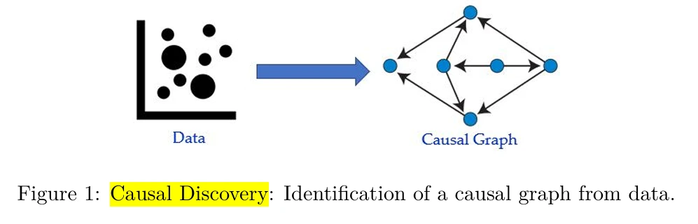
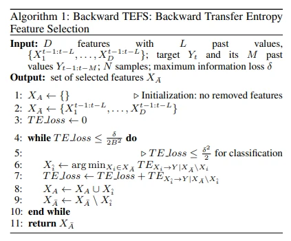
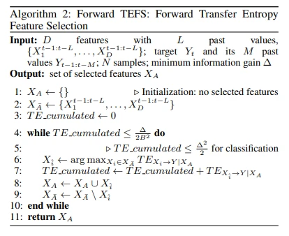

# 엔트로피에서 전이 엔트로피까지

작성일 2025-04-17 · 최종 수정일 2025-05-06
{ .post-date }

시계열 인과 발견(causal discovery) 문헌을 조사하기에 앞서, 이 분야에서 반복해서 등장하는 정보 이론의 양을 먼저 정리하고자 한다. 엔트로피에서 출발해 상호정보량, 전이 엔트로피(transfer entropy), 조건부 전이 엔트로피 순서로 정의를 따라가고, 실제 데이터에서 이 값들을 어떻게 추정하는지 살펴본다. 마지막에는 전이 엔트로피를 변수 선택에 쓴 논문 한 편을 요약한다.

## 1. 인과 발견이란

전통적인 통계 분석은 변수 사이의 상관관계, 그중에서도 선형 상관에 초점을 맞춘다. 그러나 연구자가 실제로 알고 싶은 것은 무엇이 원인이고 무엇이 결과인가, 즉 어느 변수가 상류(upstream)이고 어느 변수가 하류(downstream)인가인 경우가 많다. Judea Pearl의 구조적 인과 모델(Structural Causal Model, SCM)과 do-calculus가 등장하면서 인과 추론은 수학적으로 체계화되었고, 신경과학, 경제학, 생명정보학, 기후 과학처럼 개입 실험이 어려운 분야에서 수요가 커졌다.

인과 발견이 하려는 일은 한 문장으로 말할 수 있다. 데이터만 보고 "무엇이 무엇에 영향을 주는가"를 화살표로 그린 그림을 얻는 것이다.

{ width="560" }

*왼쪽의 관측 데이터가 입력이고, 오른쪽의 화살표 그림(인과 그래프)이 출력이다. 점 하나가 변수, 화살표 하나가 "이 변수가 저 변수의 원인"이라는 주장이다. 출처: Hasan 외, "A Survey on Causal Discovery Methods for I.I.D. and Time Series Data" Figure 1.*

조금 더 정확히 말하면, 인과 발견은 관측 데이터로부터 변수 사이의 인과 구조를 추론하는 일이다. 인과 구조는 보통 위 그림의 오른쪽과 같은 방향성 비순환 그래프(Directed Acyclic Graph, DAG)로 표현하며, 노드는 변수, 간선은 인과 관계를 뜻한다. 화살표를 어떤 근거로 그리느냐에 따라 접근법이 갈린다. 대표적인 접근법은 다음과 같다.

| 접근법 | 예 | 방식 |
|---|---|---|
| 제약 기반(constraint-based) | PC | 조건부 독립성 검정을 반복해 그래프 구조를 추정한다 |
| 점수 기반(score-based) | GES | 그래프의 적합도를 나타내는 점수를 정하고 점수가 좋은 구조를 탐색한다 |
| 함수적 인과 모델(functional causal model) | LiNGAM | 잡음의 분포와 함수 형태에 대한 가정을 이용해 방향을 정한다 |
| 시계열 모델 | Granger causality | 원인이 결과보다 앞선다는 시간 순서를 이용한다 |

최근에는 DAG-GNN, NOTEARS처럼 신경망이나 연속 최적화를 쓰는 방법도 많다.

어느 접근법이든 한계는 비슷하다. 관측된 변수만으로는 잠재 교란 변수(latent confounder)의 영향을 배제하기 어렵고, 표본이 적거나 잡음이 많으면 잘못된 구조가 추정되며, 선형성이나 독립성 같은 모델 가정이 현실과 어긋나면 결과도 어긋난다.

## 2. 엔트로피

전이 엔트로피까지 가는 길은 세 걸음이다. 한 변수가 얼마나 예측하기 어려운지를 재고(엔트로피), 두 변수가 정보를 얼마나 나누어 갖는지를 재고(상호정보량), 그 나눔에 방향을 붙인다(전이 엔트로피). 첫 걸음부터 보자.

엔트로피 $H(X)$는 확률 변수 $X$가 지닌 불확실성의 양이다. 값이 얼마나 예측하기 어려운지, $X$를 알려면 정보를 얼마나 드러내야 하는지를 수치로 나타낸다.

$$
H(X) = -\sum_{x \in \mathcal{X}} p(x) \log p(x)
$$

$-\log p(x)$는 사건 $x$의 정보량이며, 놀람의 정도(surprisal)로 이해할 수 있다. 확률이 작은 사건일수록 일어났을 때 더 놀랍고, 더 놀란다는 것은 그만큼 몰랐다는 뜻이다. 엔트로피는 이 놀람의 기댓값이다. 확률이 작을수록 정보량은 커지지만 그 사건이 일어날 확률을 가중치로 곱하므로, 엔트로피는 이 변수를 관측할 때 평균적으로 얻는 정보량이 된다. 확률에 로그를 취하면 음수가 되기 때문에 앞에 음의 부호를 붙여 양수로 만든다. 로그의 밑이 2이면 단위는 bit, $e$이면 nat이다.

동전으로 예를 들면 다음과 같다.

| 동전 | 분포 | 엔트로피 |
|---|---|---|
| 공정한 동전 | $p(H) = 0.5,\ p(T) = 0.5$ | $-(0.5 \log_2 0.5 + 0.5 \log_2 0.5) = 1$ bit |
| 치우친 동전 | $p(H) = 0.9,\ p(T) = 0.1$ | $-(0.9 \log_2 0.9 + 0.1 \log_2 0.1) \approx 0.47$ bit |

공정한 동전은 결과를 가장 예측하기 어려우므로 엔트로피가 최대다. 치우친 동전은 거의 항상 앞면이 나오므로 관측해도 얻는 정보가 적다.

조건부 엔트로피 $H(X \mid Y)$는 $Y$를 알고 난 뒤에도 남는 $X$의 불확실성이다.

## 3. 상호정보량

상호정보량(mutual information) $I(X; Y)$는 두 확률 변수가 공유하는 정보량이다. $Y$를 알 때 $X$에 대해 알게 되는 정보의 양이며, 반대 방향으로도 같은 값이다.

$$
I(X; Y) = \sum_{x \in \mathcal{X}} \sum_{y \in \mathcal{Y}} p(x, y) \log \frac{p(x, y)}{p(x)\,p(y)}
$$

연속형 변수에서는 합이 적분으로 바뀐다.

$$
I(X; Y) = \iint p(x, y) \log \frac{p(x, y)}{p(x)\,p(y)} \, dx \, dy
$$

이 식은 결합 분포 $p(x, y)$가 주변 분포의 곱 $p(x)p(y)$와 얼마나 다른지를 잰다. 두 변수가 독립이면 로그 안이 1이 되어 값이 0이고, 의존성이 있으면 양수가 된다. 다시 말해 상호정보량은 "$X$와 $Y$가 독립일 것"이라는 가정이 틀린 정도를 KL divergence로 측정한 것이다.

$$
I(X; Y) = D_{KL}\big(p(x, y) \,\Vert\, p(x)\,p(y)\big)
$$

엔트로피로 쓰면 의미가 더 분명해진다.

$$
I(X; Y) = H(X) - H(X \mid Y) = H(X) + H(Y) - H(X, Y)
$$

$H(X)$는 $Y$가 없을 때 $X$에 대해 모르는 정도, $H(X \mid Y)$는 $Y$를 안 뒤에도 남는 모르는 정도이므로, 둘의 차이는 $Y$ 덕분에 $X$에 대해 알게 된 양이다.

| 성질 | 의미 |
|---|---|
| $I(X; Y) \ge 0$ | 항상 0 이상이다 |
| $I(X; Y) = 0 \iff X, Y$ 독립 | 독립일 때만 0이다 |
| $I(X; X) = H(X)$ | 자기 자신과의 상호정보량은 엔트로피다 |
| $I(X; Y) = I(Y; X)$ | 대칭이다 |

마지막 성질이 인과 분석에서는 한계가 된다. 상호정보량은 두 변수가 정보를 얼마나 공유하는지만 말할 뿐, 누가 누구를 설명하는지, 어느 쪽이 원인인지는 말하지 않는다. 방향이 필요하다는 문제의식에서 출발한 것이 전이 엔트로피다.

## 4. 전이 엔트로피

### 배경

시계열에서 인과를 다루는 고전적인 도구는 Granger causality다. 그러나 Granger causality는 벡터 자기회귀(VAR) 모델, 즉 선형성과 가우시안 가정에 기반하므로 비선형이거나 복잡한 시스템에는 잘 맞지 않는다. Schreiber(2000)는 정보 이론에 기반한 전이 엔트로피를 제안해 비선형, 비가우시안 구조에서도 모델을 가정하지 않고(model-free) 정보의 흐름을 잴 수 있게 했다. 전이 엔트로피는 원래 두 시계열 사이의 단방향 정보 흐름을 측정하는 도구였고, 이후 인과 구조를 구성하는 데 쓰이도록 확장되었다.

### 정의

전이 엔트로피가 묻는 것은 하나다. "$Y$의 내일을 맞히는 데, $Y$의 어제까지를 이미 알고 있어도 $X$의 어제가 더 도움이 되는가." 도움이 되는 만큼이 $X$에서 $Y$로 흐른 정보다.

식으로는 조건부 상호정보량의 특수한 형태다. $X$에서 $Y$로의 전이 엔트로피는 $Y$의 과거를 조건으로 했을 때 $X$의 과거와 $Y$의 다음 값이 공유하는 정보량이다.

$$
TE_{X \to Y} = I\big(Y_{t+1};\, X_t^{(l)} \,\big\vert\, Y_t^{(k)}\big)
$$

$Y_t^{(k)}$는 $Y$의 과거 $k$개 값, $X_t^{(l)}$는 $X$의 과거 $l$개 값이다. 풀어 쓰면 다음과 같다.

$$
TE_{X \to Y} = \sum p\big(y_{t+1}, y_t^{(k)}, x_t^{(l)}\big) \log \frac{p\big(y_{t+1} \mid y_t^{(k)}, x_t^{(l)}\big)}{p\big(y_{t+1} \mid y_t^{(k)}\big)}
$$

로그 안의 분수를 보면 뜻이 읽힌다. 분모는 $Y$의 과거만으로 한 예측이고, 분자는 거기에 $X$의 과거를 더한 예측이다. $Y$의 과거만 알았을 때보다 $X$의 과거를 함께 알았을 때 $Y$의 다음 값을 더 잘 예측할 수 있다면 분수가 1보다 커지고, $X$가 $Y$에 정보를 주고 있다고 본다. $X$가 아무것도 보태지 못하면 분자와 분모가 같아 값은 0이다. $Y$ 자신의 과거를 조건에 넣는 것이 핵심이다. 이렇게 해야 $Y$의 자기상관으로 설명되는 부분을 빼고, $X$의 과거가 독립적으로 더하는 정보만 남는다.

상호정보량과 달리 이 값은 비대칭이다. $TE_{X \to Y}$와 $TE_{Y \to X}$는 일반적으로 다르며, 이 차이로 방향을 논한다.

### 결합 분포로 전개하기

과거를 한 시점씩만 쓴다고 하고($k = l = 1$) 조건부 확률을 결합 확률로 바꾸면

$$
p(y_{t+1} \mid y_t, x_t) = \frac{p(y_{t+1}, y_t, x_t)}{p(y_t, x_t)}, \qquad
p(y_{t+1} \mid y_t) = \frac{p(y_{t+1}, y_t)}{p(y_t)}
$$

이므로 전이 엔트로피는 다음과 같이 쓸 수 있다.

$$
TE_{X \to Y} = \sum p(y_{t+1}, y_t, x_t) \log \frac{p(y_{t+1}, y_t, x_t)\; p(y_t)}{p(y_t, x_t)\; p(y_{t+1}, y_t)}
$$

따라서 실제 계산에서는 로그 안의 네 분포 $p(y_{t+1}, y_t, x_t)$, $p(y_t)$, $p(y_t, x_t)$, $p(y_{t+1}, y_t)$를 추정하면 된다.

### 부호

전이 엔트로피는 조건부 상호정보량이고 상호정보량은 항상 0 이상이므로, 전이 엔트로피도 이론적으로는 항상 0 이상이다. $X$의 과거가 $Y$의 다음 값과 조건부 독립이면 0이고, 조금이라도 예측에 도움이 되면 0보다 크다. 다만 유한한 표본으로 추정하면 오차 때문에 음수가 나올 수 있고, 이 경우 0으로 잘라 쓰는 경우가 많다고 한다.

### 응용과 한계

뇌파(EEG)에서 영역 간 정보 흐름을 추정하거나, 지역 간 기후 변수의 영향을 추적하거나, 한 종목의 정보가 다른 종목에 어떻게 전달되는지 보는 데 쓰인다.

한계와 그에 대한 대응은 다음과 같이 정리했다.

| 한계 | 내용 | 대응 |
|---|---|---|
| 추정의 불안정성 | 표본이 적으면 상호정보량 추정이 불안정하고 편향이 생긴다. 추정 방식(k-NN, kernel, binning)에 따라 결과가 달라진다 | k-NN 기반 추정, 임베딩 차원의 선택 |
| 거짓 양성 | 공통 원인이 있으면 직접 관계가 없어도 전이 엔트로피가 크게 나올 수 있다 | 조건부 전이 엔트로피 |
| 확장성 | 변수가 많은 시스템에서는 계산 비용이 크다 | 희소 그래프 가정, PC 방식의 가지치기 |
| 해석 | 정보의 흐름과 인과가 완전히 같은 것은 아니다 | 개입 실험이나 다른 방법과의 병행 |

## 5. 조건부 전이 엔트로피

제3의 변수 $Z$가 $X$와 $Y$ 모두에 영향을 준다면, $X$와 $Y$ 사이에 직접 관계가 없어도 $TE_{X \to Y}$가 크게 나올 수 있다. 조건부 전이 엔트로피(conditional transfer entropy)는 $Z$의 과거를 조건에 추가해 이 부분을 걸러 낸다.

$$
CTE_{X \to Y \mid Z} = \sum p(y_{t+1}, y_t, x_t, z_t) \log \frac{p(y_{t+1} \mid y_t, x_t, z_t)}{p(y_{t+1} \mid y_t, z_t)}
$$

"$Z$가 주어진다"는 조건은 결합 확률로 바꾸어 계산한다.

$$
p(y_{t+1} \mid y_t, x_t, z_t) = \frac{p(y_{t+1}, y_t, x_t, z_t)}{p(y_t, x_t, z_t)}, \qquad
p(y_{t+1} \mid y_t, z_t) = \frac{p(y_{t+1}, y_t, z_t)}{p(y_t, z_t)}
$$

$$
CTE_{X \to Y \mid Z} = \sum p(y_{t+1}, y_t, x_t, z_t) \log \frac{p(y_{t+1}, y_t, x_t, z_t)\; p(y_t, z_t)}{p(y_t, x_t, z_t)\; p(y_{t+1}, y_t, z_t)}
$$

식의 모양은 전이 엔트로피와 같고 모든 분포에 $z_t$가 하나씩 더 붙을 뿐이다. 문제는 조건 변수가 늘수록 추정해야 하는 결합 분포의 차원이 커진다는 점이다. 그래서 이 값을 어떻게 추정하느냐가 실질적인 문제가 된다.

## 6. 추정 방법

위 식들은 모두 확률 분포를 안다고 가정하고 쓴 것이다. 실제로는 표본만 있으므로 분포, 또는 엔트로피 자체를 추정해야 한다. 아래의 다섯 방법은 "표본에서 확률을 어떻게 얻는가"에 대한 서로 다른 답이다. 칸을 나누어 세거나(binning), 가까운 이웃까지의 거리로 재거나(k-NN), 표본마다 부드러운 봉우리를 얹어 밀도를 그리거나(KDE), 분포의 모양을 정규분포로 정해 버리거나(Gaussian), 신경망에게 맡긴다(MINE).

### Binning

가장 단순한 방법은 연속 값을 구간(bin)으로 나누어 이산화하고, 구간별 빈도로 확률을 추정해 위의 합을 그대로 계산하는 것이다. 구현은 쉽지만 다음 문제가 있어 연속 변수에는 다른 추정기를 쓰는 경우가 많다.

- bin의 개수와 경계를 어떻게 잡느냐에 따라 오차가 크게 달라진다.
- 값이 어느 구간에 속하는지만 남기 때문에, 값 사이의 순서나 변화율 같은 동적인 정보를 잃는다.
- 조건 변수가 늘면 칸의 수가 급격히 늘어 대부분의 칸이 비게 된다.

### k-최근접 이웃 (KSG)

Kraskov, Stögbauer, Grassberger의 추정기(KSG)는 각 표본에서 $k$번째로 가까운 이웃까지의 거리를 이용해 상호정보량을 추정한다. 구간을 나누지 않으므로 연속 변수에 자연스럽게 적용되고, 상호정보량 추정에서 가장 널리 쓰인다.

전이 엔트로피는 조건부 상호정보량 $TE_{X \to Y} = I(y_{t+1};\, x_t \mid y_t)$이므로, 이 조건부 상호정보량을 KSG 방식으로 추정하면 된다. 절차는 다음과 같다.

```text
1. 표본 (y_{t+1}, y_t, x_t)를 구성한다
2. 각 표본에서 결합 공간의 k번째 최근접 이웃까지의 거리를 구한다
3. 그 거리 안에 들어오는 표본 수를 부분 공간별로 센다
4. digamma 함수로 조건부 상호정보량을 계산한다
```

조건 변수를 $Z$라고 할 때 4번에서 쓰는 식은 다음과 같다. $n_{xz}$, $n_{yz}$, $n_z$는 3번에서 센 각 부분 공간의 이웃 수, $\psi$는 digamma 함수이고, $\langle \cdot \rangle$는 표본에 대한 평균이다.

$$
\hat{I}(X; Y \mid Z) = \psi(k) - \big\langle \psi(n_{xz} + 1) + \psi(n_{yz} + 1) - \psi(n_z + 1) \big\rangle
$$

k-NN 계열 추정기에도 약점이 있다. 고전적인 Kozachenko–Leonenko 추정기는 각 표본 주변의 이웃 영역 안에서 확률 밀도가 균일하다고 가정한다. "Nonparametric k-nearest-neighbor entropy estimator"(2016)는 이 가정을 완화한다. 표본 주변 $p$개의 이웃에 가우시안을 맞추어 국소적인 밀도의 불균일성을 반영하는 방식이다. 논문이 개선을 목표로 한 상황은 세 가지다.

1. 확률 변수의 차원이 클 때
2. 성분 사이에 함수 관계에 가까운 강한 상관이 있을 때
3. 성분마다 주변 분산이 크게 다를 때

두 번째 경우는 이렇게 이해했다. 두 성분의 상관이 매우 강하면 데이터는 공간 전체에 퍼지지 않고 $y = x$ 직선을 따라 좁고 길게 분포한다. 그러면 표본 주변의 영역에서 직선 방향으로는 표본이 많지만 직교 방향으로는 거의 없어, 그 방향의 확률 질량(probability mass)이 매우 작다. 영역 안의 밀도가 균일하다는 가정이 크게 틀리는 것이다. 국소 가우시안으로 근사하면 이런 경우와 분포의 꼬리 부분을 더 잘 다룰 수 있다.

### 커널 밀도 추정 (KDE)

결합 분포를 커널 밀도 추정으로 직접 추정해 전이 엔트로피 식에 대입하는 방법이다.

$$
\hat{p}(y_{t+1}, y_t, x_t) \approx \frac{1}{N} \sum_{i=1}^{N} K_h(\mathbf{x}_i - \mathbf{x})
$$

수식이 직관적이고 부드러운 분포를 얻을 수 있다는 장점이 있다. 반면 차원이 높아지면 bandwidth $h$의 설정에 매우 민감해지고, 표본이 적으면 크게 부정확해진다(차원의 저주).

"Undersmoothed kernel entropy estimators"(2008)는 bandwidth에 대해 직관과 다른 결론을 낸다. 커널 엔트로피 추정기의 오차는 세 부분으로 나눌 수 있다.

| 오차 | 원인 | 표본이 늘면 |
|---|---|---|
| smoothing error | bandwidth가 0보다 크면 추정한 밀도가 실제보다 부드러워진다. 추정기의 구조에서 오는 결정론적 오차다 | $h$가 고정이면 줄지 않는다 |
| bias | 추정값의 평균이 참값에서 벗어난 정도 | 일반적으로 줄어든다 |
| variance | 표본에 따라 추정값이 흔들리는 정도 | 일반적으로 줄어든다 |

smoothing error를 줄이려면 $h$를 작게 해야 한다. 그런데 기존의 plug-in 추정기에서는 $h$를 너무 작게 하면 추정한 밀도가 표본 하나하나에 과하게 반응해(undersmoothing) bias와 variance가 커진다. 그래서 기존의 일관성(consistency) 결과는 bandwidth가 $1/N$보다 천천히 줄어든다는 가정에 기대고 있었다. 이 논문은 bandwidth가 $1/N$ 수준으로 줄어도 추정 오차가 0으로 가는 추정기를 제시한다. 결론은 엔트로피를 정확히 추정하는 데 밀도를 정확히 추정할 필요는 없다는 것이다. 오히려 밀도 추정의 품질을 희생하고 일부러 undersmoothing하는 편이 낫다.

이 결론이 처음에는 이상하게 느껴졌는데, 다음과 같이 이해했다. 미분 엔트로피에서 중요한 것은 $p(x)$의 세부적인 모양이 아니라 $p(x) \log p(x)$의 평균이다. 밀도가 틀리더라도 틀린 부분의 기여가 작으면 엔트로피에는 영향이 적다. 예를 들어 $p(x)$가 거의 0인 구간에서는 $\log p(x)$의 절댓값이 커도 $p(x)$가 곱해지므로 기여가 작다.

또 하나 눈에 띈 점은, 표본이 늘면 참값에 수렴한다는 일관성 결과는 많지만, 넓은 범위의 분포에 대해 평균 오차의 상한을 명시하는 worst-case 보장은 드물다는 지적이었다.

### 모수적 추정 (Gaussian)

변수들이 정규분포를 따르고 관계가 선형이라고 가정하면 전이 엔트로피가 닫힌 형태로 구해진다. 계산이 빠르고 해석이 쉬워 비교 기준으로 자주 쓰이지만, 가정대로 비선형 관계는 반영하지 못한다.

### 신경망 추정 (MINE)

"Mutual Information Neural Estimation"(2018)은 신경망으로 상호정보량을 추정한다. binning, KDE, 가우시안 가정에 기반한 기존 방법은 표본 수나 차원이 커질 때 확장하기 어렵다는 것이 출발점이다. MINE의 연산 비용은 차원과 표본 수에 대해 선형으로 늘어난다.

핵심은 상호정보량이 KL divergence라는 사실이다.

$$
I(X; Z) = D_{KL}\big(\mathbb{P}_{XZ} \,\Vert\, \mathbb{P}_X \otimes \mathbb{P}_Z\big)
$$

KL divergence는 f-divergence의 한 종류다. f-divergence는

$$
D_f(P \,\Vert\, Q) = \int q(x)\, f\!\left(\frac{p(x)}{q(x)}\right) dx
$$

로 정의되며, KL divergence, total variation distance, Jensen–Shannon divergence가 모두 여기에 속한다. 이 식은 두 분포의 형태를 알아야 계산할 수 있는데 실제로는 표본밖에 없다. 그래서 쌍대 표현(dual formulation)으로 바꾸어, 함수 $T$를 찾는 최적화 문제로 푼다. $f^*$는 $f$의 convex conjugate다.

$$
D_f(P \,\Vert\, Q) = \sup_{T \in \mathcal{T}} \Big( \mathbb{E}_P[T(x)] - \mathbb{E}_Q[f^*(T(x))] \Big)
$$

MINE은 KL divergence의 쌍대 표현인 Donsker–Varadhan 표현을 쓰고, $T$를 신경망 $T_\theta$로 둔다. 신경망이 표현할 수 있는 함수 안에서만 최댓값을 찾으므로 결과는 하한이 되고, 이 하한을 경사 상승으로 최대화해 추정값으로 삼는다.

$$
I(X; Z) \ge \sup_{\theta} \; \mathbb{E}_{\mathbb{P}_{XZ}}[T_\theta] - \log \mathbb{E}_{\mathbb{P}_X \otimes \mathbb{P}_Z}\big[e^{T_\theta}\big]
$$

같은 쌍대 표현에서 $T$를 판별자로 두고 다른 신경망이 $Q$를 조정하게 하면 GAN과 같은 적대적 구조가 된다(f-GAN).

$$
\min_G \max_D \; \mathbb{E}_{x \sim P_{data}}[\log D(x)] + \mathbb{E}_{z \sim P_z}[\log(1 - D(G(z)))]
$$

MINE은 이런 경쟁 없이 단일 최적화 문제만으로도 상호정보량을 추정할 수 있음을 보였고, 추정뿐 아니라 상호정보량을 최대화하거나 최소화하는 목적 함수로도 쓸 수 있다.

### 정리

| 방법 | 장점 | 약점 |
|---|---|---|
| Binning | 구현이 단순하다 | bin 설정에 민감하고 동적 정보를 잃는다 |
| k-NN (KSG) | 연속 변수에 바로 적용되고 가장 널리 쓰인다 | 고차원이거나 성분 간 상관이 강하면 국소 균일성 가정이 깨진다 |
| KDE | 직관적이고 부드러운 분포를 준다 | bandwidth에 민감하고 고차원에서 부정확하다 |
| Gaussian | 닫힌 형태로 빠르게 계산한다 | 선형성과 정규성을 가정한다 |
| MINE | 차원과 표본 수에 대해 확장된다 | 신경망 학습이 필요하다 |

## 7. 전이 엔트로피로 변수를 고르는 연구

"Causal Feature Selection via Transfer Entropy"(TEFS)는 전이 엔트로피를 시계열 변수 선택에 쓴 논문이다.

### 문제의식

데이터의 차원이 너무 크면 과적합이 일어나므로 변수 선택(feature selection)으로 이를 완화한다. 그런데 고전적인 변수 선택은 타깃과 관련이 큰 변수를 고를 뿐 인과 관계는 고려하지 않는다. 반대로 인과 발견 연구는 인과 구조를 복원하는 데만 관심을 두고, 그 결과가 실제 예측에 도움이 되는지는 확인하지 않는 경우가 많다. 이 논문은 두 분야가 만나는 지점을 다룬다.

시계열에서 타깃에 인과적으로 관련된 변수를 찾기 어려운 이유로는 관측되지 않은 교란 변수, 높은 차원, 자기상관, 시간 지연을 든다. 이 가운데 자기상관이 왜 문제인지 처음에는 이해하지 못했는데, 다음과 같이 정리했다. 타깃에 자기상관이 있으면 그것만으로도 다른 변수와의 상호정보량이 크게 나올 수 있고, 이것이 실제 인과 관계를 덮어 거짓 양성을 만든다. 전이 엔트로피는 타깃 자신의 과거를 조건에 넣어 자기회귀 성분을 제거하므로, 변수에서 타깃으로 향하는 비대칭적인 정보 흐름만 잴 수 있다. 여기에 다른 변수들까지 조건에 넣으면, 변수와 타깃이 공통 원인을 통해 공유하는 정보도 걸러 낼 수 있다.

### 설정

변수들은 정상(stationary) 시계열이고, 타깃 $Y_t$는 자신의 과거 $Y_{t-1:t-M}$과 변수들의 과거 $X^i_{t-1:t-L}$로 결정된다고 가정한다. 비정상 시계열은 다루지 않는다.

$$
TE_{X \to Y} = I\big(Y_t;\, X_{t-1:t-L} \mid Y_{t-1:t-M}\big)
$$

$$
TE_{X \to Y \mid Z} = I\big(Y_t;\, X_{t-1:t-L} \mid Y_{t-1:t-M},\, Z_{t-1:t-L}\big)
$$

### 알고리즘

논문은 제거한 변수들이 타깃에 주던 전이 엔트로피가 클수록 예측 오차의 상한이 커진다는 것을 회귀와 분류 각각에 대해 보인다. 이 결과가 "전이 엔트로피가 작은 변수는 빼도 된다"는 절차의 근거가 된다.

절차는 두 가지다. 전부 들고 시작해서 덜 중요한 것부터 버리거나(backward), 빈손으로 시작해서 가장 중요한 것부터 줍는다(forward).

**Backward.** 모든 변수가 타깃에 중요하다고 가정하고 시작한다.

{ width="460" }

*$X_A$가 버린 변수, $X_{\bar{A}}$가 남은 변수다. 6행에서 버릴 변수를 고르고, 7행에서 잃은 정보를 더하고, 4행에서 계속할지를 정한다. 출처: TEFS 논문 Algorithm 1.*

위 의사코드를 줄 번호로 따라가면 다음과 같다.

- **1 ~ 3행.** 버린 변수 집합 $X_A$는 비어 있고, 남은 변수 집합 $X_{\bar{A}}$는 전체 변수다. 누적 손실 `TE_loss`는 0이다.
- **6행.** 남은 변수 가운데, 나머지 변수가 모두 주어졌을 때 타깃으로의 전이 엔트로피 $TE_{X_i \to Y \mid X_{\bar{A}} \setminus X_i}$가 가장 작은 변수를 찾는다. 다른 변수들이 이미 말해 주는 것 외에 타깃에 보태는 정보가 가장 적은 변수다.
- **7행.** 그 전이 엔트로피를 누적 손실에 더한다. 이 변수를 버림으로써 잃는 정보의 양이다.
- **8 ~ 9행.** 그 변수를 남은 집합에서 버린 집합으로 옮긴다.
- **4행.** 누적 손실이 임계값 이하인 동안 6 ~ 9행을 반복한다. 임계값은 허용할 최대 정보 손실 $\delta$로 정하며, 회귀에서는 $\delta / 2B^2$, 분류에서는 $\delta^2 / 2$다(5행의 주석).
- **11행.** 임계값을 넘으면 멈추고 남은 변수 $X_{\bar{A}}$를 반환한다.

가장 덜 유용한 변수부터 빼되, 뺐을 때 잃는 정보의 합이 허용 범위 안에 있는 동안만 계속 뺀다는 뜻이다.

**Forward.** 방향만 반대다. 빈 집합에서 시작한다.

{ width="460" }

*이번에는 $X_A$가 고른 변수다. Backward의 `arg min`이 6행에서 `arg max`로, 누적 손실이 누적 이득 `TE_cumulated`로 바뀐 것만 다르다. 출처: TEFS 논문 Algorithm 2.*

매 단계에서 이미 선택한 변수들 $X_A$를 조건으로 했을 때 타깃으로의 전이 엔트로피 $TE_{X_i \to Y \mid X_A}$가 가장 큰 변수를 추가한다(6행). 이미 고른 변수들이 설명하지 못한 부분을 가장 많이 채워 주는 변수다. 그 값을 누적 이득에 더하고(7행), 누적된 정보 이득이 최소 정보 이득 $\Delta$로 정한 기준을 넘어 충분히 커지면 멈춘다(4행).

두 방식 모두 전이 엔트로피로 잰 정보 흐름을 누적하면서 선택을 진행한다. 실험은 합성 데이터와 실제 데이터의 회귀 문제에서 이루어지며, 실제 데이터에서는 선택된 변수만으로 얻은 결정계수 $R^2$로 예측력이 유지되는지를 본다.

$$
R^2 = 1 - \frac{SS_{res}}{SS_{tot}} = 1 - \frac{\sum_i (y_i - \hat{y}_i)^2}{\sum_i (y_i - \bar{y})^2}
$$

$R^2 = 1$이면 완벽한 예측, $0$이면 평균만 예측한 것과 같고, 음수이면 평균보다 못한 예측이다. 변수 수가 늘면 $R^2$는 커지기만 할 수 있으므로 변수 수가 다른 모델을 비교할 때는 adjusted $R^2$를 함께 보아야 한다.

## 8. 초록을 읽을 때 확인한 것

이 시기에 ICML과 KDD의 인과 발견 논문을 초록 위주로 훑었는데, 다음 여섯 가지를 기준으로 읽었다.

1. 어떤 방법론에 기반하는가 (PC, 전이 엔트로피, Granger 등)
2. 데이터의 특성과 가정은 무엇인가 (시계열인지, 비선형성을 고려하는지)
3. 인과성의 어떤 측면을 강조하는가 (정확도, 계산 효율, 확장성)
4. 어디에 활용하는가
5. 무엇과 비교하고 어떤 벤치마크를 쓰는가
6. 한계나 열린 문제를 언급하는가

## 남았던 질문과 답

공부할 당시에는 풀지 못하고 남겨 둔 질문들이다. 글을 정리하면서 답을 찾아 덧붙였다.

**Q. 추정한 전이 엔트로피가 음수일 때 0으로 자르는 것이 일반적인 처리인가. 그렇게 하면 편향이 생기지 않는가.**

KSG 계열 추정기는 digamma 함수 값의 차이로 계산되므로 추정값이 0 이상이라는 보장이 없다. 참값이 0에 가까우면 추정값이 0 주변에서 흔들리면서 음수가 나오고, 이는 "0과 구분되지 않는다"는 뜻으로 읽는다. 값을 보고할 때 0으로 자르는 처리는 흔하지만, 자르면 편향이 생긴다. 참값이 0이고 추정 오차가 0을 중심으로 퍼져 있다면 음수만 0으로 올라가므로 $\mathbb{E}[\max(0, \hat{T})] > 0$이 되어, 자른 값의 평균은 양수 쪽으로 치우친다. 그래서 정보 흐름이 있는지를 판정할 때는 자른 값의 크기를 기준으로 삼지 않는다. 원인 쪽 시계열의 시간 순서를 섞어 만든 surrogate 데이터에서 같은 추정기로 값을 여러 번 구하고, 자르지 않은 추정값이 그 분포에서 얼마나 극단적인지를 보는 순열 검정이 표준적인 절차다.

**Q. 조건 변수가 많아질 때 어떤 추정기가 가장 안정적인가.**

모든 상황에서 가장 낫다고 할 수 있는 추정기는 없다. 다만 차원이 늘 때 각 추정기가 어떻게 무너지는지는 알려져 있다. binning과 KDE는 결합 공간 전체에서 밀도를 추정하므로 필요한 표본 수가 차원에 대해 지수적으로 늘어난다. k-NN 추정기는 표본이 있는 곳에서만 거리를 재기 때문에 더 오래 버티지만, 차원이 커질수록 $k$번째 이웃까지의 거리가 멀어져 국소 균일성 가정이 깨지고 편향이 커진다. 가우시안 추정기는 공분산 행렬만 추정하면 되므로 고차원에서 가장 안정적이지만 선형 의존성만 잰다. 이 때문에 실제 방법들은 추정기를 바꾸기보다 조건 집합을 줄이는 쪽을 택하는 경우가 많다. PCMCI가 조건 집합을 부모 후보로 제한하는 것이 그 예다. 주어진 데이터에서 어느 추정기가 나은지는 표본 수, 차원, 의존성의 형태에 달려 있으므로 직접 비교해야 한다는 점은 그대로다.

**Q. 전이 엔트로피가 크다는 사실을 어디까지 인과로 해석할 수 있는가.**

전이 엔트로피가 0이 아니라는 것은 조건부 의존성 $Y_{t+1} \not\perp X_t^{(l)} \mid Y_t^{(k)}$에 대한 진술일 뿐이다. 이것을 "$X$가 $Y$의 원인"으로 읽으려면 [인과 그래프와 가정](03-causal-graphs-and-assumptions.md)에서 정리한 가정이 필요하다. 모든 공통 원인이 관측되었고(인과 충분성), 다른 관측 변수들의 과거가 모두 조건에 들어가 있으며(조건부 전이 엔트로피), causal Markov condition과 faithfulness가 성립하고, 동시점 효과가 없고, 조건에 넣은 과거의 길이가 실제 지연을 모두 덮어야 한다. 이 조건 아래에서는 조건부 전이 엔트로피가 0이 아니라는 것과 $X$의 과거에서 $Y$의 현재로 가는 간선이 있다는 것이 일치한다. 하나라도 빠지면 그렇지 않다. 예를 들어 $Z_{t-2} \to X_{t-1}$, $Z_{t-2} \to Y_t$만 있고 $X$에서 $Y$로 가는 간선이 없는 시스템에서도, $Z$를 조건에 넣지 않으면 $TE_{X \to Y} > 0$이 나온다. 가정을 확인할 수 없는 데이터에서는 "$X$의 과거가 $Y$의 예측에 도움이 된다"까지만 말할 수 있다.

## 참고 자료

- T. Schreiber, "Measuring Information Transfer", Physical Review Letters, 2000.
- A. Kraskov, H. Stögbauer, P. Grassberger, "Estimating mutual information", Physical Review E, 2004.
- "Nonparametric k-nearest-neighbor entropy estimator", 2016.
- "Undersmoothed kernel entropy estimators", 2008.
- "Mutual Information Neural Estimation", 2018.
- "Causal Feature Selection via Transfer Entropy", 2024.
- ICML 2022 ~ 2024 논문 목록 (검색어 "causal discovery"): [2024](https://icml.cc/virtual/2024/papers.html?search=causal+discovery), [2023](https://icml.cc/virtual/2023/papers.html?search=causal+discovery), [2022](https://icml.cc/virtual/2022/papers.html?search=causal+discovery)
- "Detecting and quantifying causal associations in large nonlinear time series datasets" (PCMCI), 2019. <https://www.science.org/doi/abs/10.1126/sciadv.aau4996>
