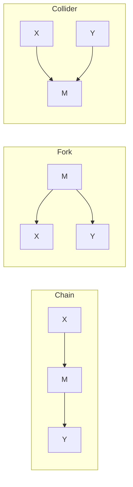
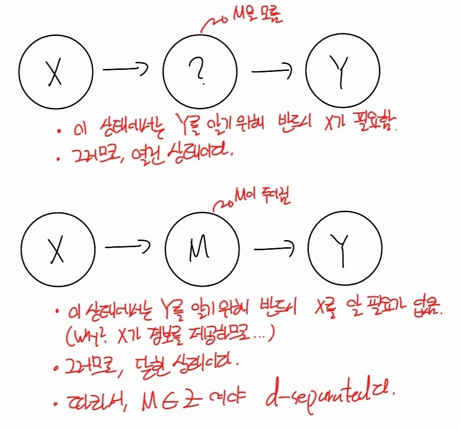
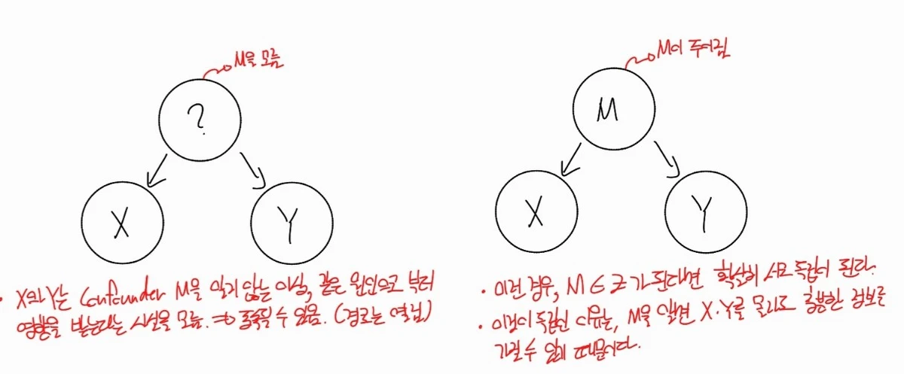
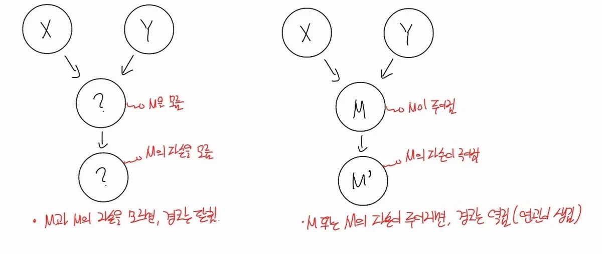
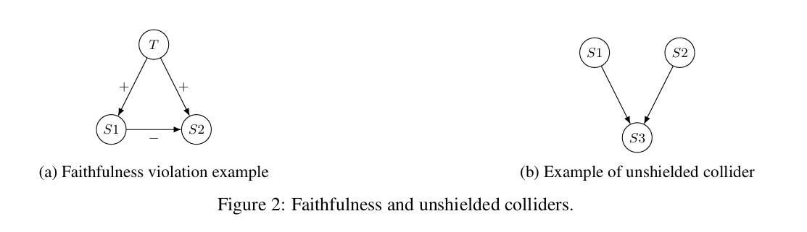
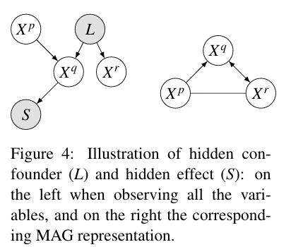
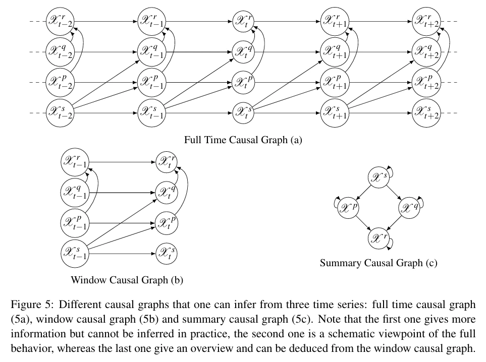

# 인과 그래프와 가정: d-separation에서 PAG까지

작성일 2025-04-26 · 최종 수정일 2025-05-20
{ .post-date }

[앞의 조사](02-instantaneous-feedback-confounder.md)에서 시계열 인과 발견 문헌은 instantaneous effect, feedback, confounder를 대부분 그래프로 설명한다는 것을 확인했다. 그런데 그래프로 무언가를 말하려면 그 그래프가 어떤 가정 위에 서 있는지를 먼저 알아야 한다. 이 글에서는 인과 그래프가 확률 분포와 어떻게 연결되는지(d-separation, Markov condition, faithfulness), 왜 그래프를 하나로 정하지 못하는지(Markov equivalence), 관측되지 않은 변수가 있을 때 그래프를 어떻게 바꾸는지(ancestral graph, MAG, PAG)를 순서대로 정리하고자 한다.

## 1. 방향 그래프

방향 그래프 $G$는 $(V, E)$의 쌍이다. $V = \{1, \ldots, M\}$는 정점의 유한 집합이고, $E \subseteq V \times V$는 방향이 있는 간선의 집합이다.

- $(i, j) \in E$이면 $i \to j$로 쓰고 두 정점이 인접(adjacent)하다고 한다. $i$는 $j$의 부모, $j$는 $i$의 자식이며 $i \in pa(j)$로 쓴다.
- 경로(path)는 하나 이상의 간선이 이어진 열이다.
- $i$에서 $j$로 가는 방향 경로 $i \to \cdots \to j$가 있으면 $i$는 $j$의 조상(ancestor), $j$는 $i$의 자손(descendant)이다. 정의상 자기 자신도 자신의 조상이자 자손으로 본다.
- 방향 cycle이 없는 방향 그래프가 DAG(Directed Acyclic Graph)다.

DAG는 데이터 생성 과정을 모델링하는 데 쓰인다. 정점 $i$는 확률 변수 $X_i$를 나타내고, 각 정점에는 부모가 주어졌을 때의 조건부 분포 $P(X_i \mid X_{pa(i)})$가 붙는다. 이 분포는 $X_i$가 부모로부터 만들어지는 메커니즘을 나타낸다.

이 모델이 단순한 확률 모델이 아니라 인과 모델이라는 것은 개입에 대한 진술이다. 어떤 정점 $X_i$에 개입해 값을 고정했을 때, 개입 후의 분포가 같은 모델에서 $i$로 들어오는 간선만 모두 지운 형태로 표현되면 그 모델을 causal하다고 한다.

## 2. 그래프와 분포를 잇는 가정

데이터가 어떤 DAG $G$를 따라 생성되었다면 결합 분포 $P(X)$는 $G$의 구조에 따라 특정한 독립성을 갖게 된다. 그래프와 분포 사이의 이 대응을 가정으로 적은 것이 아래의 조건들이다.

### 분해와 호환

DAG는 각 변수가 부모에만 의존하는 형태의 분해를 나타낸다.

$$
P(X_1, \ldots, X_n) = \prod_{i} P\big(X_i \mid pa(X_i)\big)
$$

예를 들어 $X^p \to X^q$, $X^p \to X^r$인 그래프에서는

$$
P(X^p, X^q, X^r) = P(X^p)\, P(X^q \mid X^p)\, P(X^r \mid X^p)
$$

이다. 확률 분포가 DAG에 따라 이렇게 분해될 수 있으면 그 분포와 DAG가 호환(compatible)된다고 말한다.

### Causal Markov condition

분포가 DAG $G$와 호환되기 위한 필요충분조건은, 모든 변수가 자신의 부모를 조건으로 할 때 자신의 비자손(non-descendant)과 독립인 것이다.

$$
V_i \perp \text{NonDescendants}(V_i) \mid Pa(V_i)
$$

어떤 변수의 부모만 알면, 자손이 아닌 다른 변수는 그 변수에 대해 더 알려 주는 것이 없다는 뜻이다. 시계열의 말로 옮기면, $Y_t$의 부모를 알았다면 다른 과거 변수는 $Y_t$의 예측에 아무 도움이 되지 않아야 한다.

### d-separation

부모와 비자손에 대한 위의 조건만으로는 임의의 두 변수가 어떤 조건에서 독립인지 바로 알기 어렵다. d-separation은 DAG 위에서 이를 판정하는 그래프 규칙이다. 주의할 점은, d-separation이 확률 분포가 아니라 그래프에서 정의되는 개념이라는 것이다.

두 변수 $X$, $Y$가 변수 집합 $Z$에 대해 d-separated라는 것은 $X$와 $Y$ 사이의 모든 경로가 $Z$에 의해 차단(block)되어 있다는 뜻이다. 경로를 따질 때는 간선의 방향을 무시하고 연결만 본 뒤, 경로 위의 각 중간 노드가 아래 세 구조 중 어디에 해당하는지를 본다. 아무리 긴 경로도 이 세 조각의 이어 붙임이므로, 세 조각의 규칙만 알면 된다.

| 구조 | $M$을 모를 때 | $M$이 주어졌을 때 |
|---|---|---|
| Chain $X \to M \to Y$ | 열림 | 차단 |
| Fork $X \leftarrow M \to Y$ | 열림 | 차단 |
| Collider $X \to M \leftarrow Y$ | 차단 | 열림 ($M$의 자손이 주어져도 열림) |

여기서 "열려 있다"는 것은 한 변수를 알기 위해 다른 변수가 필요한 상태, 즉 의존을 뜻하고, "차단되었다"는 것은 필요하지 않은 상태, 즉 독립을 뜻한다. 경로를 정보가 흐르는 관이라고 생각하면 쉽다. 중간 노드 $M$의 값을 아느냐 모르느냐가 그 관의 밸브를 열고 닫는다. 공부할 때 구조마다 "$M$을 모를 때"와 "$M$이 주어졌을 때"를 나란히 그려 보았다. 아래 세 그림에서 물음표가 적힌 원은 값을 모르는 노드다.

**Chain.** 정보가 $X$에서 $M$을 거쳐 $Y$로 전달되는 구조다.

{ width="520" }

*위는 $M$을 모르는 경우, 아래는 $M$이 주어진 경우다.*

위쪽 그림처럼 $M$을 모르면 $Y$를 알기 위해 $X$가 필요하므로 경로가 열려 있다. 아래쪽 그림처럼 $M$이 주어지면 $X$가 줄 수 있는 정보는 이미 $M$에 들어 있으므로 $X$를 알 필요가 없다. 경로가 닫힌다. 따라서 $M \in Z$이면 $X$와 $Y$는 d-separated다.

**Fork.** $M$이 $X$와 $Y$의 공통 원인인 구조다.

*왼쪽은 $M$을 모르는 경우, 오른쪽은 $M$이 주어진 경우다.*

왼쪽 그림처럼 $M$을 모르면 $X$와 $Y$는 공통 원인 $M$ 때문에 함께 움직인다. 같은 원인의 영향을 받는다는 사실을 걸러 낼 방법이 없으므로 경로는 열려 있다. 오른쪽 그림처럼 $M$을 알면 둘은 각각 $M$으로 설명되고, $X$와 $Y$가 따로 공유하는 정보는 남지 않는다. 그래서 $P(X, Y \mid M) = P(X \mid M)\, P(Y \mid M)$이 된다. 처음에는 "$M$을 모른다"는 말을 간선의 존재도 모른다는 뜻으로 읽었는데, 그래프의 구조는 아는 상태에서 값만 관측하지 않았다는 뜻이었다.

**Collider.** $X$와 $Y$가 공통의 결과 $M$을 갖는 구조다. 앞의 두 구조와 반대로 움직인다.

*왼쪽은 $M$과 그 자손 $M'$을 모두 모르는 경우, 오른쪽은 주어진 경우다.*

왼쪽 그림처럼 $M$을 모르면 $X$와 $Y$를 잇는 것이 없으므로 독립이다. 경로는 처음부터 닫혀 있다. 오른쪽 그림처럼 $M$을 알면 $X$와 $Y$는 $M$을 설명하기 위해 서로를 제약하게 된다. $M$이 일정한 값이려면 하나가 작을 때 다른 하나가 커야 하는 식이다. 그래서 $M$을 조건으로 주면 오히려 경로가 열리고 없던 연관이 생긴다. $M$ 자신이 아니라 $M$의 자손 $M'$만 주어져도 마찬가지다. $M'$의 값이 $M$에 대한 정보를 주기 때문이다.

정리하면, 경로 위에 $Z$에 속한 non-collider가 있거나, 자신과 자손이 모두 $Z$에 속하지 않는 collider가 있으면 그 경로는 차단된다. 모든 경로가 차단되면 $X$와 $Y$는 $Z$에 의해 d-separated다.

이 규칙을 쓰면 Markov condition을 다음과 같이 말할 수 있다. $G$에서 두 노드가 $Z$에 의해 d-separated이면 분포에서도 두 변수는 $Z$를 조건으로 독립이다.

$$
\text{d-separation in } G \;\Longrightarrow\; \text{conditional independence in } P
$$

### Minimality

Markov condition만으로는 부족하다. 간선이 더 많은 그래프도 같은 분포와 호환될 수 있기 때문이다. Minimality condition은 분포 $P$가 $G$와는 호환되지만 $G$의 어떤 진부분그래프와도 호환되지 않을 것을 요구한다. 간선 하나를 빼도 같은 조건부 독립성이 성립한다면 그 간선은 불필요한 의존성을 나타내고 있으므로 빼야 한다는 뜻이다.

### Faithfulness

Markov condition은 그래프에서 분포로 가는 방향만 말한다. faithfulness는 그 반대 방향이다. 분포에서 성립하는 모든 조건부 독립성은 그래프의 d-separation으로 설명되어야 한다.

$$
\text{conditional independence in } P \;\Longrightarrow\; \text{d-separation in } G
$$

두 조건을 합치면 그래프의 d-separation과 분포의 조건부 독립성이 정확히 일치한다.

이 가정이 필요한 이유는, 그래프 구조와 무관하게 파라미터 값 때문에 우연히 독립성이 나타날 수 있기 때문이다. 예를 들어 $X$에서 $Y$로 가는 두 경로의 효과가 정확히 상쇄되면, 그래프에서는 연결되어 있는데 분포에서는 독립으로 보인다.

*왼쪽 (a)가 상쇄의 예다. $T$에서 $S2$로 가는 길이 둘이다. 직접 가는 길은 $+$이고, $S1$을 거치는 길은 $+$와 $-$가 이어져 반대 부호가 된다. 오른쪽 (b)는 서로 인접하지 않은 두 노드가 한 노드에서 만나는 collider로, 3절의 v-structure다. 출처: "Causal Discovery from Ecological Time-Series with One Timestamp and Multiple Observations" Figure 2.*

(a)에서 두 길의 크기가 같으면 $T$가 변해도 $S2$는 변하지 않는다. 그래프에는 $T \to S2$가 있는데 데이터에서는 $T$와 $S2$가 독립으로 나온다. faithfulness는 이런 우연이 없다고 가정한다. 이 가정이 있어야 데이터에서 검정한 조건부 독립성을 그래프의 구조로 거꾸로 읽을 수 있다. 제약 기반 인과 발견이 성립하는 근거다.

### 인과 충분성과 selection bias

- **인과 충분성(causal sufficiency).** 관측된 변수들의 모든 공통 원인이 관측되어 있다는 가정이다. 잠재 교란 변수가 없다는 말과 같다. Markov condition이 관측된 변수들만의 DAG에서 제대로 성립하려면 이 가정이 필요하다. 가능한 그래프의 범위를 크게 줄여 주지만 강한 가정이며, 실제 데이터에서는 깨지는 경우가 많다.
- **No selection bias.** 데이터가 모집단 전체를 대표하도록 수집되었다는 가정이다. selection bias는 특정 조건을 만족하는 표본만 관측되어 생기는 왜곡이다. 인과 관계가 없는 두 변수도, 둘의 공통 결과에 해당하는 조건으로 표본을 골랐다면 가짜 의존성을 보일 수 있다. collider를 조건으로 주면 경로가 열린다는 규칙의 한 사례다.

## 3. Markov equivalence와 식별 가능성

faithfulness를 가정해도 그래프가 하나로 정해지지는 않는다. 서로 다른 DAG가 정확히 같은 조건부 독립성 집합을 나타낼 수 있기 때문이다. 이런 DAG들을 Markov equivalent하다고 한다. 두 DAG가 Markov equivalent일 조건은 다음 둘이다.

1. 뼈대(skeleton)가 같다. 뼈대는 방향을 무시한 연결 관계다.
2. v-structure가 같다. v-structure는 $A \to C \leftarrow B$처럼 서로 인접하지 않은 두 노드가 한 노드에서 만나는 collider 구조다.

예를 들어 $X \to M \to Y$, $X \leftarrow M \leftarrow Y$, $X \leftarrow M \to Y$는 모두 "$M$이 주어지면 $X$와 $Y$가 독립"이라는 같은 독립성만 가지므로 관측 데이터로는 구분할 수 없다. 반면 $X \to M \leftarrow Y$는 독립성 패턴이 달라 구분된다.

식별 가능성(identifiability)은 주어진 데이터로 인과 구조를 유일하게 정할 수 있는가의 문제다. 조건부 독립성만 쓰는 방법은 Markov equivalence class 수준까지만 구조를 복원할 수 있다. 그 안에서 방향을 더 정하려면 잡음의 분포나 함수 형태에 대한 가정처럼 방법마다 다른 추가 정보를 써야 한다.

### 제약 기반 방법이 하는 일

위의 가정을 놓고 보면 제약 기반 방법의 절차가 자연스럽게 이해된다.

1. 변수 쌍에 대해 조건부 독립성 검정을 반복한다. 어떤 조건 집합 $Z$에서 두 변수가 독립으로 판정되면, faithfulness에 따라 그래프에서 d-separated라고 보고 그 사이의 간선을 지운다. 이렇게 뼈대를 얻는다.
2. 뼈대에서 v-structure를 찾아 방향을 정한다. collider는 독립성 패턴으로 모호함 없이 방향을 정할 수 있는 유일한 구조이기 때문이다.
3. 방향 규칙(orientation rule)을 적용해 나머지 간선 중 정할 수 있는 것을 정한다.

d-separation이 그래프에서의 판정 기준이라면, 조건부 독립성 검정은 그것을 데이터에서 실제로 수행하는 절차라고 볼 수 있다.

## 4. 관측되지 않은 변수가 있을 때

여기까지는 필요한 변수가 모두 관측되었다고 보았다. 이제 일부가 보이지 않는 경우다. 보이지 않는 변수를 그래프에 그릴 수는 없으니, 그 변수가 남긴 흔적을 나타낼 새로운 종류의 간선이 필요해진다.

인과 충분성이 깨지면 관측된 변수들만으로 그린 DAG는 더 이상 올바르지 않다. 잠재 교란 변수 $L$이 $L \to A$, $L \to C$로 영향을 주면 $A$와 $C$는 어떤 관측 변수를 조건으로 주어도 독립이 되지 않는다. 그렇다고 $A \to C$나 $C \to A$를 그리면 틀린 인과 관계를 말하게 된다.

### Ancestral graph

ancestral graph는 DAG를 확장한 혼합 그래프(mixed graph)다. 잠재 변수나 selection 변수가 있을 수 있는 상황에서, 관측된 변수들만으로 인과 구조를 표현한다. 전체 DAG에서 잠재 변수를 주변화(marginalize)하고 selection 변수를 조건화했을 때, 관측 변수 사이의 조건부 독립성이 유지되도록 만든 그래프다. 주변화한다는 것은 그 변수를 모델에서 빼고 그 영향을 나머지 변수들의 분포에 흡수시키는 것이다.

간선은 세 종류다.

| 간선 | 의미 |
|---|---|
| $X \to Y$ | 인과적 방향이 있다. 관측되지 않은 변수를 거친 간접 경로일 수도 있다 |
| $X \leftrightarrow Y$ | 잠재 교란 변수를 주변화한 결과다 ($U \to X$, $U \to Y$) |
| $X - Y$ | selection 변수를 조건화한 결과다 |

서베이의 예시 그림에 세 종류의 간선이 모두 나온다.

{ width="400" }

*왼쪽은 모든 변수를 다 그린 그래프이고, 회색 노드 $L$(숨은 공통 원인)과 $S$(selection 변수)는 관측되지 않는다. 오른쪽은 관측된 세 변수만으로 그린 MAG다. 출처: Assaad 외 서베이 Figure 4.*

왼쪽에서 오른쪽으로 가면서 간선이 어떻게 바뀌는지 하나씩 보면 다음과 같다.

- $X^p \to X^q$는 그대로 남는다. 관측된 변수 사이의 인과 관계다.
- $L$이 $X^q$와 $X^r$의 공통 원인이므로, $L$을 지우면 $X^q \leftrightarrow X^r$가 생긴다.
- $X^p$와 $X^r$ 사이에는 방향 없는 간선 $X^p - X^r$가 생긴다. 왼쪽 그래프에서 둘은 직접 이어져 있지 않다. 그런데 $S$는 collider $X^q$의 자손이고, 모든 관측이 $S$를 조건으로 한 것이므로 collider $X^q$를 조건에 넣은 것과 같아진다. 그러면 $X^q$의 두 원인 $X^p$와 $L$ 사이의 경로가 열리고, $L$은 $X^r$의 원인이므로 $X^p$와 $X^r$가 연관된다. 앞에서 본 "collider나 그 자손을 조건으로 주면 경로가 열린다"는 규칙이 그대로 작동한 것이다.

"ancestral"이라는 이름은 조상 관계에 대한 다음 조건에서 온다.

1. 어떤 변수도 자신의 조상이 될 수 없다. $X \to Y \to X$ 같은 방향 cycle은 금지된다.
2. $X \leftrightarrow Y$이면 둘은 서로의 조상이 아니다. 공통 원인은 있지만 둘 사이의 인과 경로는 없다는 뜻이다.

### MAG

MAG(Maximal Ancestral Graph)는 ancestral graph 중에서 maximal한 것이다. 인접하지 않은 두 노드는 반드시 어떤 조건 집합에 의해 분리되어야 한다. 바꿔 말하면 어떤 조건 집합 $Z$를 주어도 $X \not\perp Y \mid Z$이면 둘 사이에 반드시 간선이 있어야 한다. 간선이 없다는 사실이 곧 어떤 조건부 독립성을 뜻하도록 만든 것이다.

selection bias가 없다고 가정하는 문헌에서는 undirected 간선을 쓰지 않고 $\to$와 $\leftrightarrow$만 쓴다.

### m-separation

MAG에는 양방향 간선이 있으므로 d-separation을 그대로 쓸 수 없다. m-separation은 d-separation을 혼합 그래프로 일반화한 기준이다. 규칙의 모양은 같고 collider의 정의만 넓어진다. 경로 위의 노드에서 양쪽 간선의 화살촉이 모두 그 노드를 향하면 collider다($\to M \leftarrow$, $\leftrightarrow M \leftarrow$, $\leftrightarrow M \leftrightarrow$).

조건 집합 $Z$가 주어졌을 때 다음 두 조건을 모두 만족하는 경로는 열려 있다(m-connecting).

- 경로 위의 모든 non-collider가 $Z$에 속하지 않는다.
- 경로 위의 모든 collider가 $Z$에 속하거나 $Z$에 속한 자손을 가진다.

열려 있는 경로가 하나도 없으면 두 변수는 $Z$에 의해 m-separated다. MAG에서의 Markov condition과 faithfulness는 d-separation 자리에 m-separation을 넣어 그대로 적용한다.

### PAG

DAG와 마찬가지로 MAG도 조건부 독립성만으로는 하나로 정해지지 않는다. PAG(Partial Ancestral Graph)는 같은 조건부 독립성을 나타내는 MAG들의 Markov equivalence class 전체를 하나의 그래프로 요약한 것이다. 그 class의 모든 MAG에서 공통인 간선 표시는 그대로 두고, MAG마다 다를 수 있는 끝은 동그라미로 남긴다. $X \circ\!\!\to Y$, $X \circ\!\!-\!\!\circ Y$처럼 방향이 완전히 정해지지 않은 간선이 생긴다.

동그라미가 뜻하는 것은 "모른다"다. $X \circ\!\!\to Y$는 $Y$ 쪽 끝이 화살촉인 것은 확실하지만 $X$ 쪽 끝이 꼬리인지 화살촉인지, 곧 $X \to Y$인지 $X \leftrightarrow Y$인지는 정해지지 않았다는 표시다.

인과 충분성 없이 구조를 찾는 대표적인 알고리즘인 FCI의 출력이 PAG다. 관측 변수 사이의 조상 관계에 대해 부분적인 정보만 주기 때문에 partial이라는 이름이 붙었다. 같은 구조에서 PC의 출력과 FCI의 출력이 어떻게 다른지는 [잠재 교란이 있을 때의 인과 발견](08-causal-discovery-with-latent-confounders.md)의 그림에서 볼 수 있다.

### 비교

| | DAG | MAG | PAG |
|---|---|---|---|
| 간선 | $\to$ | $\to$, $\leftrightarrow$ ($-$) | 끝이 정해지지 않은 간선 포함 |
| 잠재 교란 변수 | 없다고 가정(인과 충분성) | $\leftrightarrow$로 표현 | $\leftrightarrow$ 또는 동그라미로 표현 |
| 방향 cycle | 금지 | 금지 | 대응하는 MAG에서 금지 |
| 독립성 판정 | d-separation | m-separation | m-separation |
| Markov, faithfulness | 가정 | 가정 | 가정 |
| 나타내는 것 | 인과 구조 하나 | 관측 변수 사이의 조상 관계와 교란 | MAG들의 equivalence class |

## 5. 시계열에서의 그래프

시계열에서는 노드가 (변수, 시점) 쌍이 되고, 다음 가정이 추가된다.

- **Temporal priority.** 원인은 결과보다 앞선다. 이 가정 덕분에 과거에서 미래로만 흐르는 비대칭 구조가 확보되고, 지연된 간선의 방향은 따로 정할 필요가 없다. 다만 sampling 주기가 충분히 짧지 않으면 서로 다른 시각에 일어난 일이 같은 시점에 일어난 것처럼 보일 수 있다.
- **Consistency throughout time.** 인과 관계가 시간에 따라 변하지 않는다. $X_{t-1} \to Y_t$가 있으면 모든 $t$에서 같은 관계가 있다.

그래프는 세 가지 수준으로 그린다. 같은 시스템을 얼마나 펼쳐서 그리느냐의 차이다.

*네 시계열 $\mathcal{X}^r$, $\mathcal{X}^q$, $\mathcal{X}^p$, $\mathcal{X}^s$의 같은 인과 구조를 세 가지로 그린 것이다. (a)는 모든 시점을 펼친 그래프, (b)는 한 구간만 자른 그래프, (c)는 시점을 접은 그래프다. 출처: Assaad 외 서베이 Figure 5.*

| 그래프 | 그림 | 내용 |
|---|---|---|
| Full time causal graph | (a) | 모든 시점의 모든 변수를 노드로 둔다. 양쪽 끝의 점선이 나타내듯 끝없이 이어진다. 각 시점에 관측값이 하나뿐이므로 그대로는 추정할 수 없다 |
| Window causal graph | (b) | consistency throughout time을 가정하고, 최대 지연까지의 구간만 잘라 그린 유한한 그래프다. (a)에서 같은 무늬가 시점마다 반복되므로 한 조각만 있으면 전체를 알 수 있다 |
| Summary causal graph | (c) | 시계열 하나를 노드 하나로 접는다. 어느 지연에서든 영향이 있으면 간선을 그린다. 자기 자신의 과거에서 오는 영향은 제자리로 돌아오는 고리가 된다 |

(a)에서 (c)로 갈수록 그리기는 쉬워지고 정보는 줄어든다. (b)에서는 $\mathcal{X}^s$가 한 시점 뒤의 $\mathcal{X}^p$와 $\mathcal{X}^q$에 영향을 주고(왼쪽에서 오른쪽으로 가는 화살표), $\mathcal{X}^p$와 $\mathcal{X}^q$는 같은 시점의 $\mathcal{X}^r$에 영향을 준다(같은 열 안에서 휘어 올라가는 화살표)는 것까지 읽을 수 있다. (c)에는 $\mathcal{X}^s \to \mathcal{X}^p$와 $\mathcal{X}^p \to \mathcal{X}^r$라는 사실만 남고, 어느 것이 지연된 관계이고 어느 것이 동시점 관계인지는 사라진다.

방법이 어떤 그래프를 출력하는지를 확인하는 것이 중요하다. PCMCI는 window causal graph를 내놓고, Granger 계열의 방법은 대부분 summary graph를 내놓는다.

## 6. 공부하면서 가진 질문

**비순환성을 가정하는데 MAG에서 $X \leftrightarrow Y$는 어떻게 허용되는가.** 처음에는 양방향 간선을 feedback loop로 읽어서 모순이라고 생각했다. 비순환성이 금지하는 것은 $X \to Y \to \cdots \to X$처럼 자기 자신으로 돌아오는 방향 경로다. $X \leftrightarrow Y$는 두 변수가 서로의 원인이라는 뜻이 아니라 공통의 잠재 원인이 있다는 뜻이므로 cycle이 아니다. 오히려 ancestral 조건에 따라 $X \leftrightarrow Y$인 두 변수는 서로의 조상이 될 수 없다.

**그래프로 개념을 설명하려면 가정을 모두 나열해야 하는가.** 시계열 그래프 하나를 그리는 데도 인과 충분성, Markov condition, minimality, faithfulness, temporal priority, consistency throughout time이 깔려 있다. 논문들을 비교해 보니 자세히 설명하는 논문과 짧게 나열만 하는 논문이 모두 있었다. 어느 쪽이든 어떤 가정을 두는지는 반드시 밝힌다.

## 남았던 질문과 답

공부할 당시에는 풀지 못하고 남겨 둔 질문들이다. 글을 정리하면서 답을 찾아 덧붙였다.

**Q. m-separation의 규칙은 왜 잠재 변수를 주변화한 분포의 독립성과 맞아떨어지는가.**

규칙에서 독립성이 따라 나오는 것이 아니라, 그렇게 되도록 MAG를 만들기 때문이다. 잠재 변수를 포함한 DAG $G$에서 관측 변수만의 MAG는 두 단계로 만든다. 먼저 두 관측 변수가 관측 변수의 어떤 부분집합으로도 $G$에서 d-separate되지 않으면 둘을 인접시킨다. 다음으로 인접한 $A$, $B$에 대해 $A$가 $G$에서 $B$의 조상이면 $A \to B$로, 어느 쪽도 조상이 아니면 $A \leftrightarrow B$로 둔다. Richardson과 Spirtes(2002)는 이렇게 만든 그래프에서, 관측 변수의 집합 $A$, $B$, $Z$에 대해 "$G$에서 $Z$가 $A$와 $B$를 d-separate한다"와 "MAG에서 $Z$가 $A$와 $B$를 m-separate한다"가 동치임을 증명했다. 주변화는 남은 변수들 사이의 조건부 독립성을 바꾸지 않으므로, 주변 분포의 독립성은 $G$의 d-separation 가운데 관측 변수만 등장하는 것들이고, MAG의 m-separation이 바로 그것을 나타낸다. 예를 들어 $X \to A \leftarrow L \to B$에서 $L$이 잠재 변수이면 MAG는 $X \to A \leftrightarrow B$다. $A$는 두 그래프 모두에서 collider이므로, $X \perp B$이고 $A$를 조건에 넣으면 의존하게 된다는 결론이 d-separation과 m-separation에서 똑같이 나온다.

**Q. 잠재 교란 변수를 허용하는 알고리즘이 의존한다고 하는 causal Markov assumption과 faithfulness는 무엇에 대한 가정인가.**

관측 변수만의 그래프가 아니라, 잠재 변수(와 selection 변수)까지 포함한 전체 DAG에 대한 가정이다. 모든 공통 원인을 변수로 포함한 전체 시스템은 정의상 인과적으로 충분하므로, 그 DAG와 전체 분포 사이에는 Markov condition과 faithfulness를 둘 수 있다. 인과 충분성이 필요했던 것은 관측 변수만으로 그린 DAG에 Markov condition을 적용하려 할 때다. ICD 논문은 causal Markov assumption, faithfulness와 함께 바탕의 인과 관계가 DAG라고 가정하고, 그 DAG를 관측 변수 $O$, selection 변수 $S$, 잠재 변수 $L$ 위의 $D(O, S, L)$로 둔 뒤 이에 대응하는 MAG의 equivalence class를 복원 대상으로 삼는다. LPCMCI 논문도 관측되지 않은 변수를 포함한 전체 변수의 분포가 그 변수들 위의 시계열 그래프에 faithful하다고 가정한다. 전체 DAG에서 두 가정이 성립하면, 위 질문의 결과에 따라 관측 변수의 분포와 MAG 사이에서도 d-separation 자리에 m-separation을 넣은 같은 대응이 성립한다.

**Q. 그래프를 MAG로 그릴 때 DAG에서 쓰던 가정 외에 추가로 필요한 가정이 있는가.**

추가되는 가정은 없고 오히려 줄어든다. 인과 충분성을 버리고(selection bias가 없다는 가정도 버릴 수 있다), 비순환성과 Markov condition, faithfulness는 잠재 변수를 포함한 전체 DAG에 대해 그대로 둔다. maximality는 가정이 아니라 MAG를 만드는 방식에서 따라 나오는 성질이다. 달라지는 것은 간선의 해석이다. $A \to B$는 직접 원인이라는 뜻이 아니라 "$A$가 $B$의 조상"이라는 뜻이어서 관측되지 않은 변수를 거친 경로일 수 있고, $A \leftrightarrow B$는 "어느 쪽도 다른 쪽의 조상이 아니다"라는 뜻이다. 시계열에서는 여기에 temporal priority와 consistency throughout time이 DAG의 경우와 똑같이 붙는다.

**Q. 두 변수에 서로 다른 지연으로 영향을 주는 잠재 교란 변수는 양방향 간선으로 어떻게 표현되고, 어떤 방법이 이를 잡아내는가.**

지연이 있는 양방향 간선으로 표현된다. $X$와 $Y$ 사이에 인과 경로가 없고 잠재 변수 $L$이 $L_{t-2} \to X_{t-1}$, $L_{t-2} \to Y_t$로 작용한다고 하자. $X_{t-1}$과 $Y_t$는 관측 변수만으로는 분리되지 않고 서로의 조상도 아니므로 MAG에 $X_{t-1} \leftrightarrow Y_t$가 생긴다. consistency throughout time에 따라 이 간선은 모든 $t$에서 반복된다. tsFCI, SVAR-FCI, LPCMCI처럼 PAG를 출력하는 시계열 방법은 이런 지연된 양방향 간선을 표현할 수 있다. 다만 시간 순서만으로 정해지는 것은 $Y_t$ 쪽의 화살촉뿐이어서 출력은 $X_{t-1} \circ\!\!\to Y_t$에서 출발한다. $X_{t-1}$ 쪽이 화살촉으로 확정되어 $\leftrightarrow$가 되려면 방향 규칙이 적용되어야 하고, 대표적으로는 $X_{t-1}$이 collider임을 보여 주는 다른 변수가 있을 때 그렇게 된다. 그런 근거가 없으면 원인인지 교란인지 정해지지 않은 채로 남는다. 방법별 차이는 [잠재 교란이 있을 때의 인과 발견](08-causal-discovery-with-latent-confounders.md)에 정리했다.

## 참고 자료

- D. Entner, P. O. Hoyer, "On Causal Discovery from Time Series Data using FCI", PGM 2010. (DAG, MAG, PAG 설명)
- C. K. Assaad, E. Devijver, E. Gaussier, "Survey and Evaluation of Causal Discovery Methods for Time Series". (d-separation, Markov condition, minimality, faithfulness, 시계열 그래프)
- "A Survey on Causal Discovery Methods for I.I.D. and Time Series Data". (인과 충분성, Markov condition의 정의)
- "Causal Discovery from Subsampled Time Series with Proxy Variables". (DAG와 MAG 중심의 설명)
- "Case Studies of Causal Discovery from IT Monitoring Time Series". (가정 목록)
- T. Richardson, P. Spirtes, "Ancestral graph Markov models", 2002. (혼합 그래프의 정의)
- J. Pearl, "Causality", 2000/2009.
- P. Spirtes, C. Glymour, R. Scheines, "Causation, Prediction, and Search", 2000.
- "Iterative Causal Discovery in the Possible Presence of Latent Confounders and Selection Bias" (ICD), NeurIPS 2021.
- A. Gerhardus, J. Runge, "High-recall causal discovery for autocorrelated time series with latent confounders" (LPCMCI), NeurIPS 2020. <https://proceedings.neurips.cc/paper/2020/file/94e70705efae423efda1088614128d0b-Paper.pdf>
