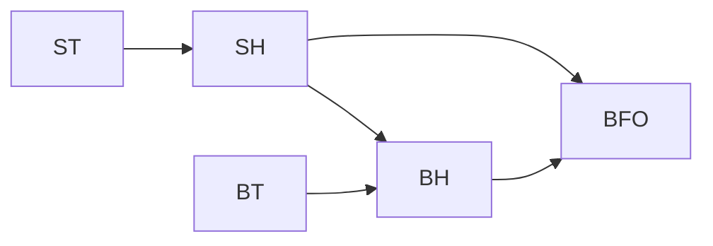

# 구조적 인과 모델과 인과의 세 단계

시계열 인과 발견 논문 가운데 수식이 가장 잘 정리된 것들은 구조적 인과 모델(Structural Causal Model, SCM)로 문제를 적는다. 그런데 "SCM이 정확히 무엇인가"라는 질문에 답하지 못한 채로 논문을 읽고 있었다. 이 글에서는 인과를 정의하려는 시도들이 어떤 문제에 부딪혔고 SCM이 그것을 어떻게 해결하는지, 그리고 SCM을 시계열에 어떻게 적용하는지를 정리하고자 한다.

## 1. 상관과 인과

"Association Between Push-up Exercise Capacity and Future Cardiovascular Events Among Active Adult Men"이라는 연구가 있다. 푸시업을 할 수 있는 횟수가 미래의 심혈관 질환과 상관관계가 있다는 내용이다. 이 결과를 "푸시업을 하면 심장에 좋다"로 읽기 쉽지만, 그것은 인과에 대한 주장이고 이 연구가 보인 것은 연관(association)이다.

인과를 정의하려는 첫 시도는 규칙성이었다. 철학자 David Hume은 원인을 "다른 대상이 뒤따르는 대상이며, 첫째와 비슷한 모든 대상에 둘째와 비슷한 대상이 뒤따르는 것"으로 정의했다. $X$가 일어나고 이어서 $Y$가 일어나는 일이 반복되면 $X$가 $Y$의 원인이라는 것이다. 이는 사실상 상관으로 인과를 정의하는 것인데, 상관은 인과가 아니다.

강의에서 본 예가 이를 잘 보여 준다. 일주일 운동 시간과 콜레스테롤 수치를 산점도로 그리면 운동을 많이 할수록 콜레스테롤이 높은 것처럼 보인다. 그런데 같은 데이터를 나이대별로 나누어 보면 모든 나이대에서 운동 시간이 길수록 콜레스테롤이 낮다. 나이가 많을수록 운동도 많이 하고 콜레스테롤도 높았던 것이다. 데이터를 어떻게 해석해야 하는지는 데이터가 어떻게 만들어졌는지에 달려 있으며, 상관만으로는 정할 수 없다.

## 2. 반사실과 potential outcome

두 번째 시도는 반사실(counterfactual)이다. David Lewis(1973)의 반사실 이론과 Donald Rubin(1974)의 potential outcome 틀이 여기에 속한다. $X$가 $Y$의 원인이라고 말하려면

- $X$가 일어났을 때 $Y$가 일어나야 하고,
- $X$가 일어나지 않았다면 $Y$도 일어나지 않았어야 한다.

potential outcome $Y_x$는 "$X$를 $x$로 정했다면 $Y$가 가졌을 값"이다. 이진 변수라면 $Y_{X=1} = 1$이고 $Y_{X=0} = 0$일 때 $X$를 $Y$의 원인이라고 한다.

개별 단위까지 적으면 $Y_x(u)$가 된다. $u$는 특정 단위의 외생 변수 값이다. 예를 들어 약을 먹지 않았고($X = 0$) 심장마비가 일어난 환자 $A$가 있을 때, "이 환자가 약을 먹었다면 심장마비가 일어났을까"에 대한 답이 $Y_1(u_A)$다. 실제로는 일어나지 않은 상황에 대한 값이므로 관측할 수 없다.

세 종류의 양을 구분해 두면 이후가 편하다.

| 종류 | 표기 | 의미 |
|---|---|---|
| Observational | $P(Y \mid X)$ | 실제로 관측된 데이터에서의 조건부 분포 |
| Interventional | $P(Y \mid do(X))$ | $X$에 개입한 뒤의 결과 분포 |
| Counterfactual | $Y_x(u)$ | 실제와 다른 가정 아래에서 특정 단위가 가졌을 결과 |

개입하는 변수가 여럿이면 $Y_{x,z}(u)$처럼 쓴다. 단위 $u$에서 $X$를 $x$로, $Z$를 $z$로 고정했을 때의 $Y$다.

### Potential outcome이 곤란해지는 경우

Suzy와 Billy가 병을 향해 공을 던진다. 두 사람의 공은 모두 반드시 병에 맞고, 병은 공에 맞으면 반드시 떨어진다. 다만 Suzy가 던지면 Suzy의 공이 항상 Billy의 공보다 먼저 병에 닿는다.

Suzy가 던져서 병이 떨어졌다. 상식적으로 Suzy의 투구가 원인이다. 그런데 반사실 정의에 넣어 보면

- Suzy가 던진다 → 병이 떨어진다
- Suzy가 던지지 않는다 → (Billy의 공에 맞아) 병이 떨어진다

가 되어 두 번째 조건이 성립하지 않는다. 정의에 따르면 Suzy의 투구는 원인이 아니다. 원인이 둘 이상 겹쳐 결과가 과잉 결정(overdetermination)되는 경우에 단순한 반사실 정의가 실패하는 것이다.

문제를 풀려면 Billy의 공이 병에 닿지 않았다는 상황을 따로 고려할 수 있어야 한다. 그러려면 "던진다"와 "맞는다"를 구분하고 변수들이 서로를 어떻게 결정하는지를 적은 모델이 필요하다.

## 3. Causal model

causal model은 $\mathcal{M} = \langle \mathbf{V}, \mathbf{U}, \mathbf{F} \rangle$로 정의한다.

- $\mathbf{V}$: 내생(endogenous) 변수의 집합. 모델 안에서 값이 정해지는 변수다.
- $\mathbf{U}$: 외생(exogenous) 변수의 집합. 모델 밖에서 주어지는 잠재 변수다.
- $\mathbf{F}$: 구조 방정식의 집합. 각 $V_i$의 값을 $V_i \leftarrow f_{V_i}(PA_{V_i}, U_{V_i})$로 정한다. $PA_{V_i} \subseteq \mathbf{V}$, $U_{V_i} \subseteq \mathbf{U}$다.

$\mathbf{U}$는 하나의 상황(context)을 나타낸다. $\mathbf{U} = \mathbf{u}$로 고정하면 모든 $\mathbf{V}$의 값이 정해진다. 불확실성은 모두 $\mathbf{U}$에 있다. 쉽게 말해 causal model은 각 변수의 값이 어떻게 정해지는지를 나타내는 함수와, 그 관계를 표현하는 그래프다.

Suzy와 Billy의 문제를 다섯 변수로 적는다. ST(Suzy가 던진다), BT(Billy가 던진다), SH(Suzy의 공이 맞는다), BH(Billy의 공이 맞는다), BFO(병이 떨어진다)이며, BH는 "Billy가 던졌고 Suzy의 공이 맞지 않았을 때" 참이다.

ST에 개입한 결과는 다음과 같다. 개입 $do(\cdot)$는 변수를 강제로 특정 값으로 정하는 것이다.

| 변수 | $do(ST = T)$ | $do(ST = F)$ |
|---|---|---|
| SH | T | F |
| BT | T | T |
| BH | F (Suzy의 공이 먼저 맞았다) | T |
| BFO | T | T |

여기까지는 앞과 같다. 어느 쪽이든 병은 떨어진다. 이 모델이 주는 것은 다음 질문을 던질 수 있다는 점이다. 실제로 일어난 일은 "Billy의 공이 병에 맞지 않았다(BH = F)"이다. 이 사실을 고정하고 ST를 바꾸면

| 변수 | $do(ST = T)$, BH = F | $do(ST = F)$, BH = F |
|---|---|---|
| SH | T | F |
| BFO | T | F |

가 되어 Suzy의 투구에 따라 병의 운명이 갈린다. 변수 사이의 구조를 적어 두었기 때문에 이런 조건부 반사실을 계산할 수 있다.

## 4. Structural Causal Model

SCM이 causal model과 다른 점은 하나다. 외생 변수 $\mathbf{U}$는 관측되지 않으므로 그 값에 불확실성이 있다. 이 불확실성을 확률 분포로 넣은 것이 SCM이다.

$$
\mathcal{M} = \langle \mathbf{V}, \mathbf{U}, \mathbf{F}, P(\mathbf{u}) \rangle
$$

- $\mathbf{V}$: 내생 변수의 집합. 예: $\mathbf{V} = \{X, Y, Z\}$
- $\mathbf{U}$: 외생 잡음 변수의 집합. 각 변수는 자신의 외생 잡음을 가진다. 외생 변수들이 서로 독립이라고 가정하며, 의존한다면 잠재 교란 변수가 있는 것으로 해석한다.
- $\mathbf{F}$: 구조 방정식의 집합. $V_i := f_i\big(pa(V_i),\, U_i\big)$
- $P(\mathbf{u})$: 외생 변수의 확률 분포

그래서 SCM을 probabilistic causal model이라고 부르기도 한다. 구조 방정식에서 어떤 변수가 어떤 변수의 인자로 들어가는지를 그리면 인과 그래프가 된다. $X \to Y$는 $X$가 $Y$의 직접 원인이라는 뜻이다.

SCM에서 $X$를 $x$로 강제로 고정했을 때 나오는 $Y$가 곧 potential outcome $Y_x$다. 즉 SCM이 있으면 potential outcome과 반사실을 모두 유도할 수 있다. 반대로 potential outcome 틀만으로는 SCM을 표현하지 못한다. 이 점에서 SCM은 여러 접근을 아우르는 공통 언어로 소개된다.

### 개입과 반사실

- **개입.** $do(X = x)$는 $X$를 외부에서 강제로 $x$로 정하는 것이다. SCM에서는 $X$의 구조 방정식 $f_X(\cdot)$를 지우고 $X := x$로 바꾸는 것으로 표현한다. 나머지 방정식은 그대로 둔다. 이렇게 바꾼 모델에서 얻는 분포가 $P(Y \mid do(X = x))$다.
- **반사실.** "만약 $X$가 달랐다면 $Y$는 어땠을까"를 다룬다. SCM은 변수들이 정해지는 방식을 모두 적은 하나의 세계 시뮬레이터이므로, 같은 $\mathbf{u}$에서 방정식만 바꾼 세계를 계산할 수 있다.

### 반사실의 공리

SCM은 반사실에 대한 몇 가지 당연한 성질로 특징지을 수 있다. 원인에서 결과로만 영향이 가는 비순환성을 전제로 할 때 다음 두 가지다.

- **Composition.** $X$를 $x$로 고정한 가상의 모집단에서는 어떤 변수 $W$든 $W_x$의 값을 가진다. 따라서 그 값을 추가로 고정해도 결과는 달라지지 않는다.

    $$
    Y_x(\mathbf{u}) = Y_{x,\, W_x(\mathbf{u})}(\mathbf{u})
    $$

    변수 하나에 개입했다면 다른 변수들도 모두 그 개입의 영향 아래에서 보아야 한다는 뜻이다.

- **Effectiveness.** $X$를 $x$로 고정했다면 $X$의 값은 $x$다.

    $$
    X_x(\mathbf{u}) = x
    $$

하나하나는 당연해 보이지만, 이 성질들이 SCM에서의 반사실을 특징짓는다는 것이 Galles, Pearl, Halpern의 결과다.

## 5. 인과의 세 단계

Pearl은 인과에 대한 질문을 세 단계로 나눈다.

| 단계 | 대표적인 일 | 양 | 질문의 예 |
|---|---|---|---|
| L1 Association | 분류, 회귀, 관측 연구 | $P(y \mid x)$ | 이 증상은 내 두통에 대해 무엇을 말해 주는가 |
| L2 Intervention | 강화학습, 무작위 실험(A/B test) | $P(y \mid do(x))$ | 아스피린을 먹으면 두통이 나을까 |
| L3 Counterfactual | 구조적 인과 모델 | $P(y_x \mid x', y')$ | 아스피린을 먹지 않았고 낫지 않았는데, 먹었다면 어땠을까 |

L1은 직접 본 것이다. 회귀도 여기에 속하므로 회귀 계수는 인과가 아니다. L2는 본 것이 아니라 시스템의 값을 고정하거나 무작위로 배정해 강제로 개입한 결과이며, 보통 인과 효과라고 부르는 양이 이것이다. L3는 이미 일어난 일을 놓고 되돌아보는 질문이다.

핵심은 낮은 단계의 지식만으로는 높은 단계의 질문에 답할 수 없다는 것이다. 관측 데이터(L1)가 아무리 많아도 가정 없이는 개입의 결과(L2)를 말할 수 없다. 1절의 운동과 콜레스테롤 예가 이 경우에 해당한다. 같은 관측 분포가 서로 다른 인과 구조에서 나올 수 있으므로 분포만 보아서는 개입의 결과를 정할 수 없다. 강의를 들을 당시에는 이 명제를 충분히 이해하지 못했고, 다음 절의 identification을 보고서야 무엇이 쟁점인지 알았다.

## 6. Causal effect identification

그렇다면 실제로는 어떻게 하는가. 자연에는 물리적 메커니즘에 따라 만들어진 SCM이 있다. 우리는 그 SCM을 모른다. 데이터를 만들어 낸 미지의 과정이다. 우리가 가진 것은 두 가지다.

- 그래프: 변수들이 대략 어떤 관계인지에 대한 정성적인 지식
- 데이터: 관측 분포에서 뽑은 표본 (L1)

알고 싶은 것은 $P(y \mid do(x))$ (L2)다. 일반적으로는 L1의 데이터만으로 L2의 질문에 답할 수 없지만, 그래프의 정보를 이용하면 답할 수 있는 경우가 있다. 그래프를 이용해 L2의 양을 L1의 양으로 계산할 수 있는 식으로 바꾸는 일을 causal effect identification이라고 한다. 예를 들어 $X$와 $Y$의 공통 원인 $Z$가 관측되어 있으면

$$
\mathbb{E}[Y \mid do(X = x)] = \sum_{z} \mathbb{E}[Y \mid x, z]\, P(z)
$$

로 쓸 수 있다. 우변은 모두 관측 데이터에서 추정할 수 있는 양이다.

여기서 인과 발견의 위치가 분명해진다. identification은 그래프가 주어졌다고 가정한다. 그 그래프를 데이터에서 찾는 일이 인과 발견이다.

## 7. SCM이 기대는 가정

SCM으로 인과 발견을 할 때 붙는 가정을 모으면 다음과 같다. 그래프에 대한 가정의 자세한 내용은 [인과 그래프와 가정](03-causal-graphs-and-assumptions.md)에 정리했다.

| 가정 | 내용 |
|---|---|
| Causal Markov condition | 각 변수는 직접적인 인과 부모를 조건으로 모든 비자손과 조건부 독립이다. 결과적으로 결합 분포가 그래프에 따라 분해된다 |
| 인과 충분성 | 모든 공통 원인이 관측되었다. Markov condition이 관측 변수만의 그래프에서 성립하기 위한 전제다 |
| Faithfulness | 분포의 모든 조건부 독립성은 그래프의 d-separation으로 설명된다 |
| 비순환성 | 같은 시점의 인과 그래프에 cycle이 없다. 시간 지연을 둔 반복 구조는 허용된다 |
| No selection bias | 데이터가 시스템 전체를 대표하도록 수집되었다 |
| 외생성 | 잡음 항은 서로 독립이며 시스템 밖에서 주어진다 |

## 8. 시계열에서의 SCM

다변량 시계열 $\mathbf{V}_t = (V_t^1, \ldots, V_t^N)$에서 SCM은 다음과 같이 쓴다.

$$
V_t^j := f^j\big(pa(V_t^j),\, \eta_t^j\big), \qquad pa(V_t^j) \subseteq \{V_{t-\tau}^i \mid i = 1, \ldots, N,\ 0 \le \tau \le \tau_{\max}\} \setminus \{V_t^j\}
$$

- $f^j$: $V_t^j$를 결정하는 인과 메커니즘. 비선형일 수 있다.
- $pa(V_t^j)$: 인과적 부모, 곧 직접 원인이다. 자기 자신을 제외한 현재 또는 과거의 변수들이다. 자기 자신의 과거와 다른 변수의 과거가 모두 들어갈 수 있다.
- $\eta_t^j$: $V_t^j$에만 붙는 잡음이다. 부모로 설명되지 않고 남는 영향을 나타낸다.

지연 $\tau = 0$을 허용하는 이유는 유한한 시간 해상도 때문이다. 실제 지연이 1주인데 데이터가 월 단위로 집계되어 있으면 그 인과 관계는 같은 시점에서 나타난다.

시계열에서 개입은 보통 특정 시점에 대한 것이다. $do(X_t = x)$는 $X_t$의 방정식만 바꾸고, $X_{t-1}$, $X_{t+1}$ 등 다른 시점은 모두 원래의 구조 방정식을 따른다.

이 식에서 그래프를 읽어 낼 수 있다. 부모 관계를 시간 축에 그대로 그리면 시계열 그래프가 되고, 시점을 접으면 summary graph가 된다. DAG로 그릴 때는 동시점 cycle만 금지되고, 지연을 사이에 둔 feedback은 금지되지 않는다. $V_{t-1}^2 \to V_t^1$과 $V_t^1 \to V_t^2$가 함께 있어도 둘 중 하나가 지연 관계이므로 cycle이 아니다.

일부 변수가 관측되지 않는 경우도 다룬다. 대기 중의 에어로졸은 구름 형성에 영향을 주지만 데이터로 관측되지 않는 경우가 많다. 이때 관측 변수만으로 그린 그래프에서

- $V_{t-\tau}^i \to V_t^j$는 관측되지 않은 변수를 거쳤을 수도 있는 직접 또는 간접의 인과 관계를,
- $V_{t-\tau}^i \leftrightarrow V_t^j$는 두 변수에 공통의 미관측 원인이 있음을 뜻한다.

관측되지 않은 교란이 없는 SCM은 잡음 항이 서로 독립이며 Markovian model이라 하고, 교란이 있어 잡음 항이 의존할 수 있는 SCM은 semi-Markovian model이라 한다.

SCM은 여러 인과 발견 방법의 바탕이 된다. PCMCI, TiMINo, VARLiNGAM은 모두 이 구조 방정식을 데이터 생성 과정으로 놓고 설계되었다. 방법마다 다른 것은 $f^j$와 $\eta_t^j$에 어떤 가정을 두느냐다.

Granger causality와의 관계도 이 틀에서 설명된다. 모든 관련 변수가 관측되었고 동시점 관계가 없다면, Granger 인과 관계는 바탕에 있는 SCM의 인과 관계와 일치한다. Granger 계열의 방법이 잠재 교란 변수와 동시점 효과가 없다고 가정하는 이유다.

## 남았던 질문과 답

공부할 당시에는 풀지 못하고 남겨 둔 질문들이다. 글을 정리하면서 답을 찾아 덧붙였다.

**Q. 인과 추론은 통계적 추론의 한 영역일 뿐인가, Pearl의 틀이 새로운 과학인가.**

한쪽이 옳다고 정할 수 있는 문제는 아니지만, 두 견해가 어디서 갈리는지는 분명히 말할 수 있다. 인과적 질문에 답하는 일은 두 단계로 나뉜다. identification은 $P(y \mid do(x))$ 같은 양을 관측 분포의 식으로 바꿀 수 있는지를 따지는 단계다. 이 단계는 표본이 무한히 많아도 데이터만으로는 풀리지 않고, 그래프나 ignorability 같은 가정이 있어야 한다. estimation은 그렇게 얻은 식을 유한한 표본에서 추정하는 단계이고, 이것은 통상의 통계적 추론이다. 인과 추론을 통계의 일부로 보는 쪽은 뒤의 단계를, 새로운 틀로 보는 쪽은 앞의 단계를 강조한다. 앞 단계에 분포 바깥의 정보가 필요하다는 점 자체는 인과 계층 정리(causal hierarchy theorem)로 정식화되어 있다. 거의 모든 SCM에서 L1의 정보는 L2의 양을, L2의 정보는 L3의 양을 결정하지 못한다는 내용이다(Bareinboim 외, "On Pearl's Hierarchy and the Foundations of Causal Inference").

**Q. 외생 잡음을 "통제할 수 없는 잡음"으로 이해해도 되는가.**

정확한 이해는 아니다. 외생 변수의 정의는 "모델 안에 그 값을 정하는 구조 방정식이 없는 변수"다. 통제할 수 없다는 뜻도, 작고 무작위적인 흔들림이라는 뜻도 정의에는 들어 있지 않다. $\mathbf{U}$에는 모델에 넣지 않은 모든 원인이 들어간다. 측정 오차뿐 아니라 개체마다 다른 특성도 포함되며, 2절에서 $u$가 특정 환자를 가리킨 것이 그 예다. 3절에서 $\mathbf{U} = \mathbf{u}$를 하나의 상황(context)이라고 부른 것도 같은 이유다. 따라서 "모델이 설명하지 않기로 한 것 전부"로 이해하는 편이 정확하다. 잡음이라는 이름은 $U_i$를 서로 독립인 확률 변수로 두는 모델에서 굳어진 관례다.

**Q. potential outcome 틀에서는 identification이 어떻게 이루어지는가.**

그래프 대신 potential outcome에 대한 가정을 직접 둔다. 표준적인 가정은 세 가지다. consistency는 실제로 $X = x$였던 개체에서 관측된 $Y$가 $Y_x$와 같다는 것, conditional ignorability는 $Y_x \perp X \mid Z$, positivity는 모든 $z$에서 $P(X = x \mid Z = z) > 0$이라는 것이다. 그러면

$$
\mathbb{E}[Y_x] = \sum_z \mathbb{E}[Y_x \mid z]\, P(z) = \sum_z \mathbb{E}[Y_x \mid x, z]\, P(z) = \sum_z \mathbb{E}[Y \mid x, z]\, P(z)
$$

가 된다. 둘째 등호에 ignorability를, 셋째 등호에 consistency를 쓰고, positivity는 조건부 기댓값이 정의되도록 한다. 결과는 6절의 조정 공식과 같다. 두 틀의 차이는 가정을 어디서 얻느냐에 있다. SCM에서는 $Z$가 backdoor criterion을 만족하는지를 그래프에서 읽고, 만족하면 conditional ignorability가 따라 나온다. potential outcome 틀에서는 ignorability를 도메인 지식에 근거해 직접 가정한다.

**Q. 인과 발견 방법을 이해하는 데 개입(intervention)과 do-calculus를 어디까지 알아야 하는가.**

관측 데이터만 쓰는 인과 발견(PC, FCI, PCMCI, Granger 계열)을 이해하는 데는 개입의 정의까지면 충분하고, do-calculus는 쓰이지 않는다. 개입의 정의가 필요한 이유는 그것이 간선의 뜻을 정하기 때문이다. $X \to Y$는 "다른 변수를 고정한 채 $X$에 개입하면 $Y$의 분포가 달라진다"는 주장이고, 인과 발견이 복원하려는 것이 이 그래프다. do-calculus는 그래프가 주어졌을 때 $P(y \mid do(x))$를 관측 분포로 표현할 수 있는지를 판정하는 세 개의 규칙이므로, 발견한 그래프로 인과 효과를 추정하는 다음 단계에서 필요하다. 개입을 더 깊이 알아야 하는 경우는 개입 데이터를 함께 쓰는 방법을 볼 때다. 개입 데이터가 있으면 관측 데이터만으로는 구분되지 않던 Markov equivalence class 안의 그래프를 더 구분할 수 있다.

## 참고 자료

- 1 ~ 6절은 SCM을 소개하는 인과 추론 강의의 슬라이드를 보며 정리한 것이다. 강의의 출처는 기록해 두지 못했다.
- J. Pearl, "Causality", 2000/2009.
- "Association Between Push-up Exercise Capacity and Future Cardiovascular Events Among Active Adult Men", JAMA Network Open, 2019. <https://jamanetwork.com/journals/jamanetworkopen/fullarticle/2724778>
- J. Runge 외, "Causal inference for time series". (시계열 SCM, Markovian과 semi-Markovian 모델)
- "Causal network reconstruction from time series: From theoretical assumptions to practical estimation".
- "Inferring causation from time series in Earth system sciences".
- "High-recall causal discovery for autocorrelated time series with latent confounders".
- "Amortized Causal Discovery: Learning to Infer Causal Graphs from Time-Series Data". (Granger causality와 SCM의 관계)
- "A Survey on Causal Discovery Methods for I.I.D. and Time Series Data". (가정의 정의)
- E. Bareinboim 외, "On Pearl's Hierarchy and the Foundations of Causal Inference". (인과 계층 정리)
