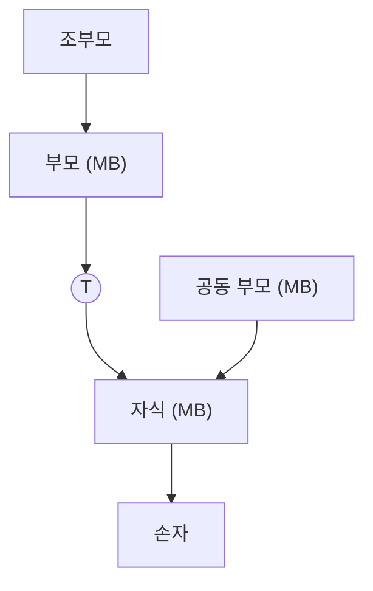
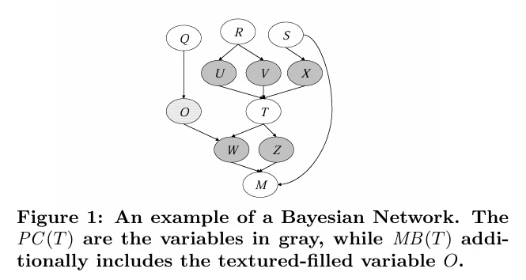
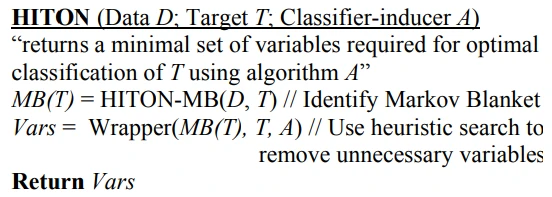
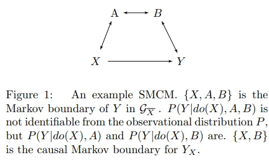

# Markov blanket과 변수 선택

작성일 2025-05-04 · 최종 수정일 2025-05-08
{ .post-date }

인과 그래프 전체를 복원하는 대신, 관심 있는 변수 하나의 주변 구조만 찾는 접근이 있다. 그 중심에 있는 개념이 Markov blanket이다. 이 글에서는 Markov blanket과 Markov boundary의 정의, 베이지안 네트워크에서 그것이 어떤 노드로 이루어지는지, 이를 찾는 대표적인 알고리즘인 HITON과 MMPC, 그리고 Markov blanket이 간접 원인을 담지 못한다는 점을 다룬 문헌을 정리하고자 한다.

## 1. 정의

### Markov blanket

타깃 변수 $T$의 Markov blanket은 그것이 주어지면 $T$가 나머지 모든 변수와 조건부 독립이 되는 변수 집합 $M$이다. 전체 변수 집합을 $V$라고 하면

$$
T \perp V \setminus (\{T\} \cup M) \mid M
$$

이다. $M$을 알면 다른 변수는 $T$에 대해 더 알려 주는 것이 없다. 타깃의 상태를 예측하는 데 필요한 정보가 모두 $M$ 안에 있다는 뜻이다. 이 정의는 베이지안 네트워크, Markov random field, dependency network 등 여러 그래프 모델에 공통으로 적용된다. 용어는 Pearl(1988)에서 시작되었다.

### Markov boundary

위의 조건을 만족하는 집합은 하나가 아니다. Markov blanket에 변수를 더 넣어도 여전히 Markov blanket이기 때문이다. Markov boundary는 최소인 Markov blanket이다. 즉 $M$이 Markov blanket이면서, $M$의 어떤 진부분집합 $M' \subsetneq M$도 Markov blanket이 아닌 경우다.

$$
T \not\perp V \setminus (\{T\} \cup M') \mid M' \qquad \text{for every } M' \subsetneq M
$$

변수를 하나라도 빼면 조건부 독립성이 깨지는 집합이다. Markov boundary의 유일성은 항상 보장되지는 않는다. 여러 개의 Markov boundary를 찾는 알고리즘이 따로 연구되는 이유다.

문헌에서는 두 용어를 엄밀히 구분하지 않고, 최소인 집합을 그냥 Markov blanket(MB)이라고 부르는 경우가 많다. 아래에서도 MB는 최소인 집합을 가리킨다.

## 2. 베이지안 네트워크에서의 Markov blanket

베이지안 네트워크(BN)는 확률 변수들의 결합 분포를 DAG로 간결하게 표현한 모델이다. 각 노드에는 부모가 주어졌을 때의 조건부 분포가 붙고, 전체 분포는 다음과 같이 분해된다.

$$
P(X_1, X_2, \ldots, X_n) = \prod_{i} P\big(X_i \mid \text{Parents}(X_i)\big)
$$

그래프와 분포는 Markov condition으로 연결된다. 각 노드는 부모가 주어지면 자신의 비자손과 조건부 독립이다.

분포가 그래프에 faithful하면 노드 $X$의 MB는 세 종류의 노드로 이루어진다.

$$
\text{MB}(X) = \text{Parents}(X) \cup \text{Children}(X) \cup \text{Co-parents of Children}(X)
$$

(MB)라고 표시한 세 노드가 $T$의 MB다. 조부모와 손자는 들어가지 않는다.

이 구성은 [d-separation](03-causal-graphs-and-assumptions.md)에서 나온다. $T$에서 바깥으로 나가는 경로를 모두 차단해야 하기 때문이다.

- 부모를 거쳐 위로 가는 경로는 chain이나 fork이므로 부모를 조건에 넣으면 차단된다.
- 자식을 거쳐 아래로 가는 경로도 chain이므로 자식을 조건에 넣으면 차단된다.
- 그런데 자식은 $T$와 공동 부모(co-parent, spouse) 사이에서 collider다. 자식을 조건에 넣는 순간 $T$와 공동 부모 사이의 경로가 열린다. 그래서 공동 부모까지 조건에 넣어야 한다.

노드가 더 많은 예에서 직접 골라 보면 감이 잡힌다. MMPC 논문의 예시 네트워크다.

{ width="460" }

*가운데의 $T$가 타깃이다. 회색 노드가 $T$의 부모와 자식(PC)이고, 여기에 무늬가 있는 $O$를 더하면 MB가 된다. 출처: MMPC 논문 Figure 1.*

- $U$, $V$, $X$는 $T$로 화살표를 보내는 부모이고, $W$, $Z$는 $T$에서 화살표를 받는 자식이다. 이 다섯이 회색이다.
- $O$는 $T$와 직접 이어져 있지 않다. 그러나 $T$의 자식 $W$의 또 다른 부모이므로 공동 부모이고, MB에 들어간다.
- $R$과 $S$는 부모의 부모(조부모), $M$은 자식의 자식(손자)이므로 들어가지 않는다. $Q$도 공동 부모 $O$의 부모일 뿐이다.

$Q$, $R$, $S$, $M$ 넷은 $T$와 무관해서 빠지는 것이 아니다. 회색 노드와 $O$를 알고 나면 더 보탤 정보가 없어서 빠진다.

MB는 d-separation의 관점에서 $T$를 바깥의 변수로부터 차단하는 최소 집합이다. 그리고 이 d-separation 관계를 데이터에서 실제로 확인하는 절차가 조건부 독립성 검정이다. MB를 찾는 알고리즘은 조건부 독립성 검정을 반복해 이 구조를 추정한다.

## 3. Dependency network와의 차이

MB가 부모만으로 이루어지는 모델도 있다. dependency network(DN)다. BN과 비교하면 다음과 같다.

| | Bayesian network | Dependency network |
|---|---|---|
| 그래프 | 비순환이어야 한다 | cycle과 양방향 간선을 가질 수 있다 |
| 파라미터 | 부모가 주어졌을 때의 조건부 분포 | 부모가 주어졌을 때의 조건부 분포 |
| 표현하는 것 | 결합 분포 전체 | 변수별 국소 조건부 분포 $P(X_i \mid \text{나머지 모든 변수})$ |
| 노드를 나머지와 독립으로 만드는 집합 | 부모, 자식, 공동 부모 | 부모 |
| 부모의 의미 | 가정 아래에서 인과적 해석이 가능하다 | 예측에 쓰이는 설명 변수일 뿐이다 |

DN은 결합 분포를 명시적으로 학습하지 않는다. 대신 각 노드에 대해 나머지 변수가 주어졌을 때의 조건부 분포만 학습한다. 이때 필요한 것은 모든 변수가 아니라 그 조건부 분포를 모델링하는 데 꼭 필요한 변수들이다. 타깃 $T$와 변수 $A$ ~ $E$가 있을 때 $P(T \mid A, B, C, D, E)$가 아니라 $P(T \mid B, D)$, 곧 $P(T \mid \text{MB}(T))$를 찾는 것이다. DN에서는 이 집합을 부모라고 부른다. DN은 cycle을 허용하므로 $T$가 $B$의 부모이면서 $B$가 $T$의 부모일 수도 있다.

그렇다면 DN에서는 부모를 어떻게 찾는가. 나머지 모든 변수를 입력으로 $T$의 조건부 분포를 예측하는 모델을 학습하고, 모델이 실제로 사용하는 변수만 남긴다. 모델은 선형 회귀, 로지스틱 회귀, 랜덤 포레스트, 신경망 등 무엇이든 될 수 있다. feature importance가 높은 변수만 남기거나, L1 정규화(Lasso)의 희소성으로 불필요한 변수의 계수를 0으로 만드는 방식이다. 이 작업은 변수 선택과 사실상 같다. 어떤 변수가 있으면 타깃을 잘 예측할 수 있는지를 찾는 일이기 때문이다.

차이는 해석에 있다. BN의 부모는 d-separation에 근거해 찾으므로 가정이 성립하면 인과적 의미를 가질 수 있다. DN의 부모는 통계적 예측에 쓰이는 변수이며 인과적 의미가 없다.

## 4. 인과 발견과의 관계

인과 발견의 목표는 데이터로부터 인과 구조를 추론하는 것이고, MB는 그 구조의 국소적인 단위다.

- 인과 그래프를 얻으면 각 노드의 MB를 읽어 낼 수 있다.
- 반대로 MB는 특정 노드의 직접적인 이웃을 알려 주므로, 모든 변수의 MB를 구하면 전체 구조를 추정하는 기반이 된다. HITON이나 MMPC는 이웃을 찾는 과정을 반복해 그래프의 뼈대로 확장할 수 있다.
- 인과적 변수 선택(causal feature selection)에서는 MB가 예측에 충분하면서 최소인 변수 집합이 된다.

전체 그래프를 학습하는 전역 학습(global learning)은 변수가 수천 개가 되면 적용하기 어렵다. 타깃 주변만 학습하는 국소 학습(local learning)은 그에 대한 현실적인 타협이다.

## 5. HITON

"HITON: A Novel Markov Blanket Algorithm for Optimal Variable Selection"(2003)은 분류와 회귀를 위한 변수 선택을 MB 탐색으로 푼다. MB가 주어지면 다른 모든 변수는 $T$를 분류하는 데 불필요해진다는 점에 근거한다. 이전의 방법들은 휴리스틱에 의존해, 표본과 시간이 무한히 주어져도 잘못된 MB를 반환할 수 있었다는 것이 논문의 문제의식이다. 평가는 여러 생의학 데이터에서 이루어졌다.

논문의 최상위 절차는 두 줄이다.

{ width="500" }

*입력은 데이터 $D$, 타깃 $T$, 분류기를 만드는 알고리즘 $A$다. 첫 줄에서 HITON-MB로 Markov blanket을 찾고, 둘째 줄에서 wrapper로 불필요한 변수를 더 덜어 낸다. 출처: HITON 논문의 의사코드.*

첫 줄의 HITON-MB가 내부에서 HITON-PC를 부르므로, 알고리즘은 세 부분으로 이루어진다.

1. **HITON-PC.** $T$의 부모와 자식(parents and children, PC)을 찾는다. 후보 집합을 두고 변수를 하나씩 넣어 가며, 어떤 조건 집합에서 $T$와 독립으로 판정되는 변수는 제외한다.
2. **HITON-MB.** $T$의 PC를 찾은 뒤, 그 PC에 속한 변수들 각각의 PC를 다시 찾는다. 이렇게 모은 집합은 MB의 상위 집합(superset)이고, 여기서 조건부 독립성 검정으로 거짓 양성을 제거한다.
3. **Wrapper.** 분류기의 성능을 기준으로 남은 변수 중 불필요한 것을 더 제거한다.

논문은 다음 조건에서 HITON-MB가 MB를 정확히 찾는다고 말한다.

- 결합 분포가 어떤 BN에 faithful하다.
- 학습 표본이 통계적 검정을 신뢰할 수 있을 만큼 충분하다.

2번을 읽으며 "공동 부모를 직접 찾지 않는데 왜 MB의 상위 집합이 되는가"가 궁금했다. $T$의 자식의 PC에는 그 자식의 다른 부모, 곧 $T$의 공동 부모가 들어 있다. 그래서 PC의 PC를 모으면 공동 부모가 모두 포함된다. 대신 조부모나 손자처럼 MB가 아닌 변수도 함께 들어오므로 검정으로 걸러 내는 단계가 필요하다. 2절의 예시 그림으로 보면, $T$의 자식 $W$의 PC를 구할 때 공동 부모 $O$가 들어오지만 손자 $M$도 함께 들어오고, 부모 $U$의 PC를 구할 때는 조부모 $R$이 들어온다. $M$과 $R$을 걸러 내는 것이 검정 단계의 일이다.

## 6. MMPC와 MMMB

"Time and Sample Efficient Discovery of Markov Blankets and Direct Causal Relations"(2003)는 BN 학습의 두 가지 성질에서 출발한다.

1. 일정한 가정 아래에서 학습된 간선은 인과적 영향에 대응한다.
2. 모든 변수 $T$에 대해, $T$를 예측하는 데 필요한 최소 변수 집합인 MB를 네트워크에서 식별할 수 있다.

기존 방법의 한계는 두 가지였다. BN 전체를 학습하는 알고리즘은 변수가 수천 개 이상이면 적용할 수 없다. 국소 영역을 학습하는 알고리즘은 학습하는 영역의 크기에 대해 지수적으로 많은 표본이 필요하다.

논문은 두 알고리즘을 제안한다.

- **MMPC** (Max-Min Parents and Children): 타깃 $T$를 중심으로, $T$에 직접 영향을 주는 변수(부모)와 $T$로부터 직접 영향을 받는 변수(자식)를 찾는 국소 알고리즘이다.
- **MMMB** (Max-Min Markov Blanket): MMPC의 결과를 바탕으로 공동 부모를 추가로 찾아 MB를 완성한다.

논문이 내세우는 점은 다음과 같다.

- 두 알고리즘이 sound하다. 여기서 soundness는 알고리즘이 출력한 것이 항상 참이라는 성질이다. 부모나 자식이 아닌 변수가 결과에 들어가지 않는다는 뜻이다. 짝이 되는 성질인 completeness는 찾아야 할 것을 모두 찾는다는 뜻이다.
- 변수가 수천 개인 데이터에서도 효율적으로 동작한다.
- 필요한 표본의 수가 학습하는 영역의 크기가 아니라 데이터를 생성한 그래프의 연결 정도(connectivity)에 따라 정해진다. 이것이 IAMB, GS, KS 같은 이전 알고리즘과의 핵심적인 차이이며, 표본 요구량이 크게 줄어드는 이유다.

이 알고리즘은 국소 인과 구조의 발견뿐 아니라 분류를 위한 변수 선택, 그리고 BN 전체를 학습하는 절차의 구성 요소로도 쓰일 수 있다. PC 알고리즘은 MMPC와 달리 변수가 많을 때 확장성이 떨어지므로, 전체 BN을 학습하기 어려운 경우에도 국소 알고리즘으로 필요한 부분만 학습할 수 있다는 가능성을 보였다고 정리했다.

## 7. MB 기반 변수 선택 문헌

MB를 이용한 변수 선택 논문을 47편 모아 두었다. 대부분은 내용을 정리하지 못하고 목록으로만 남아 있다. 일부를 주제별로 묶으면 다음과 같다.

| 주제 | 논문 |
|---|---|
| 리뷰 | Markov Blanket based Feature Selection: A Review of Past Decade / Causality-based Feature Selection: Methods and Evaluations |
| 기본 알고리즘 | HITON / MMPC / Local Causal and Markov Blanket Induction for Causal Discovery and Feature Selection for Classification Part I |
| 효율과 정확도 | BAMB: A Balanced Markov Blanket Discovery Approach to Feature Selection / Towards Efficient and Effective Discovery of Markov Blankets for Feature Selection / Accurate Markov Boundary Discovery for Causal Feature Selection |
| 여러 개의 MB, 여러 타깃 | Algorithms for Discovery of Multiple Markov Boundaries / Multi-Target Markov Boundary Discovery: Theory, Algorithm, and Application |
| 스트리밍 데이터 | Feature Selection in the Data Stream Based on Incremental Markov Boundary Learning |
| 가정의 완화 | Practical Markov Boundary Learning without Strong Assumptions / Tolerant Markov Boundary Discovery for Feature Selection |
| 구조 학습으로의 확장 | A Recursive Markov Boundary-Based Approach to Causal Structure Learning |
| 개입과의 관계 | Causal and Interventional Markov Boundaries / Learning Causal Markov Boundaries with Mixed Observational and Experimental Data |

이 가운데 "Practical Markov Boundary Learning without Strong Assumptions"의 문제 제기를 적어 둔다. MB는 변수 선택의 최적해지만, 현재의 MB 학습 알고리즘은 데이터의 분포, 변수의 형태, 판정 기준의 정확성에 대한 엄격한 가정 때문에 실제 데이터에서 중요한 변수를 놓치는 경우가 있다. 변수가 수치형인지 범주형인지, 관계가 선형인지 비선형인지, 의존성이 쌍 단위인지 다변량인지에 따라 가정이 깨질 수 있다는 것이다.

## 8. Markov blanket과 간접 원인

MB는 정의상 타깃의 직접적인 이웃만 담는다. $I \to X \to Y$에서 $Y$의 MB에는 $X$만 들어가고, 간접 원인 $I$는 들어가지 않는다. $X$가 주어지면 $I$는 $Y$에 대해 더 알려 주는 것이 없기 때문이다. 이 점을 문헌이 어떻게 다루는지 네 편을 읽었다. 네 편 모두 $I \to X \to Y$ 형태의 간접 원인을 다루지만, 그것을 다루는 이유는 서로 달랐다.

### Causal Markov Boundaries (UAI 2021)

MB의 핵심 성질은 $P(Y \mid \text{나머지}) = P(Y \mid \text{MB}(Y))$다. MB는 관측 분포에서 최적이면서 최소인 예측 집합이다. 그러나 의사결정에서는 관측 데이터만 가진 채로, $X$에 개입한 뒤의 결과 분포 $P(Y \mid do(X))$를 알고 싶은 경우가 많다. 관측 분포에서의 MB는 개입 이후의 예측을 위한 집합이 아니다.

이상적으로는 개입 이후의 그래프에서 $Y$의 MB를 쓰고 싶다. 그러나 잠재 교란 변수가 있으면 그 집합 $Z$에 대한 $P(Y \mid do(X), Z)$를 관측 데이터에서 식별하지 못할 수 있다. 논문은 관측 데이터로부터 식별할 수 있으면서 개입 이후의 예측에 가장 좋은 최소 변수 집합을 causal Markov boundary라고 정의한다.

{ width="380" }

*$X \to Y$가 알고 싶은 개입의 효과다. 양쪽에 화살촉이 있는 간선 세 개($A \leftrightarrow B$, $A \leftrightarrow X$, $B \leftrightarrow Y$)는 관측되지 않은 공통 원인을 뜻한다. 출처: "Causal Markov Boundaries" Figure 1.*

이 그래프에서 $X$에 개입한 뒤의 $Y$의 MB는 $\{X, A, B\}$다. 그런데 셋을 모두 조건에 넣은 $P(Y \mid do(X), A, B)$는 관측 분포에서 식별되지 않는다. $A$나 $B$ 하나만 넣은 $P(Y \mid do(X), A)$와 $P(Y \mid do(X), B)$는 식별된다. 그래서 가장 많은 것을 알려 주는 $\{X, A, B\}$ 대신, 식별되는 것 가운데 가장 좋은 $\{X, B\}$가 causal Markov boundary가 된다. 실험 데이터가 있더라도 표본이 적은 경우가 많으므로, 많은 관측 데이터와 적은 실험 데이터를 결합해 변수를 고르는 방법을 제안한다. 시계열을 다루는 논문은 아니다.

### Necessary and Sufficient Conditions for Causal Feature Selection in Time Series with Latent Common Causes (ICML)

잠재 변수가 있는 시계열에서 타깃의 직접 원인과 간접 원인을 찾는 방법(SyPI)을 다룬다.

- 배경: Granger causality는 인과 충분성과 동시점 효과의 부재를 가정한다. PCMCI는 Granger causality보다 거짓 양성이 낮지만 여전히 인과 충분성에 의존한다. 인과 충분성 없이 전체 그래프를 찾으려는 시도는 매우 많은 조건부 독립성 검정을 요구했다.
- 방법: 그래프의 연결 구조에 대한 몇 가지 가정 아래에서, 후보 변수 하나당 두 번의 조건부 독립성 검정으로 판정하는 조건을 제시한다. 이 조건은 직접 원인과 간접 원인을 찾아내기에 충분하고, 잠재 변수가 있을 때 교란되지 않은 직접 원인에 대해서는 필요조건이기도 하다. 다른 제약 기반 방법과 달리 큰 조합을 탐색하지 않고도 올바른 조건 집합을 정한다.
- 합성 데이터: 관측 변수의 수, 잠재 시계열의 수, 간선의 밀도, 잡음 수준, 표본 크기를 바꾸어 가며 실험한다. 각 시점의 값은 이전 시점 값들의 선형 결합이고, 인과 관계의 존재 여부는 베르누이 분포로 뽑는다. Granger causality와 비교해 거짓 양성이 0에 가깝고, 직접 원인과 간접 원인을 합친 기준의 거짓 음성률도 더 낮다고 보고한다.
- 실제 데이터: 유럽의 유제품 공식 가격(독일, 아일랜드, 영국)을 쓴다. 버터 가격을 타깃으로 두고 원유 가격을 주요한 직접 원인으로 가정한다. 정답 그래프가 있는 데이터는 아니며, 논문도 이 데이터에서 그래프 가정이 성립하는지 검증할 수 없다고 밝힌다.

### Predictive and Causal Implications of using Shapley Value for Model Interpretation (KDD 2020)

Shapley value를 변수 선택에 쓰는 것이 적절한지를 베이지안 네트워크의 관점에서 분석한다. 결론은 높은 Shapley value가 인과와 항상 연결되지는 않는다는 것이다. 간접 원인($I \to X \to Y$의 $I$)이 MB에 속한 변수들의 Shapley value를 합친 것보다 더 큰 Shapley value를 가질 수 있음을 보인다. 실험 없이 예시에 대한 수학적 확인만 한다.

이 논문을 "간접 원인이 중요하다"는 근거로 읽을 수 있는지 따져 보았다. 그렇게 읽기는 어렵다고 판단했다. 논문이 보이려는 것은 Shapley value가 인과 구조를 반영하지 못한다는 점이고, 간접 원인의 예는 그 수단이다. 간접 원인을 반영하는 것이 중요하다는 주장과는 초점이 다르다.

### Computational Causal Discovery for Post-traumatic Stress in Police Officers (2020)

MB의 한계를 명시적으로 지적한다. MB는 직접 원인, 직접 결과, 직접 결과의 직접 원인만 담으므로 간접 원인은 들어가지 않는다는 것이다. 간접 원인은 개입으로 정의한다.

- $A$가 $B$의 원인이면 $P(B \mid do(A = a_i)) \ne P(B \mid do(A = a_j))$다.
- $A$가 $B$의 원인이지만 중간의 변수들을 고정했을 때 $A$와 $B$의 인과 관계가 사라지면, $A$는 간접 원인이다.

논문은 이를 보완하려고 전체 인과 그래프를 구성한 뒤, 83개의 경로(pathway)를 만들어 어떤 변수가 얼마나 많은 경로에 영향을 미치는지를 기준으로 평가한다. 경찰관 207명의 실제 데이터를 쓰지만 시계열 데이터는 아니다.

### 정리

| 논문 | 간접 원인을 다루는 맥락 | 데이터 |
|---|---|---|
| Causal Markov Boundaries | 개입 이후의 예측에는 관측상의 MB가 최적이 아니다 | 비시계열 |
| Causal feature selection with latent common causes | 잠재 변수가 있는 시계열에서 직접 원인과 간접 원인을 함께 찾는다 | 합성 시계열, 유제품 가격 |
| Shapley value 논문 | Shapley value가 인과 구조를 반영하지 못함을 보이는 예로 쓴다 | 수학적 예시 |
| 경찰관 PTSD 논문 | MB가 간접 원인을 담지 않으므로 경로 기반 분석을 더한다 | 비시계열 실제 데이터 |

네 편 가운데 정답 인과 구조가 알려진 실제 시계열 데이터를 쓴 논문은 없었다. 그래서 정답 인과 그래프가 있는 실제 시계열 데이터가 무엇이 있는지 따로 찾아보았고, 그 내용은 [시계열 인과 발견 벤치마크](07-time-series-causal-benchmarks.md)에 정리했다.

## 남았던 질문과 답

공부할 당시에는 풀지 못하고 남겨 둔 질문들이다. 글을 정리하면서 답을 찾아 덧붙였다.

**Q. Markov boundary가 여러 개일 수 있는 것은 어떤 경우인가. faithfulness를 가정하면 유일해지는가.**

faithfulness를 가정하면 유일하다. 분포가 어떤 DAG에 faithful하면 $T$의 Markov boundary는 부모, 자식, 공동 부모의 집합 하나로 정해진다. 더 일반적으로는 분포가 intersection 성질, 곧 $T \perp A \mid B \cup C$이고 $T \perp B \mid A \cup C$이면 $T \perp A \cup B \mid C$라는 성질을 만족하면 유일하며(Pearl, 1988), 모든 값의 조합이 양의 확률을 갖는 분포가 여기에 속한다. 여러 개가 되는 것은 이 성질이 깨질 때다. 가장 단순한 예는 $X_2$가 $X_1$의 복사본이고 $T$가 $X_1$에 의존하는 경우다. $X_1$을 알면 $X_2$가 필요 없고 $X_2$를 알면 $X_1$이 필요 없으므로 $\{X_1\}$과 $\{X_2\}$가 모두 Markov boundary다. 이처럼 서로 다른 변수 집합이 타깃에 대해 같은 정보를 담는 경우는 결정론적 관계나 그에 가까운 중복이 있는 데이터에서 나타나며, 이때 분포는 어떤 DAG에도 faithful하지 않다.

**Q. DN에서 양방향 간선으로 표현되는 Markov blanket 관계는 인과적 해석과 어떻게 다른가.**

인과 구조가 $A \to C \leftarrow B$인 경우를 보면 된다. $C$의 Markov blanket은 $\{A, B\}$이고, $A$의 Markov blanket은 자식 $C$와 공동 부모 $B$를 합친 $\{B, C\}$, $B$의 것은 $\{A, C\}$다. DN에서는 각 변수의 부모가 곧 그 변수의 Markov blanket이므로 $A \rightleftarrows C$, $B \rightleftarrows C$, $A \rightleftarrows B$가 모두 그려진다. 인과적으로는 $A$와 $B$ 사이에 아무 관계가 없고 $C$는 $A$의 원인이 아니다. DN의 간선 $X \to Y$는 "나머지 변수를 모두 알아도 $X$가 $Y$의 예측에 필요하다"는 뜻이고, 이 관계는 대칭이다. 분포가 DAG에 faithful할 때 $X$가 $Y$의 Markov blanket에 속하면 $Y$도 $X$의 Markov blanket에 속하기 때문이다. 그래서 DN의 구조는 방향이 없는 Markov network와 같은 정보를 담고, 어느 쪽이 원인인지에 대해서는 말하지 않는다.

**Q. MMPC 논문에서 말하는 neighborhood approximation의 품질은 무엇을 재는가.**

논문 초록은 두 알고리즘이 참인 neighborhood를 근사하는 정도에서 이전 알고리즘들보다 낫다고 쓴다. 여기서 neighborhood는 데이터를 생성한 네트워크에서 타깃 $T$의 실제 이웃, 곧 MMPC에서는 부모와 자식의 집합이고 MMMB에서는 Markov blanket이다. 따라서 알고리즘이 반환한 집합이 정답 집합과 얼마나 일치하는지를 가리키며, 국소 영역을 얼마나 정확히 찾는지로 읽은 것이 맞다.

**Q. MMPC는 변수가 매우 많을 때도 어떻게 현실적으로 동작하는가.**

조건 집합을 전체 변수가 아니라 지금까지 고른 후보 집합(CPC, candidate parents and children) 안에서만 만들기 때문이다. MMPC는 CPC를 빈 집합에서 시작한다. 남은 변수 $X$마다, CPC의 부분집합 $S$들을 조건으로 했을 때 $T$와의 연관성 가운데 가장 작은 값을 기록해 둔다. 이 최솟값이 가장 큰 변수를 CPC에 넣는다(max-min). 어떤 $S$에서든 $T$와 독립으로 판정된 변수는 최솟값이 0이 되어 후보에서 빠지고 다시 검정하지 않는다. 마지막에는 CPC 안의 변수들을 서로를 조건으로 다시 검정해 거짓 양성을 뺀다. 그러므로 검정 횟수는 대략 $\vert V \vert \cdot 2^{\vert \text{CPC} \vert}$에 비례하고, 지수에 들어가는 것은 전체 변수 수가 아니라 타깃의 이웃 수다. 그래프가 희소하면 CPC가 작으므로 변수가 수천 개여도 계산할 수 있고, 조건 집합이 작으니 검정에 필요한 표본도 적다. 6절에서 표본 요구량이 그래프의 연결 정도에 따라 정해진다고 한 것이 이 뜻이다.

### 아직 남은 질문

- MMPC 논문이 neighborhood approximation의 품질을 실험에서 어떤 수치 지표로 계산했는지는 확인하지 못했다. 논문 본문의 실험 절을 보아야 한다.

## 참고 자료

- J. Pearl, "Probabilistic Reasoning in Intelligent Systems: Networks of Plausible Inference", Morgan Kaufmann, 1988.
- C. F. Aliferis, I. Tsamardinos, A. Statnikov, "HITON: A Novel Markov Blanket Algorithm for Optimal Variable Selection", 2003.
- I. Tsamardinos, C. F. Aliferis, A. Statnikov, "Time and Sample Efficient Discovery of Markov Blankets and Direct Causal Relations", 2003.
- "Causal Markov Boundaries", UAI 2021.
- "Necessary and Sufficient Conditions for Causal Feature Selection in Time Series with Latent Common Causes", ICML 2021.
- "Predictive and Causal Implications of using Shapley Value for Model Interpretation", KDD 2020.
- "Computational Causal Discovery for Post-traumatic Stress in Police Officers", 2020.
- "Practical Markov Boundary Learning without Strong Assumptions".
- "Markov Blanket based Feature Selection: A Review of Past Decade".
- "Causality-based Feature Selection: Methods and Evaluations".
- 7절의 표에 적은 나머지 논문들.
