# 시계열 인과 발견 벤치마크: CausalRivers를 중심으로

작성일 2025-05-09 · 최종 수정일 2025-05-22
{ .post-date }

인과 발견 방법을 평가하려면 정답 인과 그래프가 필요하다. 그런데 실제 시계열 데이터에서 정답을 아는 경우는 드물다. 이 글에서는 정답 그래프가 알려진 실제 시계열 벤치마크로 무엇이 있는지 살펴보고, 그중 규모가 가장 큰 CausalRivers를 논문과 공개된 데이터 파일 기준으로 정리하고자 한다. 산업 설비 데이터로 만든 벤치마크도 함께 적는다.

## 1. 왜 실제 데이터가 필요한가

인과 발견 연구의 평가는 대부분 합성 데이터나 규모가 작은 실제 사례에 의존한다. 반면 실제의 인과 관계는 시간에 따라 변하고, 비선형이며, 교란 요인의 영향을 받는다.

CausalRivers 논문의 문제 제기는 다음과 같다. 많은 방법이 강한 가정 위에 서 있다. 인과 충분성, 선형성, 숨은 교란 변수의 부재가 대표적이고, additive noise model은 잡음의 분포를, PC나 FCI 같은 제약 기반 방법은 faithfulness를 가정한다. 복잡한 실제 데이터에서는 이런 가정이 잘 맞지 않는다. 합성 데이터는 가정에 맞추어 만들 수 있으므로, 합성 데이터에서의 성능을 그대로 믿기 어렵다. 또 많은 연구가 가정 아래에서의 이론적 보장을 보이는 데 그치는데, 이것은 실제 적용에는 큰 도움이 되지 않는다.

## 2. 정답이 알려진 실제 시계열 벤치마크

CausalRivers 논문은 인과 발견 평가에 쓰이는 데이터를 폭넓게 정리한 표를 싣고 있다.

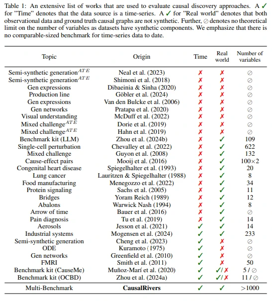{ width="560" }

*봐야 할 것은 가운데의 두 열이다. Time 열은 시계열인지, Real world 열은 관측 데이터와 정답 그래프가 모두 합성이 아닌지를 나타낸다. 두 열에 모두 초록색 표시가 있는 줄은 아래쪽의 몇 개뿐이고, 변수 수(맨 오른쪽 열)가 1,000을 넘는 것은 마지막 줄의 CausalRivers 하나다. 출처: CausalRivers 논문 Table 1.*

그 가운데 시계열이면서 실제 데이터인 것을 추리면 다음과 같다.

| 벤치마크 | 연도 | 내용 | 변수 수 |
|---|---|---|---|
| CauseMe | 2020 | 인과 발견 방법을 비교하는 온라인 벤치마크 플랫폼. 실제 데이터와 합성 데이터가 섞여 있다 | 실제 데이터 기준 5 |
| Aerosols | 2021 | 에어로졸 관련 데이터 | 14 |
| Industrial Systems | 2024 | 연구 시설의 산업용 냉각 시스템 | 233 |
| OCBD | 2024 | 벤치마크 키트. 실제 데이터와 합성 데이터가 섞여 있다 | 실제 데이터 기준 11 |
| CausalRivers | 2025 | 하천 유량 | 1,000 이상 |

같은 표에는 fMRI, 유전자 네트워크, ODE 기반 데이터처럼 시계열이지만 합성이거나 반합성인 데이터와, 단백질 신호 전달망처럼 실제 데이터이지만 시계열이 아닌 데이터도 올라 있다. 논문은 시계열 분야에 이 정도 규모의 벤치마크가 없었다는 점을 강조한다.

## 3. CausalRivers

### 데이터

CausalRivers는 하천의 유량(discharge, $m^3/s$)을 15분 간격으로 측정한 데이터다. 관측소 하나가 노드 하나다.

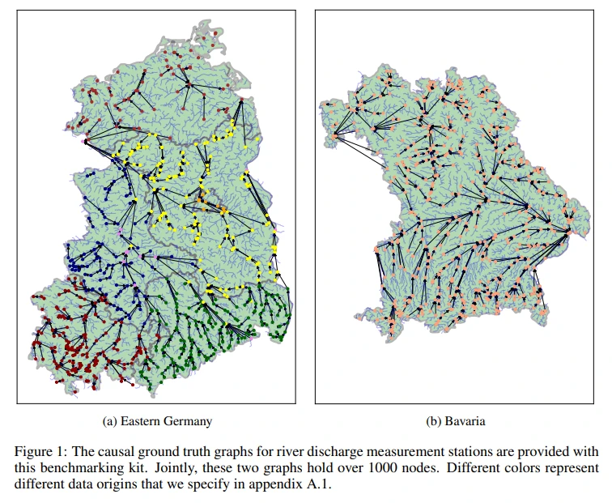

*지도 위의 점 하나가 유량 관측소, 검은 화살표 하나가 "상류 관측소에서 하류 관측소로"라는 정답 간선이다. 가는 파란 선은 하천이다. 왼쪽이 독일 동부, 오른쪽이 바이에른이고 두 그래프를 합치면 노드가 1,000개를 넘는다. 점의 색은 데이터 출처의 차이다. 출처: CausalRivers 논문 Figure 1.*

| 데이터셋 | 노드 | 간선 | 기간 | 해상도 |
|---|---|---|---|---|
| RiversEastGermany | 666 | 651 | 2019-01-01 ~ 2023-12-31 | 15분 |
| RiversBavaria | 494 | 490 | 2019-01-01 ~ 2023-12-31 | 15분 |
| RiversElbeFlood | 42 | 42 | 2024-09-09 ~ 2024-10-10 | 15분 |

- RiversEastGermany는 독일 동부, RiversBavaria는 바이에른주를 다룬다. 두 데이터셋에 각각 정답 그래프가 제공된다.
- RiversElbeFlood는 엘베강 유역에서 극심한 강수로 홍수가 난 기간의 데이터다. 평소와 분포가 다른(distribution shift) 사건으로 제공되며, 정답 그래프는 RiversEastGermany의 부분 그래프다.
- 저자들은 더 넓은 지역을 다루는 RiversEastGermany를 주된 벤치마크로 권한다.

홍수 기간의 데이터가 어떻게 생겼는지는 다음 그림에서 볼 수 있다.

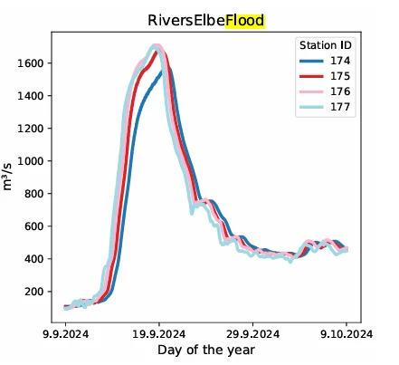{ width="420" }

*RiversElbeFlood에 들어 있는 관측소 네 곳(174 ~ 177)의 유량. 100 $m^3/s$ 남짓이던 유량이 며칠 사이에 1,600 $m^3/s$를 넘겼다가 내려온다. 네 곡선이 같은 모양으로 조금씩 어긋나 있다. 출처: CausalRivers 논문.*

### 왜 인과 관계라고 볼 수 있는가

상류의 물은 하류로 흐른다. 상류 관측소의 유량이 늘면 얼마 뒤 연결된 하류 관측소의 유량도 늘어난다. 하천이 어떻게 연결되어 있는지는 지리 정보로 알 수 있으므로, 이것이 정답 그래프가 된다. 인과 발견 방법이 유량 시계열만 보고 이 연결을 복원하는지를 평가한다.

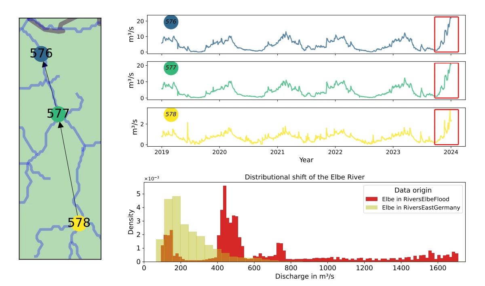

*왼쪽 지도는 정답 그래프에서 뽑은 관계 하나(578 → 577 → 576)이고, 오른쪽 위는 그 세 관측소의 5년치 유량이다. 세 곡선이 거의 같은 모양으로 오르내린다. 빨간 상자는 큰비가 온 구간이다. 오른쪽 아래는 같은 엘베강 관측소들의 유량 분포를 평소 데이터(노란색)와 홍수 데이터(빨간색)로 비교한 것이다. 출처: CausalRivers 논문 Figure 2.*

평가 사례 하나는 이 그림의 왼쪽과 오른쪽 위를 합친 것이다. 방법에게는 오른쪽의 시계열 세 줄만 주고, 왼쪽의 화살표 두 개를 맞히는지를 본다. 세 시계열의 모양이 서로 매우 비슷하다는 점을 눈여겨볼 만하다. 함께 오르내린다는 사실만으로는 화살표를 어디에, 어느 방향으로 그어야 하는지가 정해지지 않는다.

### 부분 그래프 샘플링

정답 그래프 하나에 노드가 수백 개이므로 시계열 전체에 인과 발견을 바로 적용하는 것은 현실적이지 않다. 그래서 정답 그래프에서 원하는 노드 수와 특성의 부분 그래프를 뽑는 도구가 함께 제공된다. 이렇게 하면 수천 개의 서로 다른 평가 사례가 만들어진다.

이 데이터로 평가할 수 있는 요소는 다음과 같다.

- 높은 차원
- 비선형성
- 비정상성과 계절 패턴
- 날씨를 통한 숨은 교란
- 인과 지연과 sampling 주기의 불일치
- distribution shift

### 데이터의 특성

논문이 드는 특성은 대부분 수문학에서 온다.

**지리적 현실.** 다양한 지역을 포함하므로 인과 구조, 지연, 영향의 세기가 다양하다. 관측소가 서로 가까우면 인과 관계를 가려내기 어렵고, 고도와 영향의 세기도 결과에 영향을 준다. 댐, 양수 저장 시설, 인공 운하, 조석의 영향 같은 이상 요인이 많이 들어 있어 유속, 수위, 관계의 일관성이 흔들린다.

**날씨에 의한 교란.** 강수는 교란 변수로 작용한다. 비는 관측소 하나에만 영향을 줄 수도 있고 전체에 영향을 줄 수도 있다. 넓은 지역에 큰비가 오면 연결되지 않은 관측소들의 유량도 함께 오른다. 앞의 그림(논문 Figure 2)에서 빨간 상자로 표시된 구간이 그 예로, 큰비가 온 뒤 세 관측소의 유량이 한꺼번에 치솟는다. 날씨는 인과 관계를 찾는 데 도움이 될 수도 있고 방해가 될 수도 있다.

**인과 지연.** 홍수 기간의 유량 그림에서 네 곡선이 시간 축으로 조금씩 어긋나 있던 것이 이 지연을 보여 준다. 관측소 사이의 거리, 고도, 유속이 제각각이므로 영향이 나타나는 지연이 데이터 전체에서 크게 다르다. 게다가 해마다 흐르는 물의 양이 달라 같은 두 관측소 사이의 지연도 시간에 따라 바뀐다. 많은 인과 발견 방법이 고정된 지연을 가진 정적인 구조를 가정하기 때문에, 논문은 이 점을 가장 도전적인 요소로 꼽는다.

**Sampling 주기.** sampling 주기는 인과 관계의 탐지에 직접 영향을 준다. 원본이 15분 간격이므로 여러 주기로 다시 집계해 실험할 수 있다(예: 15분에서 24시간으로).

**도메인 편향.** 인과 발견 방법은 보통 도메인 지식을 거의 쓰지 않는데, 논문은 그것이 지나치게 중립적인 태도일 수 있다고 말한다. 하천에는 쓸 만한 지식이 있다.

- 하천은 보통 하나의 종착점으로 모이므로, 한 노드가 여러 자식을 가질 가능성은 낮다(강이 갈라지는 특수한 경우 제외).
- 유량은 인과 방향을 따라 내려갈수록 줄어들 가능성이 낮다.

이런 편향은 수문학에 국한된 정보일 수 있지만, 다른 도메인에도 비슷한 종류의 편향이 있을 수 있고 활용될 수 있다.

읽으면서, 상류의 상류가 하류에 주는 영향은 중간 관측소를 거치는 일종의 간접 효과로 볼 수 있겠다는 생각이 들었다.

### 단순한 기준 방법

논문은 인과 발견 알고리즘을 쓰지 않는 단순한 기준 방법을 먼저 제시한다.

| 방법 | 내용 |
|---|---|
| CC (Cross-correlation) | 두 시계열을 서로 밀어 가며 교차상관이 최대가 되는 지연을 찾는다. $x_1$과 그보다 뒤 시점의 $x_2$ 사이에서 상관이 가장 높으면 $x_1 \to x_2$로, 반대이면 $x_1 \leftarrow x_2$로 판정한다 |
| RP (Reverse Physical) | 유량의 크기로 방향을 정한다. 큰 강이 작은 강으로 흘러 들어가는 일은 없으므로, 평균 유량이 더 큰 쪽을 하류(결과)로 본다. $x_2$의 평균이 $x_1$의 평균보다 크면 $x_1 \to x_2$다 |
| Combo | 두 방법을 결합한다. 합집합으로 간선을 구성하거나 추가 조건으로 거른다 |

Combo와 RP에는 "한 노드는 자식을 하나만 가진다"는 도메인 지식을 반영한 변형이 있다. 자식 후보 가운데 유량이 그다음으로 큰 노드를 고르는 방식(+N), 유량이 가장 큰 노드를 고르는 방식(+B), 교차상관이 가장 높은 노드를 고르는 방식(+C)이다.

### 실험 구성

비교한 인과 발견 방법은 다음과 같다.

- PCMCI (선형 조건부 독립성 검정)
- VARLiNGAM
- DYNOTEARS
- VAR (단순한 선형 Granger 방식)
- CDMI (비선형 Granger 방식의 딥러닝 방법)
- Causal Pretraining (합성 데이터에서 다변량 시계열을 인과 그래프로 바로 사상하도록 학습한 모델)

각 방법에 대해 간단한 하이퍼파라미터 탐색을 했다. 논문은 여기에 덧붙여, 설정해야 할 하이퍼파라미터가 적은 방법일수록 실제 응용에서 성공할 가능성이 높으므로 방법을 비교할 때 이 점을 고려해야 한다고 적는다. 실험으로 보인 결과가 아니라 저자들의 의견이다.

**실험 1: 그래프 구조에 따른 비교.** RiversEastGermany에서 특성이 다른 부분 그래프 집합을 뽑아, 전체 기간의 시계열로 실험한다.

| 집합 | 구성 |
|---|---|
| Random | 노드 3개 또는 5개인 부분 그래프를 모두 뽑는다. 데이터 전체를 포괄한다 |
| Close | Random 중에서 노드 사이의 거리가 가까운 것만 고른다. 가까우면 인과 효과가 더 뚜렷하다 |
| Random + 1 | 노드 2개 또는 4개인 부분 그래프에 연결되지 않은 노드 하나를 더한다. 교란을 피하려고 해안이나 경계 지역에서 뽑는다 |
| Root cause | 모든 노드의 부모가 많아야 하나인 부분 그래프, 곧 한 줄로 이어진 chain이다. 근본 원인 분석에 해당한다 |
| Confounder | 자식이 여럿인 노드를 포함한 부분 그래프를 뽑은 뒤, 그 노드를 제거한다. 숨은 교란 변수가 있는 상황이 된다 |
| Disjoint | 노드 5개인 부분 그래프 두 개를 합친다. 서로 연결되지 않도록 지리적으로 가장 먼 것끼리 고른다. 관련 없는 변수가 섞였을 때의 성능을 본다 |

집합별 표본 수는 다음과 같다.

| | Close | Root cause | Random + 1 | Random | Confounder | Disjoint |
|---|---|---|---|---|---|---|
| 노드 3 | 636 | 649 | 651 | 1,196 | 24 | |
| 노드 5 | 637 | 655 | 2,790 | 7,521 | 361 | |
| 노드 10 | | | | | | 7,519 |

가장 큰 집합은 Random-5, 가장 작은 집합은 Confounder-3이다. 결과는 다음 표와 같다.

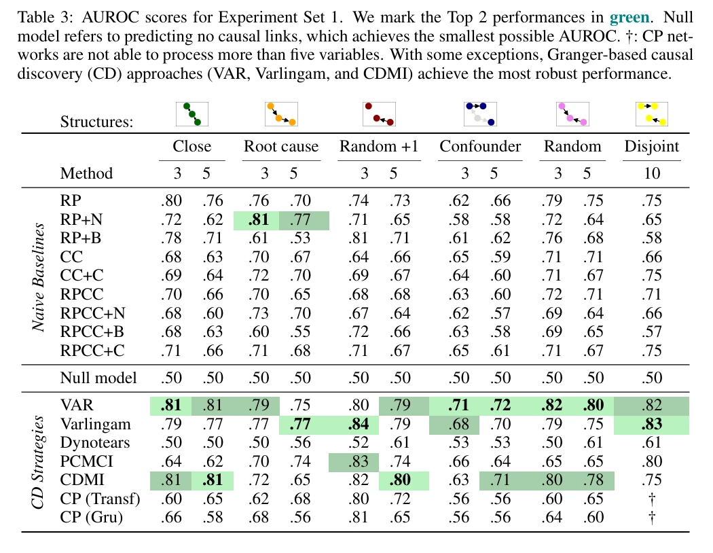

*열은 부분 그래프 집합과 노드 수(3, 5, 10), 행은 방법이다. 위쪽 묶음(Naive Baselines)이 앞 절의 단순한 기준 방법, 아래쪽 묶음(CD Strategies)이 인과 발견 방법이고, 가운데의 Null model은 간선이 없다고만 답하는 경우로 AUROC가 0.5다. 초록색 칸이 열마다 가장 좋은 두 값이다. 출처: CausalRivers 논문 Table 3.*

표에서 세 가지를 읽을 수 있다.

- 초록색 칸은 대부분 VAR, Varlingam, CDMI 세 줄에 모여 있다. 논문은 이를 두고 일부 예외를 제외하면 VAR, VARLiNGAM, CDMI 같은 Granger 계열의 방법이 가장 견고한 성능을 보였다고 요약한다.
- 인과 발견 알고리즘을 쓰지 않는 기준 방법도 만만치 않다. 유량의 크기만 보는 RP가 Close에서 0.80, 0.76을 내고, Root cause에서는 RP+N이 0.81, 0.77로 가장 좋은 두 값에 든다. Dynotears는 여러 열에서 Null model과 같은 0.50이다.
- Confounder 열은 전체적으로 낮다. 가장 좋은 VAR도 0.71, 0.72로, Random에서의 0.82, 0.80보다 떨어진다. 자식이 여럿인 노드를 지워 숨은 교란을 만든 집합에서는 가장 견고한 방법의 점수도 내려간다.

논문 부록에는 같은 실험을 F1의 최댓값으로 평가한 표가 있다.

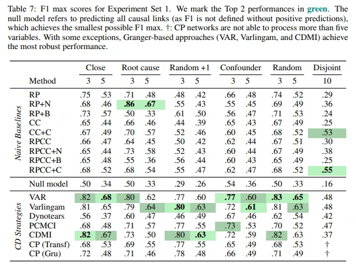{ width="640" }

*표의 짜임은 AUROC 표와 같다. 여기서의 Null model은 모든 간선이 있다고 답하는 경우다. 초록색 칸이 VAR, Varlingam, CDMI에 모이는 경향은 같다. 출처: CausalRivers 논문 Table 7.*

**실험 2: 시계열의 부분 선택.** 특정 부분 그래프를 고정하고 특정 기간의 데이터만으로 평가한다. 방법에 따라 어느 기간의 데이터를 쓰느냐에 따라 정확도가 달라진다는 것을 보인다.

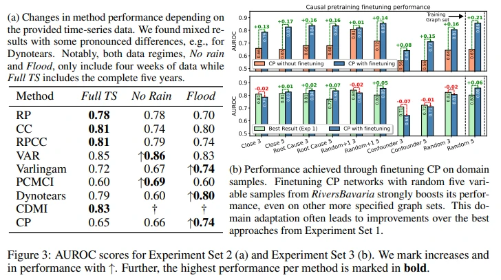

*왼쪽 표 (a)가 실험 2다. 같은 그래프를 전체 기간(Full TS), 비가 오지 않은 4주(No Rain), 홍수가 난 4주(Flood)의 데이터로 평가했다. 위쪽 화살표는 전체 기간보다 점수가 오른 경우다. 오른쪽 (b)는 Causal Pretraining 모델을 이 도메인의 데이터로 미세 조정했을 때의 변화다. 출처: CausalRivers 논문 Figure 3.*

표 (a)에서 방법마다 움직임이 다르다. VAR은 0.85에서 No Rain 0.86, Flood 0.83으로 거의 그대로인데, Dynotears는 0.79에서 No Rain 0.60으로 떨어졌다가 Flood에서 0.80이 된다. PCMCI는 No Rain에서 0.60이 0.69로 오른다. 어느 기간의 데이터를 주느냐가 방법의 순위를 바꿀 수 있다.

### 평가 지표

평가에는 AUROC와 F1 score를 쓴다.

- **AUROC.** 판정 임계값을 바꾸어 가며 true positive rate와 false positive rate의 관계를 그린 ROC 곡선의 아래 면적이다. 0.5는 무작위 추측, 1.0은 완벽한 분류다. 임계값을 고르지 않아도 되고 클래스가 불균형해도 비교적 안정적이다.
- **F1 score.** precision과 recall의 조화 평균이다.

AUROC는 모든 임계값에서의 성능이고, F1은 임계값 하나에서의 성능이다. 인과 발견 방법의 출력은 보통 확률이나 가중치 같은 연속적인 점수이므로, 이를 간선으로 바꾸려면 임계값을 정해야 한다.

논문이 스스로 밝히는 주의점이 중요하다고 생각했다. 제시한 평가 방식은 CausalRivers를 활용하는 하나의 예일 뿐이다.

- 정답이 있기는 하지만 부분 그래프가 수천 개이므로 모든 경우에 대해 하이퍼파라미터를 조정하는 것은 불가능하다.
- 실제 응용에서는 정답이 없으므로 적절한 하이퍼파라미터나 임계값을 고를 근거가 없다.
- 따라서 하이퍼파라미터에 따라 성능 차이가 큰 방법이나 임계값을 정하기 어려운 방법은, 정답을 보고 조정한 평가에서 성능이 과대평가될 수 있다.

## 4. CausalRivers의 파일 구성

공개된 저장소를 내려받아 데이터가 어떤 형태인지 확인했다. 기본적인 전처리 도구와 튜토리얼이 함께 제공된다.

**관측소 정보.** 각 노드에는 다음 속성이 있다.

| 속성 | 의미 |
|---|---|
| ID | 노드의 고유 번호 |
| R | 하천 이름 |
| X, Y | 관측소의 좌표 |
| D | 하천을 따라 잰 거리. 양수이면 하천의 끝까지, 음수이면 수원까지의 길이로 이해했다 |
| H | 고도 |
| original_id | 원래 관측소 ID |

**그래프와 시계열.**

| 파일 | 내용 |
|---|---|
| `product/rivers_east_germany.p`, `rivers_bavaria.p`, `rivers_flood.p` | 데이터셋별 전체 그래프(관측소와 연결 정보) |
| `product/rivers_ts_east_germany.csv` | 유량 시계열. 행은 15분 간격의 시각, 열은 관측소 ID이며 값은 유량($m^3/s$)이다 |
| `datasets/random_5` 등 | 실험에 쓰는 부분 그래프 집합. 각 항목이 정답 그래프 하나가 된다 |

부분 그래프는 지도 위에 그려 볼 수 있고, 제공되는 함수로 인접 행렬 형태의 정답 레이블로 바꿀 수 있다. 튜토리얼을 따라 `random_5` 집합의 부분 그래프 하나를 그려 본 결과가 아래 그림이다.

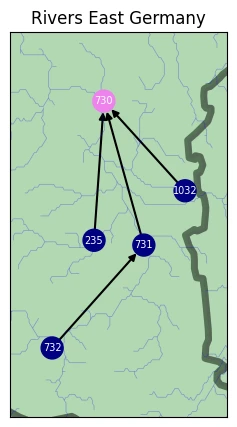{ width="260" }

*관측소 다섯 곳(235, 730, 731, 732, 1032)과 그 사이의 정답 간선 네 개. 732의 물이 731로, 731·235·1032의 물이 730으로 흘러든다.*

같은 부분 그래프를 레이블로 바꾸면 다음 행렬이 된다.

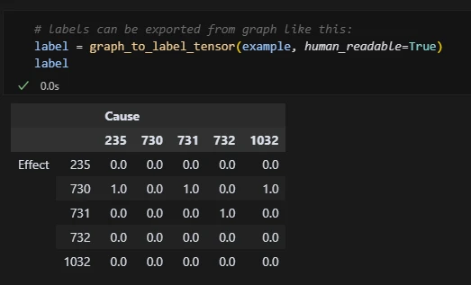{ width="460" }

*행이 결과(effect), 열이 원인(cause)이다. 730 행에는 235, 731, 1032 열에 1이 있고, 731 행에는 732 열에 1이 있다. 위 지도의 화살표 네 개와 1이 적힌 칸 네 개가 하나씩 대응한다.*

행이 결과, 열이 원인이며, 인과 관계가 있는 칸이 1이다. 지도에서 730으로 들어오는 화살표가 셋이므로 730 행에 1이 셋이고, 어디로도 들어오는 화살표가 없는 235, 732, 1032 행은 모두 0이다. 따라서 평가용 표본 하나는 (부분 그래프에 속한 관측소들의 시계열, 인접 행렬)의 쌍으로 만들 수 있다.

시계열을 열어 보니 결측값이 있었다. 논문에서도 결측값 처리, 정규화, 지연 정렬 같은 처리를 하지 않은 데이터라고 밝힌다. 제공되는 표준 전처리 도구가 이 부분을 어떻게 다루는지는 당시 확인하지 못했고, 글을 정리하면서 확인한 내용을 글 끝의 "남았던 질문과 답"에 적었다. 당시 조사한 범위는 여기까지이며, 직접 전처리를 마치지는 않았다.

## 5. Industrial Systems

"Causal discovery in a complex industrial system: A time series benchmark"는 스웨덴의 연구 시설 European Spallation Source의 산업 설비에서 수집한 데이터와, 전문가 지식으로 만든 인과 그래프를 제공한다.

### 시스템

데이터는 ACCP라는 산업용 극저온 냉각 시스템에서 나온다. 압축기, 오일 제거 및 가스 관리 장치, 열 교환기, 터빈, 흡착기 같은 하위 시스템이 냉각재의 흐름으로 연결되어 있다. 냉각재는 액체 헬륨 조로 이동해 선형 가속기의 공동(cavity)을 식힌 뒤 다시 돌아온다. 핵심은 헬륨의 순환이다.

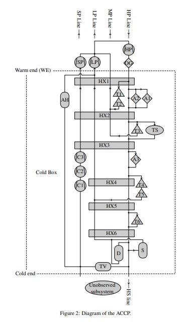{ width="380" }

*도형 하나가 하위 시스템 하나이고, 선은 화살표 방향으로 흐르는 냉각재다. 위쪽이 따뜻한 쪽(warm end), 아래쪽이 차가운 쪽(cold end)이며 가운데에 열 교환기 HX1 ~ HX6이 층층이 놓여 있다. 맨 아래의 타원이 관측되지 않은 하위 시스템이다. 출처: Industrial Systems 논문 Figure 2.*

하위 시스템의 이름과, 각각에 딸린 측정 변수의 수는 다음 표와 같다.

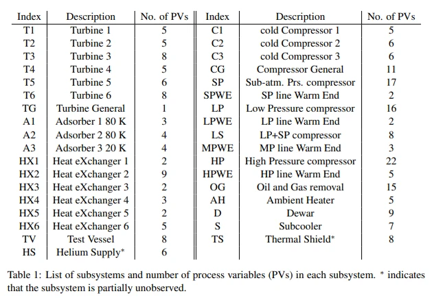{ width="600" }

*위 다이어그램의 기호(T1 ~ T6은 터빈, HX1 ~ HX6은 열 교환기, C1 ~ C3은 저온 압축기 등)를 풀어 쓴 표다. 별표가 붙은 Helium Supply와 Thermal Shield는 부분적으로만 관측된다. 출처: 같은 논문 Table 1.*

눈에 띄는 것은 관측되지 않은 부분이 명시되어 있다는 점이다.

- 액체 헬륨 조는 측정되지 않았다. 관측되지 않은 하위 시스템이 있다.
- 일부 하위 시스템은 부분적으로만 관측된다. 압력, 온도, 냉각재 유량만 측정된 경우다.
- 기능 다이어그램에는 없지만 여러 하위 시스템을 지원하는 장치들이 있다.

냉각재의 흐름을 그린 기능 다이어그램과 인과 그래프는 비슷하지만 같지 않다.

### 데이터 수집

각 하위 시스템의 상태는 여러 개의 process variable(PV)로 기술된다. 데이터는 세 기간에 걸쳐 수집되었다.

| 기간 | 시작 | 끝 |
|---|---|---|
| 1 | 2022-12-30 17:00 | 2023-01-02 08:00 |
| 2 | 2023-01-05 19:00 | 2023-01-09 09:00 |
| 3 | 2023-01-13 16:00 | 2023-01-16 06:00 |

- 한 기간 안에서는 시스템의 입력 설정이 같고, 기간 사이에는 다르다. 기간의 차이를 개입과 관련지어 볼 수 있다.
- 운영자가 실시간 감시를 원해 sampling 빈도가 높지만, 실제 값의 변화는 그보다 느리다.
- 데이터는 정제되지 않았다. 장비의 오작동으로 잘못된 값이 들어 있을 수 있으며, 정제에 대한 안내가 제공된다.

### 정답 그래프

정답 그래프는 도메인 전문가가 만들었고, 노드는 변수 하나가 아니라 하위 시스템이다. 하위 시스템 하나가 PV 여러 개의 묶음이다.

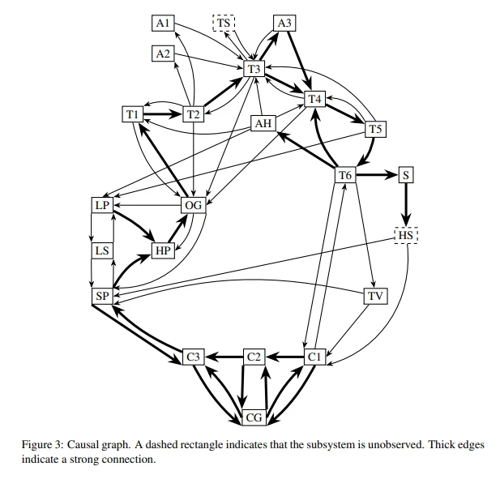{ width="560" }

*상자 하나가 하위 시스템이다. 점선 상자(TS, HS)는 관측되지 않은 하위 시스템이고, 굵은 화살표는 강한 연결이다. 아래쪽의 압축기 C1, C2, C3 각각과 CG 사이처럼 양쪽으로 화살표가 오가는 쌍도 있다. 출처: 같은 논문 Figure 3.*

앞의 기능 다이어그램은 냉각재가 흐르는 길만 그린 것이어서 이 인과 그래프와 비슷하지만 같지 않다. 하천이 한쪽으로 모여드는 CausalRivers의 정답 그래프와 비교하면 훨씬 얽혀 있다.

논문에는 하위 시스템 단위로 Granger 검정을 해 본 결과도 실려 있다.

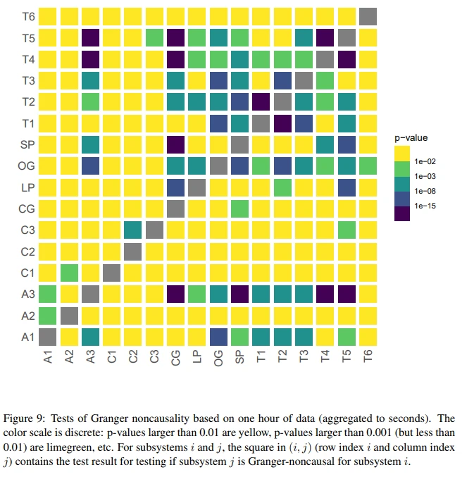{ width="560" }

*$i$행 $j$열의 칸은 "하위 시스템 $j$가 $i$를 Granger-cause하지 않는다"는 가설을 검정한 p-value다. 노란 칸은 0.01보다 큰 경우(기각하지 못함)이고, 색이 짙을수록 p-value가 작다. 한 시간 분량의 데이터를 초 단위로 집계해 검정했다. 출처: 같은 논문 Figure 9.*

하위 시스템 단위로 집계한 데이터를 썼다는 것은 그림의 설명에서 알 수 있지만, 집계의 구체적인 방법은 이 그림에 적혀 있지 않다.

변수 단위의 그래프를 주지 않은 이유를 다음과 같이 이해했다. 시스템의 상태가 매우 빠르게 변해 특정 지연에 의존하는 구조를 분명히 가려내기 어렵고, 어떤 지연 구조가 나타나더라도 실제 인과 구조가 아니라 데이터 수집 방식에서 온 것일 수 있다. PV마다 sampling 간격도 일정하지 않아 고유한 지연 구조를 정의하는 것 자체가 의미가 없다.

결국 이 벤치마크를 쓰려면 사용자가 PV들을 하위 시스템 단위로 집계하는 과정을 직접 설계해야 한다. 안내가 제공되기는 하지만 CausalRivers보다 준비 과정이 복잡하다.

## 6. 두 벤치마크의 비교

| | CausalRivers | Industrial Systems |
|---|---|---|
| 도메인 | 하천 유량 | 극저온 냉각 설비 |
| 정답의 근거 | 하천의 지리적 연결 | 도메인 전문가의 지식 |
| 노드 | 관측소 (변수 하나) | 하위 시스템 (변수 묶음) |
| 규모 | 노드 1,000개 이상, 부분 그래프 샘플링 | 변수 233개 |
| 숨은 교란 | 날씨 | 측정되지 않은 하위 시스템 |
| sampling | 15분 간격으로 일정 | 변수마다 간격이 다름 |
| 준비 | 표준 전처리 도구와 튜토리얼 제공 | 집계와 정제를 직접 설계 |

## 남았던 질문과 답

공부할 당시에는 풀지 못하고 남겨 둔 질문들이다. 글을 정리하면서 답을 찾아 덧붙였다.

**Q. CausalRivers의 결측값을 표준 전처리 도구가 어떻게 처리하는가.**

공개 저장소의 전처리 함수를 읽어 확인했다(2026년 11월의 저장소 기준). 처리 순서는 다음과 같다. 먼저 시각을 지정한 해상도로 반올림해 묶고 평균을 낸다. 평균은 결측이 아닌 값만으로 계산되므로, 한 구간 안에서 일부만 빠진 결측은 여기서 흡수된다. 다음으로 옵션에 따라 시계열별 최솟값과 최댓값으로 0과 1 사이에 맞춘다. 그 뒤에도 남은 결측은 pandas의 `interpolate()`로 채우며, 기본 동작은 앞뒤 값 사이의 선형 보간이다. 마지막으로 평가 표본을 만들 때, 부분 그래프에 속한 시계열 가운데 하나라도 결측인 행을 시계열의 앞쪽과 뒤쪽에서 잘라 낸다. 기본 설정은 해상도 6시간, 보간 사용이다. 논문에 따르면 시계열별 결측 비율은 RiversEastGermany에서 평균 약 8%, RiversBavaria에서 약 1%다.

**Q. 여러 부분 그래프 집합 가운데 무엇을 써야 하는가.**

무엇을 평가하려는가에 따라 정해진다. 전체적인 성능은 Random, 인과 효과가 뚜렷한 조건은 Close, chain 구조는 Root cause, 관련 없는 변수에 간선을 잘못 긋는지는 Random + 1과 Disjoint, 인과 충분성이 깨진 상황은 Confounder로 본다. 숨은 교란을 보려면 Confounder 집합이 맞지만, 노드 3개짜리는 표본이 24개뿐이어서 표본 하나의 AUROC가 평균을 최대 약 0.04까지 움직인다. 표본이 361개인 노드 5개짜리를 주된 근거로 삼고, 3개짜리는 보조로 보는 편이 안전하다. 참고로 논문이 기존 방법 가운데 가장 믿을 만하다고 평가한 VAR의 AUROC는 Random에서 0.82(노드 3개), 0.80(노드 5개)이고 Confounder에서는 0.71, 0.72다.

**Q. sampling 주기를 15분에서 하루 단위로 바꾸면, 지연을 두고 나타나던 관계가 같은 시점의 관계로 나타나는가.**

그렇다. 상류의 물이 하류 관측소에 닿는 데 걸리는 시간이 집계 구간보다 짧으면 원인과 결과가 같은 구간 안에 들어간다. 도달 시간이 6시간인 두 관측소를 하루 평균으로 집계하면, 상류에서 생긴 변화의 대부분이 같은 날 하류에 나타나 지연 0의 관계가 된다. 이 경우 지연된 관계만 모델링하는 방법(Granger 계열, PCMCI)은 관계의 주된 부분을 표현하지 못하고, 동시점 간선을 허용하는 방법(PCMCI+, VARLiNGAM, DYNOTEARS)이 필요해진다. 논문은 15분, 1시간, 6시간, 12시간, 24시간의 해상도를 하이퍼파라미터의 하나로 탐색하고, 가장 좋은 조합의 결과를 보고한다.

### 아직 남은 질문

- 결측 구간을 선형 보간으로 채우는 처리가 인과 지연의 추정에 실제로 얼마나 영향을 주는지는 알지 못한다. 결측이 많은 관측소를 넣은 경우와 뺀 경우의 결과를 비교해 보아야 한다.
- 홍수 기간의 데이터에서 동시점 관계나 feedback이 어떻게 나타나는지는 확인하지 못했다. RiversElbeFlood를 여러 해상도로 집계해 직접 보아야 한다.
- Industrial Systems에서 변수를 하위 시스템 단위로 집계하는 방식에 따라 결과가 얼마나 달라지는지는 알지 못한다. 논문은 데이터를 줄이는 처리가 인과 발견을 어렵게 만들 수 있다고 언급하고 전처리 방식의 비교를 이 벤치마크로 해 볼 수 있는 일로 남겨 둔다.

## 참고 자료

- "CausalRivers: Scaling up benchmarking of causal discovery for real-world time-series", 2025. <https://arxiv.org/abs/2503.17452>
- "Causal discovery in a complex industrial system: A time series benchmark", 2024. <https://proceedings.mlr.press/v236/mogensen24a.html>
- "CauseMe: An online system for benchmarking causal discovery methods", 2020.
- "DeepLearning Based Causal Inference: A Feasibility Study Based on Three Years of Tectonic-Climate Data From Moxa Geodynamic Observatory" (CDMI).
- "Embracing the black box: Heading towards foundation models for causal discovery from time series data" (Causal Pretraining).
- CausalRivers 공개 저장소(전처리 함수와 튜토리얼). <https://github.com/causalrivers/causalrivers>
