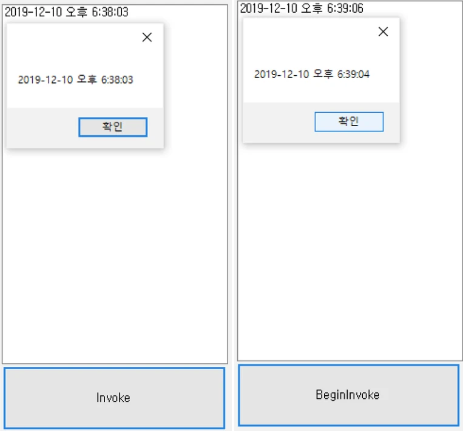
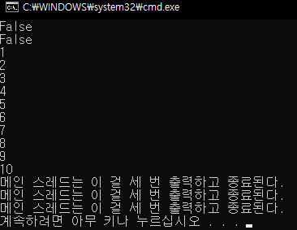
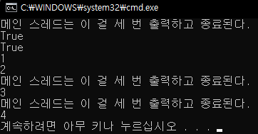
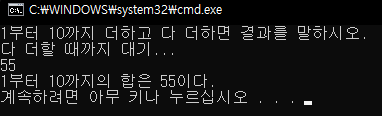
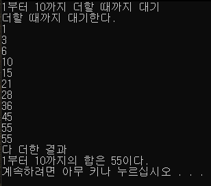

# Invoke와 BeginInvoke

작성일 2022-12-20 · 최종 수정일 2023-01-25
{ .post-date }

## BeginInvoke

멀티스레드 프로그래밍을 하는 데 있어서 중요한 부분이 UI를 접근하는 문제이다. 간단하게는 텍스트를 변경하는 것에서부터 Form.Show(), WebBrowser.Navigate() 같은 부분도 UI를 접근하는 문제라고 할 수 있다. 이런 부분을 메인 스레드가 아닌 부분에서 사용하게 되면 문제가 될 수 있기 때문에(왜냐면, UI 작업은 굉장히 overhead가 커서 성능이 가장 좋은 main thread에서 진행하지 않으면 오랜 작업시간이 소요될 수 있다.) 디버깅 모드에서는 바로바로 예외가 발생한다. 이러한 문제를 해결하기 위해 Control(Form에 있는 partial class)은 Invoke와 BeginInvoke 메서드, 그리고 InvokeRequired 속성을 가진다. 이 메서드들은 이 Control들이 생성된 스레드에게 해당 코드를 전달해주는 역할을 하게 된다.

```csharp
webBrowser.Invoke(new Action(() => {
	webBrowser.Navigate("https://www.naver.com");
}));
```

⇒ 즉, 위 스니펫은 webBrowser.Navigate 메서드를 실행하는 스레드는 Invoke 메서드를 실행한 스레드가 아니라, webBrowser를 생성한 스레드가 되는 것이다.

그렇다면, Invoke와 BeginInvoke의 차이점은 무엇인가?  
Invoke의 경우, 컨트롤을 생성한 스레드에서 동기식으로 실행하고, BeginInvoke는 비동기식으로 실행한다.

```csharp
private void button1_Click(object sender, EventArgs e)
{
	Thread thread = new Thread(
	delegate(object obj)
	{
		Thread.Sleep(1000);
		textBox1.Invoke(new Action(() =>
		{
			textBox1.Text = DateTime.Now.ToString();
		}));
		MessageBox.Show(DateTime.Now.ToString());
	});
	thread.Start();

	Thread.Sleep(3000);
}
```

Invoke의 경우, 동기식으로 실행되기 때문에 생성 스레드의 Thread.Sleep(3000) 3초를 대기 후, MessageBox가 Show되어 메시지 박스의 시간과 TextBox의 시간이 동일하다.

```csharp
private void button2_Click(object sender, EventArgs e)
{
	Thread thread = new Thread(
	delegate(object obj)
	{
		Thread.Sleep(1000);
		textBox1.BeginInvoke(new Action(() =>
		{
			textBox1.Text = DateTime.Now.ToString();
		}));
		MessageBox.Show(DateTime.Now.ToString());
	});
	thread.Start();

	Thread.Sleep(3000);
}
```

하지만, BeginInvoke의 경우에는 BeginInvoke 함수가 바로 반환되어 (Asynchronously) 메시지 박스를 띄우고, 생성 스레드의 Thread.Sleep(3000) 3초를 대기 후, 텍스트 박스가 갱신되어 메시지 박스와 텍스트 박스 사이의 시간 차가 발생된다.



BeginInvoke : Executes the specified delegate asynchronously on the thread that the control’s underlying handler was created on.

⇒ 즉, delegate로 설정해놓은 method를 새로운 thread에서 asynchronous하게 실행한다는 뜻.

## BeginInvoke 예제 1

[https://frozenpond.tistory.com/26](https://frozenpond.tistory.com/26)

```csharp
using System;
using System.Threading;
using System.Collections.Generic;
using System.Linq;
using System.Text;
using System.Threading.Tasks;

namespace ConsoleApp2
{
    delegate void myDelegate();
    internal class Program
    {
        static void Main(string[] args)
        {
            myDelegate a = Func;

            // delegate a를 호출하는 방법 세 가지
            // a(); => 메서드를 호출한다.
            // a.Invoke(); => 메서드를 동기적으로 호출한다.
            // a.BeginInvoke(null, null) => 메서드를 비동기적으로 호출한다.

            // 현재 코드 상에서는 1, 2번의 기능이 동일하다.
            // 3번의 기능만 다르다.
            a.BeginInvoke(null, null);

            for (int i = 0; i < 3; i++)
            {
                Console.WriteLine("메인 스레드는 이 걸 세 번 출력하고 종료된다.");
                Thread.Sleep(100);
            }
        }

        private static void Func()
        {
            Console.WriteLine(Thread.CurrentThread.IsBackground);
            Console.WriteLine(Thread.CurrentThread.IsThreadPoolThread);

            for (int i = 0; i < 10; i++)
            {
                Console.WriteLine(i + 1);
                Thread.Sleep(100);
            }
        }
    }
}
```

위 예제에서 1, 2번의 delegate a 호출 방식은 동일한 결과를 불러온다. (동기식, Synchronous) 하지만 3번은 비동기적으로 호출하기 때문에, 결과가 다르다.



동기식(a(), a.Invoke())



비동기식(a.BeginInvoke())

BeginInvoke를 이용하면, 마치 새로운 스레드를 생성해서 두 개의 로직을 실행한 것과 비슷한 결과가 나온다. BeginInvoke를 실행했을 때 결과가 다 출력되지 않고 종료된 것은, 메인 스레드의 실행이 먼저 종료되기 때문이다. 그리고, Func 메서드를 보면 백그라운드 스레드인지, 스레드풀스레드인지 불 형식으로 출력하는 코드도 존재한다.

```csharp
Console.WriteLine(Thread.CurrentThread.IsBackground);
Console.WriteLine(Thread.CurrentThread.IsThreadPoolThread);
```

⇒ BeginInvoke의 경우, 결과는 True이다. 결과적으로, BeginInvoke 키워드를 사용하면 어떠한 작업을 백그라운드 스레드로 돌리며, 스레드풀에 들어가서 실행된다는 걸 확인할 수 있다.

---

- `스레드풀`이란?

풀이란 재사용이 가능한 자원을 빠르게 할당하고자 미리 준비한 공간이다.

`스레드풀`이란, 스레드의 생성, 소멸에 드는 자원을 최소화하기 위해 미리 준비된 공간이다. 결과적으로 비동기 처리를 하는 것은 스레드를 만들어서 처리하는 것과 비슷하지만 생성, 소멸의 비용이 최소화됐다는 차이점이 있다. 보통 `데이터 폴링`처럼 `while 루프`를 통해 계속 실행해야 하는 로직이나 성능적으로 주요한 로직은 직접 스레드를 할당하여 사용하고, 그 외의 비동기로 처리해야할 작업들은 스레드풀에서 실행하는 경우가 많다. (디스크 I/O, 파일 I/O 등등…) 스레드풀의 스레드는 일반 스레드보다 우선순위가 낮으며, 스레드풀에서 처리해야 할 작업이 많으면 성능 및 안정성이 보장되지 않는다는 특징이 있으니, `데이터 폴링`같은 작업은 일반 스레드를 만들어서 하는게 좋다.  

## BeginInvoke 예제 2

[https://frozenpond.tistory.com/34](https://frozenpond.tistory.com/34)

비동기작업(BeginInvoke)은 스레드를 직접 생성하는 것과는 다르게 `스레드풀` 에서 돌아간다는 차이가 있긴 하지만, 1번 예제의 작업은 스레드를 하나 더 만들어서 하는 것과 큰 차이점을 찾을 수 없었다. 이번 예제에서는 스레드의 작업과 비동기 작업의 차이점에 대해 살펴본다.

`비동기`와 `스레드` 모두 여러 개의 작업을 할 수 있지만, 비동기 작업은 스레드와 다르게 리턴값을 받아올 수 있으며, 콜백이라는 구문이 존재한다.

```csharp
using System;
using System.Collections.Generic;
using System.Linq;
using System.Text;
using System.Threading.Tasks;
using System.Threading;

namespace ConsoleApp2
{
    delegate int myDelegate(int n);
    internal class BeginInvokeTest2
    {
        static void Main(string[] args)
        {
            myDelegate a = Func;
            int cnt = 10;
            Console.WriteLine("1부터 {0}까지 더하고 다 더하면 결과를 말하시오.", cnt);

            // 첫 번째 매개변수는 비동기 작업에 전달하는 매개변수이다.
            IAsyncResult ar = a.BeginInvoke(cnt, null, null);

            // EndInvoke를 사용하면 비동기 구문의 리턴값을 받아올 수 있다.
            // 리턴값을 받으려면 당연히 메인스레드는 해당 비동기 작업이 끝날 때까지 블락된다.
            Console.WriteLine("다 더할 때까지 대기...");
            int result = a.EndInvoke(ar);

            Console.WriteLine("1부터 {0}까지의 합은 {1}이다.", cnt, result);
        }

        private static int Func(int n)
        {
            int sum = 0;

            for (int i = 1; i <= n; i++)
            {
                sum += i;
                Thread.Sleep(100);
            }

            Console.WriteLine(sum);
            return sum;
        }
    }
}
```



비동기 작업을 실행할 때 좌항에 들어가는 값은 IAsyncResult 타입이다. EndInvoke를 사용해야 비동기 리턴값을 받아올 수 있다. 즉, 리턴값이 나오려면 비동기 작업이 끝나야하므로 비동기 작업을 호출했던 스레드는 (위 예제에서는) 1초 동안 아래 구문에서 블락된다.

int result = a.EndInvoke(ar);

정상적인 방법은 WaitOne을 사용하는 것이지만, EndInvoke을 사용해서 결과가 나올 때까지 기다리게 해서 블락을 시킬 수도 있다.

## BeginInvoke 예제 3

[https://frozenpond.tistory.com/35](https://frozenpond.tistory.com/35)

이번 예제에서는 비동기 작업의 콜백에 대해 알아본다. `콜백`이란, 피호출자가 호출자의 메서드를 실행해주는 것을 말하며 BeginInvoke에서의 콜백 메서드는 비동기작업이 끝난 직후 실행된다. (보통 비동기 작업은 외부에서 끝내주는 경우가 많아 콜백이라고 한다.) 즉, 비동기 호출을 한 스레드는 비동기의 일이 진행이 되던 말던 다음 줄을 실행하게 되는데, 작업이 끝났다는 걸 콜백 메서드를 통해 보고 받고 원하는 로직을 실행한다고 생각하면 된다. 비동기 호출을 한 스레드를 블락시키거나, 스레드를 하나 더 만들고 변수를 폴링시켜서 비슷한 동작을 할 수는 있으나, 콜백은 비동기 호출을 실행한 스레드가 살아있던, 죽어있던 호출되어서 호출한 스레드를 따로 블락시킬 필요가 없으며, 비동기 호출의 IAsyncResult 및 매개 변수를 받아와 작업을 할 수 있는 등, 장점이 많다.

```csharp
using System;
using System.Collections.Generic;
using System.Linq;
using System.Text;
using System.Threading.Tasks;
using System.Threading;
using System.Runtime.Remoting.Messaging;

namespace ConsoleApp2
{
    delegate int myDelegate(int n);
    class BeginInvokeTest3
    {
        static void Main(string[] args)
        {
            myDelegate a = Func;
            int cnt = 10;
            Console.WriteLine("1부터 {0}까지 더할 때까지 대기", cnt);

            // 첫 번째 매개변수는 비동기 작업에 전달하는 매개 변수
            // 두 번째 매개변수는 콜백 메서드
            // 세 번째 매개변수는 콜백메서드에 전달할 object 형식의 매개변수이며
            // 콜백 메서드에서는 ar.AsyncState로 받아올 수 있다.
            IAsyncResult ar = a.BeginInvoke(cnt, new AsyncCallback(myCallback), cnt);
            // 즉, delegate a에 지정된 메서드를 실행하는데, 이 곳에 인자 cnt(첫 번째 매개변수)를 전달.
            // 동작이 끝나면 return 값인 sum이 전달되는데, 이를 EndInvoke를 사용하여 메인으로 가져올 수 있다.
            // 하지만, 이번 예제에서는 callback으로 지정한 메서드에서 받아준다.

            // BeginInvoke의 callback method는 인자로 IAsyncResult 변수를 전달받는다.

            Console.WriteLine("더할 때까지 대기한다.");

            // 이번 예제에서는 리턴값을 호출한 스레드에서 받아오지 않으므로,
            // WaitOne을 사용하여 메인 스레드를 블락시켜주어야 한다.
            // 리턴값이 있다면 EndInvoke를 통해 리턴값이 나올 때까지 블락시킬 수도 있지만
            // msdn에서는 리턴값이 있던 없던
            // AsyncWaitHandle.WaitOne()을 사용하여 블락시킬 것을 권장한다.
            ar.AsyncWaitHandle.WaitOne();

            Console.WriteLine("다 더한 결과");

            // 콜백 메서드가 실행될 수 있도록 1초를 기다린다.
            Thread.Sleep(1000);
        }

        private static void myCallback(IAsyncResult ar)
        {
            // EndInvoke를 사용하면 비동기 구문의 리턴값을 받아올 수 있다.
            // 이와 같은 방식을 사용하여 비동기 호출된 delegate 개체를 가져올 수 있음.
            myDelegate temp = ((AsyncResult)ar).AsyncDelegate as myDelegate;
            int result = temp.EndInvoke(ar);
            Console.WriteLine("1부터 {0}까지의 합은 {1}이다.", ar.AsyncState, result);
        }

        private static int Func(int n)
        {
            int sum = 0;
            for (int i = 1; i <= n; i++)
            {
                sum += i;
                Console.WriteLine(sum);
                Thread.Sleep(100);
            }
            Console.WriteLine(sum);
            return sum;
        }
    }
}
```



- 주의사항

1. EndInvoke는 한 번만 호출 할 수 있다.

    콜백 메서드에서 리턴값을 받아올 지, 비동기 작업을 호출한 스레드에서 리턴값을 받아올 지 한 가지를 정해서 로직을 짜야한다. 양쪽에서 다 호출하면 컴파일 에러가 발생한다.

2. ‘다 더한 결과’가 출력되는 시점을 잘 확인해야 한다.

    해당 문자열의 출력 시점은 콜백 메서드의 종료가 아닌, 비동기 작업의 종료 시점이다. 즉, waitOne에서의 블락이 풀리는 시점은 콜백 메서드가 종료되는 시점이 아닌, 비동기 작업이 종료되는 시점이다.

## BeginInvoke 예제 4

```csharp
using System;
using System.Collections.Generic;
using System.Linq;
using System.Text;
using System.Threading.Tasks;
using System.Threading;

namespace ConsoleApp2
{
    public delegate int myDel(int n);
    internal class CallbackEx
    {
        static void Main(string[] args)
        {
            Boss boss = new Boss();
            boss.Run();
        }

    }
    class Boss
    {
        public void Run()
        {
            int goldCnt = 10;
            Console.WriteLine("보스 : {0}개의 금을 캐오세요.", goldCnt);
            myDel myWork = MyFunc;

            // 첫 번째 매개변수는 delegate 메서드의 매개변수, 두 번째 매개변수는 콜백 메서드
            // 세 번째 매개변수는 콜백 메서드에 들어갈 object 형식의 argument이다.
            // 지금은 예제를 위해 단순히 문자열을 넘겨주지만,
            // 다양한 매개변수를 넘겨줄 수 있고, 클래스의 객체를 넘겨줄 수도 있다.
            IAsyncResult myResult = myWork.BeginInvoke(goldCnt, new AsyncCallback(myCallback), "이제 좀만 쉴게요.");

            // BeginInvoke의 리턴값은 IAsyncResult 타입.
            // IAsyncResult 타입에서 IsCompleted는 비동기 작업이 끝났는지에 대한 bool을 반환한다.
            // 외부에서 해당 비동기 작업이 끝났는지 확인하는 IsCompleted 존재.
            // 해당 구문처럼 while 안에 넣어서 메인 스레드 진행을 강제로 대기시킬 수도 있음. (polling은 좋은 방식은 아니다.)
            while (!myResult.IsCompleted)
            {
                Console.WriteLine("보스 : 커피 마시는 중...");
                Thread.Sleep(1000);
            }

            // 아래 구문은 정상적으로 블락시키는 방법.
            // 위의 while이 없다면, 해당 스레드는 비동기 구문이 끝날 때까지 여기서 대기한다.
            // msdn에서 권장하는 블락 방법. while로 직접 polling 하는 것은 좋은 방법은 아니다.
            myResult.AsyncWaitHandle.WaitOne();
            int goldResult = myWork.EndInvoke(myResult);

            Console.WriteLine("{0}개의 금을 다 캤구나!", goldResult);

            // 비동기 작업이 끝나고 리턴값을 받으면 아래의 포문이 돌아간다.
            // 콜백 메서드가 끝나는 시점이 아니며, 비동기 작업이 끝나면 실행된다.
            // 즉, 콜백 메서드와는 별도로 돌아가게 되는 부분이다.
            // 콜백 메서드는 스레드풀에 의해서 다른 스레드로 동작한다.
            for (int i = 0; i < 5; i++)
            {
                Console.WriteLine("보스 : 다 캔 것 같은데, 뭐하고 있니?");
                Thread.Sleep(1000);
            }
        }

        // callback method.
        private void myCallback(IAsyncResult ar)
        {
            Thread.Sleep(1000);
            // 비동기 작업이 끝나면 실행되는 콜백 메서드이다.
            // 메인문은 비동기 작업이 끝나는 순간 WaitOne과 EndInvoke의 블락을 풀어버리며 실행된다.
            // 콜백 메서드가 끝날때까지 메인문이 블락되지 않는다.

            // 맨 처음 비동기작업을 지시할 때 넘겨준 객체는 아래의 방법으로 제어한다.
            // 이번 예제는 간단한 문자열인 "이제 좀만 쉴게요."를 넘긴다.
            Console.WriteLine("작업자 : {0}", ar.AsyncState);

            for (int i = 0; i < 10; i++)
            {
                Console.WriteLine("작업자 : 쉬는 중입니다...");
                Thread.Sleep(300);
            }
        }

        // MyFunc에 goldCnt 전달. 현재 goldCnt는 10이다.
        public int MyFunc(int n)
        {
            int sum = 0;

            for (int i = 0; i < n; i++)
            {
                Console.WriteLine("작업자 : {0}개의 금을 캤습니다.", i + 1);
                sum++;
                Thread.Sleep(300);
            }

            return sum;
        }
    }
}
```

실제 콜백은 보통 외부시스템에서 지시한 작업(소켓읽기 작업 등)이 끝난 순간 실행되는 경우가 많다. 또한 비동기 작업에는 리턴값과 매개변수의 갯수를 미리 지정해서 delegate와 캡슐화 시켜놓은 `Action`과 `Func`키워드가 있다.  delegate의 매개변수를 명시적으로 확인하지 않아도 된다면 사용하는 것도 좋다.

## WndProc

WndProc은 Form 클래스 내에 포함되어 있는 API이다. 따라서, Form class 내부에서 override해서 구현하면 된다.

C#을 사용하게 된다면 MVC를 통해서 웹 환경을 만드는 경우도 있으나 보통 Window 폼이나 콘솔 배치를 만드는 일이 많다. 이 경우, 윈도우 메시지를 처리하는 함수가 WndProc이다.

[https://learn.microsoft.com/ko-kr/windows-hardware/drivers/kernel/processing-wm_devicechange-messages](https://learn.microsoft.com/ko-kr/windows-hardware/drivers/kernel/processing-wm_devicechange-messages)

Win32 기반 애플리케이션은 Window Procedure를 구현하여 애플리케이션 창으로 전송되는 메시지를 처리할 수 있다.

## static

- static이란? : 변수나 메서드에 키워드로 사용된다. static 키워드를 사용한 변수는 클래스가 메모리에 올라갈 때 자동으로 생성된다. 스태틱 변수는 객체를 선언만 해도 메모리가 할당되며, 일반적인 변수들이 객체가 새로 생성될 때 메모리가 초기화 되는 것과 다르게 해당 객체를 계속 반복적으로 생성해도 메모리가 유지된다는 특징이 있다. 인스턴스(객체)의 생성 없이도 바로 사용 가능하며, 객체를 생성하지 않아도 되니까 편리하고 속도도 빠르다.

- static의 사용 이유? : 자주 변하지 않는 일정한 값(정적인 값) 혹은 설정(configuration) 정보 같은 공용 자원에 대한 접근에 있어서 매번 메모리에 로딩, 혹은 값을 읽어들이는 것보다 일종의 ‘전역 변수’와 같은 개념을 통해서 접근하는 것이다. 인스턴스 생성 없이 사용 가능하기 때문에 프로그램 내에서 공통으로 사용되는 데이터들을 관리할 때 사용한다. 클래스의 일반 멤버 변수는 클래스의 객체가 생성될 때, 각 객체마다 따로 생기지만, 정적 변수는 해당 클래스가 처음으로 사용되는 때에 한 번만 초기화되어 계속 동일한 메모리를 사용하게 된다.

- static (정적) 메서드 : 정적 메서드는 인스턴스 메서드와는 달리 클래스로부터 객체를 생성하지 않고 직접 [클래스명, 메서드명] 형식으로 호출하는 메서드이다. 메서드 앞에 static C# 키워드를 적어주며, 메서드 내부에 클래스의 인스턴스 객체 멤버를 참조해서는 안된다. static 메서드는 인스턴스 객체로부터 호출될 수 없으며, 반드시 클래스명과 함께 사용된다.

## Control

시각적으로 표시되는 구성 요소인 컨트롤의 기본 클래스를 정의한다.
