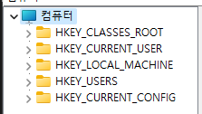
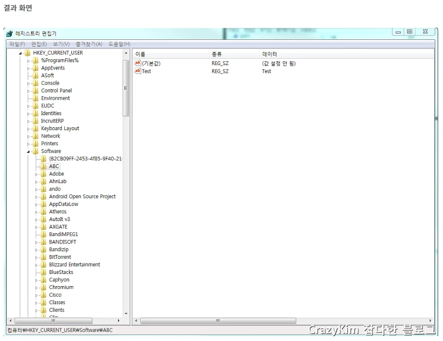
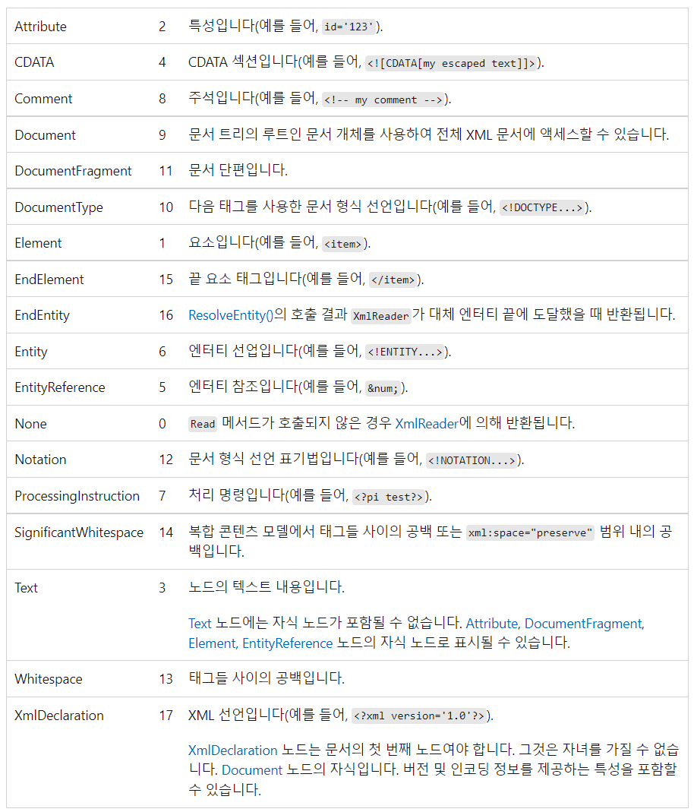

# 레지스트리 API

작성일 2023-01-17 · 최종 수정일 2023-01-22
{ .post-date }

## Registry에 대하여

Registry란?

윈도우 레지스트리는 마이크로소프트 윈도우 32/64비트 버전과 윈도우 모바일 운영체제의 설정과 선택 항목을 담고 있는 데이터베이스로, 모든 하드웨어, 운영체제, 운영체제 소프트웨어, 대부분의 비운영체제 소프트웨어, 사용자 PC 선호도 등에 대한 정보와 설정이 들어있다. 사용자가 제어판 설정, 파일 연결, 시스템 정책 또는 설치된 소프트웨어를 변경하면 이에 따른 변경 사항들이 레지스트리에 반영되어 저장된다. 레지스트리는 또한 성능 카운터와 현재 사용하고 있는 하드웨어와 같은 런타임 정보를 노출하면서 윈도우를 커널의 운영체제 안에 제공한다.

(간단하게 말하자면, GUI에서의 시스템에 대한 정보를 저장하는 곳)

## 메서드

- CreateSubKey

레지스트리의 폴더를 만드는 기능이다. RegistryKey를 사용하면, 레지스트리 변수를 선언할 수 있다. 레지스트리 변수 reg를 선언하고, 먼저 레지스트리의 HKEY 값을 선택해야 한다. 

(HKEY_폴더란, 윈도우의 기본이 되는 정보들을 구분해 놓은 폴더를 생각하면 된다.)



레지스트리 편집기에 들어가면 이와 같이 HKEY_폴더가 구분되어 있는 것을 확인할 수 있다.

CreateSubKey(”Software”).CreateSubKey(”ABC”)를 하면 폴더가 생성된다.

```csharp
RegistryKey reg;
reg = Registry.CurrentUser.CreateSubKey("Software").CreateSubKey("ABC");
```

---

- OpenSubKey

레지스트리의 폴더에 접근하는 방법이다. CreateSubKey로 하위 폴더로 접근하고 최종 접근하려는 폴더에서 OpenSubKey를 사용하면 된다.

```csharp
RegistryKey reg;
reg = Registry.CurrentUser.CreateSubKey("Software").OpenSubKey("ando");
this.edtOpen.Text = reg.ToString();
```


- OpenSubKey method Signature

```csharp
RegistryKey RegistryKey.OpenSubKey(string name, bool writable)
```

writable true 설정에 따라서 CreateSubKey 등이 가능한 것으로 보인다.

---

- DeleteSubKey

레지스트리의 폴더를 삭제하는 방법이다. 위와 마찬가지로 CreateSubKey로 폴더에 접근한 후, DeleteSubKey를 사용하여 원하는 폴더를 삭제한다. 이렇게 하면 위에서 생성한 ABC폴더가 삭제된다.

```csharp
Registry.CurrentUser.CreateSubKey("Software").DeleteSubKey("ABC");
```

---

- SetValue

이전까지는 레지스트리 폴더를 생성하는 방법에 대해서 알아보았다. 이번에는 레지스트리의 값을 추가하는 방법에 대해서 알아본다. SetValue를 사용하여 레지스트리에 값을 추가할 수 있다. SetValue시, 레지스트리가 없다면 생성하고 있다면 값을 수정한다.

먼저 Registry.CurrentUser.CreateSubKey(”Software”).CreateSubKey(”ABC”)를 사용하여 경로를 지정한다. 아래와 같이 쓰면 HKEY_CURRENT_USER\\Software\\ABC\\Test 레지스트리가 생성된 것을 확인할 수 있다.

```csharp
RegistryKey reg;
reg = Registry.CurrentUser.CreateSubKey("Software").CreateSubKey("ABC");

reg.SetValue("Test", this.edtWrite.Text);
```



- 추가 사항

SetValue는 Object 형태로 값을 입력한다.

SetValue의 세 번째 인자에 데이터 타입을 넣어주면 데이터를 변경하여 입력하게 된다. 주로 레지스트리는 바이너리로 저장되어 바이너리 형태가 많다.

| 멤버 이름 | 설명 |
|---|---|
| String | 문자열(REG_SZ) |
| ExpandString | 확장 문자열(REG_EXPAND_SZ) |
| Binary | 이진 데이터(REG_BINARY) |
| DWord | 32비트 이진수(REG_DWORD) |
| MultiString | 문자열 배열(REG_MULTI_SZ) |
| QWord | 64비트 이진수(REG_QWORD) |
| Unknown | 윈도우에서 기본적으로 지원하지 않는 레지스트리 데이터 형식(REG_RESOURCE_LIST) |

- 사용 방법

```csharp
reg.SetValue("Test", this.edtWrite.Text, RegistryValueKind.String);
```

---

- GetValue

레지스트리 안의 값을 보여준다. GetValue는 레지스트리가 아니더라도 값을 가져오는 메서드로 많이 사용된다.

먼저, Registry.CurrentUser.CreateSubKey(”Software”).CreateSubKey(”ABC”)를 사용하여 경로를 지정한다. 아래와 같이 사용하면 “Test” 레지스트리 안의 값을 보여준다. 두 번째 인자에 값을 넣으면 “Test” 레지스트리가 null인 경우 그 데이터를 보여준다. 아래와 같이 적으면 “Test” 레지스트리에 데이터가 없다면 “값이 없습니다”를 출력한다.

```csharp
RegistryKey reg;
reg = Registry.CurrentUser.CreateSubKey("Software").CreateSubKey("ABC");
this.edtRead.Text = reg.GetValue("Test", "값이 없습니다").ToString();
```

---

- DeleteValue

레지스트리 값을 삭제하는 방법이다.

먼저 Registry.CurrentUser.CreateSubKey(”Software”).CreateSubKey(”ABC”)를 사용하여 경로를 지정한다. 아래와 같이 reg.DeleteValue(레지스트리)를 통해 삭제하면 된다. 중간에 if문을 한 이유는, 만약 null인 경우 에러가 발생하여 레지스트리가 존재하는지를 체크해주어야 하기 때문이다.

```csharp
RegistryKey reg;
reg = Registry.CurrentUser.CreateSubKey("Software").CreateSubKey("ABC");

if (reg.GetValue(this.edtDelete.Text, "").ToString() != "")
{
	reg.DeleteValue(this.edtDelete.Text);
}
```

## Windows Forms 이벤트

- Form1.Designer.cs

```csharp
this.Load += new System.EventHandler(this.Form1_Load);
```

C#의 Windows Forms Application은 메인 Form Class를 기준으로 프로그램이 실행되며, UI와 관련한 이벤트는 Form1.Designer.cs에서 EventHandler에서 설정되어 있다. 즉, 어떠한 이벤트가 발생할 때 수행될 이벤트가 등록되어 있어야 한다. (이는 메서드를 델리게이트[delegate, 위임] 시킨다고 생각할 수 있다.)

- 이벤트가 실행되는 순서

[이벤트 순서 - Windows Forms .NET Framework](https://learn.microsoft.com/ko-kr/dotnet/desktop/winforms/order-of-events-in-windows-forms?view=netframeworkdesktop-4.8)

---

[Why is FormDeactivate called before the form is closed?](https://stackoverflow.com/questions/38086915/why-is-formdeactivate-called-before-the-form-is-closed)

⇒ Deactivate 이벤트가 왜 창을 닫지 않아도 실행되는 것일까? 라는 궁금증이 생겨서 찾다가 stackoverflow에서 비슷한 글을 발견했다. 결과적으로 해당 이벤트는 창을 닫을 때 발생하는 이벤트가 아니며, 내가 실행중인 애플리케이션을 비롯하여 내 PC에서 다른 창이 뜬다면 그 때 발생하는 이벤트라고 한다. 만약, 내가 창을 닫을 때 이벤트를 실행시키고 싶다면 Deactivate 이벤트가 아닌, FormClose 이벤트를 활용하는 것이 맞다.

[XML의 Text 데이터 읽기(XmlTextReader)](https://m.blog.naver.com/ivorysom/20115151181)

## XmlTextReader

XML 파일을 문자 스트림 형태로 읽기 위해서 사용하는 스트림이다. 이 클래스는 순방향 읽기 전용의 스트림이며, 컨텐트 형식과 노드 형식 데이터를 반환하는 메서드가 포함되어 있다. 이는 XmlReader를 구현한 것이며, 빠른 성능의 파서를 제공한다. 즉, 이 클래스는 XML 파일을 로딩한 후, 스트림에서 노드 단위로 데이터를 읽어낼 수 있다.

- XmlTextReader 객체 생성

```csharp
// 파일 이름이나 URL로 XMLTextReader 얻기
XmlTextReader tr = new XmlTextReader("파일 이름");
XmlTextReader tr = new XmlTextReader(URL);
```

- XmlTextReader 객체를 끝까지 읽는 법 : 데이터를 순방향으로 검색하기 위해서 Read() 메서드를 이용한다.

```csharp
XmlTextReader tr = new XmlTextReader("파일 이름");

while (tr.Read()) {
	// 노드 단위로 데이터의 정보를 추출한다.
}
```

XmlTextReader의 Read()메서드는 데이터의 키(Key)만을 이동시키며, 단지 데이터가 있고 없음을 리턴한다. 즉, 데이터가 존재할 때는 true를 반환하지만, 데이터가 더 이상 존재하지 않을 때는 false를 반환하게 된다. Key가 안전하게 이동되었다면 XmlTextReader의 Value attribute를 이용하여 키에 존재하는 데이터를 얻을 수 있다.

- XmlNodeType이란?

XmlNodeType은 열거형으로, 노드의 타입을 결정한다.


