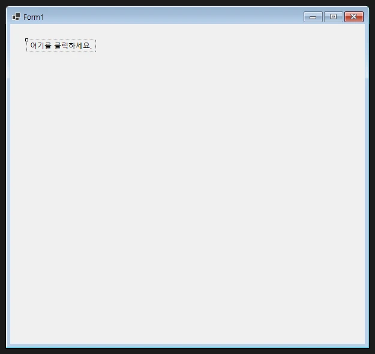
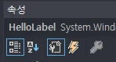

# C# 스터디 2022.11.26

작성일 2022-11-26
{ .post-date }

- Windows Forms Application : 윈도우에서 흔히 보는 어플리케이션들, UI가 잘 돼있다.
- Console Application : Command(Console) 창을 열어서 실행하는 프로그램을 작성하는 것. 특별한 UI가 없다. 대부분의 어플리케이션들이 다 Console Application으로 되어있다. 뒤에서 돌아가는 프로그램들, 실제로 큰 프로젝트들을 보면 유저들과 통신하기 위해서는 Windows Forms Application을 쓰지만, 실제로 내부에서 중요한 작업을 수행하는 것은 Console Application으로 되어있다.

```csharp
using System; // using System을 한다고해서, 그 안에 있는 모든 것을 사용할 수는 없다.
using System.Collections.Generic;
using System.Linq;
using System.Text;
using System.Threading.Tasks;

// using이라는 keyword 다음에 namespace를 선언해서
// 필요한 기능을 불러온다.

namespace cs_study
{ 
    // window OS가 cs_study namespace안에 있는 Program이라는 tool을 사용한다.
    internal class Program
    {
        // main 함수가 시작되면서 프로그램이 시작된다.
        // 모든 console application이 시작할 때 가장 먼저 시작되는 함수가 main이다.
        static void Main(string[] args) 
        {
            // Console이라는 도화지에 작업을 수행한다.
            Console.WriteLine("Hello, C#");
            Console.WriteLine(args.Length);

            Console.ReadKey();

        }
        // main이 끝나면 프로그램이 종료된다.
    }
}
```

- Program이라는 class안에 선언된 Main은 OS가 프로그램이 실행될 때 불러와주는 유일한 함수이다. 다른 함수는 필요할 경우 프로그래머가 직접 코딩해서 불러와서 사용해야 하며, OS가 직접 불러주지 않는다.
- Main이라는 함수가 무언가 기능을 하기 위해서는 무언가를 받아들여야 할 수도 있다. 그래서 Main함수는 필요할 경우 string[] args를 통해 값을 입력받을 수 있다. (필수는 아님)
- 이 프로그램을 직접 실행해보려면, cmd를 열고 해당 directory에서 bin\\Debug로 가면된다. 해당 경로로 간 다음, 실행 파일 이름을 cs_study라고 한다면 cs_study 라고 cmd에 입력하면 프로그램이 수행된다. 프로그램이 수행될 때, cs_study test1 test2 와 같이 실행한다면 프로그램의 실행 인자로 test1 test2가 같이 넘어가게 된다. 그렇게 되면 위의 예제에서는 args.Length는 2가 된다.

---

## Data type

- 먼저, Windows Forms로 프로젝트를 구성한다. Form1.cs를 더블 클릭하면 디자인을 할 수 있는 창이 뜬다. 코딩을 이 곳에 하면 된다.
- Main에서는 forms1을 불러주는 방식으로 코드가 기본으로 짜여있다. 따라서 우리는 form1에서 코드를 구성하고 UI를 만들면 된다. forms1 ⇒ calculator로 이름을 바꾸고, 도구 상자를 띄워서 UI를 추가할 수 있다.



- 속성 창을 열면, 각 요소의 정보와 데이터 등을 변경할 수 있다. Label을 Drag & Drop으로 설치한 뒤, 텍스트 내용을 ‘여기를 클릭하세요.’로 바꾼다.



- 속성 창을 보면 다음과 같이 (열쇠를 제외하고) 네 개의 슬롯이 있는 것을 볼 수 있는데, 오른쪽에 있는 두 개의 슬롯이 중요한 역할을 한다. 오른쪽에서 첫 번째 슬롯은 ‘속성’으로, 속성 창을 켰을 때 기본으로 선택되는 것이고, 번개 모양은 ‘이벤트’ 슬롯으로, 현재 선택된 요소가 어떤 이벤트를 가질 수 있는지 알려준다.

> windows program은 event-driven이다. 모든 프로그램이 이벤트를 바탕으로 동작된다.

- 이전에 프로그램이 실행되면 운영체제가 가장 먼저 Main 함수를 실행시켜준다고 했다. 이와 똑같이 프로그램이 수행되는 동안 이벤트가 발생하면, 운영체제가 해당 이벤트를 처리하는 함수를 확인해서 수행시켜준다. 이를 event-handler 라고 한다. 
- 즉, 우리는 현재 계산기 form application을 만들 것이기 때문에, 각 계산기의 요소들로부터 이벤트가 생겼을 때 발생할 수 있는 상황에 대한 event handler들을 코딩해주면 된다.

```csharp
// Label

namespace WinFormsApp_calculator
{
    public partial class Calculator : Form
    {
        public Calculator()
        {
            InitializeComponent();
        }

        private void HelloLabel_Click(object sender, EventArgs e)
        {
            // 해당 Label이 Click 되었을 때 실행되어야 할 코드를 작성한다.
            HelloLabel.Text = "Hello, C#";
        }
    }
}
```

- 그리고, 해당 라벨 위에 커서가 있을 때 커서 모양이 바뀌도록 설정할 수도 있다. (Cursor option)
