# Flex 1

작성일 2023-07-21 · 최종 수정일 2023-07-23
{ .post-date }

[CSS Flex(Flexible Box) 완벽 가이드](https://heropy.blog/2018/11/24/css-flexible-box/)

Flex는 크게 두 개의 개념으로 나뉘어진다.

1) Container

2) Items

주의할 부분은, Container와 Items에 적용하는 속성이 구분되어 있다는 것이다.

- Container : display, flex-flow, justify-content
- Items : order, flex, align-self

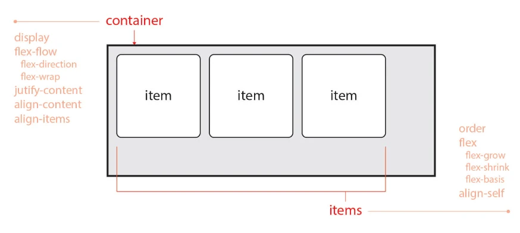

---

## Flex Container

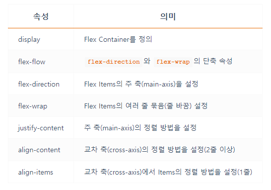

- **display**

display 속성을 이용하면 **Flex Container를 정의**할 수 있다. **Container의 적재 순서**이다.

display: block;

display: inline-block;

display: none;

> display: inline - 기본 값. 요소를 inline 요소처럼 표시하여, 앞뒤로 줄바꿈되지 않는다.  
> display: block - 요소를 block 요소처럼 표시한다. 따라서 요소 앞 뒤로 줄바꿈 된다.  
> display: none - 박스가 생성되지 않아서, 공간을 차지하지 않는다.  
> display: inline-block - 요소는 inline인데, 내부는 block 처럼 표시. 즉, 박스 모양이 inline처럼 옆으로 늘어섬.

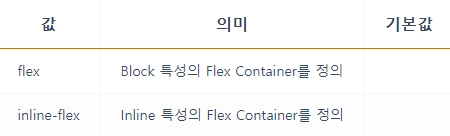

`flex`와 `inline-flex`의 차이

`display: flex;` : Block 요소와 같은 성향(수직 쌓임)을 가짐

`display: inline-flex;` : Inline(Inline Block) 요소와 같은 성향 (수평 쌓임)을 가진다. 

⇒ **여기서 말하는 수직과 수평 쌓임은 Items가 아닌, Container에 대한 것이다. 두 값의 차이는 내부에 Items에는 영향을 주지 않는다.**

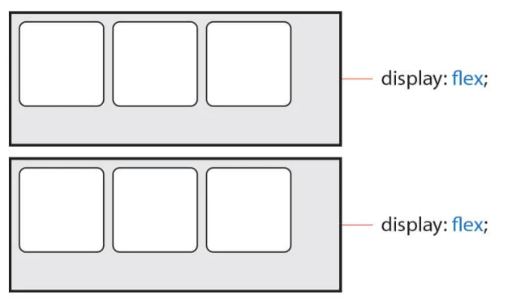

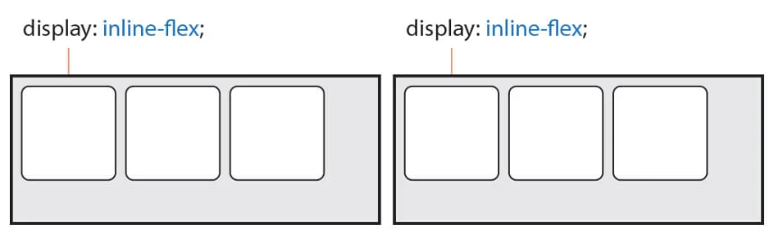

- **flex-flow**

이 속성은 단축 속성으로 Flex Items의 주축(main-axis)을 설정하고, Items의 여러 줄 묶음(줄 바꿈)도 설정한다.

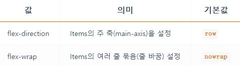

- **flex-direction**

아이템의 주축(main-axis)을 설정한다.  
⇒ Container **내부 아이템들의 정렬 순서**(주축 결정)

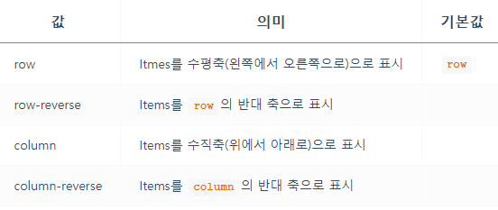

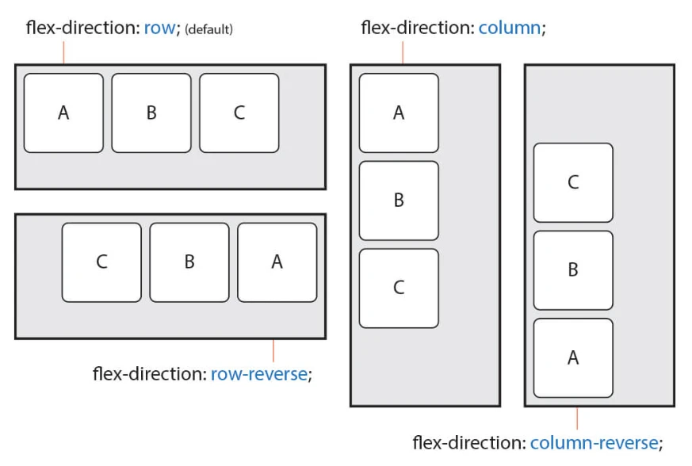

- 주축(main-axis)과 교차축(cross-axis)

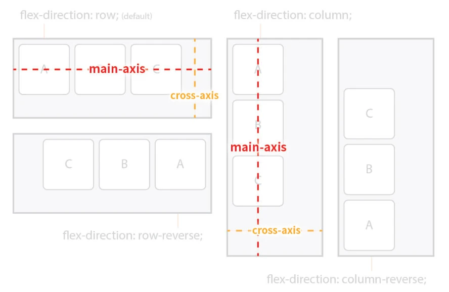

row는 아이템을 수평축으로 표시하므로, 이때는 주축이 수평이며, 교차축은 수직이다.

column은 아이템을 수직축으로 표시하므로, 이때는 주축이 수직이며, 교차축은 수평이다.

- 시작점(flex-start)과 끝점(flex-end)

flex-start와 flex-end는 방향에 맞는 시작점과 끝점을 의미한다.

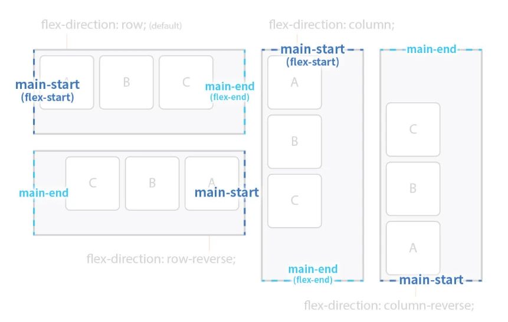

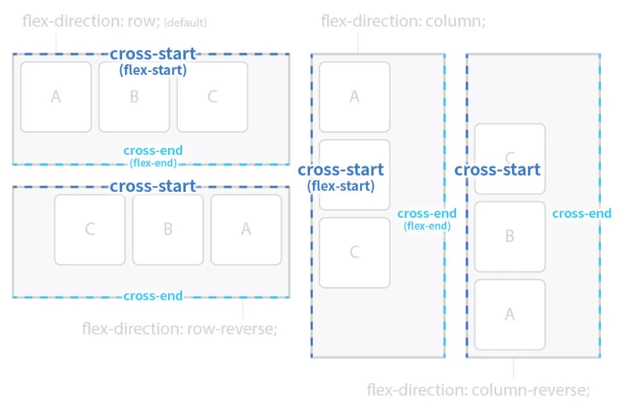

- flex-wrap

**아이템의 여러 줄 묶음(줄 바꿈)을 설정**한다.

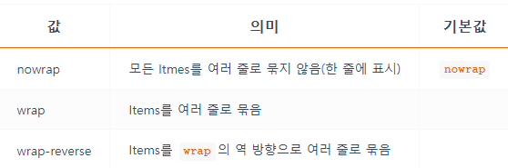

기본적으로 Items는 한 줄에서만 표시되고 줄바꿈되지 않는다. 이는 지정된 크기(주 축에 따라 width나 height)를 무시하고 한 줄 안에서만 가변한다. Items를 줄바꿈하려면 값으로 wrap을 사용한다.

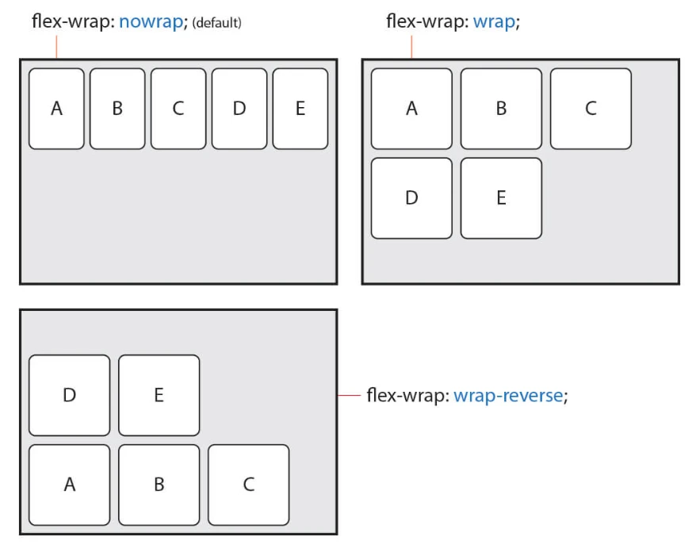

- justify-content

**주축<strong>(main-axis)</strong>의 정렬 방법**을 설정한다. 즉, **아이템들의 정렬 방법**이다.

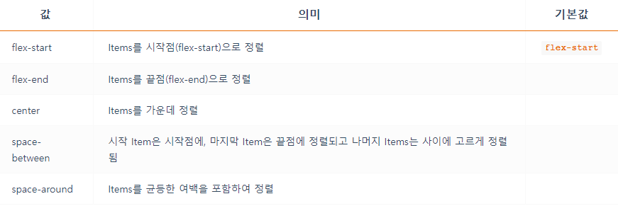

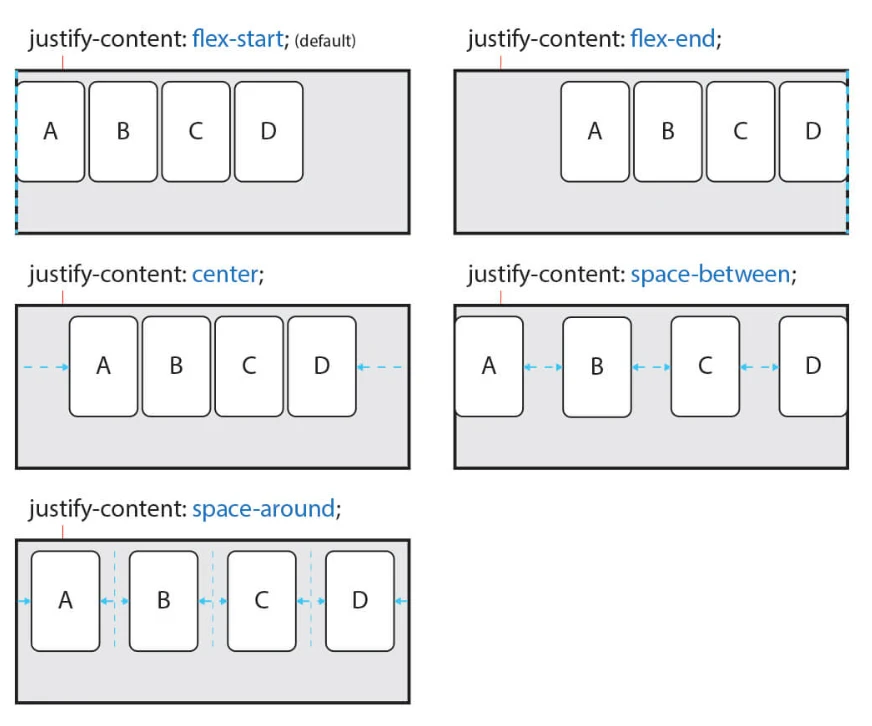

- align-content

교차축(cross-axis)의 정렬 방법을 선택한다. 주의할 점은, flex-wrap 속성을 통해 Items가 여러 줄(2줄 이상)이고, 여백이 있을 경우에만 사용이 가능하다.

(Items가 한 줄일 경우, align-items 사용)

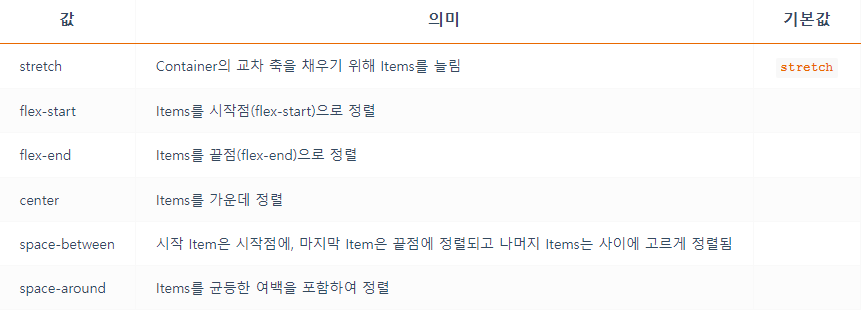

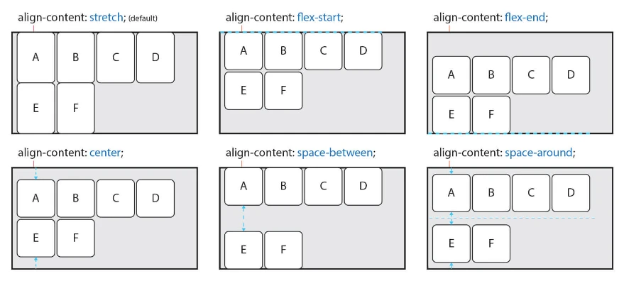

- align-items

교차축(cross-axis)에서 Items의 정렬 방법을 설정한다. Items가 한 줄일 경우 많이 사용된다.

주의할 점은, Items가 flex-wrap을 통해 여러 줄(2줄 이상)일 경우에는 align-content 속성이 우선한다. 따라서, align-items를 사용하려면, align-content 속성을 기본값(stretch)로 해야 한다.

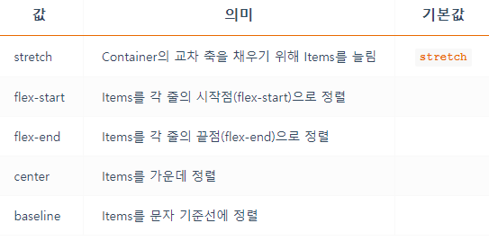

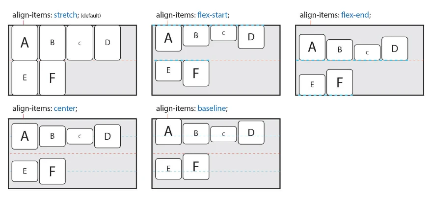

---

## Flex

아이템의 너비(증가, 감소, 기본)를 설정하는 단축 속성이다.

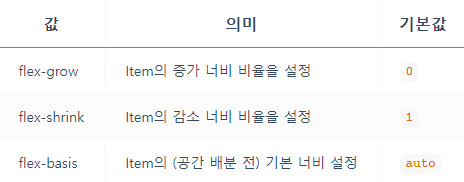

`flex-grow`를 제외한 개별 속성은 생략이 가능하다.

`flex: 1;` 로 설정했다면, `flex-grow: 1;` 과 같다.

나머지 속성은 생략했으니, 기본값이 적용되어 `flex-shrink: 1;` `flex-basis: auto;` 가 될 것이다.

`flex-basis`의 기본값은 `auto` 이지만, 단축 속성인 `flex`에서 그 값을 생략하면, `0`이 적용된다.

다시 정리하면, `flex: 1;` 혹은 `flex: 1 1;` 은 `flex: 1 1 0;` 이 된다.

- flex-grow

아이템의 증가 너비 비율을 설정한다. 숫자가 크면 더 많은 너비를 가진다. 아이템이 가변 너비가 아니거나, 값이 0일 경우는 효과가 없다.

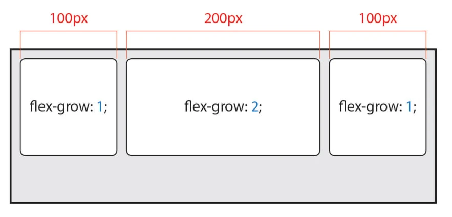

- flex-shrink

아이템이 감소하는 너비의 비율을 설정한다. 숫자가 크면 더 많은 너비가 감소한다. 아이템이 가변 너비가 아니거나, 값이 0일 경우 효과가 없다.

⇒ 계산이 까다롭고 활용도가 다소 떨어짐.

- flex-basis

아이템의 (공간 배분 전) 기본 너비를 설정한다. 값이 auto일 경우, width, height 등의 속성으로 아이템의 너비를 설정할 수 있다. 하지만 단위 값이 주어지면 설정할 수 없다.

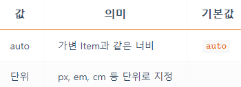

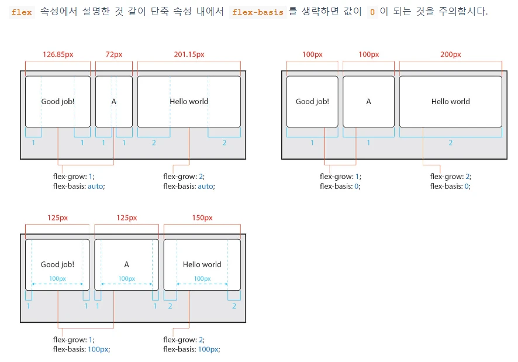

- align-self

교차축(cross-axis)에서 개별 아이템의 정렬 방법을 설정한다. align-items는 Container 내 모든 아이템의 정렬 방법을 설정한다. 필요에 의해 일부 아이템만 정렬 방법을 변경하려고 할 경우, align-self를 사용할 수 있다. 이 속성은 align-items 속성에 우선한다.

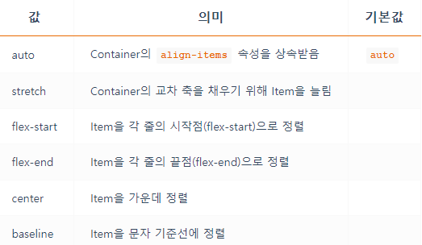

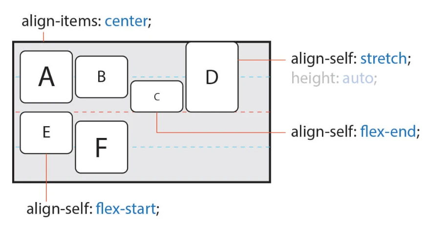
