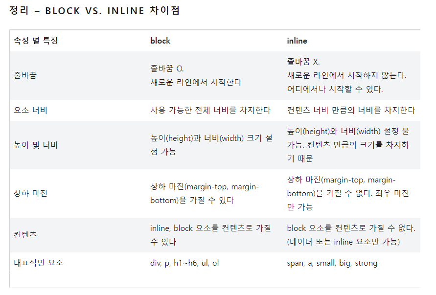

# display block, inline, inline-block

작성일 2023-07-23
{ .post-date }

- block : 라인 하나의 전체를 다 차지한다.

    - inline 요소는 컨텐츠 너비만큼을 차지하며, 라인 하나에 여러 요소가 배치될 수 있다.
    - 또한 block 요소는 inline 요소를 컨텐츠로 가질 수 있지만, inline 요소는 block 요소를 가질 수 없다.
    - 대표적인 block 요소로 div가 있고, inline 요소로는 span 태그가 있다. 즉, div 안에 span을 넣을 수 있지만, span 안에 div를 넣을 수 없다.

- inline

    - 컨텐츠의 크기만큼만 영역을 가짐.
    - width, height 속성에 영향을 받지 않음.

- block

    - inline과 달리 새로운 줄로 시작하며, 해당 줄의 가로를 모두 차지

- inline-block

    - inline과 같이 양 옆으로 화면에 나열 가능
    - width, height 속성을 통해 사이즈 조절이 가능
