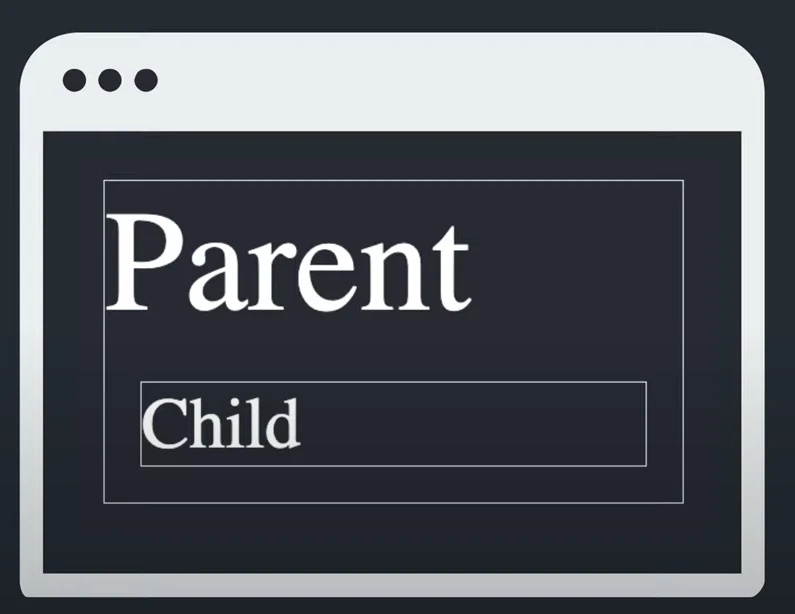

# 드림코딩 CSS 6: EM & REM

작성일 2023-07-24
{ .post-date }

**Terms**

- 사이즈를 결정하는 Unit은 크게 두 개의 Category로 나누어서 정리할 수 있다.

    - Absolute(절대적)
    - Relative(상대적)

- Absolute Units

    - 현재는 Pixel을 제외한 다른 수치는 적용하지는 않음.
    - pixel은 화면에 나타낼 수 있는 가장 작은 단위이다.

    ⇒ pixel을 사용했을 때의 문제점은, Container의 크기가 바뀌어도 크기가 고정되어 반응형으로 UI를 구성할 수 없다는 것이다.

- Relative Units

    - em : Font size of the parent, in the case of typographical properties like font-size, and font size of the element itself, in the case of other properties like width.
    - rem : Font size of the root element.
    - vw : 1% of the viewports’ width.
    - vh : 1% of the viewports’ height
    - % : Relative to the parent element

---

- em : typography에서, 현재 지정된 point size를 나타내는 단위이다. 즉, 지금 point size를 나타내는 단위를 말한다.  
    ⇒ 어떤 font-family를 쓰냐에 따라서 사용자에게 보여지는 text의 size는 달라질 수 있다. em은 선택된 font-family에 상관없이, 항상 고정된 font-size를 보여준다.

⇒ 왜 em이 상대적인가?



```html
<div class="parent">
	Parent
	<div class="child">Child</div>
</div>
```

```css
.parent {
	font-size: 8em;
}

.child {
	font-size: 0.5em;
}
```

⇒ 기본적으로 Browser에서 HTML에 할당되는 Font-size는 16px이다. HTML이나 body에 font-size를 지정하지 않으면 16px로 지정되는데, Parent에서 8em이라는 것은 Parent의 부모 요소인 html의 16px에 8배가 곱해진 값이다. 그러므로 Parent는 128px로 Browser에 표시가 되며, Child는 0.5em이기 때문에, 그의 Parent인 128px * 0.5 = 64px로 표시된다.

em은 다소 %와 비슷한 느낌이 있다.

⇒ 8em은 800%와 같다. 즉, `font-size: 8em;` == `font-size: 800%;`

---

- rem : rootem. 즉, root에 지정된 font-size에 따라서 크기가 결정되는 단위이다.

```html
<div class="parent">
	Parent
	<div class="child">Child</div>
</div>
```

```css
.parent {
	font-size: 8rem;
}

.child {
	font-size: 0.5rem;
}
```

⇒ 이렇게 하면, .parent는 root 요소인 html의 글씨 크기 16px * 8 = 128px이 되고, .child는 root 요소인 html 글씨 크기 16px * 0.5 = 8px이 된다.

> html에서 따로 font size를 지정하지 않으면, font-size는 100%가 default value이다. 이 말은, Browser에서 지정한 font-size를 따라 간다는 뜻이며, 이 경우 em이나 rem은 Browser에서 정한 font-size에 상대적으로 결정된다.  
>   
> 반대로, html에서 font-size를 Absolute로 지정한다면 font-size를 바꿔도 반응형이 되지 않는다.

---

- vw, vh

vw(viewport width)

vh(viewport height)

⇒ Window 전체를 기준으로 크기가 지정된다. 이 경우, 부모 요소의 크기는 고려되지 않고 Window의 크기에 따라 결정된다.

---

- % : 부모 요소에 대해 상대적으로 크기가 계산된다.

---

- 언제 어떤 단위를 사용해야 할까?

    1. 부모 요소의 크기에 따라서 사이즈가 변경이 되어야 하는 경우

        %나 em을 사용한다.

    2. 부모와는 상관없이 브라우저 사이즈에 대해 반응하는 경우

        v\*, rem을 사용한다.

    3. 요소의 너비와 높이에 따라 사이즈가 변경되는 경우, box 자체의 크기를 정하는 경우.  
        ⇒ flex-box를 이용, flex-direction: column; 등을 통해 활용하는 것이 좋다.

        %, v\*을 사용한다.

    4. 폰트 사이즈에 따라서 사이즈가 변경되는 경우

        em, rem을 사용한다.

⇒ em과 rem의 차이?

둘 중에 어떤게 더 낫다고 말할 수 없다. 어떤 디자인인지에 따라서, 어떤 기능을 구현하는 지에 따라서 em을 쓸 때도 있고, rem을 쓸 때도 있다.

- rem : 부모 요소 안에 있어도 사이즈가 상대적으로 변하지 않음. (root 기준이기 때문)
- em : 부모 요소 안에 있으면 부모의 사이즈에 따라 상대적으로 크기가 변함.

⇒ 즉, 나의 컴포넌트가 어떤 상황에서도 사이즈가 그대로여야 한다면, rem을 쓴다.

⇒ 반대로, 나의 컴포넌트가 상황에 따라서 사이즈가 변해야 한다면, em을 쓴다.

> font-size를 결정할 때는 rem을 사용하는 것을 선호.  
>   
> font-size에서 em은 부모의 font-size에서 측정이 되어지지만, 안의 사이즈 속성 (Padding, Height 등등)은 em 사용 시, 해당 요소의 font-size로부터 계산이 되어진다.
