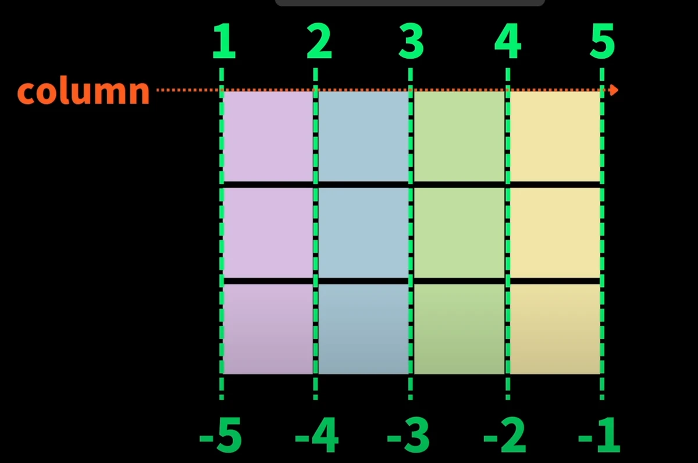
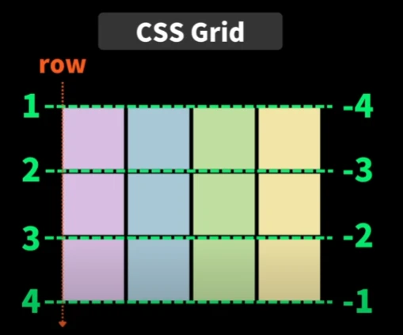

# 드림코딩 CSS 7: grid

- Container : grid

    - display: grid
    - grid-template-columns
    - grid-template-rows
    - grid-template-areas

    - grid-gap : 각각의 grid cell에 적용할 gap

        - grid-column-gap

        - grid-row-gap

            ⇒ 둘 중 하나만 지정할 수도 있고, 둘다 지정할 수도 있음.

- grid cell

    - grid-column-start

    - grid-column-end

        ⇒ column을 어디부터 어디까지 보여줄 것인지

    - grid-row-start

    - grid-row-end

        ⇒ row를 어디부터 어디까지 보여줄 것인지

    - grid-area : 어떤 영역에 표시되길 원하는지

---

- 자식 속성 (grid-column-start & grid-column-end)

