# 2 (relation 개념)

작성일 2023-08-11 · 최종 수정일 2023-08-12
{ .post-date }

- relational data model

⇒ 이 개념을 이해하기 위해서는 먼저 ‘set’의 개념을 알아야 한다.

---

## Relation in Mathematics

- set

    - 서로 다른 elements를 가지는 collection

    - 하나의 set에서 elements의 순서는 중요하지 않다.

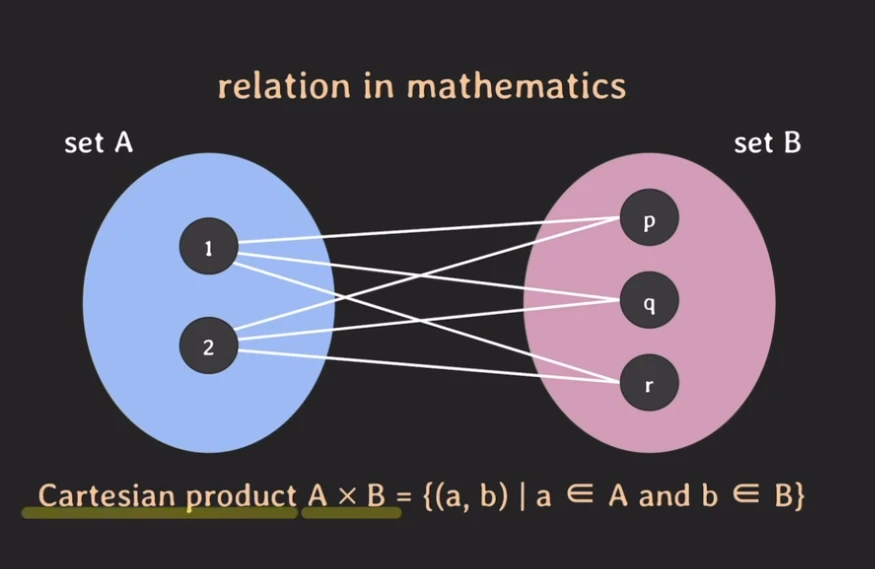

수학에서는 두 집합의 관계를 Cartesian Product로 나타낼 수 있다. (A x B)

여기서 A x B가 의미하는 것은, set A에서 element를 하나 고르고, set B에서 element를 하나 골라서 만들 수 있는 모든 Pair의 조합을 의미한다.

⇒ 이것이 왜 중요한가? **수학에서 말하는 relation이 Cartesian Product와 관련있기 때문**이다.

set이 두 개만 있는 경우를 &lt;binary relation&gt; 이라고 한다. 이 상태에서 binary relation이란, A와 B의 Cartesian Product의 부분 집합을 의미한다.

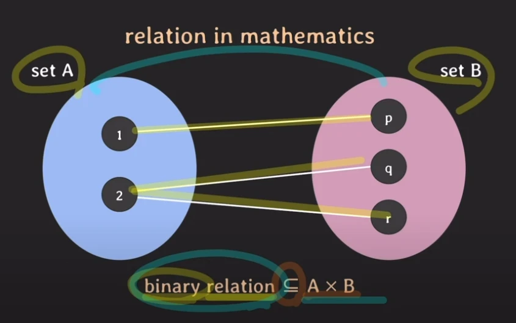

따라서 위의 그림은 수학에서 말하는 relation이라고 판단할 수 있다. (Cartesian Product의 부분집합이기 때문이다.)

---

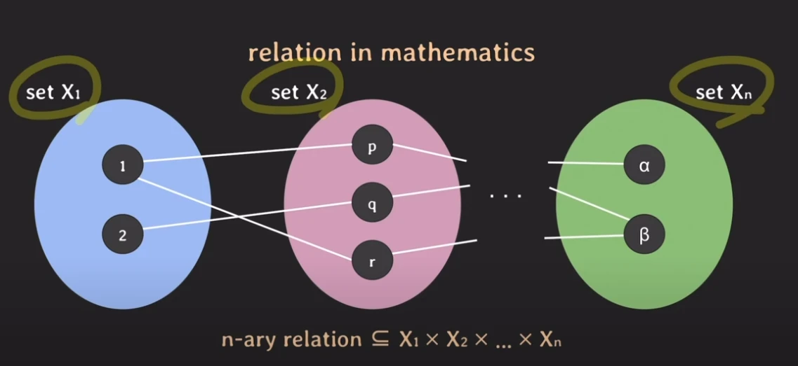

이 상태에서 Cartesian Product는 &lt;X1 x X2 x … x Xn&gt; 으로 표현할 수 있다. 이전의 예제에서는 Set이 두 개였기 때문에 Binary Relation이라고 표현했지만, 이번에는 n개의 Set이 존재하기 때문에 n-ary relation이라고 표현한다.

이 상태에서 n-ary relation은 n개의 Set에 대한 Cartesian Product의 부분집합이라고 생각할 수 있다.

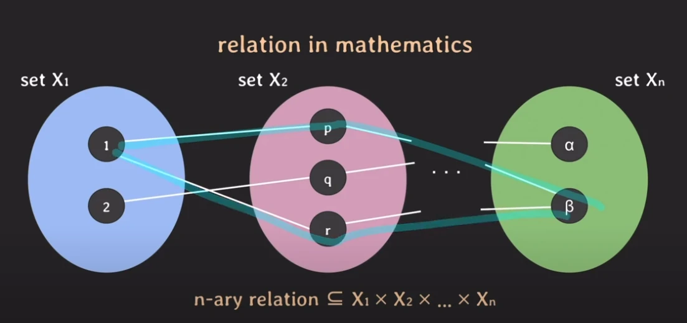

위의 그림은 n개의 집합에 대해서 존재하는 여러 개의 tuple을 다루는데, 이를 n-tuple이라고 한다. (tuple이란, n개의 element로 이루어진 list라는 의미이다.)

---

- 수학에서 다루는 relation

    - Cartesian Product의 부분집합
    - Tuple들의 집합

---

## Relational Data Model

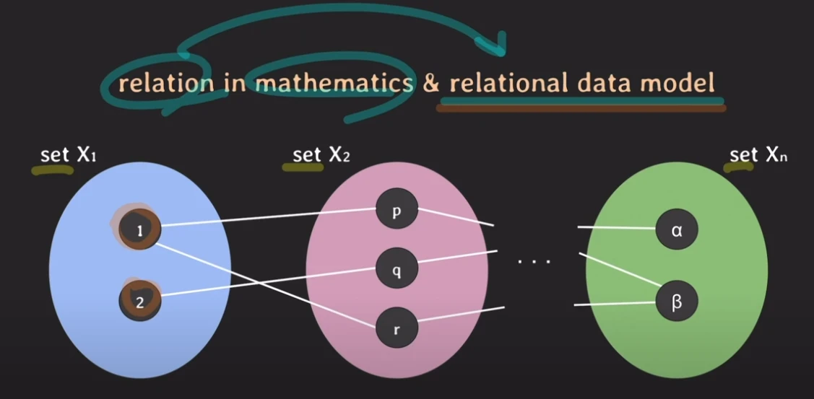

Relational Data Model에서는 각각의 set을 &lt;Domain&gt; 이라고 부른다.

- 대학교 학생들의 데이터를 저장하는 Relational Data Model 정의하기

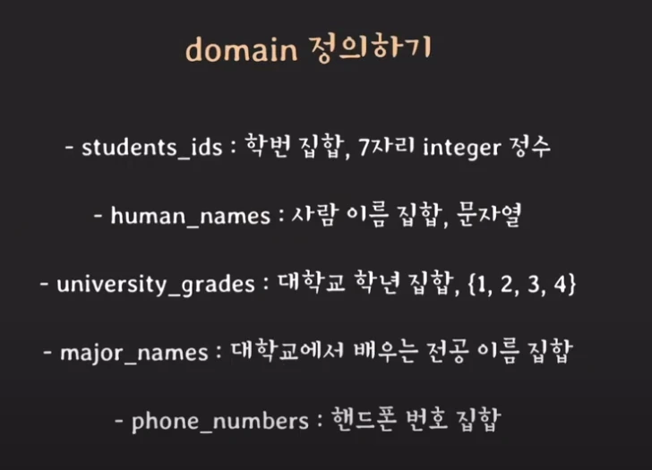

⇒ 각각의 데이터를 Domain으로 정의한다고 볼 수 있다. (Columns)

- Domain을 연결하기

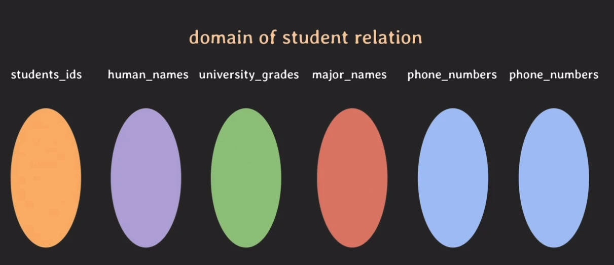

⇒ phone_numbers 도메인은 사용자의 전화번호와 사용자의 비상 연락망을 저장하기 위해 두 번 사용된다고 해보자. 이때, 같은 도메인이더라도 사용되는 역할을 구분하기 위하여 attribute라는 것이 사용된다.

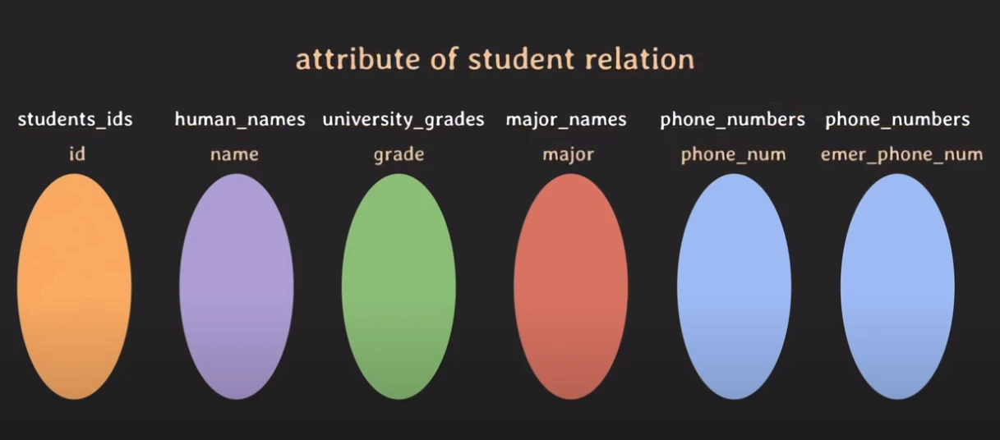

phone_numbers에 대해서 phone_num을 담당하는 attribute가 부여된 domain이 존재하고, phone_numbers에 대해서 emer_phone_num을 담당하는 attribute가 부여된 domain이 존재한다.

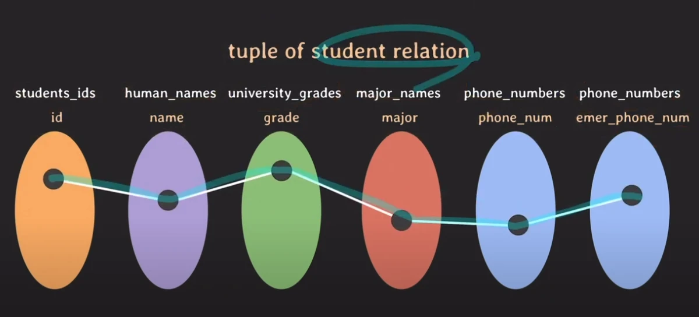

각각의 Domain(attribute)에 대해서 실제로 Element(Data)가 존재하고 있을 것이고, 그리고 그 Data를 Element로 갖는 Tuple이 존재할 것이다.

이 그림을 가장 잘 표현하는 방법은 바로 Table이다.

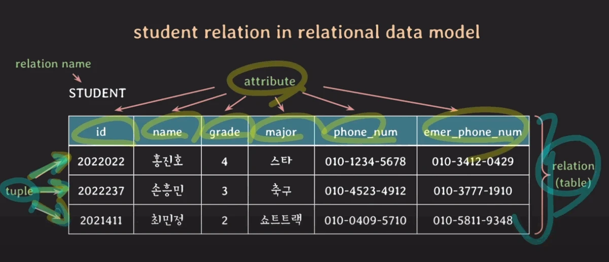

- 주요 개념

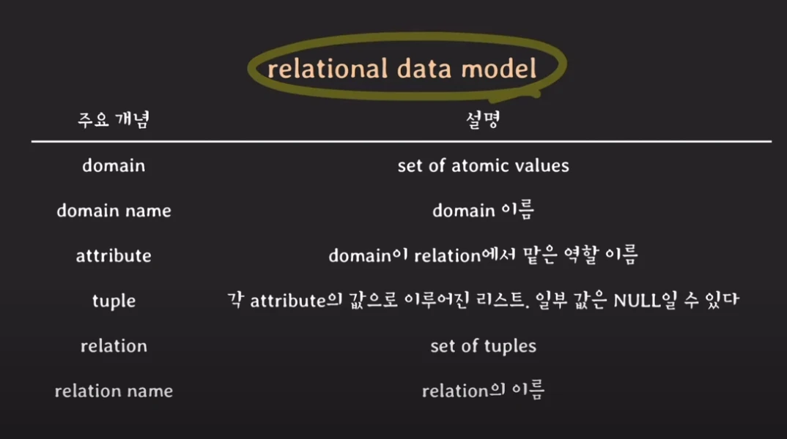

domain : set of atomic values. 더 이상 나눠질 수 없는 unique한 elements로 구성된다.

domain name : domain에 붙이는 이름

attribute : domain이 relation에서 맡은 역할의 이름. column name

tuple : 각 attribute의 값으로 이루어진 list. 일부 값은 null이 될 수 있다.

relation : set of tuples. attribute에 속하는 값들로 만들어진 list가 tuple이며, 이 tuple의 집합으로 구성되는 것이 바로 하나의 relation이다.

relation name : relation의 이름.

---

## Relation Schema

- relation의 구조를 나타내며, relation의 이름과 attributes 리스트로 표기된다.

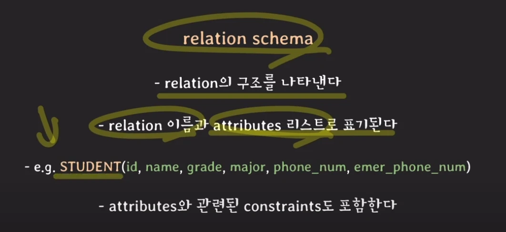

여기서 relation은 STUDENT이고, attributes의 리스트는 id, name, grade, …, emer_phone_num 이다.

이때 attribute와 관련된 constraints도 포함된다.

⇒ 한 relation에서 attributes의 수를 degree라고 한다. (STUDENT relation은 degree가 6)

- relation (relation state)

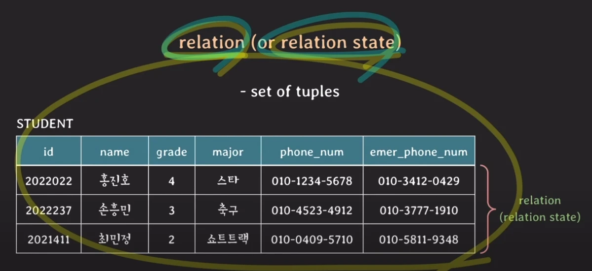

임의의 시점에서의 relation(attributes 의 집합)을 말하며, relation state라고도 한다. 즉, 개념적인 relation을 말하는 것과는 구분되는 용어라고 볼 수 있기 때문에, relation이 개념적인 relation을 말하는 것인지, 아니면 특정 시점에서의 tuple들의 집합인 relation(relation state)을 말하는 것인지 잘 구분할 수 있어야 한다.

---

## Relational Database

- relational data model에 기반하여 구조화된 database
- relational database는 여러 개의 relations로 구성된다.

- relational database schema

    - relation schemas set + integrity constraints set
    - schema는 여러 개의 relation으로 구성되며, 특정한 integrity constraints set과 결합된다.

- relation의 특징들

    - 한 relation에서 tuple의 모든 element가 같은 tuple은 존재할 수 없음.
    - relation의 tuple을 식별하기 위해 attribute의 부분 집합을 key로 설정함. (unique key)

    - relation에서 tuple의 순서는 중요하지 않다. (순서가 바뀐다고 의미가 바뀌지 않음.)

        - 따라서 순서를 정하는 방법이 여러 개가 존재할 수 있다.

    - 하나의 relation에서 attribute의 순서는 중요하지 않다.
    - 또한 attribute의 순서도 중요하지 않다.
    - attribute는 atomic 해야 한다.

    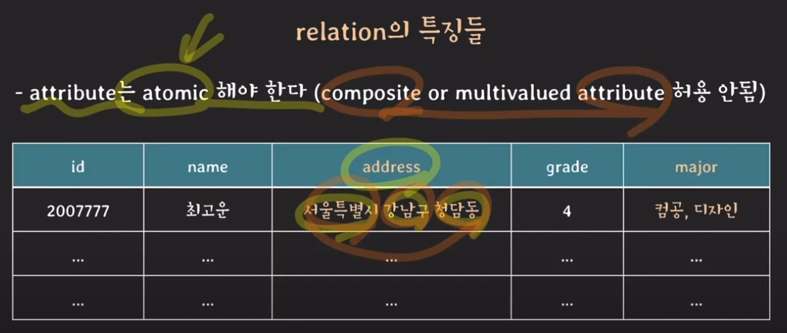

    ⇒ 다음과 같은 relation에서 address는 ‘서울특별시’ ‘강남구’ ‘청담동’으로 쪼개질 수 있다. 이런 것을 composite or multivalued attribute라고 하는데, 이것이 허용되지 않는다.

---

## Key

- superkey

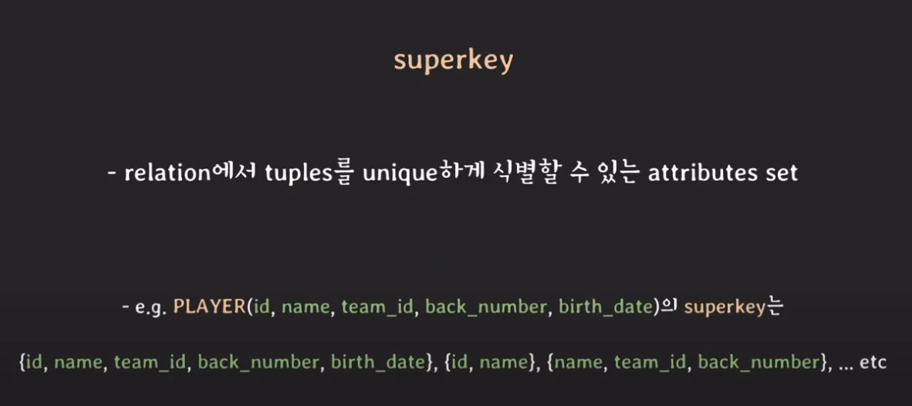

superkey란, attributes set을 만들었을 때, 그 set이 다른 tuple과 구분될 수 있는 unique한 정보를 제공하는 경우를 말한다. 그래서 {id, name, team_id, back_number, birth_date} 자체가 같은 tuple은 존재할 수 없기 때문에 superkey가 될 수 있고, {id, name}이 같은 tuple은 존재할 수 없기 때문에 superkey가 될 수 있다.

- candidate key

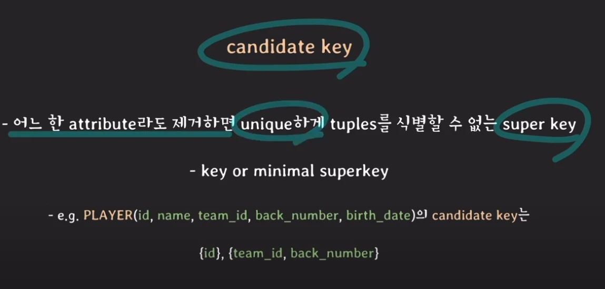

⇒ key/minimal superkey 라고도 한다.

{id}는 그 자체로 superkey가 될 수 있지만, 이것이 빠질 경우 set이 사라져서 tuple을 구분할 수 없기 때문에 key/minimal superkey가 될 수 있다.

또한 {team_id, back_number}는 두 개의 element가 모인 set일 때는 tuple을 구분할 수 있는 superkey가 되지만, 둘 중 하나라도 빠지면 안되기 때문에 key/minimal superkey가 될 수 있다.

- primary key

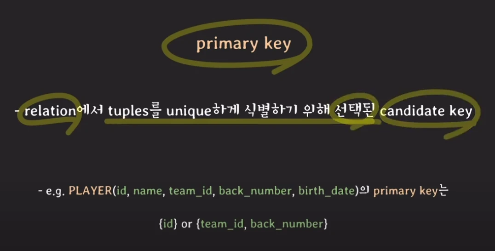

⇒ 만약 PLAYER라는 relation에서 {id}를 가지고 tuple을 구분한다고 한다면, primary key는 {id}가 된다. 만약 {team_id, back_number}를 가지고 tuple을 구분한다고 하면, primary key는 {team_id, back_number}가 된다.

> primary key를 선정할 때는 attribute key가 최대한 적은 것을 고른다.

- unique key

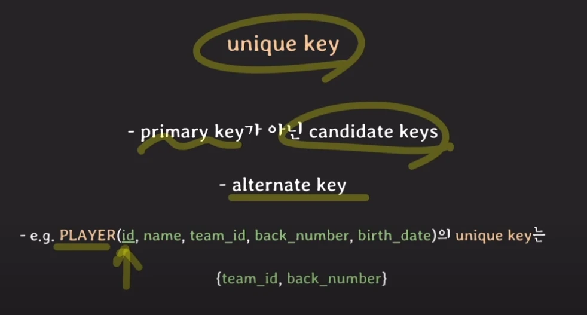

primary key가 아닌 다른 candidate keys. alternate key(대리키)라고도 한다.

- foreign key(외래키)

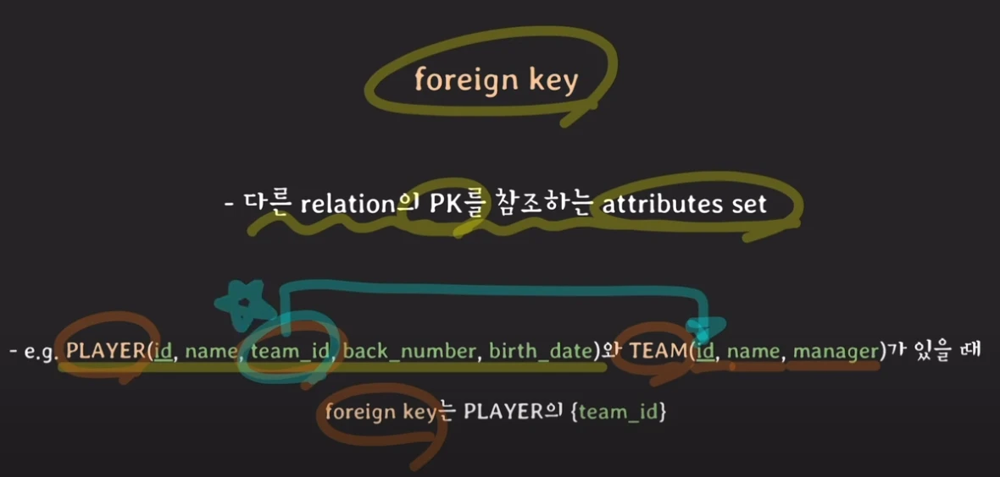

⇒ 다른 relation의 PK를 참조하는 attributes set. 만약 PLAYER relation의 attribute인 team_id가 TEAM relation의 PK인 id를 참조한다면, PLAYER relation의 team_id는 foreign key가 된다.

---

## Constraints

- implicit constraints

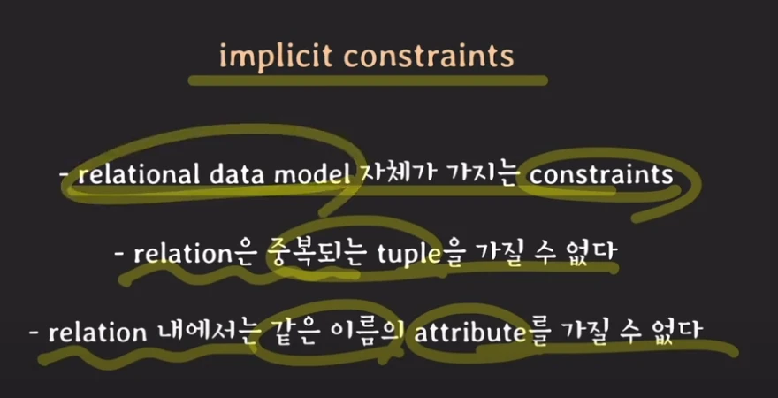

- schema-based constraints (explicit constraints)

    

    - domain constraint

    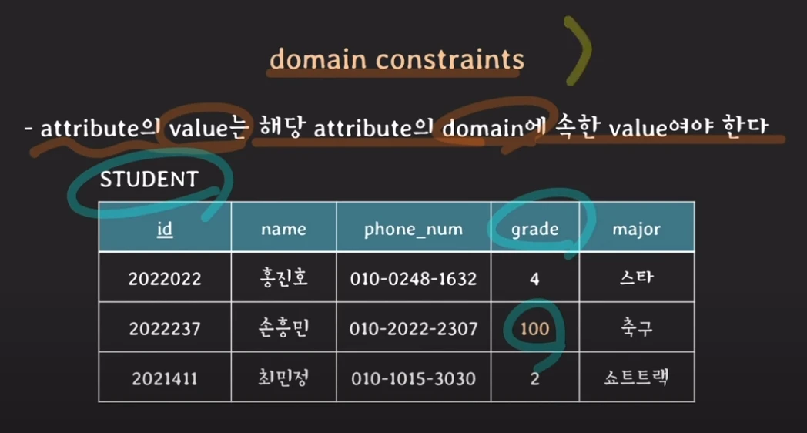

    ⇒ grade에서 100학년은 말이 안되므로 domain constraints에 어긋남.

    - key constraint

    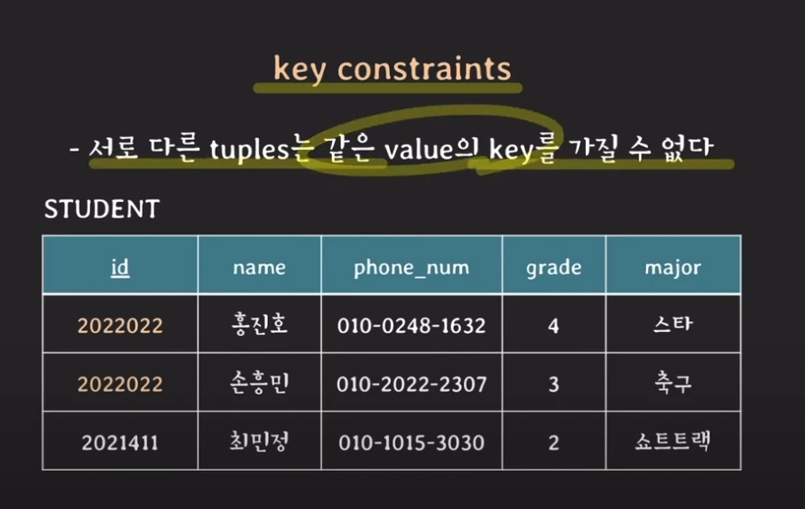

    ⇒ 서로 다른 tuple이 같은 PK를 가질 수 없다. (unique함이 사라짐)

    - NULL value constraint

    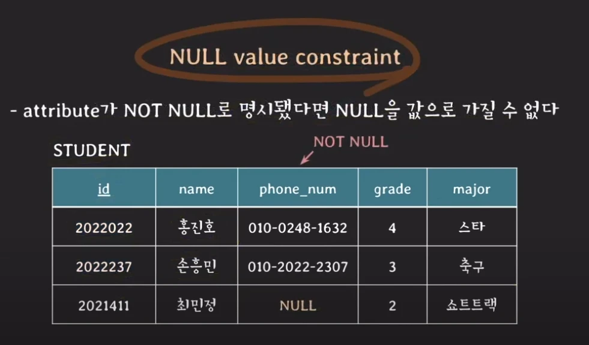

    - primary integrity constraint

    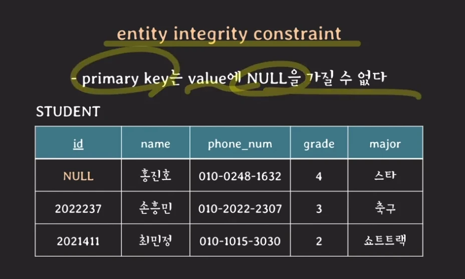

    - referential integrity constraint (foreign key와 관련된 constraint)

    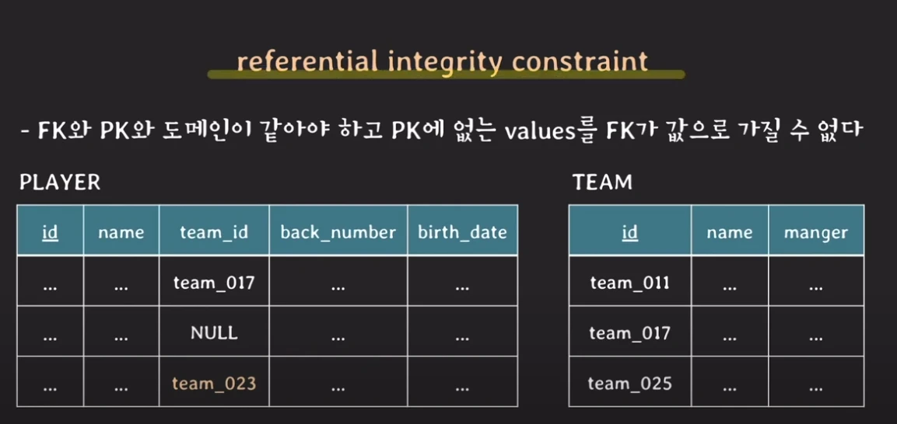

    ⇒ FK가 다른 relation의 PK를 reference 할 때, 같은 domain을 이용해야 한다는 의미. 즉, FK에 있는 값은 반드시 PK에 있는 값을 참조해야 한다는 뜻이다.

> 이와 같이 constraints가 존재하는 이유는 데이터의 무결성 (integrity)을 유지하기 위함이다.
