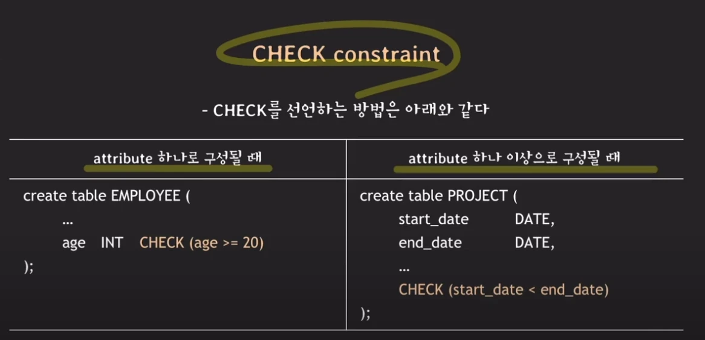
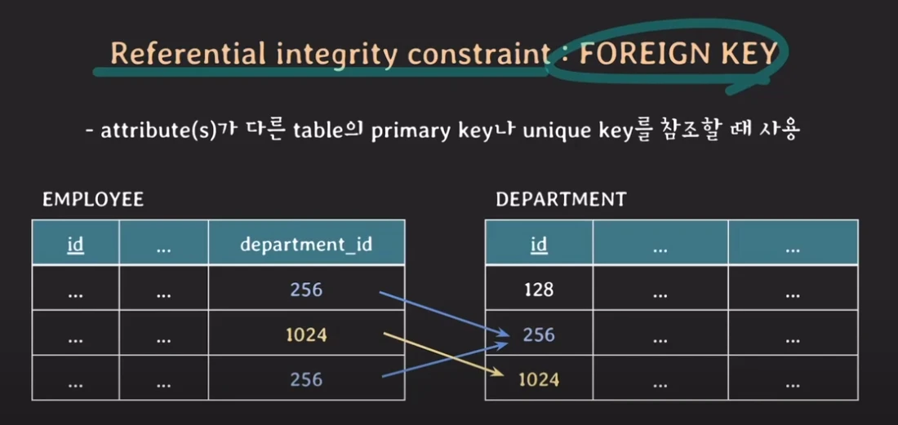
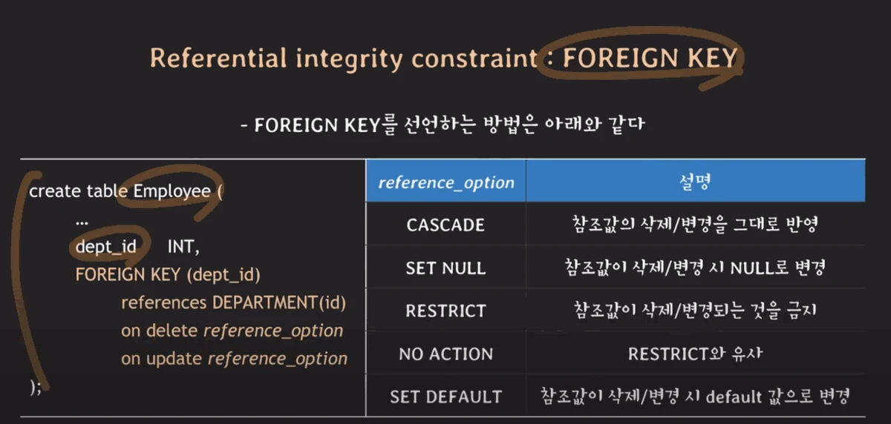
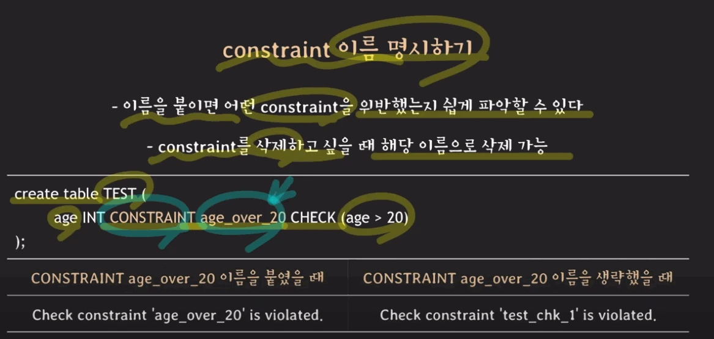
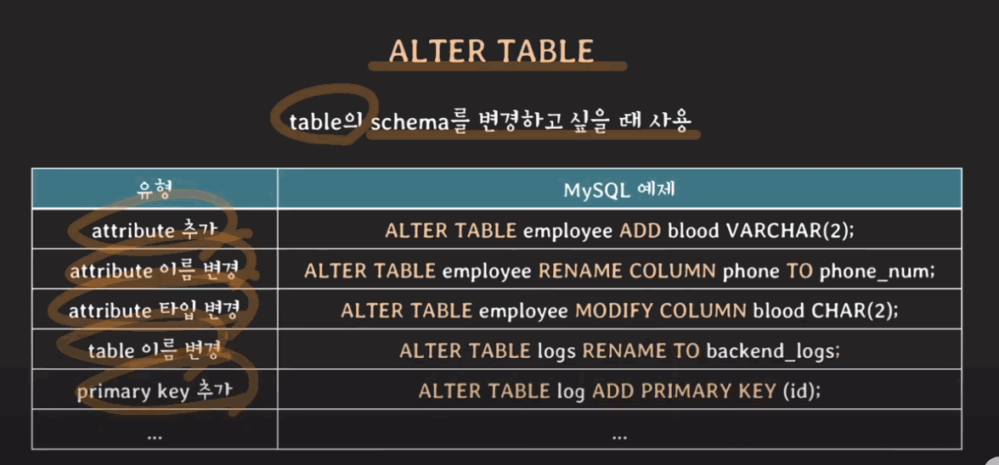

# 3 (sql 주요 개념)

## SQL 주요 용어

- relation ⇒ table
- attribute ⇒ column
- tuple ⇒ row
- domain ⇒ domain

- SQL에서 relation

    multiset(= bag) of tuples

    중복된 tuple을 허용한다.

---

## Attribute Data Type

- 정수

    - TINYINT : 1 byte
    - SMALLINT : 2 byte
    - MEDIUMINT : 3 byte
    - INT or INTEGER : 4 byte
    - BIGINT : 8 byte

- 부동 소수점 방식

    - FLOAT : 4 byte
    - DOUBLE or DOUBLE PRECISION : 8 byte

- 고정 소수점 방식

    - DECIMAL or NUMERIC

        ⇒ MySQL에서는 두 개가 큰 차이가 없음. (둘 다 엄격하게 저장함)

        ⇒ 실수를 정확하게 저장할 때 사용.

        ⇒ DECIMAL(5, 2) : (Precision, Scale)

        Precision은 몇 자리까지 표현할 것인지(전체 수)

        Scale은 소수점 이하 몇 자리까지 표현할 것인지(소수점)

- 문자열

    - 고정 크기 문자열 CHAR(n) [0 ≤ n ≤ 255]

        - 최대 몇 개의 ‘문자’를 가지는 문자열을 저장할지를 지정한다.
        - **저장된 문자열의 길이가 최대 길이보다 작으면, 나머지를 space로 채워서 저장**

        - ex) CHAR(4) : ‘aOOO’, ‘한국OO’, ‘고고고고’, ‘wowO’

            ⇒ O는 공백을 의미함.

    - 가변 크기 문자열 VARCHAR(n) [0 ≤ n ≤ 65,535]

        - 최대 몇 개의 ‘문자’를 가지는 문자열을 저장할지를 지정한다.
        - **저장될 문자열의 길이 만큼만 저장한다.**
        - ex) VARCHAR(4) : ‘a’, ‘한국’, ‘고고고고’, ‘wow’

    > CHAR와 VARCHAR는 차이가 있다. MySQL에서는 VARCHAR가 Storage 상의 이점은 존재하지만, 시간적 관점에서는 성능이 떨어진다. 따라서 MySQL에서는 크기가 고정적인 것은 CHAR를 쓰고, 크기가 가변적인 것은 VARCHAR를 쓰길 권장한다.

    - 사이즈가 큰 문자

        - TINYTEXT

        - TEXT

            ⇒ MySQL에서 TINYTEXT와 TEXT는 VARCHAR와 같거나 작은 사이즈의 문자열을 저장한다.

        - MEDIUMTEXT
        - LONGTEXT

- 날짜와 시간

    - 날짜 : 년, 월, 일을 저장 (YYYY-MM-DD) ⇒ DATE

    - 시간 : 시, 분, 초를 저장 (hh:mm:ss or hhh:mm:ss) ⇒ TIME

        - hhh:mm:ss의 경우에는 경과된 시간을 기록하고자 할 때 사용.

    - 날짜와 시간 : 날짜와 시간을 같이 표현 (YYYY-MM-DD hh:mm:ss)

        - DATETIME

        - TIMESTAMP : Time-zone을 반영함.

            ⇒ MySQL은 내부적으로 Time-zone을 설정할 수 있음. 이를 통해 데이터를 읽어오고 전달할 때 표준 시간대를 반영하여 값을 보정할 수 있다.

        

- else

    - byte-string : (문자열이 아닌) byte string을 저장 : 암호 등을 저장할 때 사용

        - BINARY
        - VARBINARY
        - BLOB type

    - boolean : true/false ⇒ MySQL에는 따로 없음. TINYINT로 대체한다.

        - 0/1로 저장한다.

    - 위치 관련 : GEOMETRY, POSITION, etc.
    - JSON

---

## Unique Constraint

Unique로 지정된 attribute(s)는 중복된 값을 가질 수 없다.

단, NULL은 중복을 허용할 수도 있다. (RDBMS마다 다르며, MySQL은 NULL 중복을 허용한다.)

## Check Constraint

attribute(s)의 값을 제한하고 싶을 때 사용.

예를 들어, salary라는 attribute에 Constraint CHECK (salary &gt; 50,000,000)을 적용하면 5천만원 이상의 값만 입력할 수 있게 된다.

## Foreign Key

⇒ Employee Table의 dept_id는 DEPARTMENT Table의 id를 Foreign Key로 참조한다.

on delete (reference_option)

on update (reference_option)

⇒ 이 설정을 통해서 참조하고 있던 값이 update되거나 delete될 때 어떤 작업을 할지 정할 수 있다.

- options

    - CASCADE : 참조값의 삭제/변경을 그대로 반영

        만약 참조값(원본)이 삭제되거나 변경되면, 참조하고 있던 Row도 삭제/변경된다.

    - SET NULL : 참조값이 삭제/변경되면, 참조하고 있던 Row의 Column 값은 NULL이 된다.

    - RESTRICT : 참조값이 삭제/변경되는 것을 금지한다.

        이 경우, 원본값은 삭제/변경할 수 없다.

    - NO ACTION : RESTRICT와 유사하다. (MySQL에서는 완전히 똑같음.)

        단, SQL 표준에 따르면, 트랜잭션 내의 여러 개의 SQL 문이 수행되는 동안에는 참조값이 삭제/변경되는 것을 허용하지만, 그것이 끝나고 나서는 금지하는 것을 말한다.

    - SET DEFAULT : 참조값이 삭제/변경시 default 값으로 변경

        단, MySQL은 SET DEFAULT를 제대로 지원하지 않는다.

    ⇒ 따라서, MySQL은 CASCADE, SET NULL, RESTRICT를 지원한다고 보면 된다.

---

## Constraint에 이름 명시하기

이름을 붙이면 어떤 constraint를 위반했는지 쉽게 파악이 가능하다.

constraint를 삭제하고 싶을 때는 해당 이름으로 삭제가 가능하다.

---

## ALTER TABLE로 schema 변경하기

