# 8 (join)

작성일 2023-08-12 · 최종 수정일 2023-08-13
{ .post-date }

## Implicit Join & Explicit Join

join이란, 두 개 이상의 table들에 있는 데이터를 한 번에 조회하는 것을 말한다.

- explicit join & implicit join

ex) ID가 1인 임직원이 속한 부서의 이름은?

```sql
select D.name
from employee as E, department as D
where E.id = 1 and E.dept_id = D.id;
```

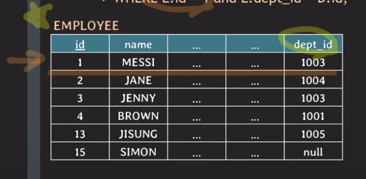

id가 1인 임직원의 정보를 EMPLOYEE에서 조회하면 dept_id를 얻을 수 있음. 그러나 이것만으로는 충분하지 않고, 부서의 id가 아닌 부서의 이름을 얻어야 한다. 그러면 최종적으로 임직원이 속한 부서의 이름은 EMPLOYEE Table에서 dept_id를 얻어서 이걸 바탕으로 DEPARTMENT Table과 연결해 주어야 한다.

- implicit join

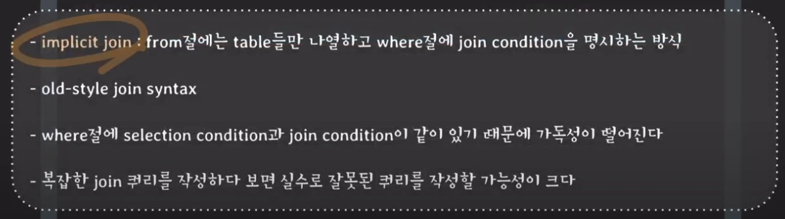

- explicit join

```sql
select D.name
from employee as E join department as D on E.dept_id = D.id
where E.id = 1;
```

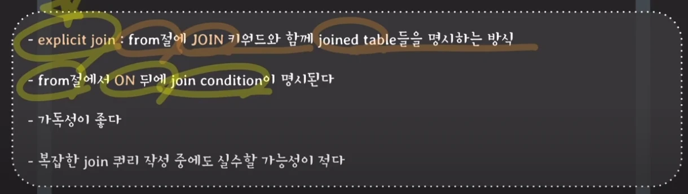

⇒ join은 explicit하게 사용하는 것이 좋다.

---

## Inner Join & Outer Join

- inner join

```sql
select *
from employee E join department D on E.dept_id = D.id;
```

⇒ 사실 위의 query는 (inner) join으로, 생략된 형태이다.

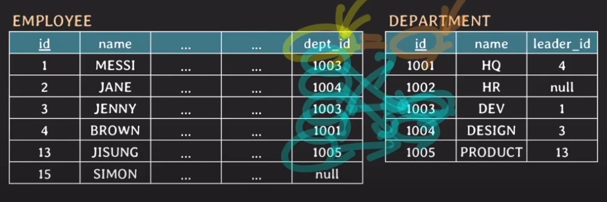

현재 위와 같은 Table이 있다고 할 때, SIMON은 dept_id와 id가 매칭되지 못하기 때문에 아래와 같이 결과가 나오게 된다.

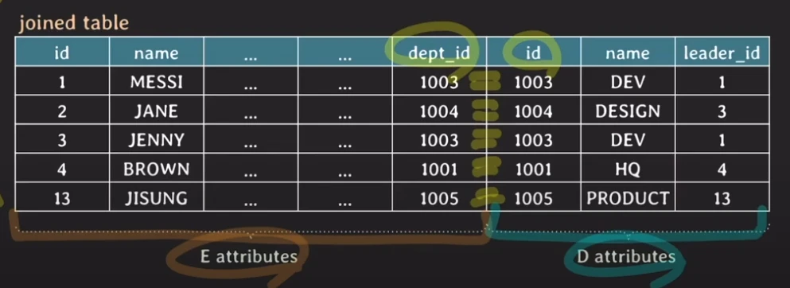

매칭이 되지 않기 때문에, E attributes에서는 SIMON이 존재하지 않고, D attributes에서는 HR 부서가 존재하지 않는다. (id 1002)

inner join에서는 두 table의 join condition을 만족하는 tuple(row)들로 result table을 만드는 방법.

⇒ join condition이 반드시 True여야만 가져오게 되는데, SIMON은 dept_id가 null이므로 매칭 불가.

```sql
from table1 [inner] join table2 on join_condition
```

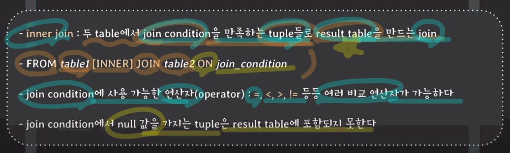

- outer join

outer join은 매칭되지 않는 row들도 result table에 포함하는 join 방식

1. left join

    ```sql
    from table1 left [outer] join table2 on join_condition
    ```

2. right join

    ```sql
    from table1 right [outer] join table2 on join_condition
    ```

3. full join

    ```sql
    from table1 full [outer] join table2 on join_condition
    ```

1) left outer join result

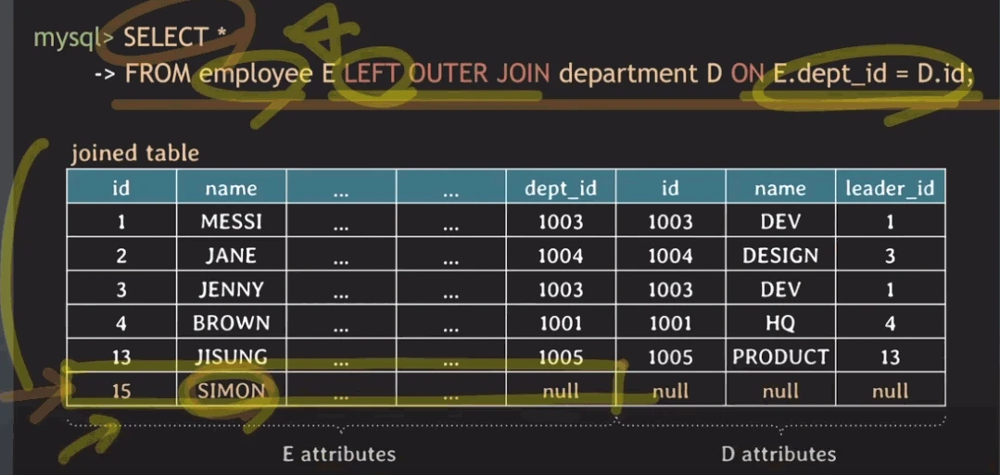

left join을 사용하면 E attributes에서 tuple의 데이터는 보존하지만, 매칭되는 값이 없을 경우 D attributes는 null로 표시된다.

2) right outer join result

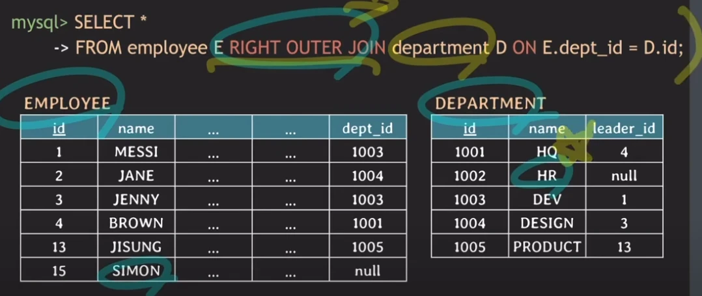

right join을 사용하면 D attributes에서 tuple의 데이터는 보존하지만, 매칭되는 값이 없을 경우 E attributes는 null로 표시된다.

3) MySQL에서는 full outer join을 지원하지 않는다.

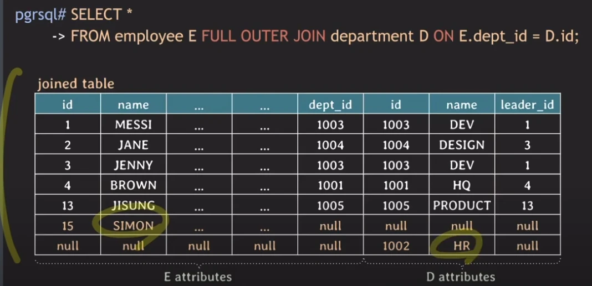

다만, 실행되면 이와 같은 결과가 나오게 된다. (둘다 보존함.)

---

## Equi Join

join condition (on) 에서 = (equality comparator) 을 사용하는 join

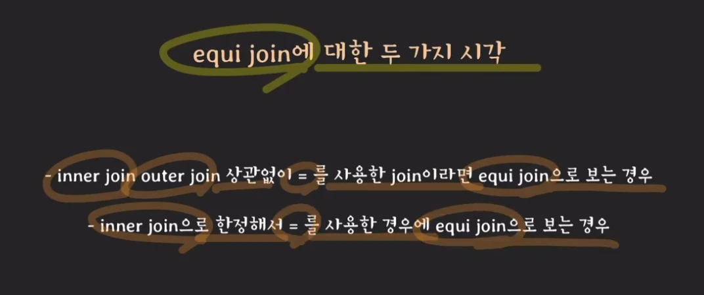

---

## Using

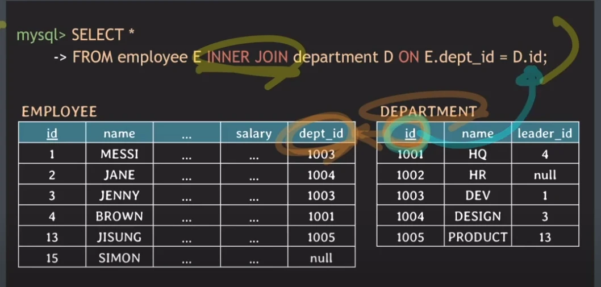

위의 예제에서, DEPARTMENT Table의 id column 이름을 dept_id로 바꿔주고 싶다.

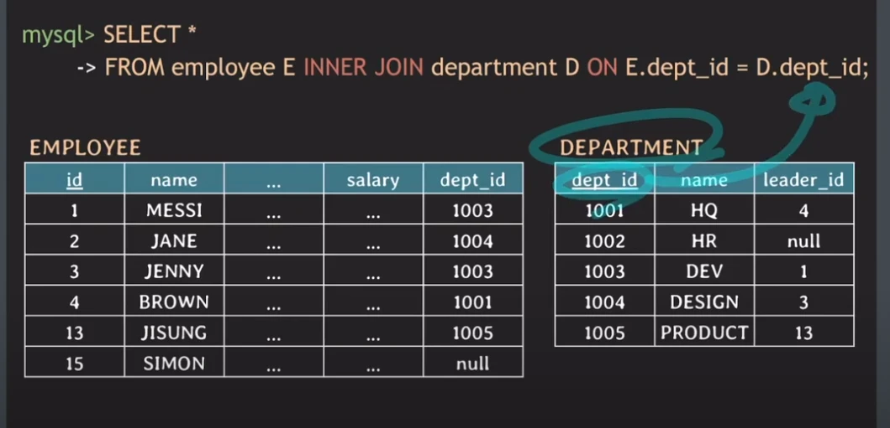

⇒ 바꾼 채로 query를 실행해도, 바꾸기 전과 똑같은 결과가 나오게 된다.

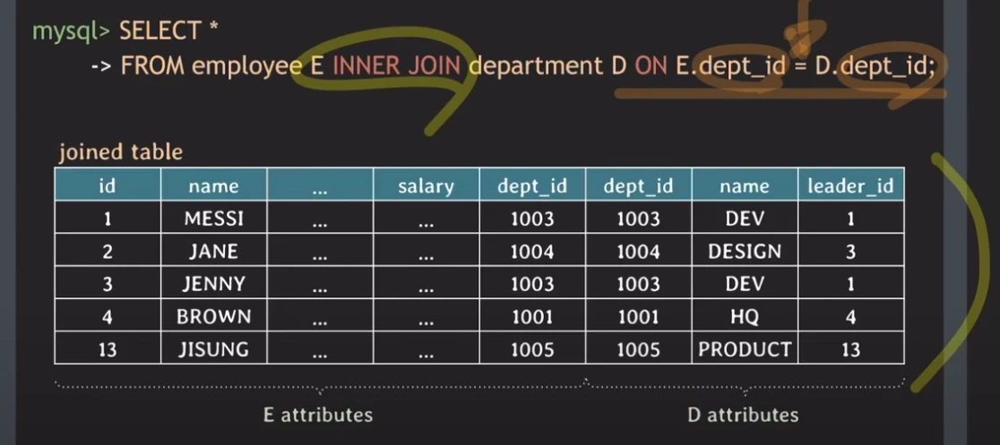

그런데, 이런 경우에는 dept_id를 굳이 두 번 적거나 두 번 보여줄 필요가 없을 것이다. 이럴 때 using 키워드를 사용하면 된다.

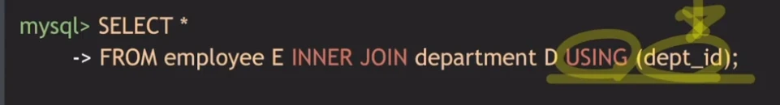

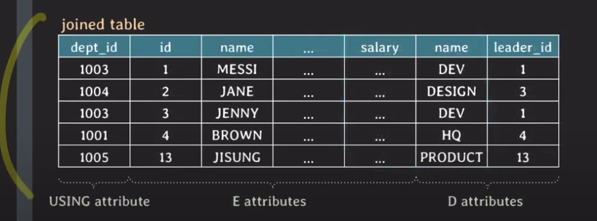

Using을 사용하면, 위와 같이 결과가 나오게 된다.

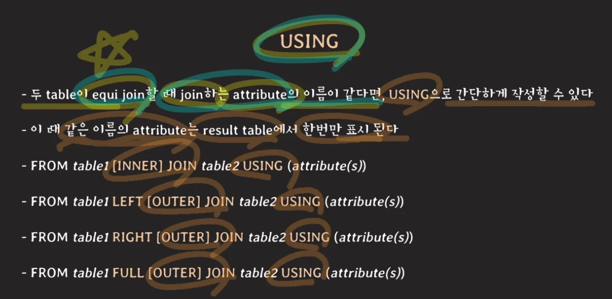

---

## Natural Join

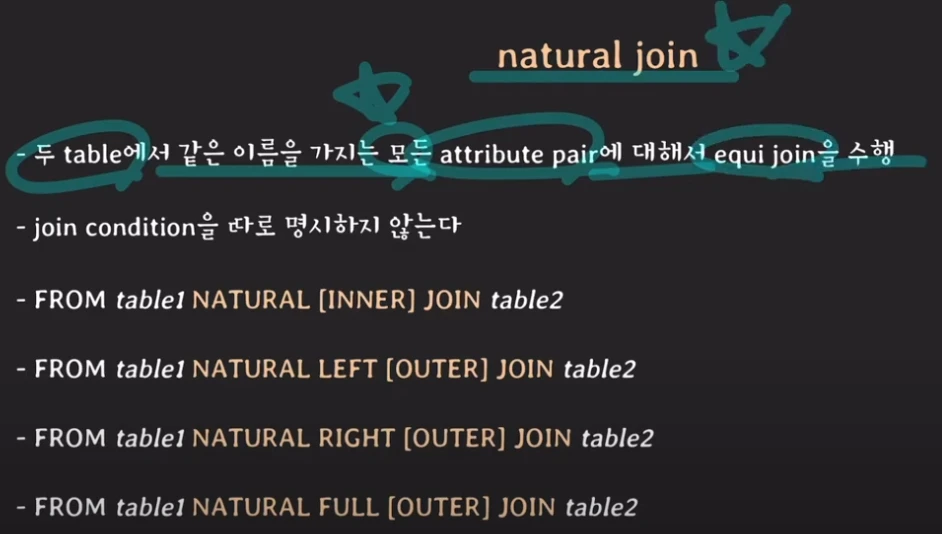

두 Table에서 이름이 같은 모든 Column에 대해 equi join을 수행하는 것을 말한다.

join condition을 따로 명시하지 않는다.

---

## Cross Join

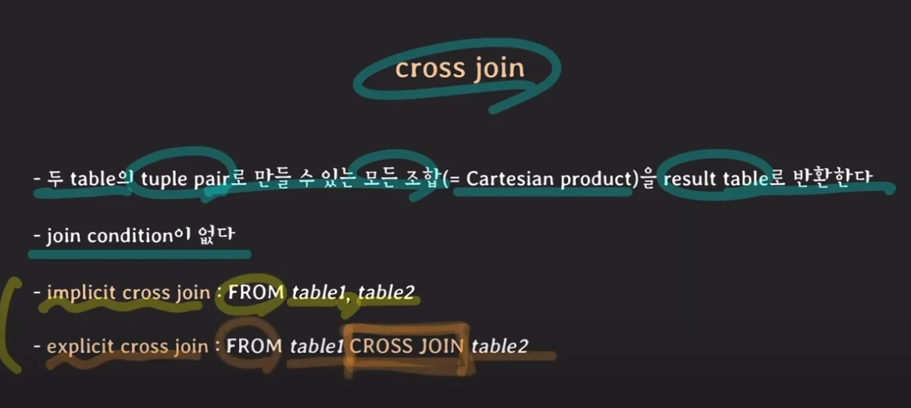

- explicit cross join

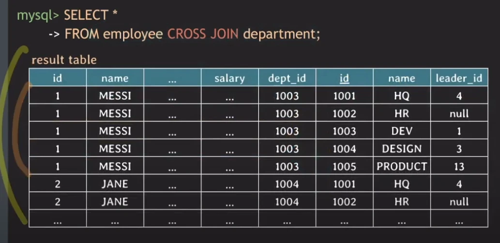

- implicit cross join

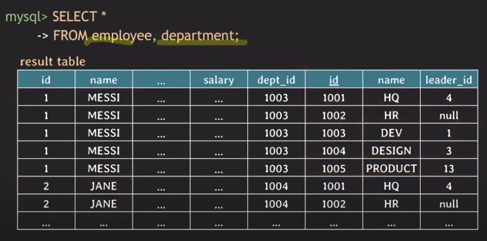

> 단, MySQL에서는 inner join = cross join = join 이다.

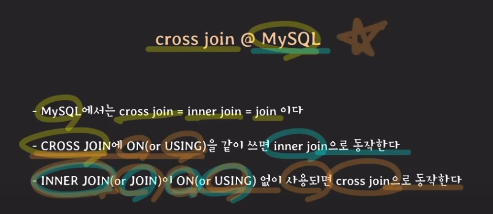

---

## Self Join

자기 자신에게도 join이 가능하다.

---

## Join Example

ex) ID가 1003인 부서에 속하는 임직원 중, 리더를 제외한 부서원의 ID, 이름, 연봉을 알고 싶다.

```sql
select * E.id, E.name, E.salary
from employee as E join department as D on E.dept_id = D.id
where E.dept_id = 1003 and E.id != D.leader_id;
```

⇒ 그러니까, join은 relation state를 뽑아내 주는 역할을 하며(snapshot), 여기서 또 다시 걸러내는 것은 where를 사용해야 한다.

ex) ID가 2001인 프로젝트에 참여한 임직원들의 이름과 직군과 소속 부서 이름을 알고 싶다.

⇒ 필요한 테이블 : works_on, employee, department

```sql
select E.name as empl_name,
			 E.position as empl_position,
			 D.name as dept_name
from works_on as W join employee as E on W.empl_id = E.id
									 left join department as D on E.dept_id = D.id
where W.proj_id = 2001;
```

⇒ left join이 핵심임.
