# 22 (functional dependency)

## Functional Dependency

- functional dependency(함수 종속)는 DB를 설계하는 방법의 기본이 된다.
- FD란? : 한 테이블에 있는 두 개의 attributes 집합 사이의 제약을 말한다.

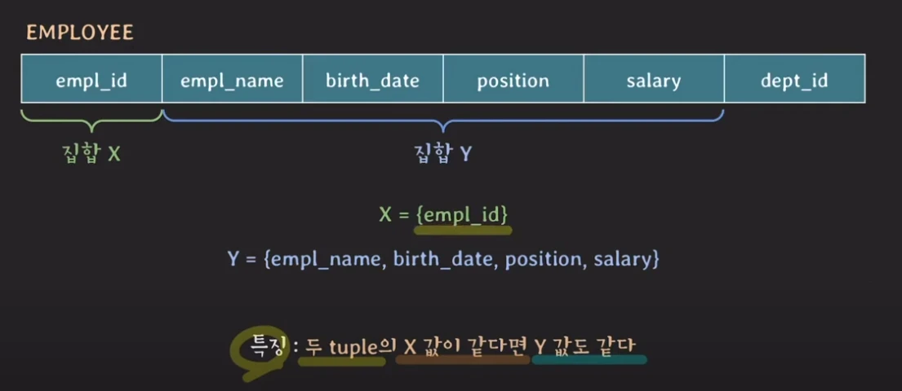

이와 같은 Table이 존재한다고 할 때, 우리는 X의 값이 같으면 Y의 값도 같다고 생각할 수 있다.

X 값에 따라 Y 값이 유일하게 결정될 때,

‘X가 Y를 함수적으로 결정한다.’, : functionally determine

‘Y가 X에 함수적으로 의존한다.’ : functionally dependent

⇒ 이러한 두 집합 사이의 제약 관계를 functional dependency 라고 한다. ( X → Y )

FD는 테이블의 Schema를 보고 의미적으로 파악해야 한다. 즉, 테이블의 state를 보고 FD를 파악해서는 안된다. (state relation : snapshot. 어떤 특정 순간에 선택된 tuples)

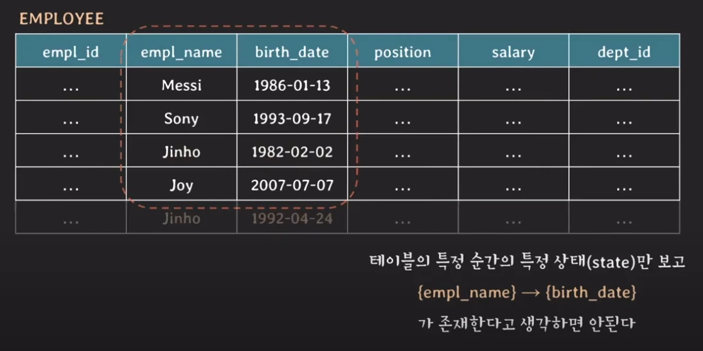

⇒ empl_name과 birth_date가 unique하게 pair로 매칭된다고 해서 empl_name → birth_date 라고 생각하면 안된다. 동명이인이 존재할 수 있고, 생일이 같은 사람이 있을 수도 있다.

ex)

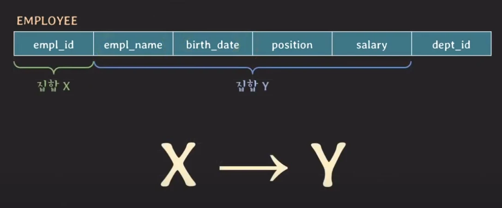

이와 같은 상황에서, X → Y 라고 말할 수 있다.

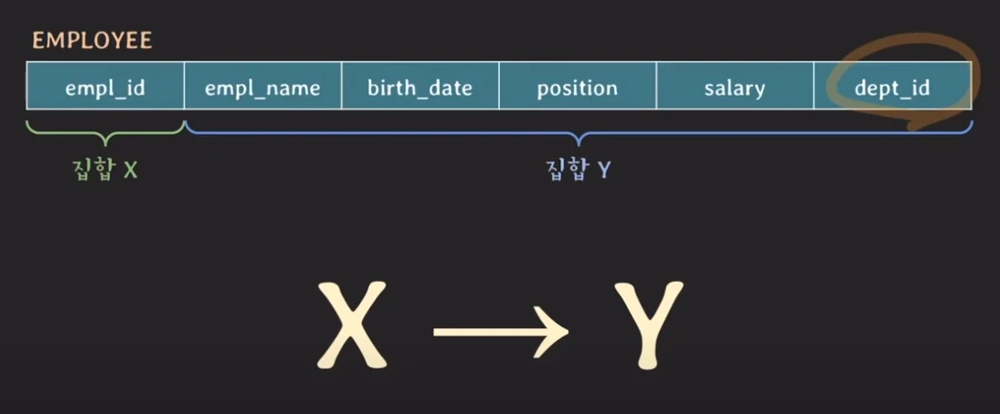

그런데 만약, 이와 같은 상황이 되면 어떨까?

1) 이 회사의 임직원이 반드시 한 번에 단 한 개의 부서에만 속할 수 있다면 X → Y가 될 수 있다.

2) 이 회사의 임직원이 여러 부서에 속할 수 있다면, X → Y가 될 수 없다.

> 구축하려는 DB의 attributes가 관계적으로 어떤 의미를 지닐지에 따라 FD들이 달라진다.

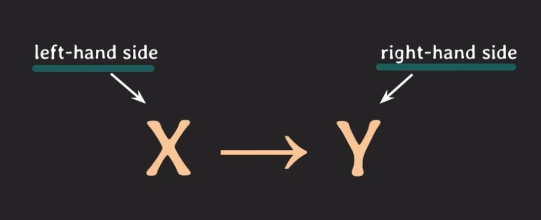

---

## Functional Dependency(FD) 예

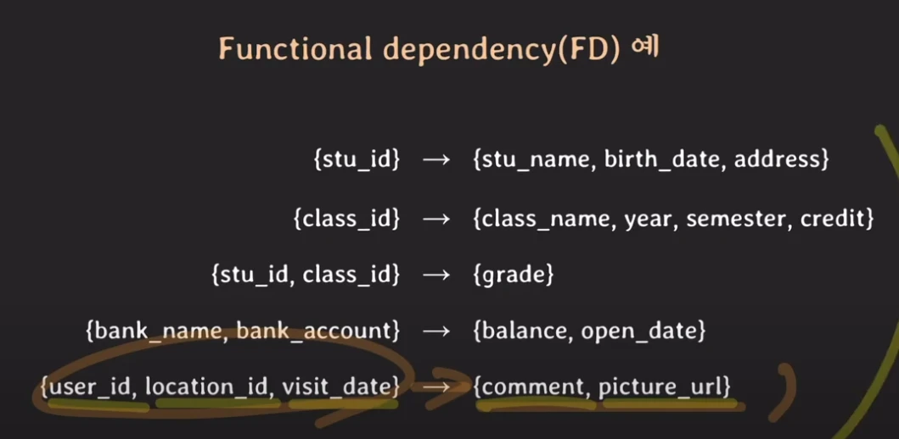

X → Y not means Y → X

- {} → Y : 항상 Y의 값이 같은 경우. (종속성이 없음. 항상성을 유지함.)

---

## Functional Dependency의 종류

- Trivial Functional Dependency

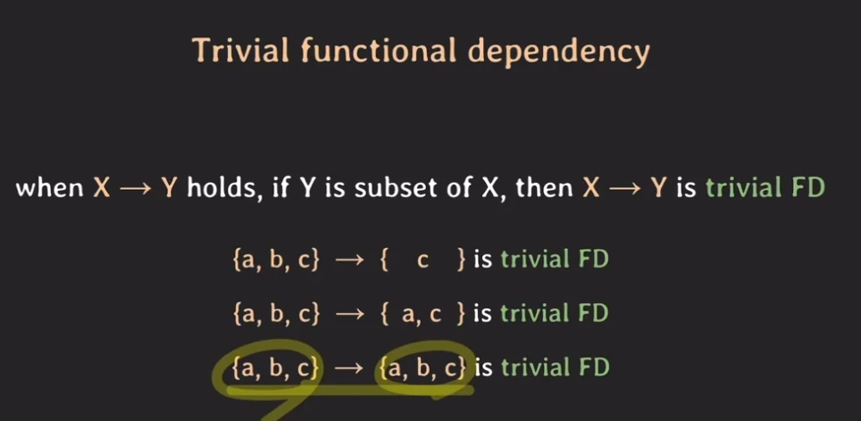

- Non-Trivial Functional Dependency

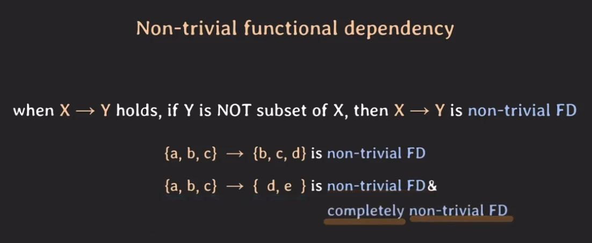

Non-Trivial Functional Dependency는 X → Y 의 관계가 유효할 때, Y가 X의 부분집합이 아닌 경우를 말한다. 이때, Y에 X의 원소가 하나도 포함되지 않는다면 이를 completely non-trivial FD라고 한다.

- Partial Functional Dependency

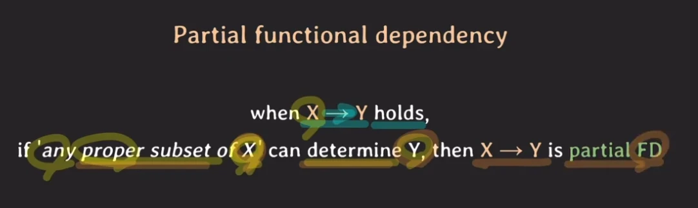

자기 자신이 아닌 어떤 부분 집합 X’라도 Y와의 dependency를 유지할 수 있다면, 이를 partial FD라고 한다. (모든 것을 포함하는게 아님. 단 한 개라도 유지하면 ok)

⇒ 이게 아니라면, 이 FD를 Full-Functional Dependency라고 한다.

Proper Subset

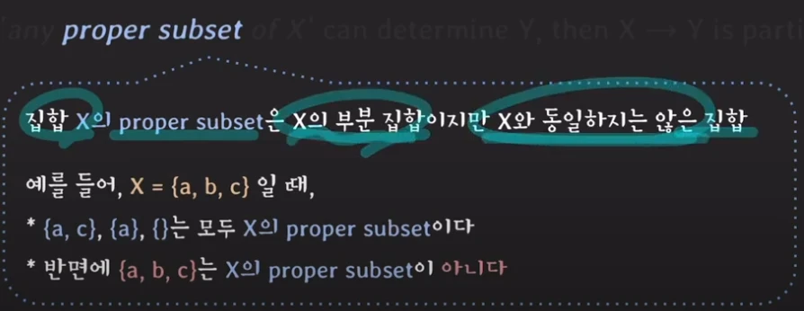

- Full Functional Dependency

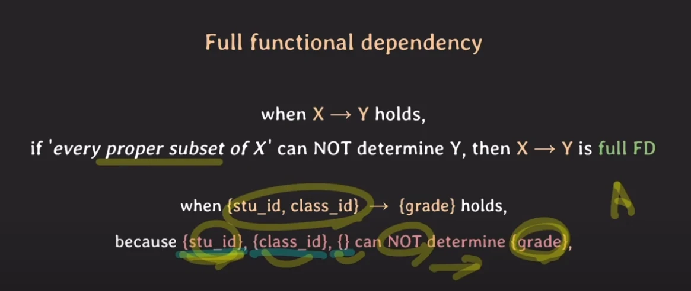

위의 예제는 반드시 {stud_id, class_id}가 있어야만 {grade}를 결정할 수 있다.
