# 23 (정규화-1)

작성일 2023-08-12 · 최종 수정일 2023-08-13
{ .post-date }

## DB 정규화(normalization)

데이터 중복과 insertion, update, deletion anomaly를 최소화하기 위해 일련의 normal forms(NF)에 따라 relational DB를 구성하는 과정

정규화 되기 위해 준수해야 하는 몇 가지 rule들이 있는데, 이 각각의 룰들을 Normal Form이라 한다.

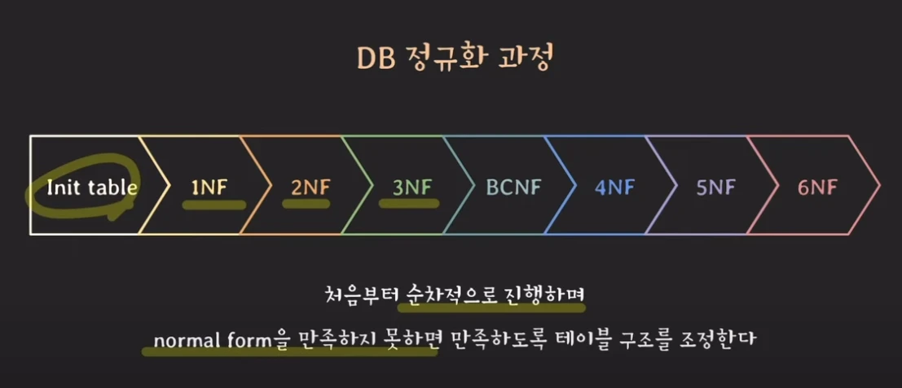

⇒ 앞 단계를 만족해야 다음 단계로 진행할 수 있다.

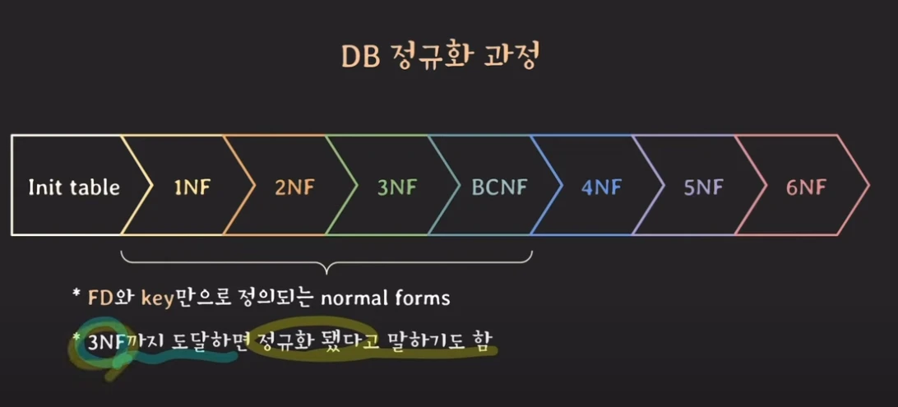

3NF를 만족하는지가 정규화의 최소 기준이 된다.

보통 실무에서는 3NF 혹은 BCNF까지 진행하며, 많이 해도 4NF 정도까지만 진행한다.

---

## 예제에 사용될 table 스키마 소개

- 임직원의 월급 계좌를 관리하는 테이블

- 월급 계좌는 국민은행이나 우리은행 중 하나

    - 따라서, bank_name은 국민은행 또는 우리은행 중 하나이다.

- 한 임직원이 하나 이상의 월급 계좌를 등록하고 월급 비율(ratio)를 조정할 수 있다.

    - ratio는 비율

- 계좌마다 등급(class)이 있다.

    - (국민: STAR → PRESTIGE → LOYAL, 우리 : BRONZE → SILVER → GOLD)

- 한 계좌는 하나 이상의 현금 카드와 연동될 수 있다.
- super key : table에서 tuple들을 unique하게 식별할 수 있는 attributes set

- (candidate) key : 어느 한 attribute라도 제거하면, 더 이상 unique하게 tuples를 식별할 수 없는 super key

    - {account_id}
    - {bank_name, account_num} : 각 은행 안에서는 계좌번호가 유일하다.

- primary key : table에서 tuple들을 unique하게 식별하려고 선택된 (candidate) key

    - 위에 나온 (candidate) key 들 중에서 하나를 선택하면 된다.
    - 가능한 attribute가 적은 (candidate) key를 선택하는 것이 좋으므로, {account_id}를 선택하도록 한다.

- prime attribute : 임의의 key에 속하는 attribute

    - {account_id}
    - {bank_name}
    - {account_num}

- non-prime attribute : 어떠한 key에도 속하지 않는 attribute

    - {class}
    - {ratio}
    - {empl_id}
    - {empl_name}
    - {card_id}

- **Functional Dependency**

    현 예제에서 primary key는 account_id 이므로, account_id가 동일하면 그 외의 모든 값들은 동일할 것이다.

    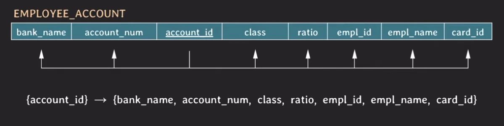

    또한, (candidate) key 였던 {bank_name, account_num}이 있으므로, FD가 생긴다.

    

    {empl_id} → {empl_name}

    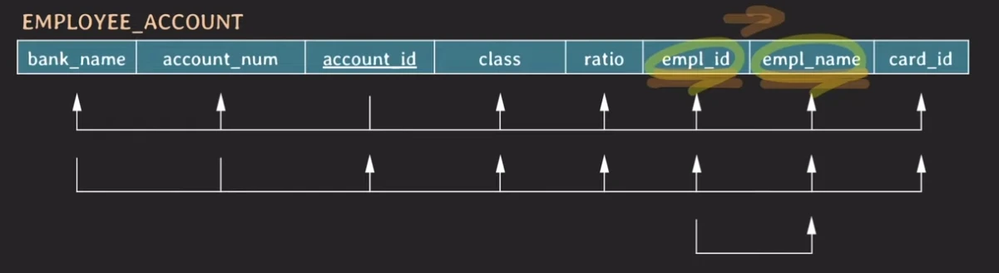

    국민은행 계좌의 등급과 우리은행 계좌의 등급은 겹치지 않는다. 즉, 등급만 보면 국민은행인지, 우리은행인지 구분할 수 있다.

    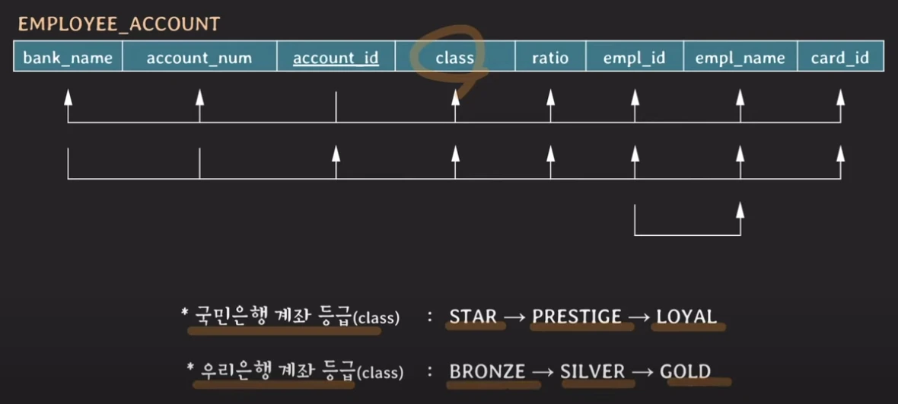

    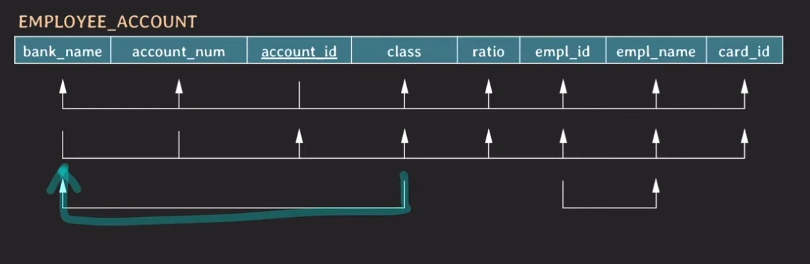

---

## 정규화(Normalization) 시작

정규화를 통해 어떻게 데이터가 줄어들 수 있는지 보기 위해서 데이터가 어느정도 있는 상태로 시작

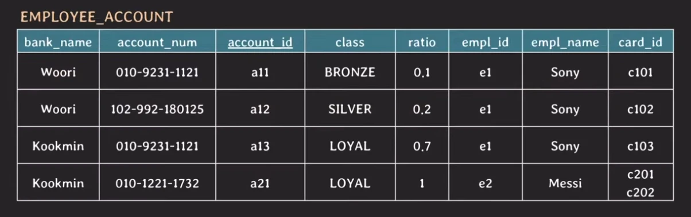

현재 Sony는 세 개의 계좌로 월급을 나눠서 받고 있다.

Messi는 한 개의 계좌에 월급을 받고 있다. 단, card가 두 개 등록되어 있다.

> 1NF : attribute의 value는 반드시 나눠질 수 없는 단일한 값이어야 한다.

그런데, Messi의 card는 두 개가 등록되어 있으므로 이는 1NF를 위반하고 있는 것이다.

이것을 처리할 수 있는 방법은 아주 다양하지만, 아래와 같이 해결하도록 해 보자.

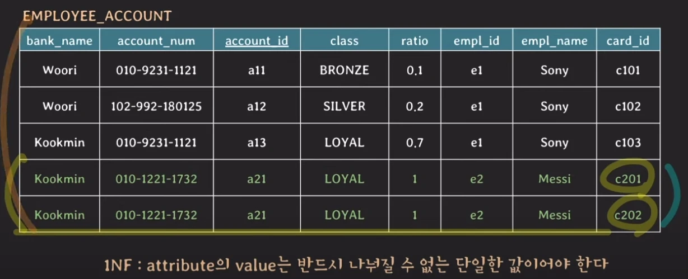

⇒ 다만 이렇게 하면 Primary Key도 다시 설정해야 하고, ratio도 이상해진다.

왜 중복 데이터가 생긴걸까?

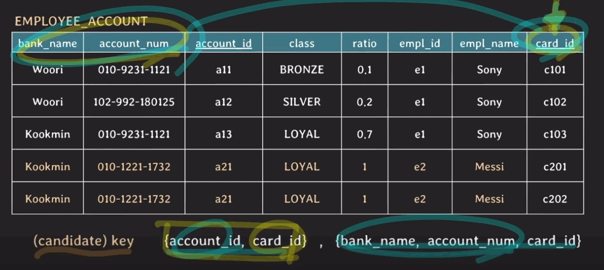

이전까지는 (candidate) key가 {account_id}, {bank_name, account_num} 이었다. 하지만 card_id를 나눠주게 됨으로써 기존의 key만으로는 unique 판별이 불가능하게 되었다.

따라서 key를 **{account_id, card_id}**, <strong>{bank_name, account_num, card_id}</strong>로 교체해야 한다.

⇒ 이 상태에서 Non-Prime Attribute는?

class, ratio, empl_id, empl_name

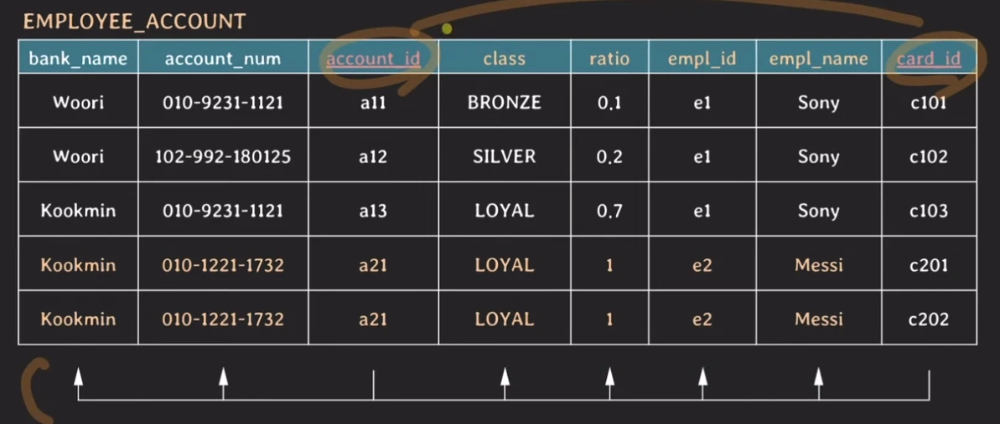

즉, 현재 상태에서는 Non-Prime Attribute들이 account_id, card_id에 의존하고 있다. 그런데, 모든 Non-Prime Attribute들이 반드시 두 개의 key에 의존해야만 할까? 그렇지는 않다.

사실은 account_id만 있어도 unique함을 파악할 수는 있다.

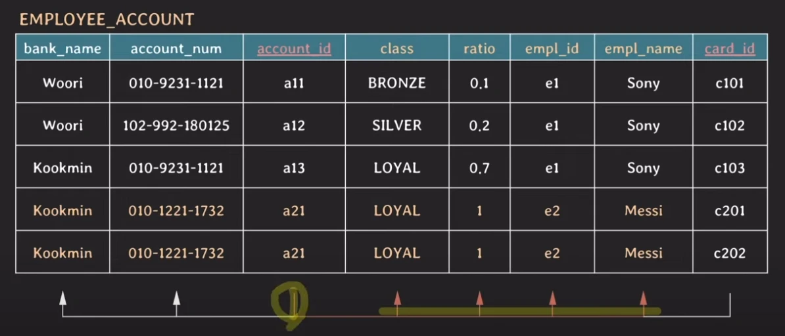

> 모든 Non-Prime Attribute 들이, {account_id, card_id}에 대해서 partially dependent 하다.

또한, {bank_name, account_num} 만으로도 card_id를 제외한 다른 Non-Prime Attribute를 unique하게 구분할 수 있기 때문에, 현재 이 Table은 모든 Non-Prime Attribute들이 {bank_name, account_num, card_id}에 partially dependent 하다고 할 수 있다.

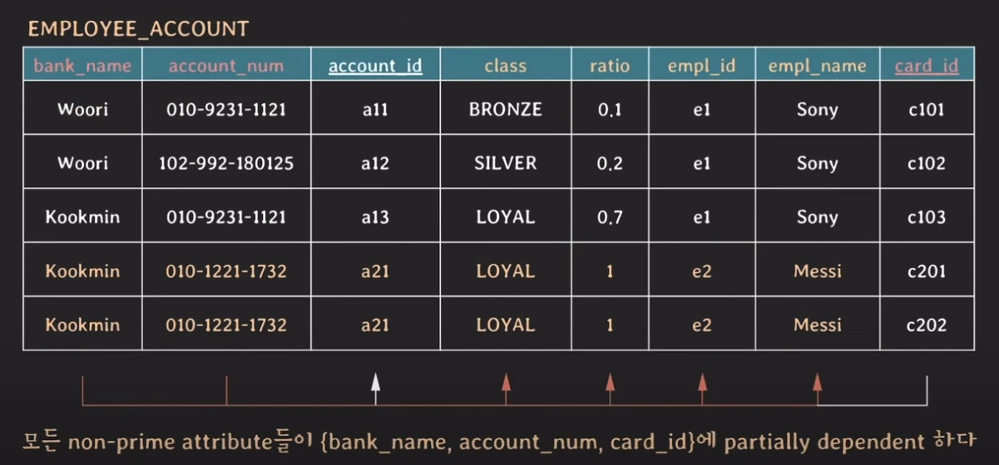

이 문제를 해결하기 위해서 등장한 것이 바로 2NF (2nd Normal Form) 이다.

> 2NF : 모든 Non-Prime Attribute는 모든 Key에 대해서 Fully Functionally Dependent 해야 함.

문제의 원인은 card_id 이다. 이 문제를 해결하려면, card_id를 이 table에서 분리시켜야 한다.

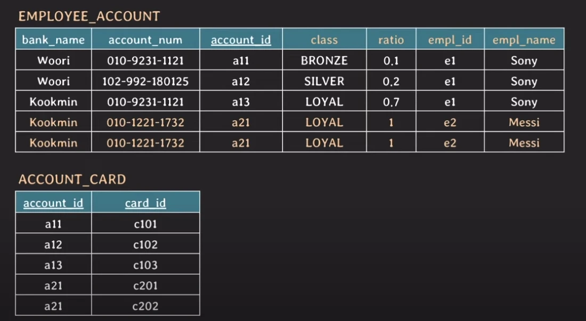

연결 고리를 없애면 안되기 때문에 account_id를 추가한다. 또, 이 상황에서 EMPLOYEE_ACCOUNT Table에서 Messi의 Tuple 두 개가 완전히 동일해지기 때문에 하나를 지워준다.

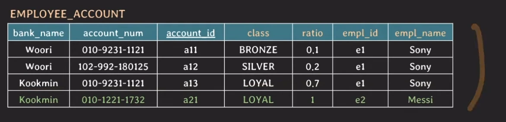

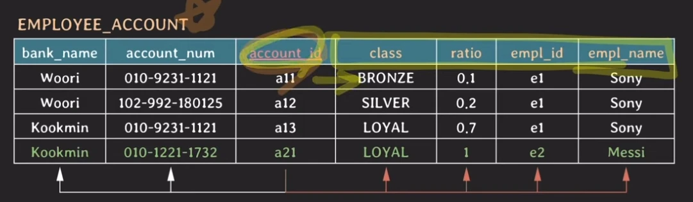

이제 Non-Prime Attribute들이 모두 Key에 대해 Fully Functionally Dependent 하다.

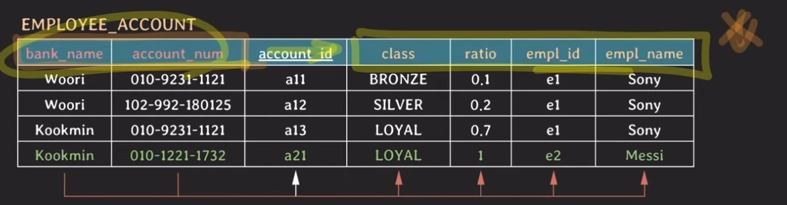

또한, account_id가 아닌 다른 candidate key인 {bank_name, account_num}에 대해서도 Fully Functionally Dependent하게 되었다.

그러므로 이제 이 Table은 2NF를 만족하게 되었다.
