# 24 (정규화-2)

작성일 2023-08-13
{ .post-date }

## 3NF 이해하기

- 3NF를 적용해 보자.

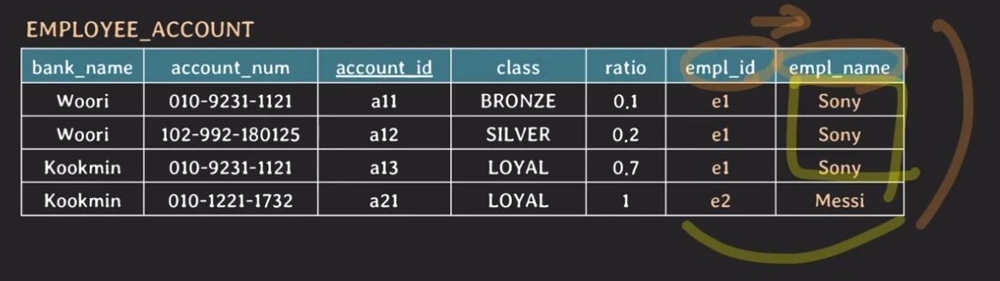

2NF까지 적용했을 때, EMPLOYEE_ACCOUNT 테이블은 empl_name이 겹치는 Row가 존재하게 된다. 왜 이런 중복이 발생하는지 확인하기 위하여 Functional Dependency를 나타내보자.

- account_id key로 나타내기

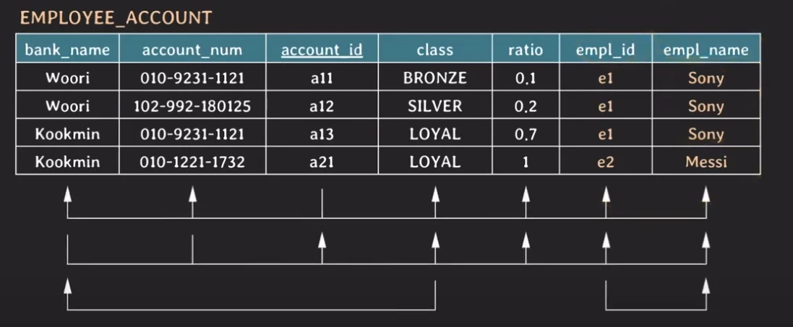

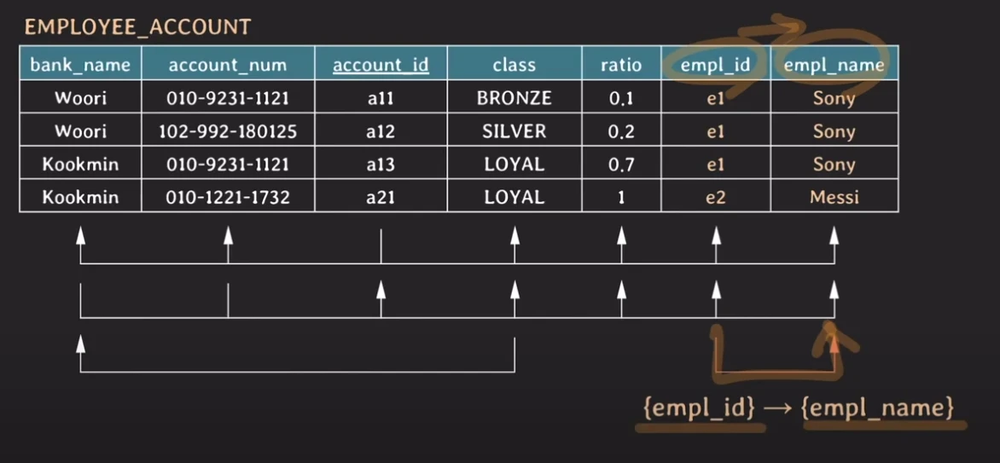

⇒ {empl_id} → {empl_name}

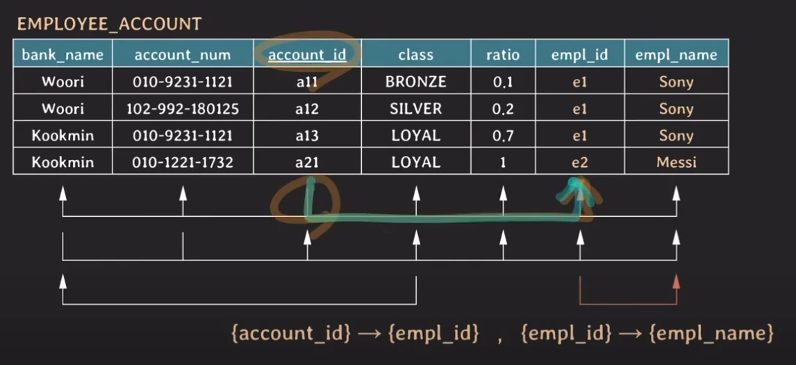

⇒ {account_id} → {empl_id}

현재, {account_id} → {empl_id} → {empl_name}의 상황이므로, 이를 축약해서 표현하면

{account_id} → {empl_name}으로 나타낼 수 있다.

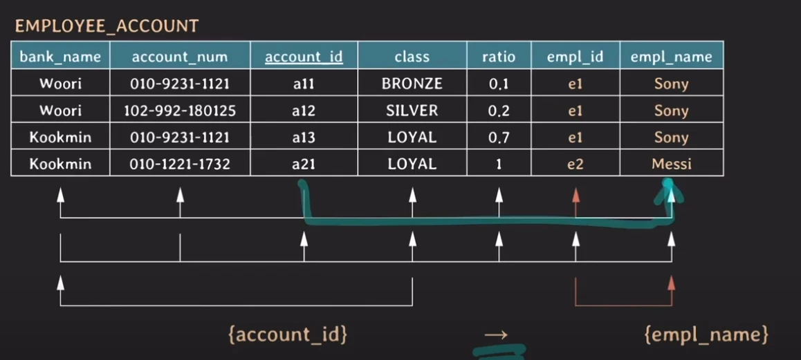

이제 account_id로 empl_name도 unique하게 나타낼 수 있다.

- {bank_name, account_num}으로 나타내기

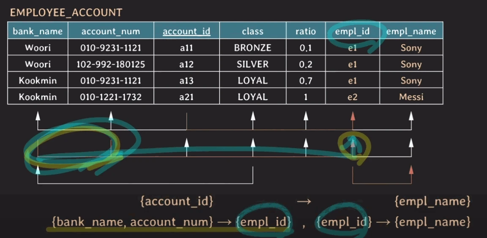

여기서도 마찬가지로 {bank_name, account_num} → {empl_id} → {empl_name} 이므로, 이를 축약해서 {bank_name, account_num} → {empl_name}으로 나타낼 수 있다.

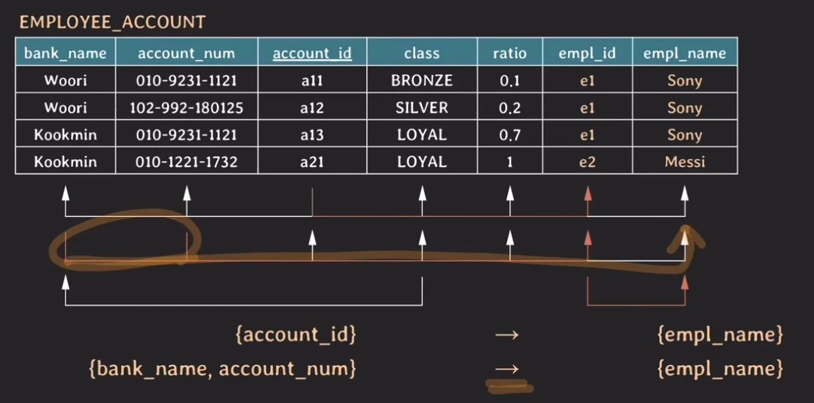

이런 방식으로, 연결되어서 FD가 존재할 수 있을 때. 이를 **transitive FD**라고 부른다.

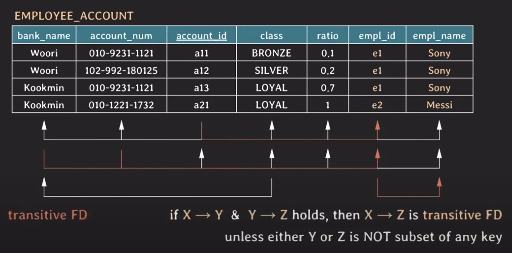

X → Y & Y → Z 일 때, Y나 Z가 어떤 키의 부분 집합이 아니면 이를 transitive FD라고 한다.

⇒ empl_id와 empl_name은 Non-Prime Attribute이기 때문에 위의 조건을 만족함.

- 그런데, account_id가 class를 결정짓고, class가 bank_name을 결정지으니까 이건 transitive FD 아니냐? 라고 할 수도 있는데, 이것이 아닌 이유는, bank_name은 key의 subset이기 때문에 transitive FD가 될 수 없다.

⇒ 결론적으로 이 테이블에서 transitive FD는 {account_id} → [empl_id] → {empl_name}, {bank_name, account_num} → [empl_id] → {empl_name}만 존재한다.

> 3NF : 모든 Non-Prime Attribute는 어떤 key에도 transitively dependent하면 안된다.  
> non-prime attribute와 non-prime attribute 사이에는 FD가 있으면 안된다.

⇒ 즉, 지금처럼 transitive FD가 있으면 안된다.

---

## 해결법

FD를 없애기 위해서 또 다른 테이블을 만들어 준다.

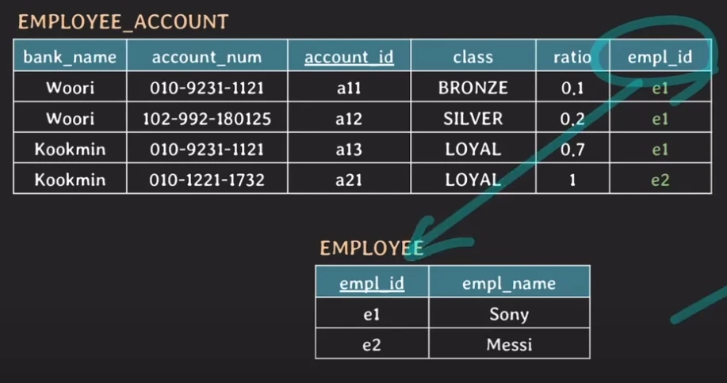

⇒ 이렇게 만들면 EMPLOYEE_ACCOUNT Table은 모든 Non-Prime Attribute가 어떤 Key에도 transitively dependent 하지 않게 되기 때문에 3NF를 만족하게 된다.

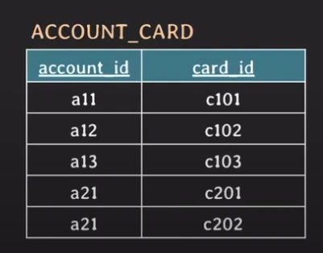

이전에 만들었던 ACCOUNT_CARD도 3NF를 만족하는지 살펴보아야 되는데, 확인해보면 account_id와 card_id가 모두 key에 포함될 수 있으므로, Non-Prime Attribute가 존재하지 않아 만족된다고 할 수 있음.

---

## BCNF

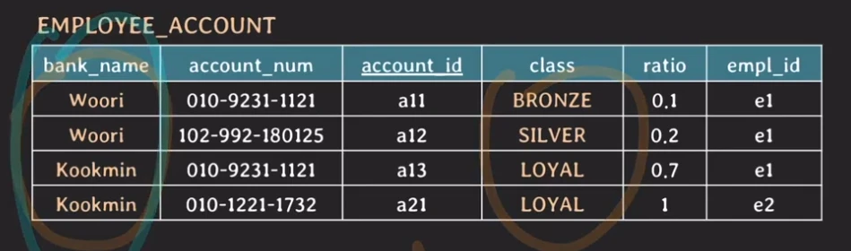

EMPLOYEE_ACCOUNT Table에서는, bank_name과 class가 중복이기 때문에, 데이터가 쌓일수록 중복 데이터가 점점 늘어나게 될 것이다.

그런데 현재 class가 bank_name을 FD하고 있다. 그러면 이런 관계가 있다면 굳이 중복이 발생하는 데이터인 bank_name을 굳이 Table에서 들고있을 필요가 없다.

> BCNF : 모든 유효한 Non-trivial FD X → Y는 X가 super key여야 한다.

- super key : 해당 Table에서 Tuple을 Unique하게 식별할 수 있는 집합

⇒ 이 정의에 따르면 class는 EMPLOYEE_ACCOUNT Table의 super key가 아니다. 이렇게 되면 이 Table은 BCNF를 위반하게 된다. (왜냐면, {class} → {bank_name}이라는 non-trivial FD가 있지만, {class}는 해당 Table의 super key가 아니기 때문이다.)

- non-trivial FD : X → Y 일때, Y가 X의 부분집합이 아닌 경우.

BCNF를 만족하게 만들기 위해서, class와 bank_name을 다른 테이블로 옮겨보자.

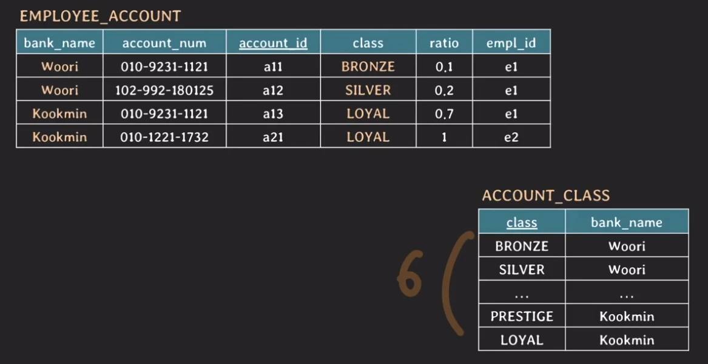

이렇게 하면, EMPLOYEE_ACCOUNT에서는 bank_name을 제거할 수 있다.

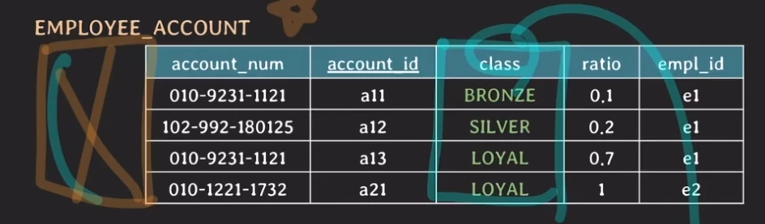

---

## 전체 테이블

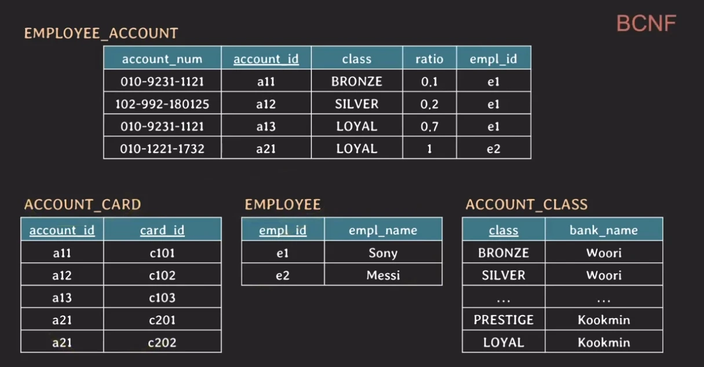

---

## 2NF 참고사항

> 2NF는 Key가 composite key가 아니라면 자동적으로 만족된다?

- composite key : 두 개 이상의 attribute로 이루어진 key
- 2NF : 모든 Non-Prime Attribute는 모든 key에 대해서 fully dependent 해야 한다.

⇒ 모든 Non-Prime Attribute는 어떤 key에도 partially dependent 하면 안된다.

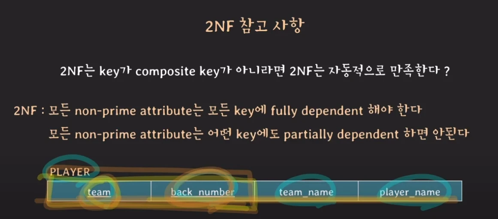

PLAYER라는 Table이 있을때, team/back_number 하나만으로는 unique하게 식별할 수 없기 때문에 team, back_number를 조합하여 primary key로 활용해야 한다.

그런데, team_name은 team만으로도 unique하게 식별될 수 있다.

그 이유는 team_name이 key에 대해서 fully dependent(composite key의 모든 원소가 있어야만 유일성을 식별할 수 있는 경우)한 것이 아니라, partially dependent(composite key의 일부 원소만 있어도 유일성을 식별할 수 있는 경우)하기 때문이다.

그래서 2NF는 Key가 composite key가 아니라면 자동적으로 만족된다? 는 말이 나오는 이유는, 애초에 Table의 key가 composite key가 아니라면 partially dependent한 경우가 아예 발생할 수도 없기 때문에 가능한 것이라는 논리이다.

⇒ 보통은 맞는 논리이다. 하지만, 예외적인 상황이 있다.

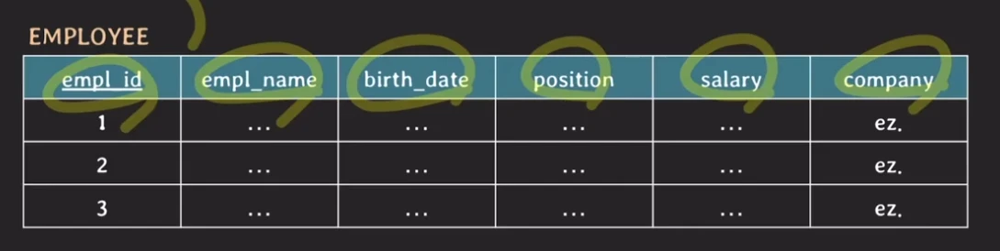

다음과 같은 Table을 보자. 만약 company 값이 항상 ez.로 동일하다고 해보자. 이 상황에서 FD를 표현해 보자.

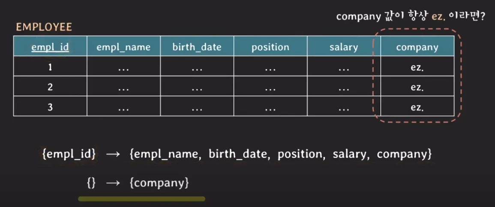

이렇게 되면, company는 empl_id에 fully dependent한 것이 아니라 partially dependent한다.

⇒ 즉, 이 Table이 2NF를 위반한다.

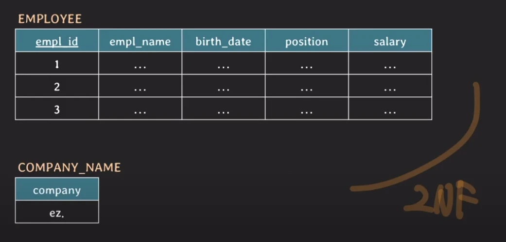

따라서 이와 같은 형태의 Table로 구성되어야 2NF를 만족한다고 말할 수 있게 된다.

---

## denormalization (역정규화)

굳이 이렇게 까지 많은 테이블을 만들면서 정규화를 해야 할까? 라고 생각할 수도 있다.

너무 많은 테이블을 쪼개서 Join을 사용하게 되면 성능이 저하되고 관리가 어려운 이슈가 발생하기 때문에, 적당한 선에서 쪼개지 않을 수도 있다. 이전에 사용한 예를 봤을 때 BCNF까지는 하지 않고 3NF까지만 적용할 수도 있는 것.

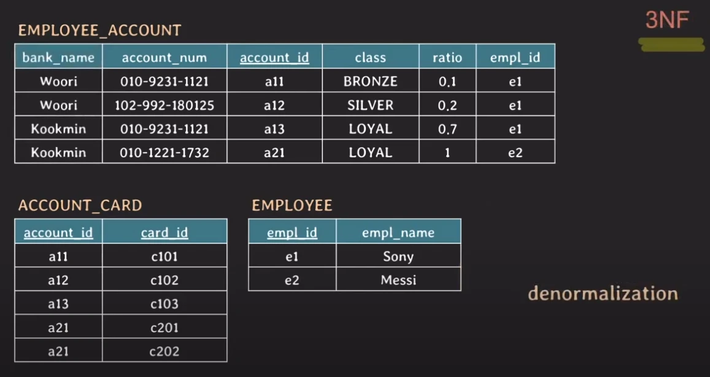

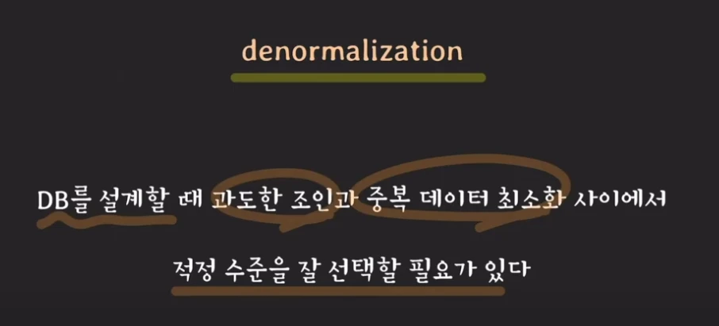
