# 25 (index)

작성일 2023-08-13
{ .post-date }

## Index에 따른 성능 차이

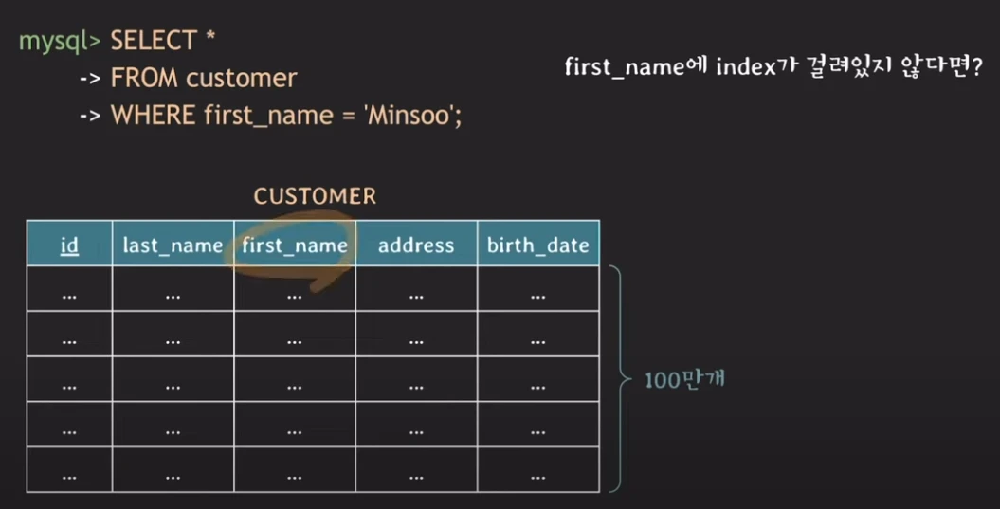

이와 같은 테이블이 있고, query를 사용하여 100만 개의 row 중에서 first_name이 Minsoo인 사람들을 찾아내고 싶다. 이 상황에 first_name에 index가 걸려있지 않다면?

⇒ **100만 개의 row를 모두 탐색해야 한다. 이를 full scan으로 찾아야 한다. O(n)**

**하지만 index가 걸려있다면, full scan보다 빠른 탐색을 하게 된다. O(logN)**

> Index를 쓰는 이유 : 조건을 만족하는 Row를 빠르게 조회하기 위해서  
> 혹은 빠르게 정렬(order by)하거나 그룹핑(group by)하기 위해서이다.

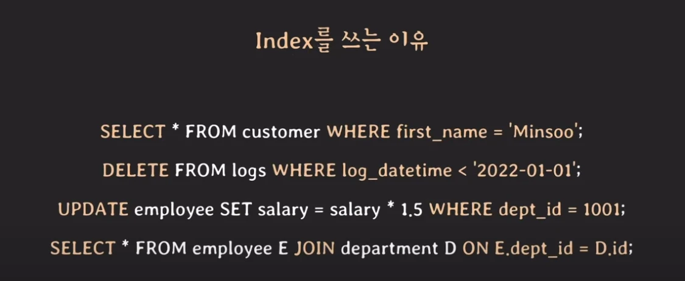

이와 같은 query들이 있다고 해보자. 모두 특정 조건을 만족하는 데이터들을 찾는 query이며, join할 때도 on을 통해서 특정 조건을 만족하는 것을 찾게 된다.

Index를 사용하는 이유는, 특정 조건을 만족하는 데이터를 빠르게 찾기 위해 사용된다.

---

## Index를 거는 문법


```sql
SELECT * FROM player WHERE name = 'Sonny';
SELECT * FROM player WHERE team_id = 105 and backnumber = 7;
```

위와 같은 두 개의 query를 사용한다고 해보자. 이 query를 빠르게 사용하기 위해서 index를 생성해 보자.

name은 중복되는 데이터가 존재할 수 있으므로, **중복을 허용하는 index**를 걸어야 한다.

```sql
CREATE INDEX player_name_idx ON player (name);
```

서로 다른 팀에서는 같은 등번호가 존재할 수 있지만, 같은 팀에서는 같은 등번호가 존재할 수 없다. 그러므로 이와 같은 경우에서는 team_id와 back_number를 합쳐서 index로 만들어주어야 한다.

```sql
CREATE UNIQUE INDEX team_id_backnumber_idx ON player(team_id, backnumber);
```

- 처음 테이블을 생성할 때부터 index 걸기

만약 테이블을 생성할 때 index를 걸게 되면 index의 이름을 생략할 수도 있다.

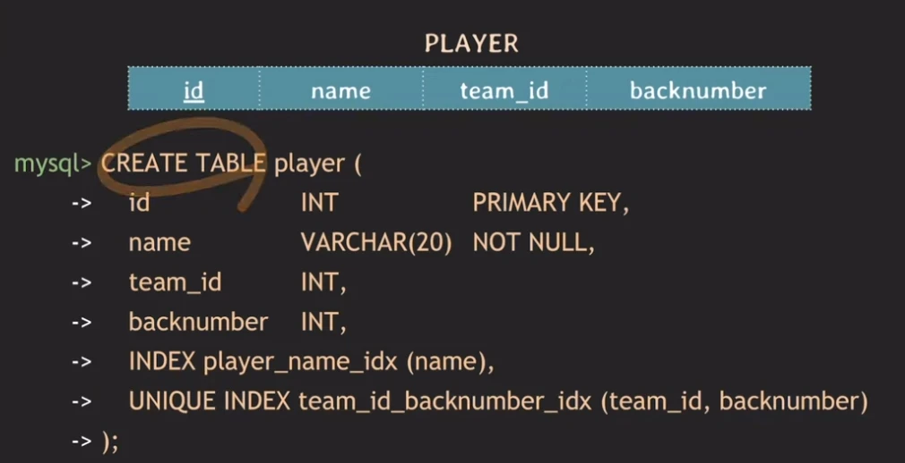

⇒ team_id, backnumber를 합쳐서 index를 거는 것을 multicolumn index, composite index 등으로 부른다.

- 대부분의 RDBMS는 Primary Key에는 index를 자동으로 생성한다.
- Table에 걸린 index 정보 보는 법

```sql
SHOW INDEX FROM player;
```

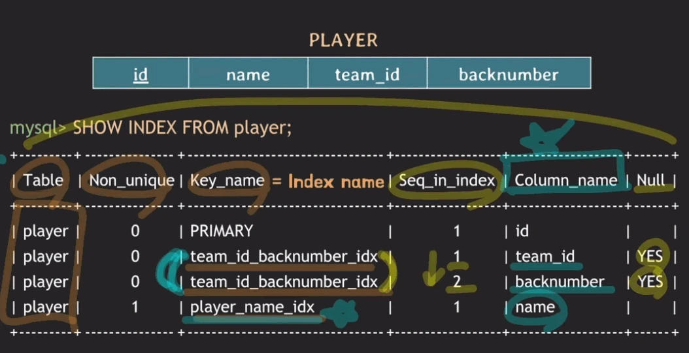

---

## B tree 기반의 index 동작 방식

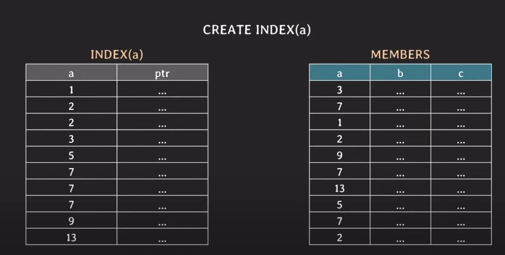

다음과 같이 MEMBERS 라는 테이블에 a, b, c column이 있다. 여기서 a에 대해 index를 생성하게 되면 왼쪽 INDEX(a)와 같이 만들어지게 된다. ⇒ **B-tree based**

a의 값들이 정렬된 상태로 저장된다. (오름차순) 그리고 pointer라는 데이터를 가져서, 실제 MEMBERS 테이블에 대한 연결고리를 담당한다.

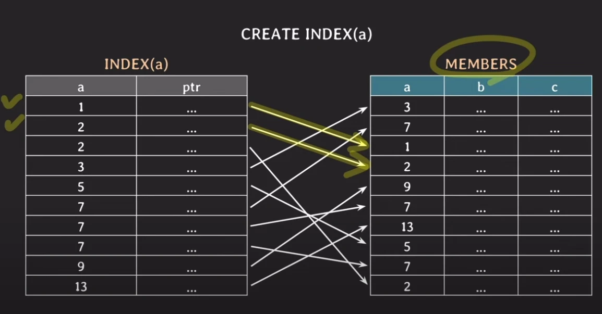

여기서 WHERE a = 9;를 통해 a가 9인 row를 찾아보도록 하자.

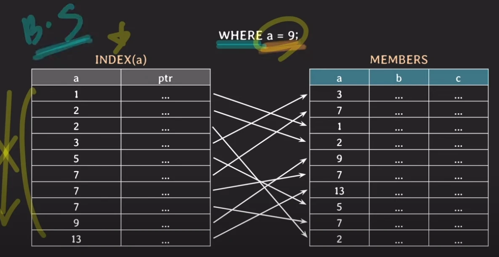

그런데, 처음부터 하나씩 정렬이 되어 있기 때문에 순차탐색이 아니라 Binary Search를 하게 된다.

이제 조건이 바뀌어서 WHERE a = 7 and b = 95; 에 대해서 찾아보도록 하자.

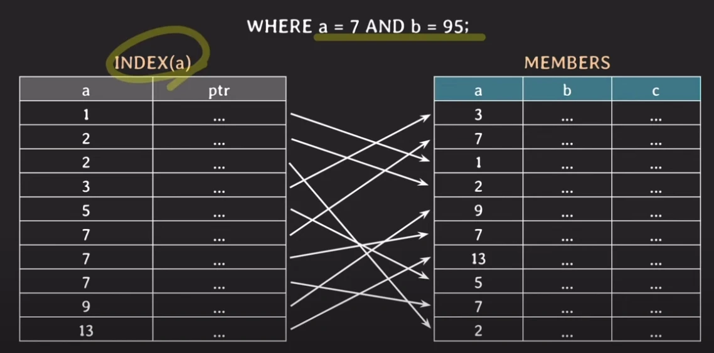

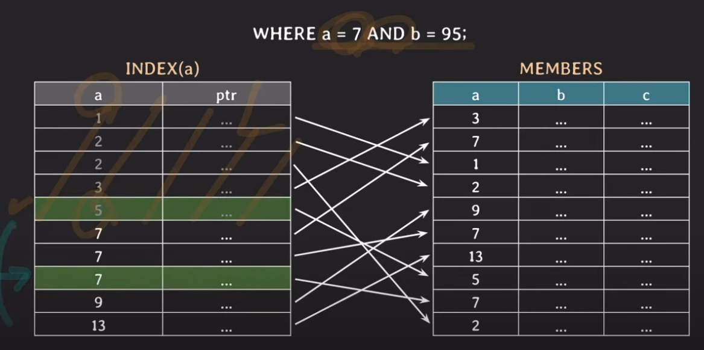

먼저 Binary Search로 7을 찾아낸다. 그런데, b = 95라는 조건도 있으므로 이것도 만족하는지 찾아야 한다. 또한, a = 7이 더 있을 수도 있으므로 현재 찾아낸 중앙의 7 위와 아래를 모두 탐색해야 한다.

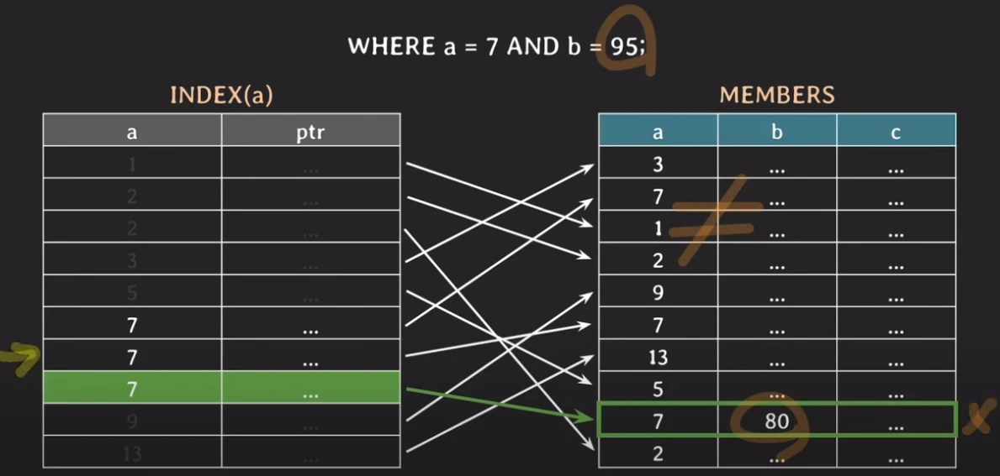

먼저 첫 번째로 선택된 7의 row로 가서, b의 값이 95인지 확인한다. 이 row는 b가 80이므로 조건에 맞지 않아 선택되지 않는다.

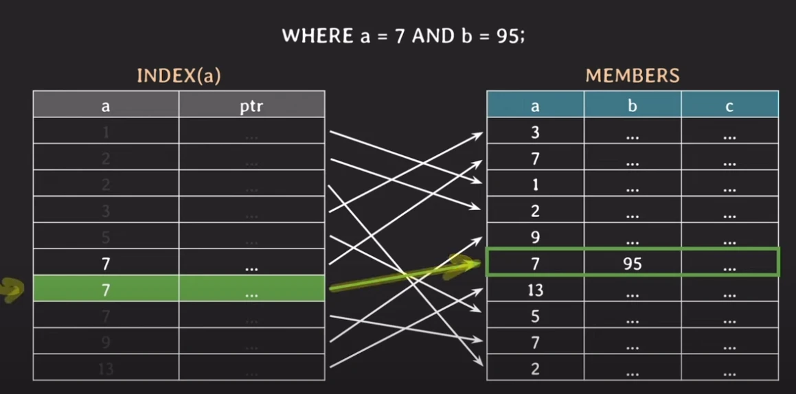

다음 row로 가서 b값을 확인한다. 이번에는 b가 같으므로 선택된다. 하지만 이 조건을 만족하는 row는 더 있을 수 있으므로 나머지도 탐색해야 한다.

즉, 우리는 a의 index를 활용해서 a 조건을 만족하는 row를 빠르게 찾아낼 수 있다. 하지만 추가적인 조건인 b 조건도 만족하는지 알아보아야 하기 때문에 해당 row로 가서, b 조건을 만족하는지도 확인해 보아야 한다.

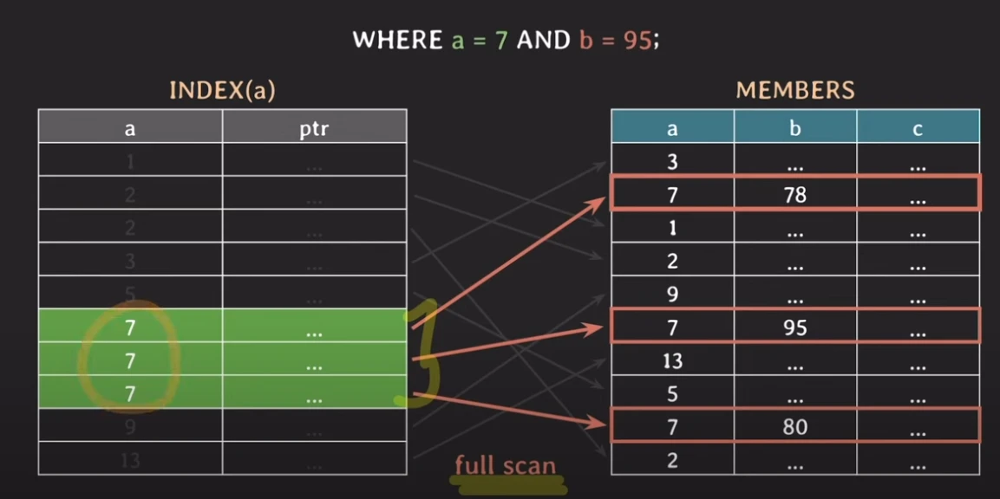

⇒ 그러므로 b 조건에 대해서는 **full scan**을 실시해야만 한다.

> 현재는 row의 수가 매우 적기 때문에 크게 문제되지 않는 것처럼 보이지만, 실제 서비스에서는 b의 값을 확인하기 위해 굉장히 많은 탐색을 해야할 수도 있다. 따라서 b에 대해서도 효율적인 탐색을 하기 위해서는 a, b를 묶어서 index로 지정해 주어야 한다.

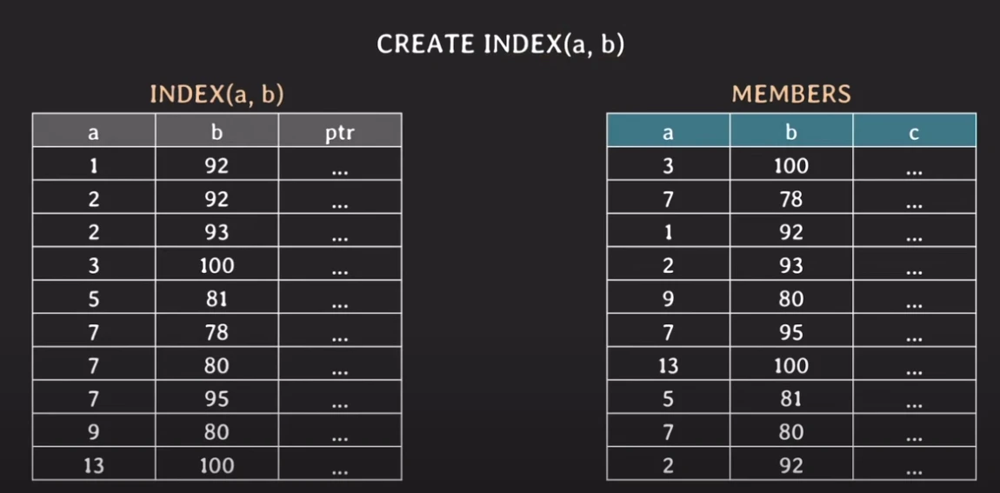

여기서 주목해야 할 점은, composite index는 어떤 방식으로 정렬이 되는가? 이다. 기준은, 왼쪽의 원소를 우선으로 하여 정렬된다. 따라서 composite index를 만들 때는 순서가 매우 중요하다.

- composite index가 적용됐을 때 탐색 과정

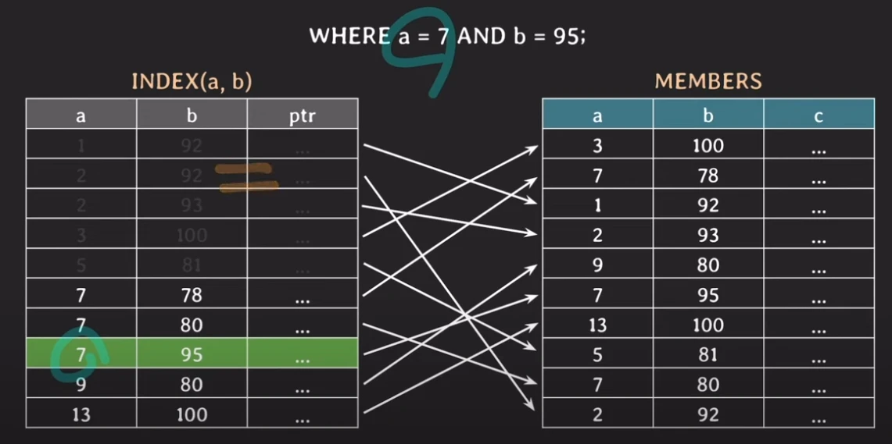

탐색했을 때 7보다 작은 영역 버리기

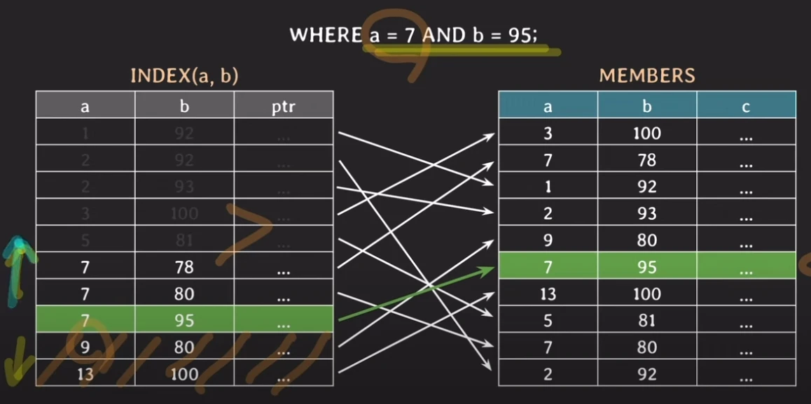

탐색했을 때 7보다 큰 영역 버리기

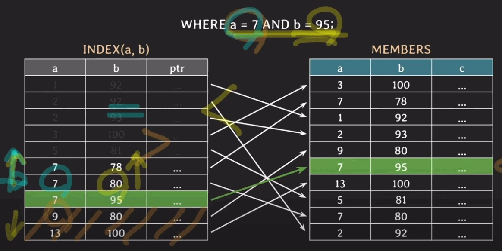

a가 7, b가 95이고, 바로 이전 row의 b 값이 80이다. 즉, 현재 선택된 row보다 이전의 row들은 95보다 작은 b값을 가지므로 버릴 수 있다.

⇒ 결국 최종적으로 하나의 row를 선택할 수 있다.

- 만약 b 조건만을 사용한다면?

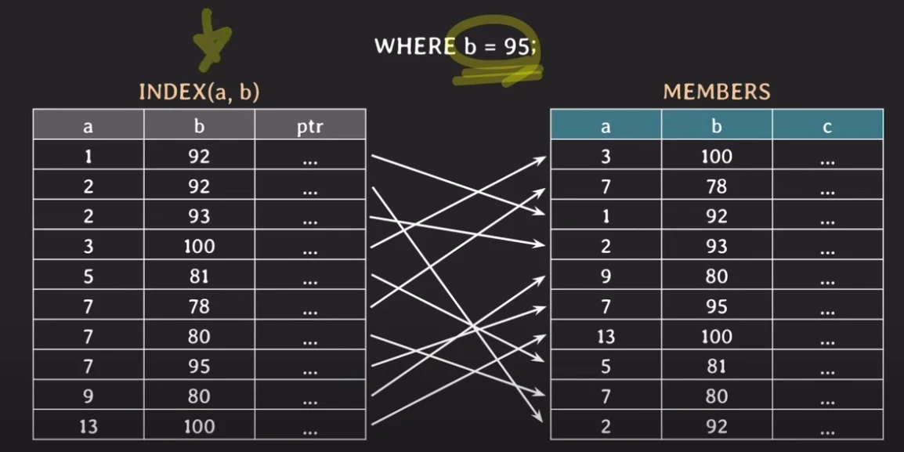

⇒ 성능이 나오지 못한다. 왜냐면, a를 기준으로 정렬이 되어있기 때문이다. 따라서 b에 대해서 탐색할 때도 성능을 얻기 위해서는 b에 대한 index도 따로 설정해 주어야 한다.

> 사용되는 query에 맞춰서 적절하게 index를 걸어주어야 query가 빠르게 처리될 수 있다.

---

## Query가 어떤 index를 사용하는지 조회하기

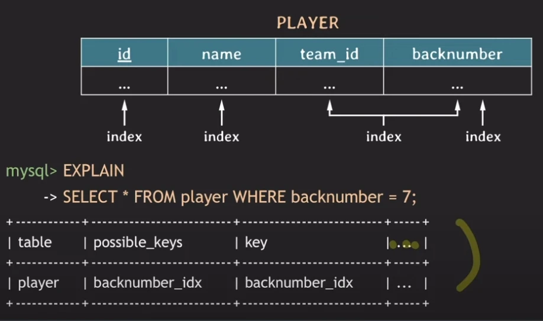

⇒ query에 사용되는 optimizer가 알아서 적절하게 index를 선택한다. 그런데 간혹 optimizer가 이상한 index를 선택할 수도 있다. 이때는 직접 index를 설정해야 한다.

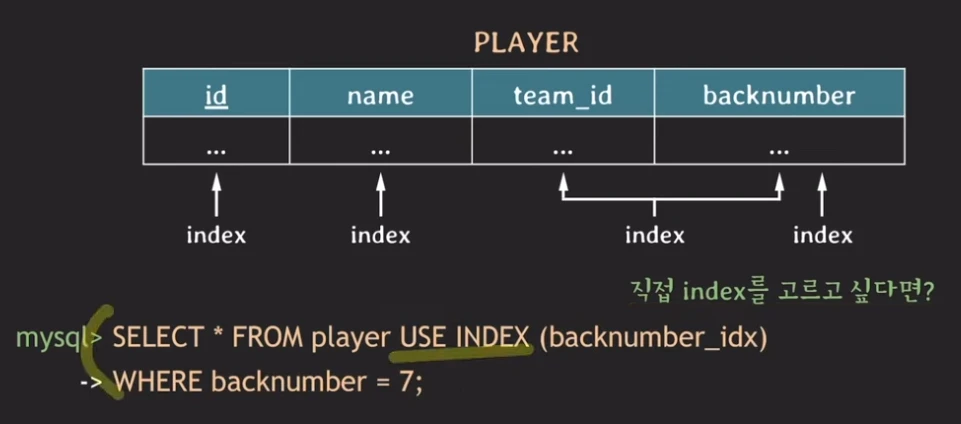

⇒ 하지만 이것은 권장 사항이고, 지정한 index의 사용을 보장할 수는 없다.

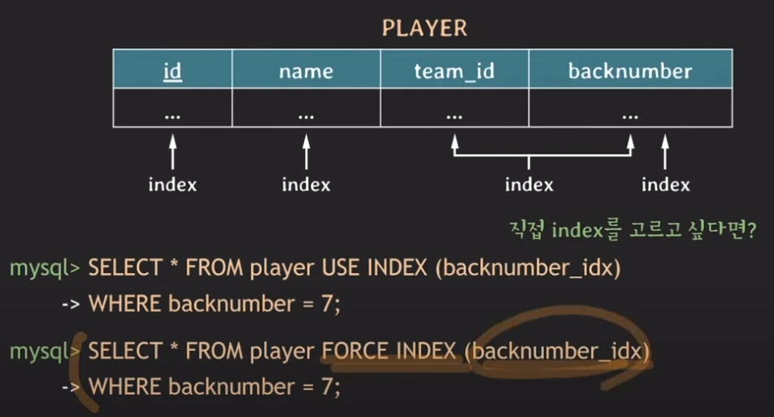

⇒ 그런 경우에는 force index를 사용해야 한다. 하지만 만약 사용을 강제한 index를 이용해서 데이터를 가져올 수 없다고 하면 full scan을 사용하게 된다.

만약 특정 index를 제외하고 싶다면 ignore index 키워드를 사용하면 된다.

---

## Index는 막 만들어도 될까?

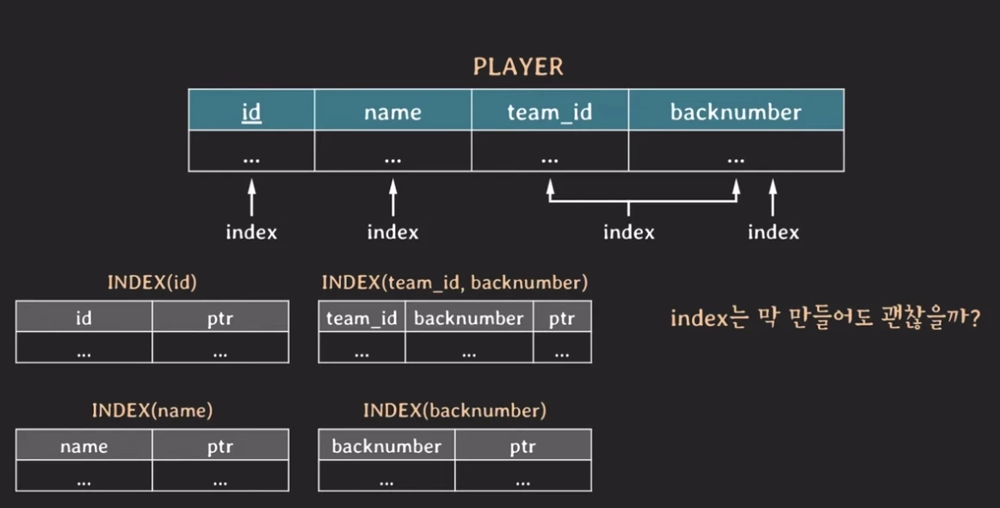

실제 Table에 대한 index를 생성하면, index table도 함께 생성된다.

- table에 write 할 때마다 index도 변경이 발생한다. ⇒ overhead 발생
- 추가적인 저장 공간을 차지한다.

⇒ 따라서, 불필요한 index는 만들지 않는 것이 중요하다.

---

## Covering Index

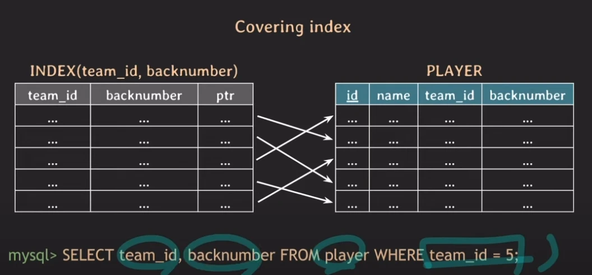

team_id, backnumber에 대해서 composite index가 지정되어 있다. 이때 team_id에 대한 조건을 걸어서 scan을 하고, team_id, backnumber를 가져온다고 해보자.

이때는 실제 Table을 참조하지 않아도 된다. (왜냐면, team_id, backnumber는 index의 attribute로 모두 cover가 되기 때문)

이것은 조회 성능이 빠르기 때문에 때때로 임의로 만들어서 사용하기도 한다.

---

## Hash Index

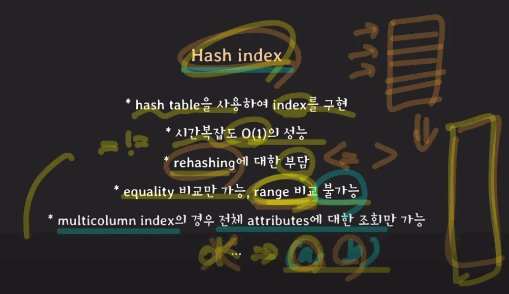

일반적으로 B-tree based index를 주로 사용한다.

---

## Full scan이 더 좋은 경우

- table에 데이터가 조금 있을 때 (몇 십, 몇 백건 정도)

실제로 큰 차이는 없을 것이다.

어차피 table에는 데이터가 계속 추가되며 많아질 것이다. 데이터가 많을 때는 언제 Full scan을 쓰는게 더 좋을까?

- 조회하려는 데이터가 테이블의 상당 부분을 차지할 때
- 예를 들어, 테이블에 100만 개의 row가 있는데 내가 찾으려는 데이터가 약 300만 개 정도이다. 이럴 때는 full scan을 쓰는게 더 좋을 수 있다. ⇒ 이 상황에 indexing을 쓸지, full scan을 쓸지는 optimizer가 결정한다.

---

## ETC

- order by나 group by에도 index가 사용될 수 있다.
- foreign key에는 index가 자동으로 생성되지 않을 수 있다. (join 관련)
- 이미 데이터가 몇 백만건 이상 있는 테이블에 index를 생성하는 경우 시간이 몇 분 이상 소요될 수 있고, DB 성능에 안좋은 영향을 줄 수 있다.
