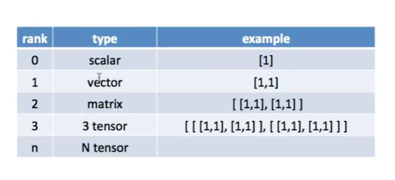
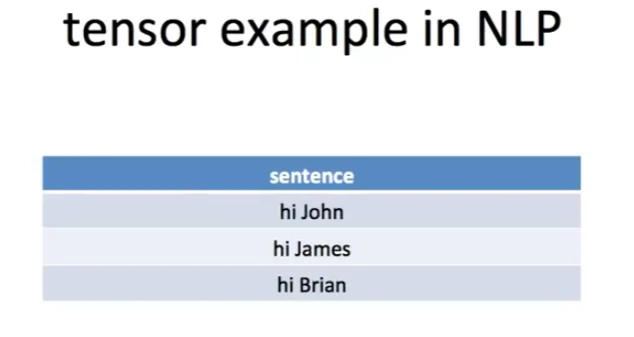
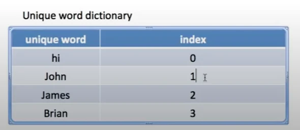
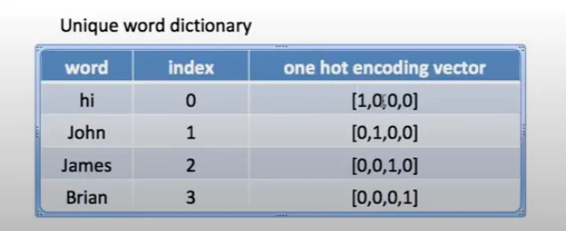
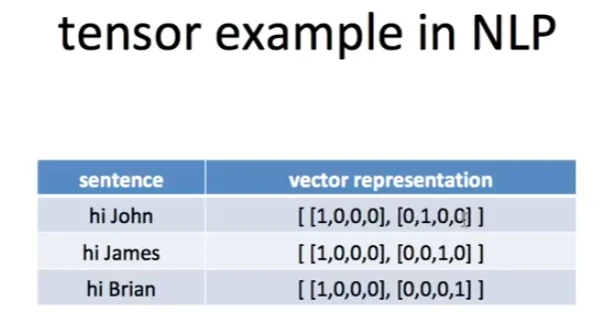
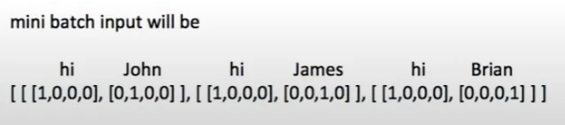
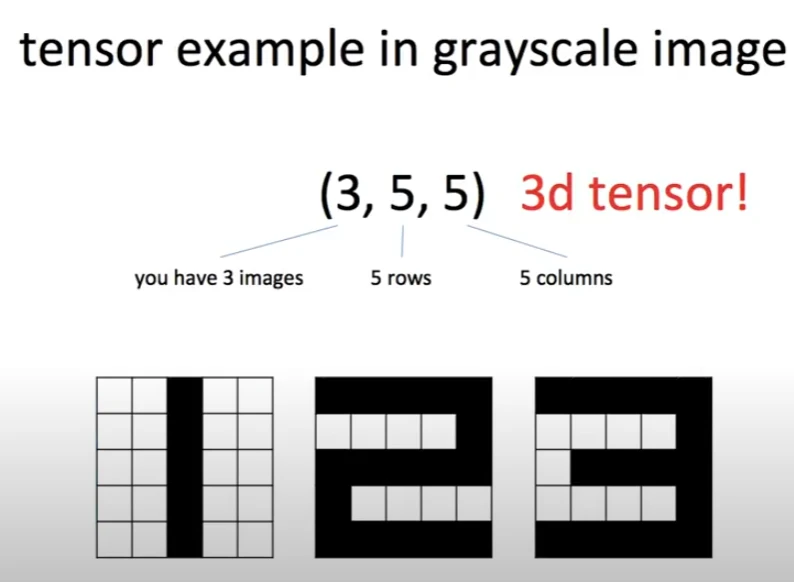
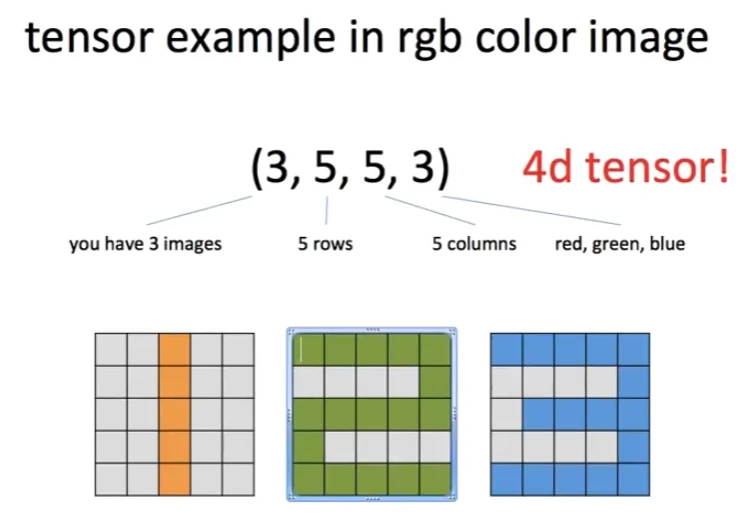

# Tensor

[[딥러닝] 텐서가 무엇인가요?](https://www.youtube.com/watch?v=m0qwxNA7IzI&list=PLVNY1HnUlO241gILgQloWAs0xrrkqQfKe&index=24)

- DL에서 Tensor란?

rank 0~n까지 Tensor가 존재

- scalar : rank 0 Tensor
- vector : rank 1 Tensor,  
    ⇒ scalar를 item으로 갖는 것
- matrix : rank 2 Tensor, Matrix  
    ⇒ vector를 item으로 갖는 것
- 3 tensor : 3d Tensor  
    ⇒ matrix를 item으로 갖는 것
- N tensor  
    ⇒ 3d Tensor를 item으로 갖는 것.

---

- Example

⇒ 이 문장들에서 Word에 대해 Index를 부여해보자.

- 자연어 처리에서는 One-hot encoding을 기본으로 사용한다.

⇒ 따라서 이와 같이 표현함으로써, 모든 word들이 같은 길이에 있는 vector로 표현되었지만, 각각 다른 부분이 1로 표현됨으로써 서로 다른 vector로 표현되었다.

이런 방식처럼, 문장들도 vector로 표현될 수 있다.

⇒ 이렇게 vector로 표현된 input들이 DL에 들어갈 수 있다. DL에 input을 넣어줄 때, 각 문장 하나씩을 넣어주는 것보다, mini-batch로 넣게 된다. 

- 각 Word는 네 개의 Scalar로 표현된다. : Sample Dimension
- 각 문장은 두 개의 Word로 표현된다. : Max Length of Sentence(Time steps에 해당하는 것으로 보인다)
- 그리고, 총 세 개의 문장을 가진다. : Word Vector Dimension

⇒ 따라서, 우리는 (3, 2, 4) size의 3d Tensor를 가지고 있는 것이다.

이를 LSTM Autoencoder로 표현하면, (전체 데이터의 개수, 각 데이터가 이루는 결합, Features)로 볼 수 있다.  
⇒ **timestep은 데이터의 한 묶음으로 처리하게 될 사이즈를 정하는 것으로 보인다.**

