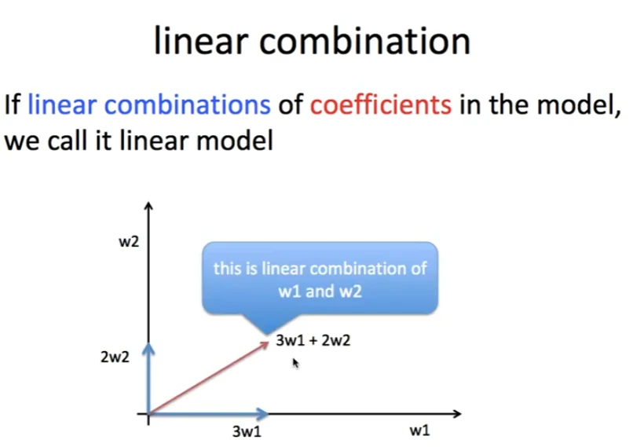
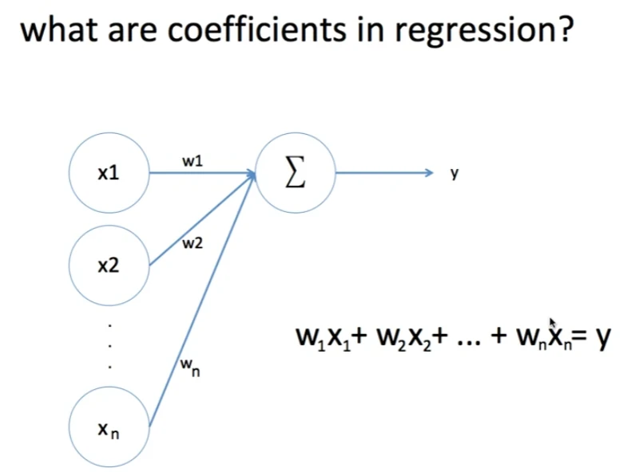
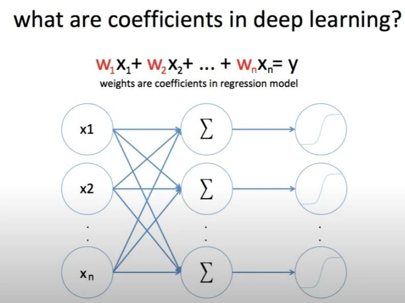
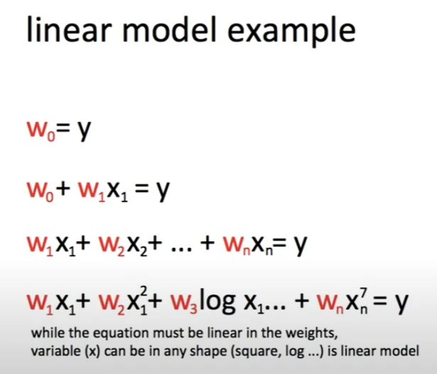
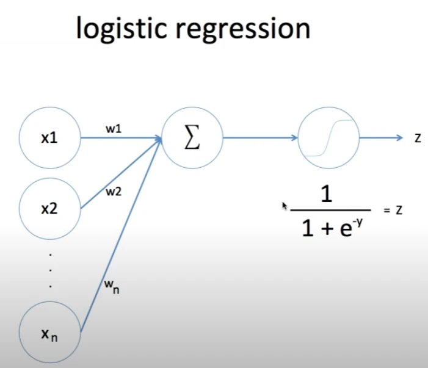
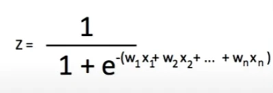
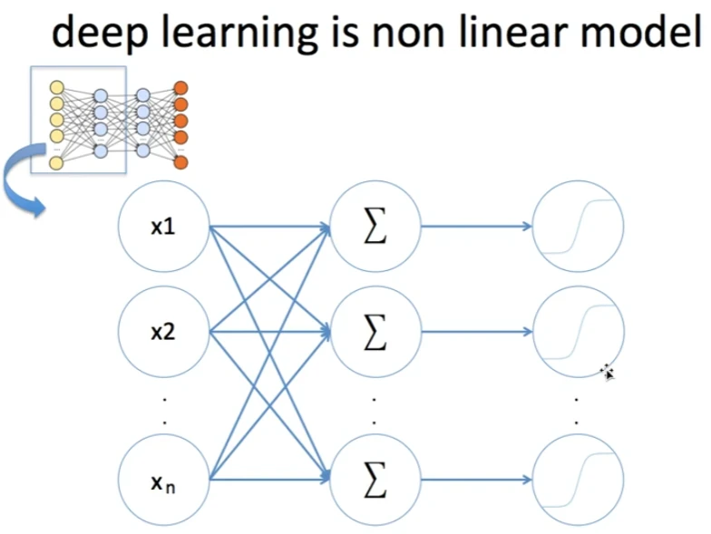

# Linearity, Non-linearity

[선형과 비선형의 차이 (머신러닝, 딥러닝)](https://www.youtube.com/watch?v=umiqnfQxlac&list=PLVNY1HnUlO241gILgQloWAs0xrrkqQfKe&index=25)

- 선형 : 머신러닝 공식에서 계수들(coefficients)이 선형 모델의 관계에 있는 것.

선형 결합이란, 두 개 벡터의 합으로 볼 수 있다.

- linear regression(선형 회귀 모델) : 여기서의 계수가 무엇일까?

여기서 계수란, 각각의 가중치를 의미한다.

계수들은 딥러닝 모델에서 w들이다. 이 가중치들이 선형 결합 형태에 있을때 우리는 이를 선형 모델이라고 말한다.

---

- 선형 모델의 예시

그렇다면 무엇이 비선형 모델일까? 선형 모델이 아닌 것.

- Logistic Regression :  Sigmoid 함수가 존재해서 Z값에 적용된다.

여기서는 w1, w2, … 가 선형 결합의 형태로 나오지 않게 된다. 즉, non-linear model이 된다.

딥러닝은 대부분 Activation Function을 사용하는데, 여기서는 Sigmoid를 사용하여 비선형의 결과를 나타내고 있다.

- 선형 모델은 그래프 상에서 곡선으로 나타날 수도 있을까?

그렇다. 선형 모델의 뜻은 그래프가 직선으로 나타난다는 것이 아니라, weight 계수들이 서로 선형 결합의 형태를 이루고 있다는 뜻이다. 그러므로 직선이 아닐 수도 있다.

(계수와 변수 간의 단순 곱의 형태를 선형이라고 말하는 것으로 보인다.)
