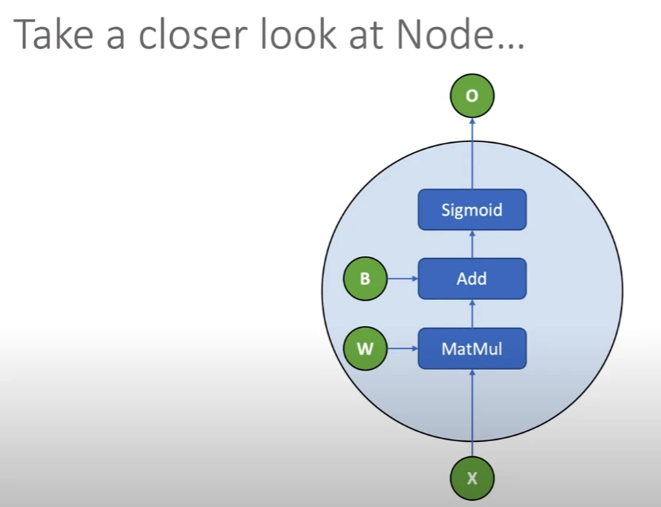

# Node



노드를 깊게 들여다보면 위와 같다. 노드는 Input x가 들어오면 가중치 W와 곱해주고, Bias를 더해준 다음에, Activation Function에 넣어 Output으로 사용한다. 여기서는 Sigmoid를 쓴다.

이때 사용되는 W와 B는 Parameters(Variables)로 통틀어서 설명하곤 한다.

Weight와 Bias는 쉽게 말하면 Node가 Input에 대해 어떻게 생각하는지를 수치로 나타낸 것이라고 볼 수 있다.

⇒ **Node는 ML, DL에서 하나의 Input을 받아 Output을 출력하는 단위로서, 내부에서 가중치(Weight)를 이용한 행렬곱과 편향값(Bias) 덧셈을 하고, 활성화 함수(Activation Function)를 적용해 최종 Output을 내보낸다. Layer의 Unit이라고 해석되기도 한다.**

- One_Feature_Node

```python
class One_Feature_Node:
  def __init__(self):
    self.w = tf.Variable([[0.1]])
    self.b = tf.Variable([[0.5]])

  def __call__(self, x):
    return self.get_output(x)

  def get_output(self, x):
    out = tf.matmul(x, self.w)
    out = tf.add(out, self.b)
    out = tf.math.sigmoid(out)

    return out
```

```python
# Single Input
x = tf.constant([[1.0]])

# Run
one_feature_node = One_Feature_Node()
one_feature_node(x)

# Result
```

학습을 통해 W, B 값을 바꾸기 위해 w, b를 variable로 선언.

이미 collect한 data의 값은 변하지 않기 때문에 constant로 선언.

get_output에서 node의 원리대로 w를 곱하고 b를 더한 다음, sigmoid에 넣어서 output으로 최종 출력한다.

⇒ Input Feature가 하나이므로 Output도 하나가 나오게 됨.

- Two Features Node

```python
class Two_Features_Node:
  def __init__(self):
    self.w = tf.Variable([[0.1], [0.2]])
    self.b = tf.Variable([[0.5]])

  def __call__(self, x):
    return self.get_output(x)

  def get_output(self, x):
    out = tf.matmul(x, self.w)
    print("out :", out)
    out = tf.add(out, self.b)
    print("out :", out)
    out = tf.math.sigmoid(out)

    return out
```

```python
# Two Features Input
x = tf.constant([[1.0, 2.0]])

# Run
two_features_node = Two_Features_Node()
two_features_node(x)

# Result
```

⇒ matmul은 행렬곱임. 따라서 1x2 * 2\*1을 하면 하나의 Scalar 값이 나오게 됨.

```python
# Two Features Input
x = tf.constant([[1.0, 2.0], [2.0, 3.0], [4.0, 5.0]])

# Run
two_features_node = Two_Features_Node()
two_features_node(x)

# Result
```

⇒ 이번에는 두 개의 Features를 갖는 세 개의 Sample을 넣었으므로, 결과가 세 개가 나오게 된다. (3, 2, 2)의 3D Tensor로 볼 수 있을 것으로 보인다.

---

지금까지의 과정을 Forward Propagation이라고 한다. Training 과정에서 이러한 W, B를 업데이트 하는 것을 Back Propagation이라고 한다.

하나의 노드만 사용하면 AND, OR 등의 노드를 구현할 수는 있지만, 하나만 쓰면 파워풀한 효과를 낼 수 없다. 그래서 Fully-Connected로 더 큰 효과를 내는 방법도 사용할 수 있다.
