# Dense Layer

- Dense Layer는 노드로 구성되어 있으며, Dense Layer란, Node들로 구성된 하나의 List이다. 이 안에 우리가 원하는만큼 Node를 넣을 수 있다.

노드는 총 세 개의 연산으로 이루어져 있는데, 가중치와의 행렬 곱, Bias 덧셈, Activation Function이다.

Dense Layer를 왜 쓰는 것일까? ⇒ 대체로 내가 가진 데이터를 다른 차원에서 보기 위해서라고 할 수 있다. 

- **노드 하나는 하나의 의사 결정선을 그릴 수 있다.** 그러면 두 개의 노드는 몇 개의 의사 결정선을 그릴 수 있을까? ⇒ 두 개이다.

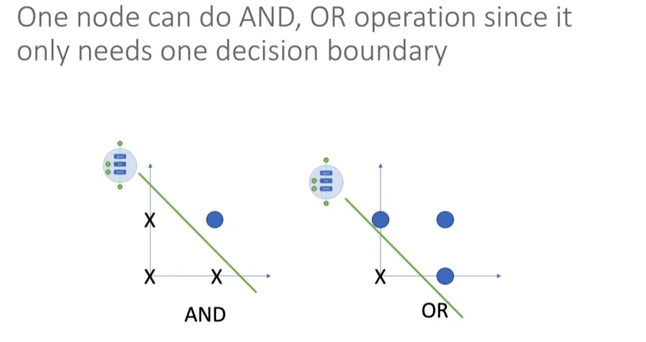

 XOR의 경우는 아래와 같이 가능하다.

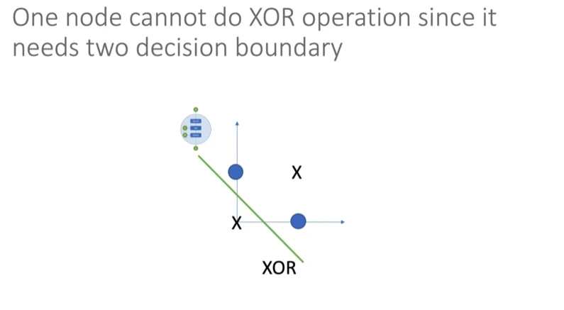

하지만, XOR는 하나의 의사결정선으로는 판단이 불가능하다. 그러므로 노드를 두 개 사용하면 아래와 같이 적절한 의사 결정선을 그릴 수 있다.

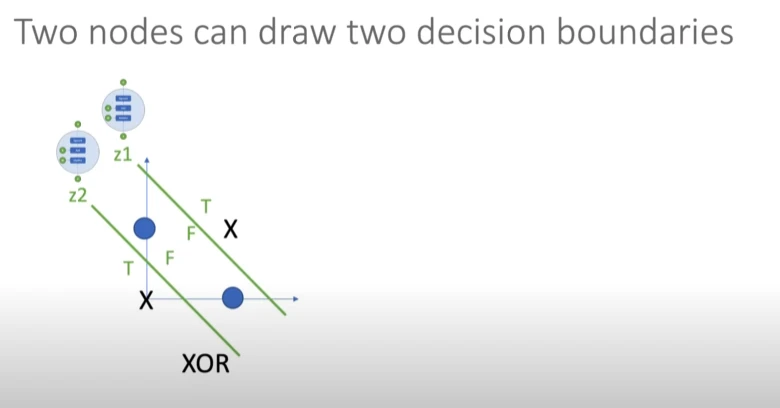

노드에 Sigmoid를 썼기 때문에 0.5 이상이면 True이고, 0.5 이하이면 False라고 판단할 수 있다. 위의 이미지에서 녹색 선은 바로 Sigmoid의 Output이며, 0.5 이상은 True, 0.5 이하는 False이다.

위의 이미지는 입력값 x1, x2를 dimension으로 썼을때의 결과이다. 그렇다면 z1, z2를 dimension으로 만들면 어떤 결과가 나올까?

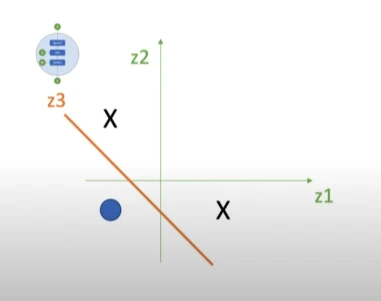

x축은 z1이 되고, y축은 z2가 되었다. 이 상태로 봐보니, O와 X가 구별되는 것을 확인할 수 있고, 이를 구별하기 위해 노드 하나가 더 필요하게 된다. 이것을 z3라고 부르자.

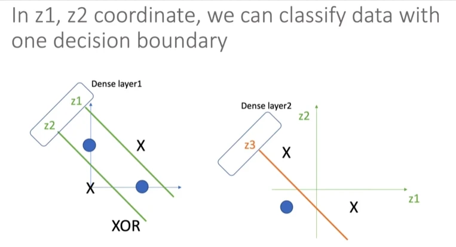

- 왼쪽 그림에서는 두 개의 노드가 필요하다. (두 개의 의사 결정선)
- 오른쪽 그림에서도 하나의 노드를 추가하여 하나의 의사 결정선을 추가하여 데이터를 구분할 수 있다.

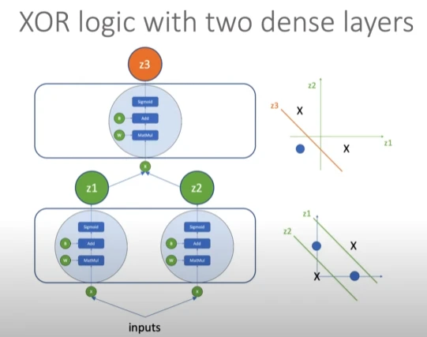

이 그림과 같이 Input x1, x2를 넣고 나온 결과 z1, z2를 바탕으로 Dimension을 재구성, 이를 바탕으로 새로운 노드에 입력을 넣어 의사결정을 내린다.

```python
from __future__ import absolute_import, division, print_function, unicode_literals

try:
  %tensorflow_version 2.x
except Exception:
  pass

import tensorflow as tf
from tensorflow.keras.layers import Dense
from tensorflow.keras.models import Sequential
# random seed for always same results
tf.random.set_seed(678)

import numpy as np
```

- Input Data

```python
X = np.array([[0.,0.],[0.,1.],[1.,0.],[1.,1.]])
y = np.array([0.,1.,1.,0.])
```

```python
model = Sequential()
# first dense layer
model.add(Dense(units=2, activation='sigmoid', input_dim=2))
# second dense layer
model.add(Dense(units=1,activation='sigmoid'))
```

First Dense Layer 두 개의 Node를 가지고 있으며, Activation Function은 sigmoid, input_dimension은 2이다. 왜냐면, input으로 들어오는 데이터가 2개의 dimension을 가지기 때문이다. (feature의 수에 해당하는 것으로 보인다.)

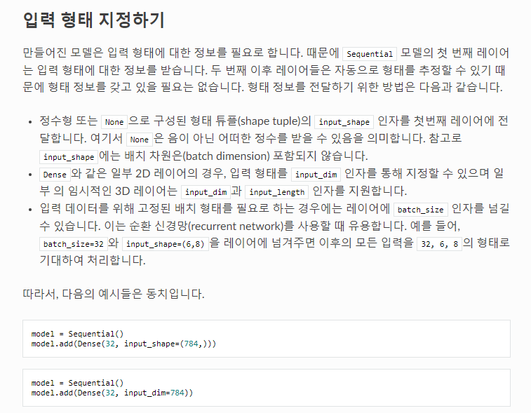

- input_shape은 튜플을 인자로 전달받는다. input_shape에 batch dimension은 포함되지 않음.

- Dense와 같은 2D 레이어는 input_dim 인자를 통해 입력 형태 지정 가능.

    - 일부 3D 레이어는 input_dim과 input_length 인자 지원

- 입력 데이터를 위해 고정된 batch 형태를 필요로 한다면, 레이어에 batch_size 인자를 넘길 수 있음. 이는 RNN에 매우 유용함.

    - 예를 들어, batch_size = 32와 input_shape=(6,8)을 레이어에 넘겨주면, 이후의 모든 입력을 (32, 6, 8)의 형태로 기대하여 처리한다.

- `batch size` : 전체 트레이닝 데이터 셋을 여러 작은 그룹으로 나누었을 때, batch size는 하나의 소그룹에 속하는 데이터의 수를 의미한다. 전체 트레이닝 셋을 작게 나누는 이유는, 트레이닝 데이터를 통째로 신경망에 넣으면 비효율적인 리소스 사용으로 학습 시간이 오래 걸리기 때문이다.

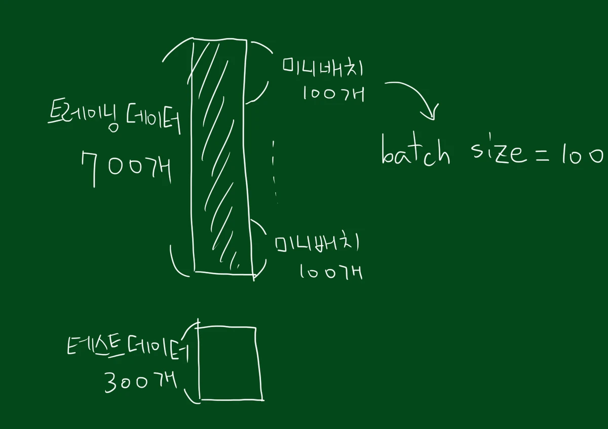

⇒ 즉, Training Data가 700개라면, batch size를 100개로 나눠서 총 7개의 mini batch가 존재한다고 볼 수 있는 것이다. 그렇다면 Input Layer일 경우에는 batch size를 unit의 수로도 볼 수 있을 것으로 보인다.

- `model.compile()`

모델을 학습시키기 전에, compile 메서드를 통해서 학습 방식에 대한 환경 설정을 해야 한다. 다음 세 개의 인자를 입력으로 받는다.

1. 정규화기(optimizer) : rmsprop나 adagrad, 또는 Optimizer 클래스의 인스턴스 사용 가능
2. 손실 함수(loss function) : 모델 최적화에 사용되는 목적 함수. categorical_crossentropy, mse 등을 사용 가능.
3. 기준(metric) 리스트 : 분류 문제에 대해서는 metrics=[’accuracy’]로 설정한다. 기준은 문자열 식별자 또는 사용자 정의 기준 함수를 사용할 수 있음.

---

- Train 진행 후, 각 노드에서의 Weight와 Bias 확인이 가능함.

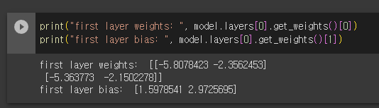

---

- Other reason why we use dense layer?

딥러닝 모델을 만들면 마지막에 Dense Layer가 있는 경우를 많이 볼 수 있는데, 분류 문제같은 경우에는 마지막에 Dense Layer를 두면 분류가 쉽게 만들 수 있다. 왜냐면, 노드 하나마다 하나의 output을 출력하는데, 그 중의 가장 큰 값의 Index를 Prediction으로 사용하면 되는 것이다.

- Example

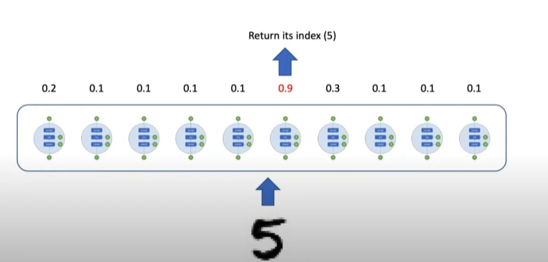

MNIST 데이터를 unit 크기가 10인 Dense Layer에 넣는다. 5라는 값이 들어갔을 때, 10개의 노드 중에서 값이 가장 큰 것을 예측한 값이라고 넘겨주는 것이다.  
⇒ 하지만 이 방식으로만 사용하면 문제가 있는데, 왜냐면 각각의 숫자들이 제각각이기 때문이다. 모두 더했을 때 1이 되면 괜찮을 것 같은데, 지금은 기준이 없다. 그래서 마지막 Dense Layer에 Softmax를 적용한다.

그러면 특정 Layer가 높은 확률을 보이며 선택할 수 있는 근거를 제공한다.

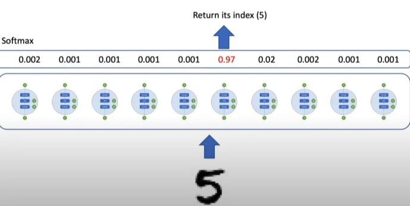
