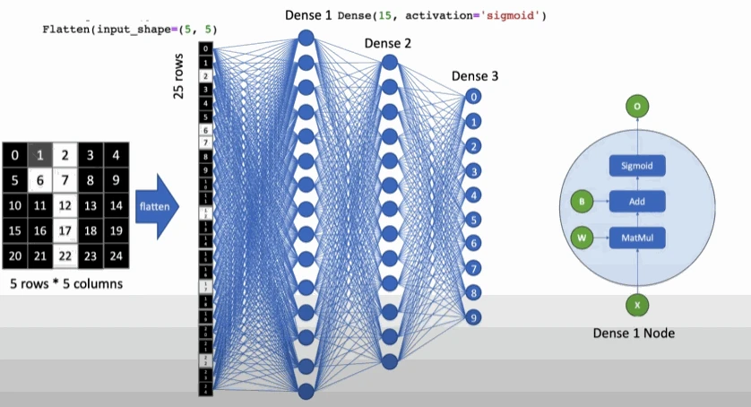
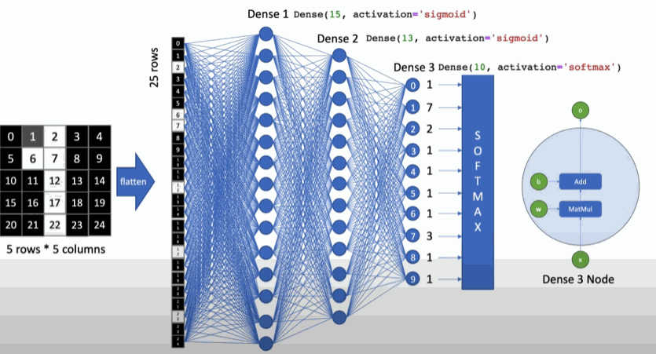
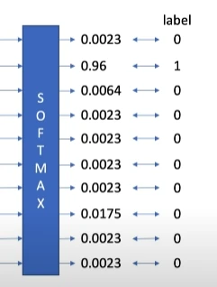

# Multi-Layer Perceptron

작성일 2023-07-15
{ .post-date }

- Dense Layer의 가장 큰 특징은 Input을 받아, 원하는 차원의 데이터로 변환을 해준다는 것이다. 이 특성을 활용해 MNIST 데이터를 0~9의 숫자 중 하나로 구분하는 실습을 할 것이다.

 이번 실습에서는 MNIST가 5\*5 데이터라고 가정을 해보도록 한다.

가장 먼저 해야할 것은 MNIST 데이터를 Flatten하는 것이다.



그리고 이렇게 Flatten된 데이터를 Deep Learning Model에 집어넣는다.

첫 번째 Dense Layer는 25개의 Input을 받아서 15개의 Output으로 내놓는다.

두 번째 Dense Layer는 15개의 Input을 받아서, 다시 13개의 Output을 내놓는다.

세 번째 Dense Layer는 13개의 Input을 받아서, 10개의 Output을 내놓는다.



마지막 Layer는 10개의 Node가 있어서, 최종적으로 나온 노드를 바탕으로 Prediction을 한다. 0~9의 노드가 있으므로, 10개가 필요하다.

또, Sigmoid를 사용하지 않고 Softmax를 activation function으로 사용하여 이를 Normalization해준다. 즉, %로 환산한다. Softmax를 사용하면 큰 값은 더욱 큰 값이 되고, 작은 값은 더욱 작은 값이 된다. 

train이라는 과정은 결국, 우리가 내놓은 Prediction 값과 Label로 있는 One-hot encoding의 차이를 줄여나가는 과정이다. 



---

```python
import numpy as np
```

```python
# softmax practice
def softmax(x):
    return np.exp(x) / np.sum(np.exp(x), axis=0)
scores = [1, 7, 2, 1, 1, 1, 1, 3, 1, 1]
print(softmax(scores))
```

```python
from __future__ import absolute_import, division, print_function, unicode_literals

try:
  %tensorflow_version 2.x
except Exception:
  pass

import tensorflow as tf
tf.random.set_seed(1)
```

```python
import tensorflow as tf
from tensorflow.keras.models import Sequential
from tensorflow.keras.layers import Flatten
from tensorflow.keras.layers import Dense
from tensorflow.keras.layers import Activation
```

```python
(x_train, y_train), (x_test, y_test) = tf.keras.datasets.mnist.load_data()
x_train = x_train.astype('float32')
x_test = x_test.astype('float32')

gray_scale = 255
x_train /= gray_scale
x_test /= gray_scale
```

```python
model = Sequential([
    Flatten(input_shape=(28, 28)),    # reshape 28 row * 28 column data to 28*28 rows
    Dense(256, activation='sigmoid'), # dense layer 1
    Dense(128, activation='sigmoid'), # dense layer 2
    Dense(10, activation='softmax'),  # dense layer 3
])
```

```python
model.compile(optimizer='adam',
              loss='sparse_categorical_crossentropy',
              metrics=['accuracy'])
```

```python
model.fit(x_train, y_train, epochs=10, batch_size=2000, validation_split = 0.2)
```

```python
results = model.evaluate(x_test,  y_test, verbose = 0)
```

```python
print('test loss, test acc:', results)
```
