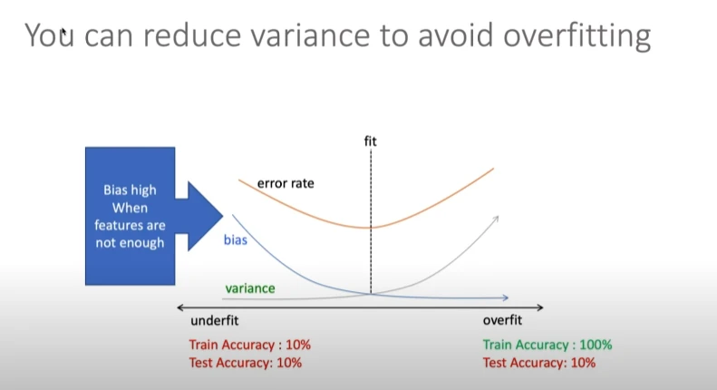
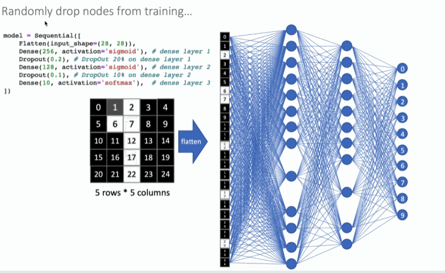
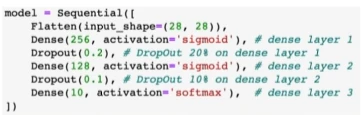
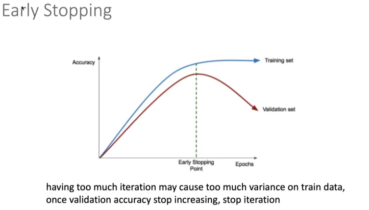
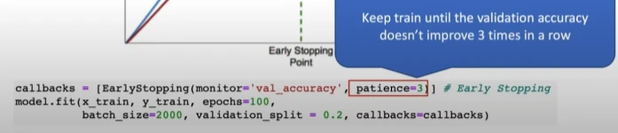
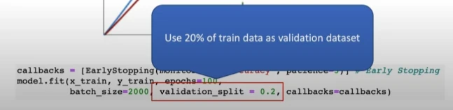
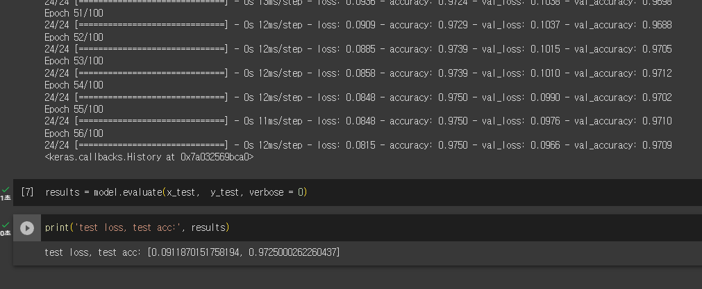

# Dropout, Early stopping

- Overfitting은 보통 Bias와 Variance의 관계로 나타낼 수 있다.

- Overfitting은 너무 데이터의 특징을 활용하지 않은 경우, Bias가 높아 나타나게 된다. 이때는 Train Accuracy도 낮고, Test Accuracy도 낮다.
- 반대로 Overfitting은 Variance가 너무 높은 경우 나타난다. 특징들을 너무 많이 사용할 경우이다. 이때는 Train Accuracy가 매우 높고, Test Accuracy가 낮다.

## Dropout

---

특징들을 너무 많이 활용하면 Overfitting이 발생할 가능성이 있으므로, Train 중간 중간에 몇 개의 노드의 연결을 랜덤하게 끊어주는 방식이다. 이렇게 하면 Variance가 낮아지므로, Overfitting을 극복할 수 있게 된다.

Dropout()이라고 선언하면, 이전에 선언된 Dense Layer에 적용된다. 즉, Dropout(0.2)라고 쓴 것은 Dense Layer 1에 대해서 Train 과정에서 20%의 노드를 사용하지 않게 적용된다.

## Early Stopping

---

Early Stopping은 Validation 과정에서 사용된다. Validation Dataset과 Test dataset은 다른 것이다. Test는 Training이 전부다 끝난 이후에 모델을 Test 할 때만 사용되는 것이며, Validation Dataset은 Train Dataset과는 다르지만, Train 중에도 사용할 수 있다. 즉, epoch 중간 중간에 Validation을 적용하여 Accuracy를 확인할 수 있다.

학습 과정에서 Training Dataset에 대해서는 Accuracy가 올라가는데, Validation Dataset에 대해서는 Accuracy가 떨어지기 시작하는 지점이 존재할 것이다. 왜냐면, Train Data는 항상 알고있는 Data이기 때문에 Accuracy가 높아지지만 어느 순간 Overfitting이 발생한 지점부터는 Validation Dataset에 대한 Accuracy가 낮아질 수 있기 때문이다.

callbacks로 EarlyStopping을 지정하고, patience를 3으로 지정해 3회 이상 validation dataset에 대해 accuracy가 증가하지 않을 경우 EarlyStopping한다라고 지정할 수 있다.

validation_split은 주어진 train dataset에서 20%만큼 validation data set으로 나눠서 쓴다는 뜻이다.

⇒ 지정한대로 세 번 연속 validation set에 대하여 accuracy가 증가하지 않자 EarlyStopping을 한 것을 볼 수 있다.
