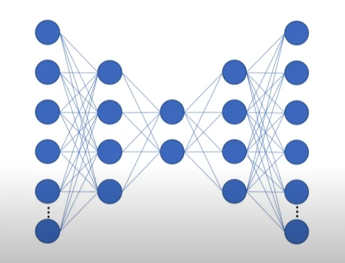
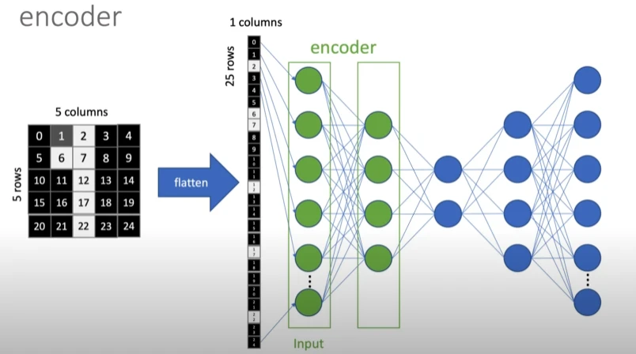
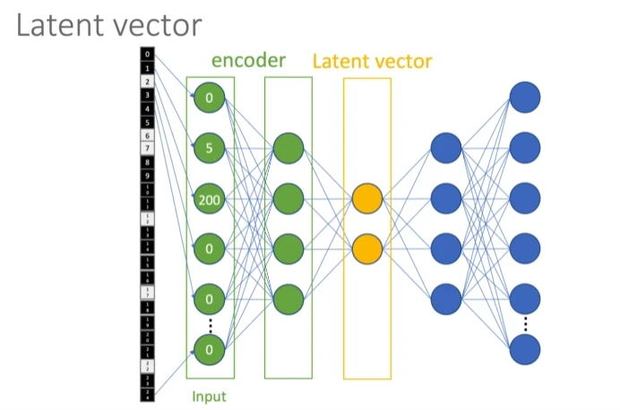
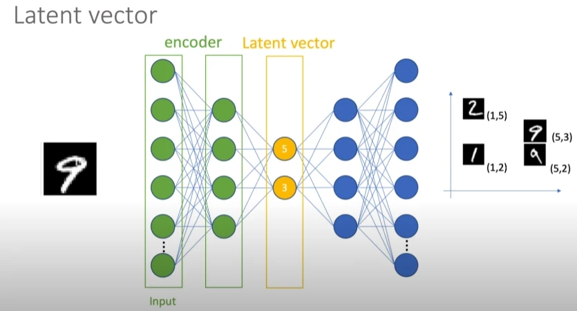
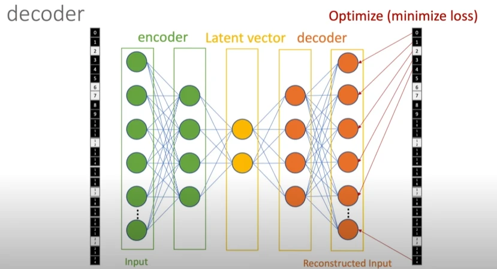
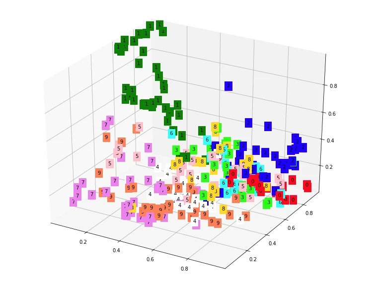
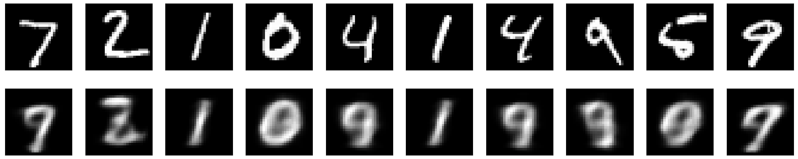

# Autoencoder

작성일 2023-07-15 · 최종 수정일 2023-07-16
{ .post-date }

앞에서 다룬 Node와 Dense Layer를 정리하면 다음과 같다.

- Node : Input이 들어오면 그 Input값에 가중치를 곱하고 편향값을 더한 뒤, Activation Function을 거쳐 Output을 출력하는 구조
- Dense Layer : 여러 개의 노드가 뭉쳐진 레이어 형태로, Input이 들어오면 여러 개의 노드에 그 값이 들어가게 되고, 여러 개의 Output이 나오게 될 것이다. 예를 들어 Input이 3개라면 Output도 3개가 된다.
- Autoencoder의 기본적인 형태



Input Vector의 차원을 줄였다가, 다시 늘리는 것이 Autoencoder의 기본이다.

---

## Encoder



5\*5 이미지 데이터라고 해보자. 그러면 이 데이터를 Flatten 하여서 input으로 넣어줄 수 있다. MNIST 데이터의 경우, 0은 검정색이고 255는 흰색이다. 첫 번째 픽셀은 값이 0이므로 노드에 0이 들어가고, 두 번째는 1, 그 다음은 2,… 이런식으로 데이터가 25개 들어가게 될 것이다. 따라서 Input Node의 수는 25일 것이다.



Encoder는 여러 개의 Dense Layer를 가진다. 하지만 중요한 것은, 가장 낮은 차원의 Vector를 생성하는 Layer를 `Latent Vector` 라고 한다.



이런 데이터들은 Latent Vector 상태에서 **Cluster**를 이루기도 한다.

- Decoder

함축된 Latent Vector를 Original Input Vector의 차원으로 변경시킨다.



이 모델을 Train 할 경우, Optimizer를 써서 Decoder의 최종 Output과 실제 Pixel 값의 차이를 줄여주는 것이 Train의 과정이다.

---

- Example

```python
# we will use train data for auto encoder training
x_train = x_train.reshape(60000, 784)

# select only 300 test data for visualization
x_test = x_test[:300]
y_test = y_test[:300]
x_test = x_test.reshape(300, 784)

x_train = x_train.astype('float32')
x_test = x_test.astype('float32')

# normalize data
gray_scale = 255
x_train /= gray_scale
x_test /= gray_scale
```

MNIST Data는 28\*28 데이터이므로, 이를 reshape해서 1차원 vector로 만든다.

초반 300개의 데이터는 test 데이터로 만들고, 역시 1차원 vector로 만든다.

그리고, 최대값이 255이므로 이를 255로 나눠 Normalization한다.

- encoder

```python
# MNIST input 28 rows * 28 columns = 784 pixels
input_img = Input(shape=(784,))
# encoder
encoder1 = Dense(128, activation='sigmoid')(input_img)
encoder2 = Dense(3, activation='sigmoid')(encoder1)
```

Input()은 keras tensor를 초기화하기 위해 사용된다. (Input Layer 생성) shape=(784,)이라고 tuple 형태로 전달해 주었으므로, 이는 1x784의 형태라고 전달해준 것.

첫 번째 Dense Layer는 MNIST 데이터를 그대로 받기 때문에 784개의 데이터를 그대로 받는다.

그리고 그 Input을 바탕으로 128개의 Output을 다음 레이어에 전달한다. 다음 레이어는 128개의 Output을 Input으로 전달받고, 이를 3개의 Output으로 다시 전환하여 Output으로 내보낸다.

- decoder는 encoder의 반대로 적용하면 된다.

```python
# decoder
decoder1 = Dense(128, activation='sigmoid')(encoder2)
decoder2 = Dense(784, activation='sigmoid')(decoder1)

# this model maps an input to its reconstruction
autoencoder = Model(inputs=input_img, outputs=decoder2)
```

이 모델을 거쳐 나온 Output과 실제 Label의 값을 비교해서 Cross-Entropy를 줄여나가는 과정이 바로 Train 과정이다.

- Train

```python
autoencoder.compile(optimizer='adam', loss='binary_crossentropy')
```

Adam optimizer를 사용하여 Cross-Entropy를 줄여나간다.

```python
autoencoder.fit(x_train, x_train,
                epochs=5,
                batch_size=32,
                shuffle=True,
                validation_data=(x_test, x_test))
```

Label 값으로 x_train이 다시 들어가는데, 이는 실제 원본 데이터와 같게 복구가 되어야 하기 때문에 다시 넣어주는 것이다. (autoencoder 이므로)

MNIST 데이터들이 어떻게 분포해 있는지 Visualization하기 위해, Latent Vector를 출력할 수 있다. 이를 위해 encoder를 TensorFlow Model로 선언한다.

그리고, 이렇게 선언된 encoder에 .predict(x_test)를 적용했을 때 Latent Vector를 받을 수 있게 된다.

- 아래 encoder, decoder 모델들은 단지 데이터 분포를 확인하고자 출력을 위해서만 만들어짐.

```python
# create encoder model
encoder = Model(inputs=input_img, outputs=encoder2)

# create decoder model
encoded_input = Input(shape=(3,))
decoder_layer1 = autoencoder.layers[-2]
decoder_layer2 = autoencoder.layers[-1]
decoder = Model(inputs=encoded_input, outputs=decoder_layer2(decoder_layer1(encoded_input)))
```

- 위에서 만들어놓은 encoder에 대해서 예측을 진행(test를 진행한다는 뜻. 학습은 fit)한다.  
    현재 Input layer부터 latent vector까지만 모델이 만들어졌으므로, latent vector를 return받음.

    이후에는 이렇게 얻은 latent_vector를 decoder에 넣어서 reconstructed_imgs 반환.

```python
# get latent vector for visualization
latent_vector = encoder.predict(x_test)

# get decoder output to visualize reconstructed image
reconstructed_imgs = decoder.predict(latent_vector)
```

- MNIST 3D Visualization

```python
# visualize in 3D plot
from pylab import rcParams
rcParams['figure.figsize'] = 10, 8

fig = plt.figure(1)
ax = Axes3D(fig)

xs = latent_vector[:, 0]
ys = latent_vector[:, 1]
zs = latent_vector[:, 2]

color=['red','green','blue','lime','white','pink','aqua','violet','gold','coral']

for x, y, z, label in zip(xs, ys, zs, y_test):
    c = color[int(label)]
    ax.text(x, y, z, label, backgroundcolor=c)
    
ax.set_xlim(xs.min(), xs.max())
ax.set_ylim(ys.min(), ys.max())
ax.set_zlim(zs.min(), zs.max())

plt.show()
```



⇒ 결과는 위와 같이 나온다고 한다.

- reconstructed image

```python
n = 10  # how many digits we will display
plt.figure(figsize=(20, 4))
for i in range(n):
    # display original
    ax = plt.subplot(2, n, i + 1)
    plt.imshow(x_test[i].reshape(28, 28))
    plt.gray()
    ax.get_xaxis().set_visible(False)
    ax.get_yaxis().set_visible(False)

    # display reconstructed image
    ax = plt.subplot(2, n, i + 1 + n)
    plt.imshow(reconstructed_imgs[i].reshape(28, 28))
    plt.gray()
    ax.get_xaxis().set_visible(False)
    ax.get_yaxis().set_visible(False)
plt.show()
```


