# CNN(Convolutional Neural Network)

CNN을 이해하려면 이전에 있었던 딥러닝 모델의 단점을 이해하는 것이 크게 도움이 된다.

- Multi-Layer Perceptron : 가장 기초적이고 단순한 Dense Layer의 결합인 딥러닝 모델이지만, 이미지 분류에 사용하기에는 큰 단점이 있다.

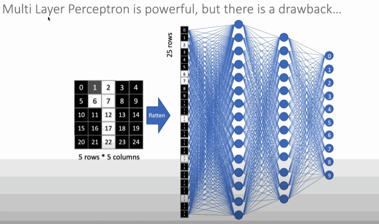

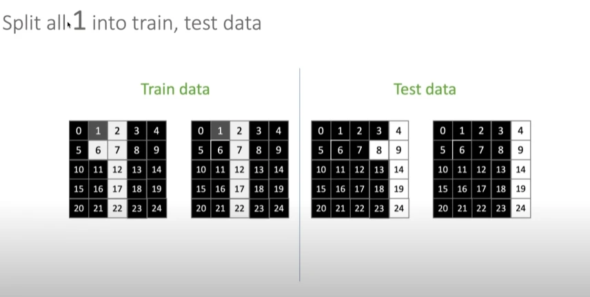

위 그림은 모두 1을 나타내는 그림이다. 모두 특징이 있으므로 머신러닝에 학습이 가능할 것이라고 생각된다. 이를 Train/Test Data로 구분해본다.

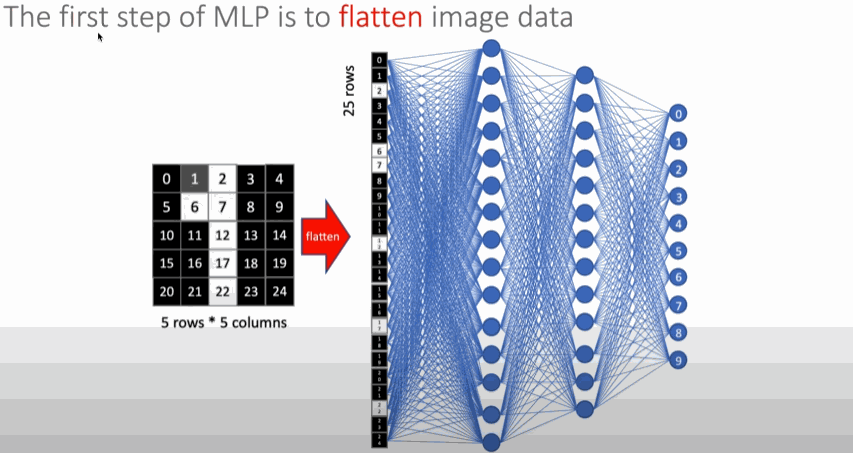

Multi-Layer Perceptron은 가장 먼저 행과 열이 있는 2차원 데이터를 1차원 데이터로 변경하는 과정을 실시한다. 그래야 Dense Layer에 Input으로 들어가기 때문이다. 이 말은 각각의 픽셀을 이미지의 특징으로 사용한다는 뜻이다.

가로 세로 5x5의 이미지이므로, 총 25개의 Feature를 Dense Layer에 입력한다고 생각하면된다.

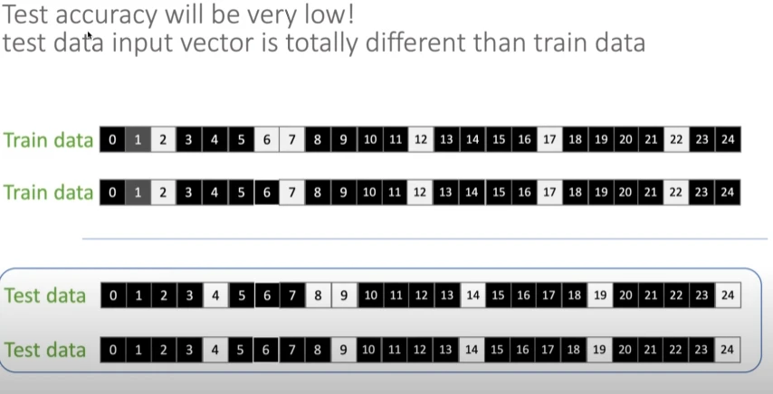

학습을 시켜보면, Train 정확도는 굉장히 높을 것으로 예상된다. 왜냐면, Train Data가 모두 2, 7, 12, 17, 22에 흰색 데이터가 있어 데이터의 특성으로 분류할 수 있기 때문이다.

하지만 이와 반대로, Test Data는 기존에 학습했던 특성과 다르기 때문에 정확도가 떨어질 것으로 예상된다.

⇒ 이러한 상황을 Overfitting이라고 한다.

**무엇이 문제였을까? 데이터가 문제였을까?** ⇒ No! 단순히 MLP가 학습 데이터에 Overfitting 된 결과이다. 그래서 CNN이 등장한다. CNN이 어떻게 Overfitting 문제를 해결할 수 있는지 알아보도록 하자.

---

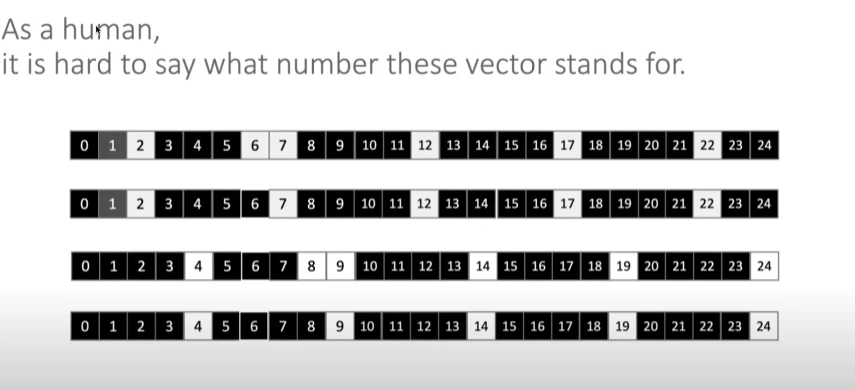

사람이 이 이미지를 보았을 때는 이것들이 어떤 숫자인지 파악하기 힘들다. 이것은 딥러닝도 마찬가지이다. 원본 이미지로는 숫자를 분석하기 쉬운데 왜 1차원 데이터로는 분석하기 어려운 것일까?

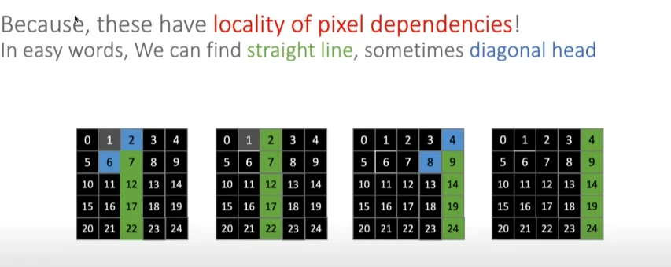

그것은 데이터의 특징을 2차원에서만 얻을 수 있기 때문이다. 1차원에서는 이 특성을 얻어내기가 힘들다.

⇒ 그렇다면 CNN은 어떻게 특징을 찾아낼 수 있을까?

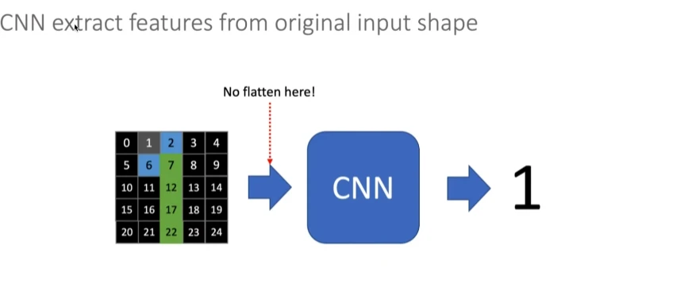

CNN은 2차원에서 데이터의 특징을 찾아낸다. 중요한 것은 어떻게 특징을 찾느냐는 것이다.

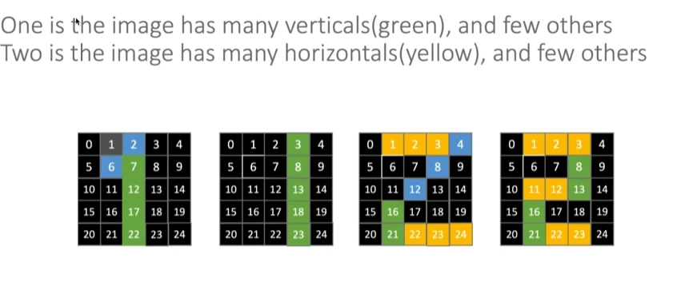

1과 2 이미지를 비교해봤을 때, 수직선 특징이 많으면 1로 판단되고 수평선 특징이 많으면 2로 판단될 수 있다.

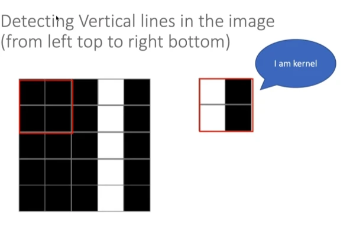

숫자의 수직선 특징을 찾기 위해서 Kernel(Window)이라는 2차원 행렬을 이미지 위에서 이동시킨다. kernel은 수직선을 찾기 위해 위 아래 두 개의 픽셀이 흰색으로 만들어져 있다. 이 kernel의 흰색 부분과 이미지의 흰색 부분이 겹치는 부분을 세어보면 많이 겹쳤는지, 적게 겹쳤는지 알 수 있다.

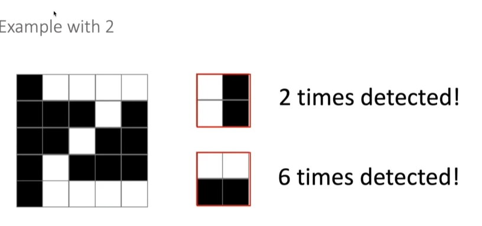

마찬가지로 수평선 특징도 6번 발견되는걸 확인할 수 있다.

하지만, 만약 숫자가 흰색이 아니라 회색이라면 흰색 특징을 잡는 것으로는 특징을 발견할 수 없을 것이다. 그래서 CNN은 색깔 대신 숫자를 사용한다.

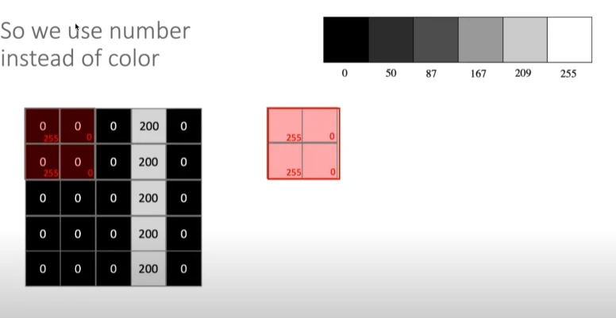

통상 Gray Scale Image는 0~255의 숫자를 사용하는데, 0은 검은색, 255는 흰색이다. CNN에서는 단순히 kernel pixel의 숫자를 겹쳐진 원본 이미지 pixel의 숫자와 곱해주도록 한다.

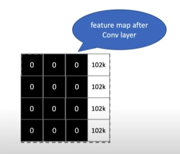

결과적으로 이와 같은 Convolution Matrix를 얻을 수 있다.

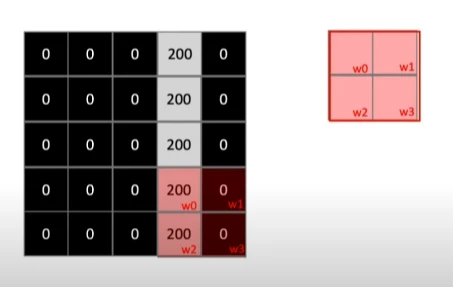

또한, kernel의 값은 딥러닝 학습 중에 값이 최적화되는 가중치이다.

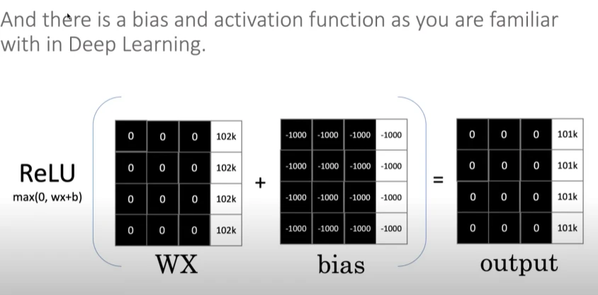

그리고 다른 딥러닝 모델들과 마찬가지로, 가중치와 입력값을 곱한 값에 편향값을 더해주고 최종적으로 활성화 함수에 넘김으로써 Output을 출력한다. CNN은 일반적으로 ReLU라는 Activation Function을 사용한다. 

이번 예제에서는 Gray Scale Image를 사용했지만, Color Image를 사용할 경우에는 `Filter`라는 개념도 이해해야 한다.

---

- kernel vs filter

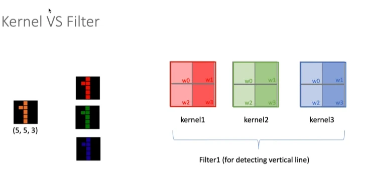

filter는 특징을 찾기 위한 목적을 지녔으며, kernel은 이차원 행렬로써, 이미지 위에서 돌아다니는 역할이다.

⇒ 둘이 같은 역할을 하는 것이라고 생각할 수도 있다. 하지만, 커널과 필터는 명백하게 다른 역할을 한다.

Color Image는 마치 한 장의 이미지 같지만 사실은 RGB 색상이 겹쳐진 이미지이다. 그러므로 Color Image가 CNN에 들어올 경우, 사실은 세 장의 이미지가 Input으로 들어오게 되는 것이다.

Color Image에서 수직선 특성을 찾기 위해서는 한 개의 Filter가 필요할 것이다. 수직선 특성을 찾기 위해서는 빨간색 이미지, 초록색 이미지, 파란색 이미지를 돌아다니는 세 개의 kernel이 필요하다.

⇒ **즉, Filter는 특정 성분을 검출하기 위해서 만들어진 특정한 형태의 Window이고, kernel은 그 Filter를 이용하여 서로 다른 Image(RGB)에서 직접 돌아다니며 특성을 검출하는 것을 말한다.**

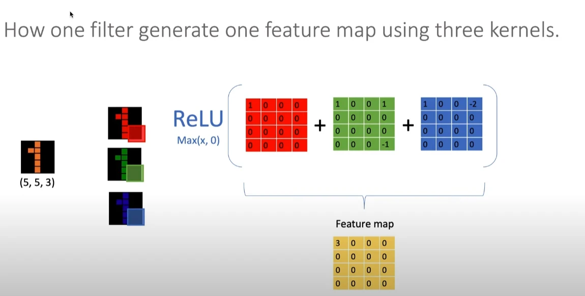

각각의 kernel 출력값들을 합쳐, filter에 해당하는 feature map을 만든다. 그리고 이 feature map을 ReLU 활성화 함수를 사용해서 최종 Feature Map을 만든다.

---

## CNN

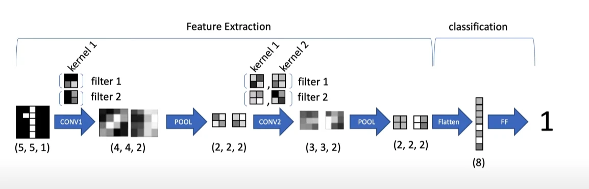

⇒ 우리가 사용하게 될 CNN의 road map.

입력값이 Gray Scale Image이므로, Input Image가 하나이기 때문에 하나의 filter에 대하여 하나의 kernel만 존재하게 된다.

만약 Convolutional Layer에서 두 개의 특징을 잡고 싶다면, 몇 개의 Filter가 필요할까? 이미지가 하나이므로 한 이미지당 하나씩. 즉, 두 개의 Filter가 필요할 것이다. 

- Convolution1

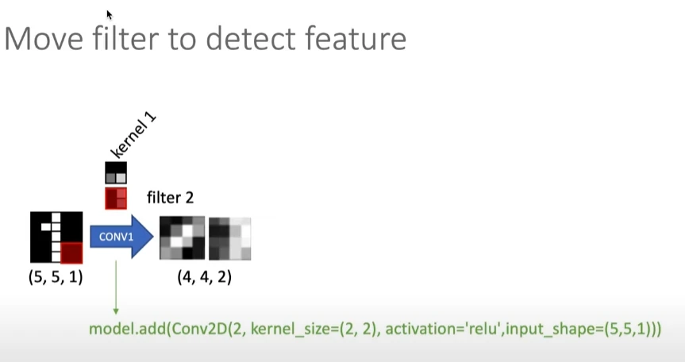

두 개의 Filter를 이동시켜, 두 개의 Feature Map을 얻어낸다. 

```python
model = Sequential()
model.add(Conv2D(16, kernel_size=(5, 5),
                 activation='relu',
                 input_shape=(28,28,1),padding='same'))
```

- Pooling Layer

이번에는 CNN에서 많이 사용되는 MaxPooling을 사용한다.

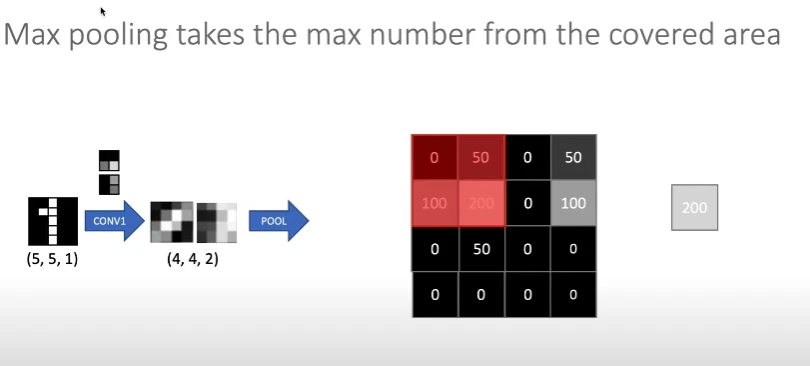

```python
model.add(MaxPooling2D(pool_size=(2, 2)))
```

MaxPooling은 Boundary 내에 있는 가장 큰 값만 가져온다. 예를 들어 위의 예제에서는, 200만 가져오게 될 것이다. 이런 방식으로 Pooling Layer를 만들어낸다.

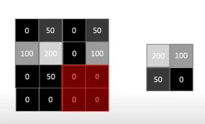

Pooling Layer는 행렬의 크기를 작게해서 Parameter 개수를 줄이고 계산 수를 줄이며, Variance를 줄여서 Overfitting을 피하게 하는 효과도 있다.

⇒ 지역적 최대값을 찾아 새로운 Layer를 만드는 역할.

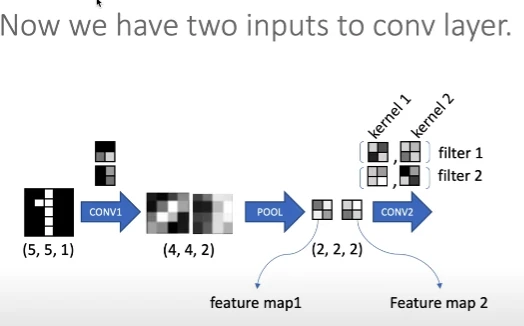

이제, 다음 Convolutional Layer에 들어가게 되는 Feature Map은 두 개가 될 것이다. 한 Filter에 두 개의 kernel이 필요할 것이다. (두 개의 특징을 찾아낼 것이므로, 두 개의 filter에 두 개의 kernel이 필요)

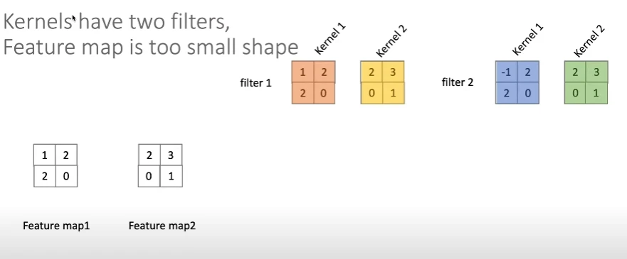

그런데, 현재 feature map의 크기가 너무 작다. 그래서 kernel이 움직이지도 못하고 convolution이 끝나게 된다. 

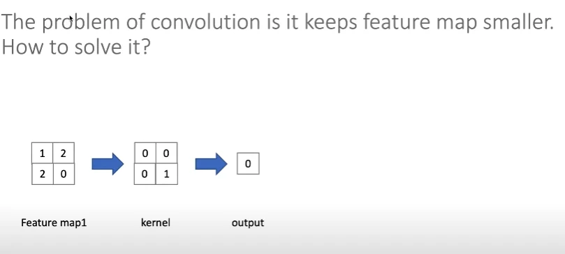

이 상태로 Convolution을 진행하면 Output이 다음과 같은 1x1 Scalar 값이 되어버린다.

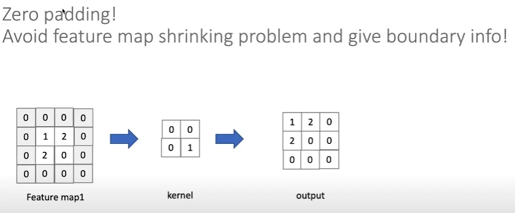

이 문제를 해결하기 위해서 `Zero Padding`을 도입한다. Zero Padding은 외곽에 0을 추가하여 컨볼루션을 할 때 Feature Map의 크기가 줄어드는 것을 방지하고, 외곽에 대한 정보도 모델에 알려주는 효과를 준다.

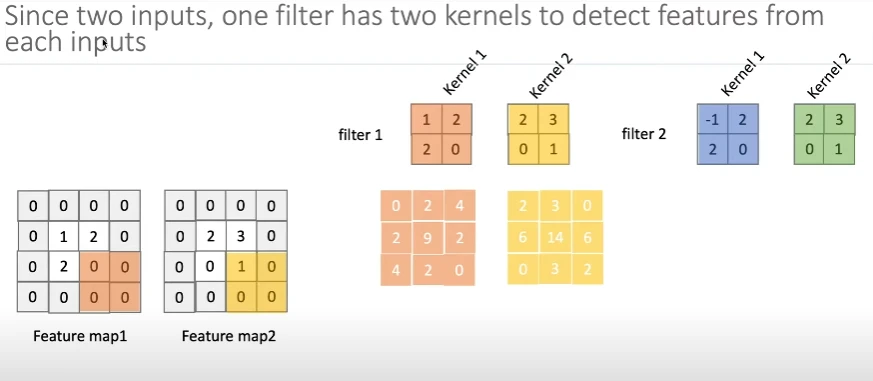

filter1로 구성된 kernel 1, 2가 feature map1, feature map2 위에서 Convolution을 진행하면서 나온 결과를 위와 같이 얻어냈다.

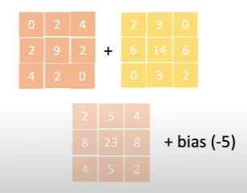

이렇게 두 커널에서 나온 Feature Map을 합치고, Bias를 적용한다.  

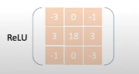

그리고 최종적으로 ReLU를 적용하여 특성 1에대한 최종 Feature Map을 얻어낸다. 이와 마찬가지로 filter 2에 대해서도 kernel을 Convolution 적용하여 Feature Map을 얻어낸다.

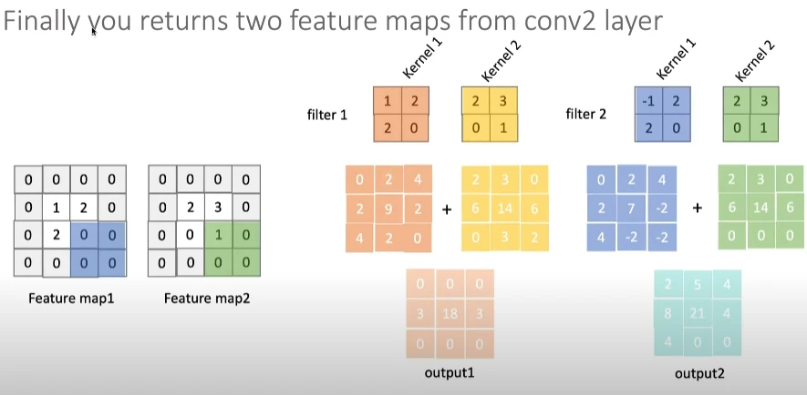

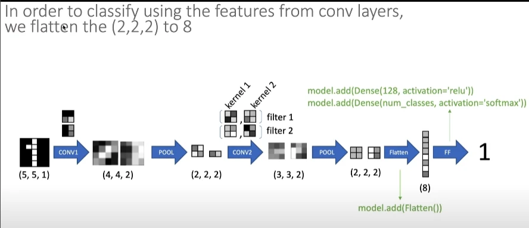

이후에 다시 Pooling Layer를 적용하여 Feature Map을 2x2로 축소시킨다. 이 두 개의 2x2 행렬이 숫자의 특징을 분류하는데 굉장히 중요한 역할을 한다. 이제 2차원 행렬을 Flatten한다.

MLP 같은 경우에는 모든 Pixel을 특징으로 사용했지만, CNN은 발견된 생김새 정보를 특징으로 한다는 것을 차이점으로 볼 수 있다. 위의 예시의 경우, 8개의 1차원 vector를 Input으로 넣을 수 있으며, 이를 feedforward 단계로 넣어준다.

feedforward 단계는 단순히 여러 개의 Dense Layer로 구성되어 있고, 최종적으로 SoftMax값을 출력하여 숫자를 분류한다.

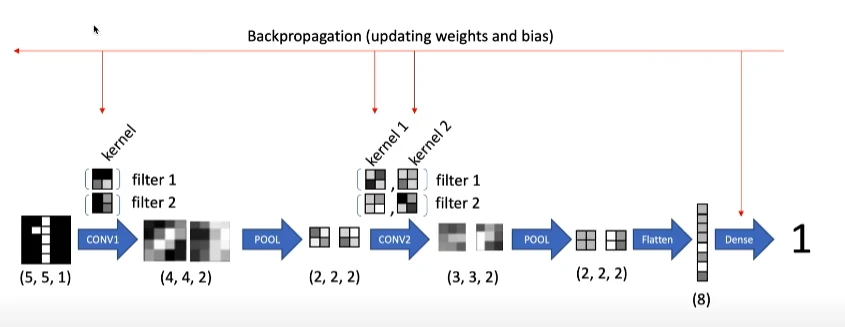

그리고 역전파를 활용해서 Weight와 Bias를 갱신한다. 사실 학습 초기에는 각각의 필터가 어떠한 특징을 잡아낼 수 있을지 모른다. 필터는 학습을 통해서 수평선, 수직선과 같은 가장 효율적인 정보를 추출하도록 세팅된다.
