# RNN(Recurrent Neural Network)

- RNN은 입력값의 순서를 고려하여 결론을 도출하는 딥러닝 모델이다.

ex)

I am a boy (statement)

am I a boy (question)

⇒ I와 am의 순서 차이가 평서문과 의문문을 가리는 차이를 만든다.

이를 one-hot encoding을 하면 아래와 같이 구성된다. (bag of words)

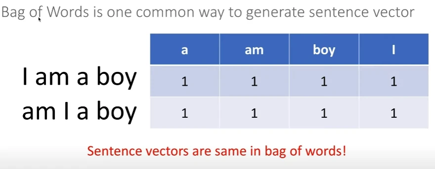

문제는 이렇게 구성하면 Bag of words가 동일하기 때문에 입력값이 같아져서 두 문장을 분류할 수가 없는 큰 문제가 발생한다.

⇒ RNN은 Input의 순서를 고려하여 예측을 내기 때문에 이런 문제에 최적합하다.

---

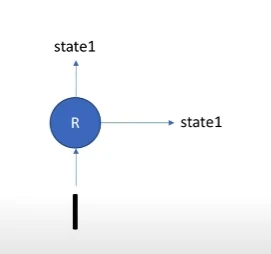

첫 단어가 RNN Cell에 들어와서 상태값을 return한다.

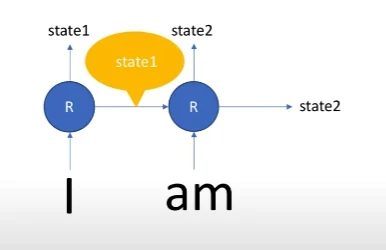

그리고 두 번째 입력값을 두 번째 RNN Cell이 처리한다. 여기서 현재 RNN Cell은 이전 RNN Cell의 출력값과 현재 단어를 고려해서 현재의 상태값을 return한다. 

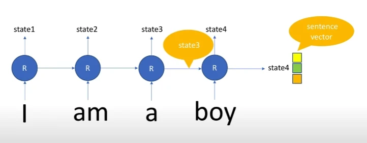

이렇게 쭉 계산을 진행한다. 결과적으로 최종 출력값은, 문장의 모든 순서를 고려하여 만들어진 벡터가 된다.

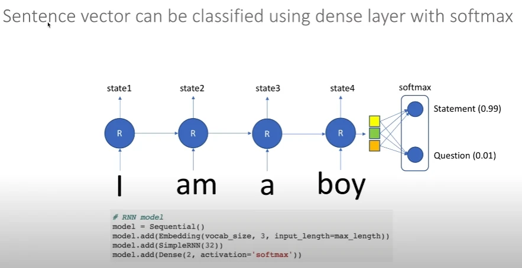

최종 출력값이 벡터이므로, Dense Layer에 SoftMax를 적용해서 분류를 할 수 있다. 

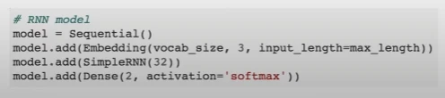

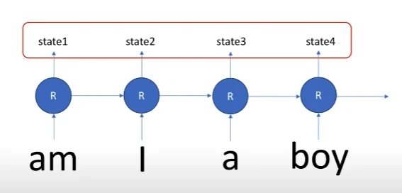

RNN Cell에서 나온 상태값은 어디에 사용되는 것일까?

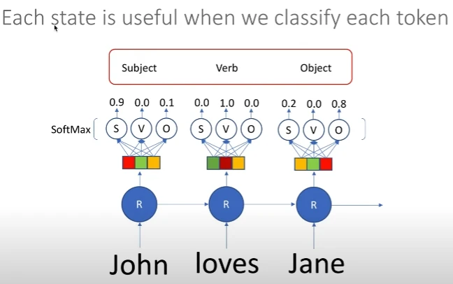

각각의 상태값 역시 각각의 입력값에 대한 분류를 위해 사용될 수 있다. S(주어), V(동사), O(목적어) 구분 예제가 존재할 때, 각각의 상태값이 벡터이므로 SoftMax를 적용해서 분류할 수 있다.

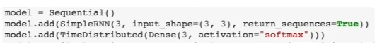

return_sequences를 True로 설정해서 각각의 상태값을 받고, TimeDistributed를 이용해 각각의 상태값을 활용해서 분류하는 것을 확인할 수 있다.

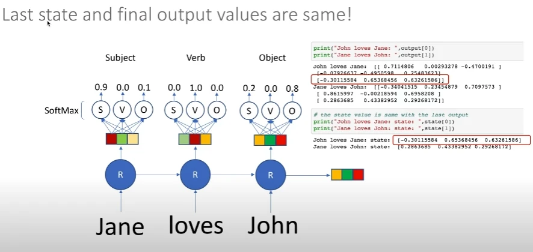

RNN Cell의 상태값과 출력값은 동일하다. 

---

- 그렇다면, RNN Cell이 어떻게 상태값을 계산하는 것일까?

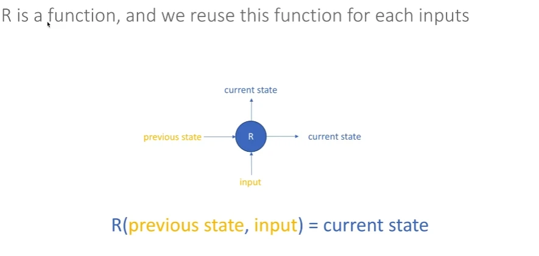

먼저, RNN Cell은 이전 Cell의 상태값과 현재 단어, 두 개의 입력값을 받는다.

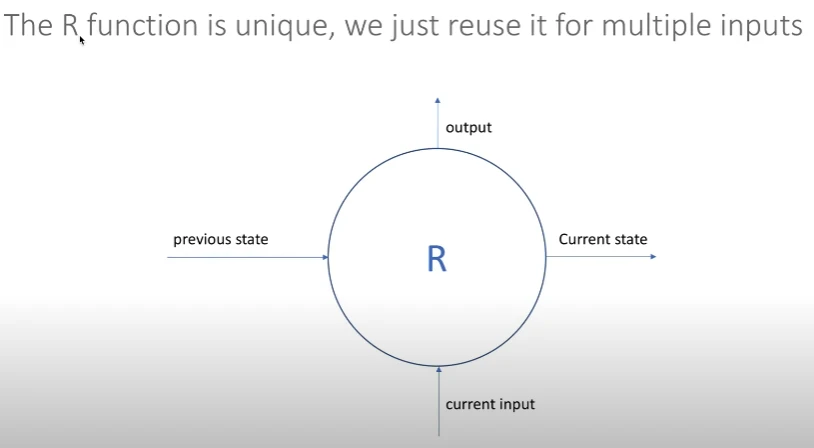

그리고, 실제로는 RNN Cell은 한 개이며, 들어오는 입력 값마다 재사용이 되는 것이다.

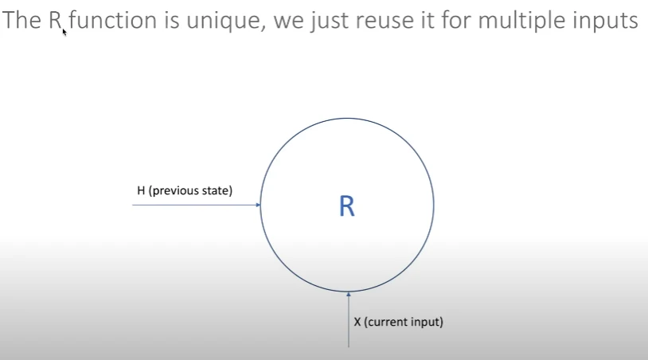

RNN Cell은 이전 Cell의 출력값(State)과 현재 Cell의 입력값을 가져온다.

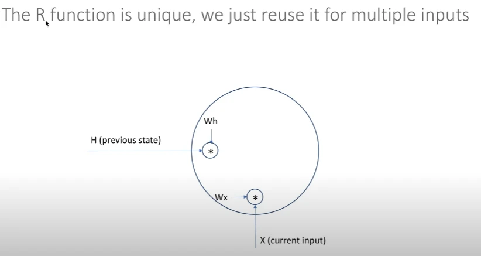

먼저 현재 Cell의 입력과 가중치를 곱하고, 그리고 이전 Cell의 상태값과 이에 해당하는 가중치를 곱해준다.

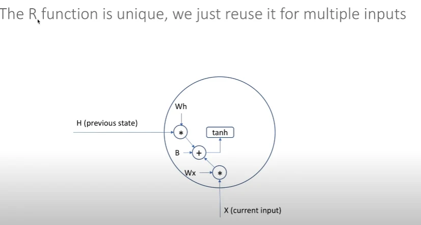

이 두 개의 값을 더해주고, 이를 활성화 함수(tanh)에 넣어줘서 최종 출력을 만든다.

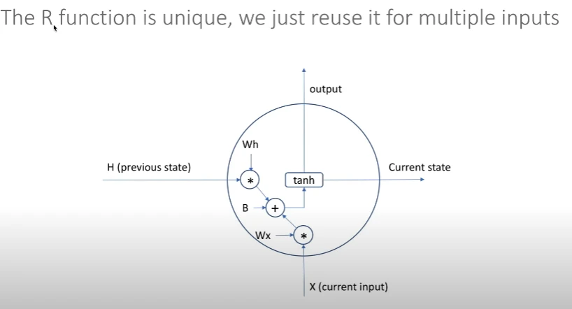

---

- example

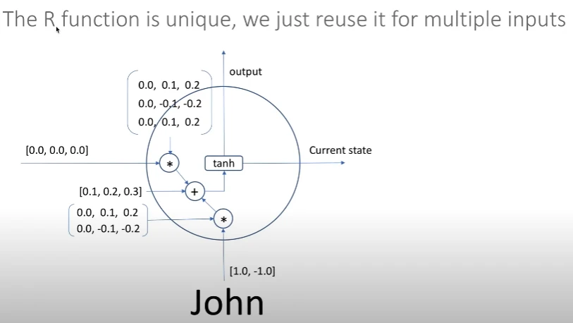

John이 [1.0, -1.0]이라는 vector라고 가정하자. 이 벡터를 가중치와 곱한다.

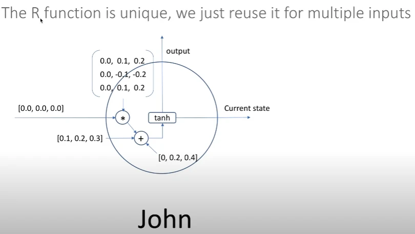

그리고 최초 단어라서 이전 RNN Cell의 State가 없기 때문에 Zero 벡터와 가중치가 곱해진다.

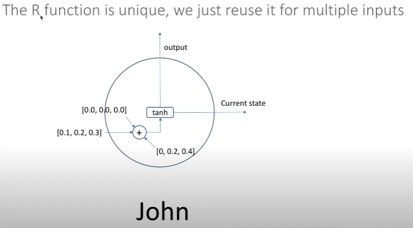

이제 이 값을 더해주고, 활성화 함수에 넣는다.

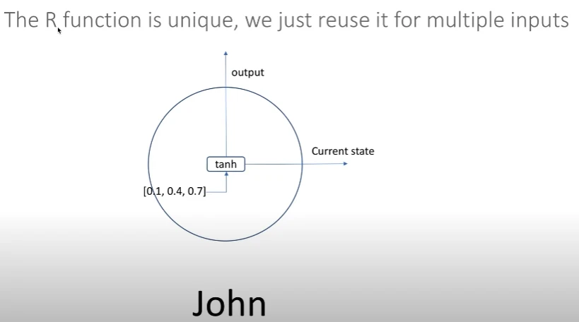

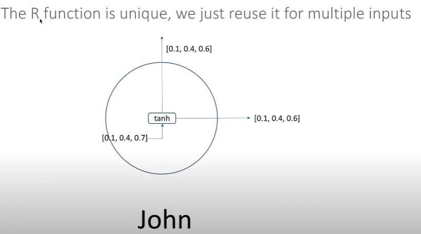

RNN Cell의 최초 출력값은 [0.1, 0.4, 0.6]이다.

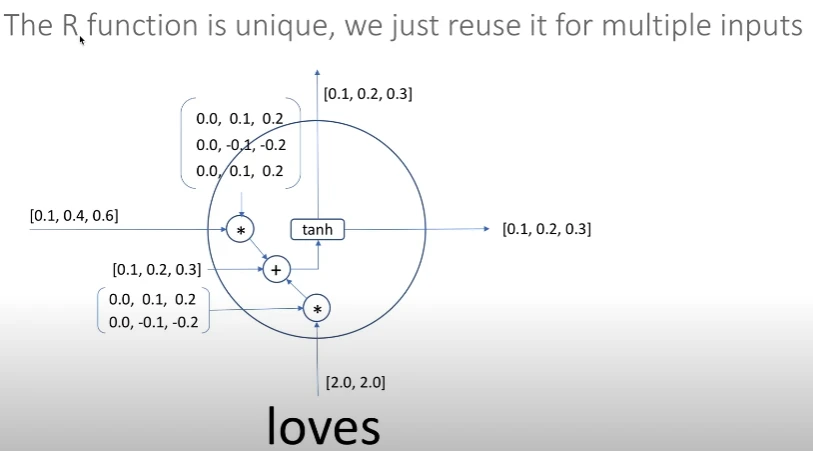

이제 다음 RNN Cell에 이전 단계의 출력값 [0.1, 0.4, 0.6]이 전달되고, 이전 단계에서 적용했던 계산이 그대로 적용되어진다.

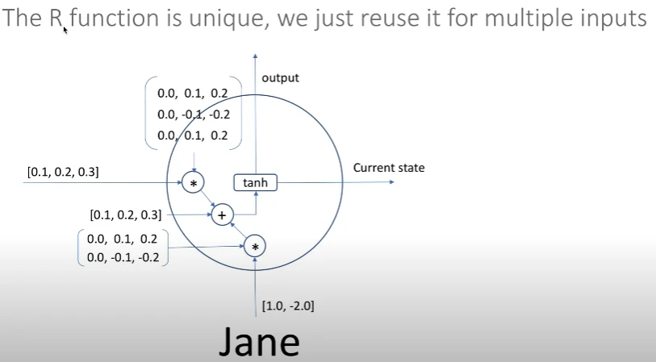

그리고 최종 단어까지 동일한 과정을 수행한다.

---

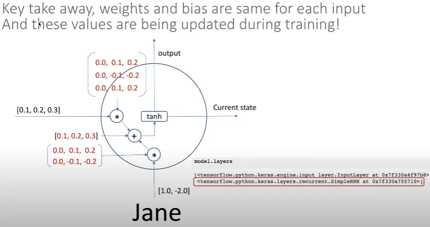

RNN Cell은 재사용이 되고, 그에 따라 가중치와 편향값이 항상 같은 것을 확인할 수 있다. 또한, tf2 코드를 통해서도 단지 한 개의 RNN Cell이 존재하는 것을 확인할 수 있다.
