# LSTM

[Long Short-Term Memory (LSTM) 이해하기](https://dgkim5360.tistory.com/entry/understanding-long-short-term-memory-lstm-kr)

**RNN & LSTM**

## RNN(Recurrent Neural Network)

전통적인 Neural Network는 지속되는 생각을 하지 못한다는 것이 큰 단점이었다. 예를 들어 영화에서 매 순간 일어나는 사건을 분류하고 싶은 경우, 전통적인 Neural Network는 이전에 일어난 사건을 바탕으로 나중에 일어나는 사건을 생각하지 못한다. (즉, 유기적이고 논리적인 추론이 불가능하다는 뜻) 이 문제를 해결하고자 RNN이라는 모델이 나오게 되었고, RNN은 스스로를 반복하면서 이전 단계에서 얻은 정보가 지속되도록 한다. 

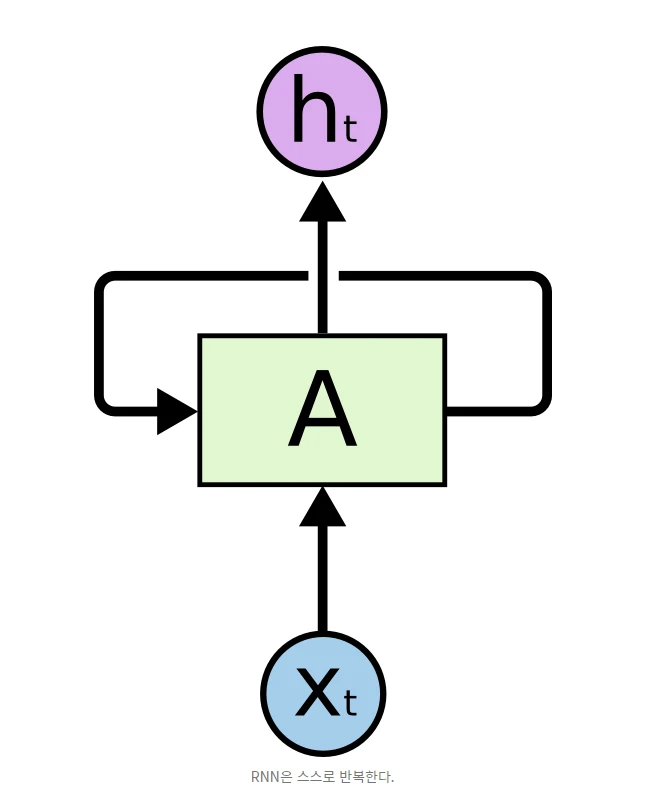

위 그림에서 A는 RNN의 한 덩어리이다. A는 input Xt를 받아서, ht를 내보낸다. A를 둘러싼 반복은 다음 단계에서의 network가 이전 단계의 정보를 받는다는 것을 보여준다.

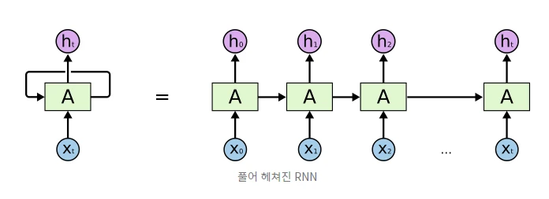

RNN을 풀어서 생각하면 위의 이미지와 같은 구조라고 볼 수 있다. 마치 여러 개의 network가 나열된 것처럼, 그 기능을 스스로 해내는 것이다.

- 긴 의존 기간으로 인한 문제점

RNN의 성공의 열쇠는 “Long Short-Term Memory Network(LSTM)”의 사용이다. LSTM은 RNN의 굉장히 특별한 종류이다. LSTM은 아까 얘기했던 영화를 프레임 별로 이해하는 것과 같은 문제들을 단순 RNN보다 훨씬 더 잘 해결한다. RNN도 LSTM만큼 이런 일을 잘 할 수 있다면 유용하겠지만, 아쉽게도 RNN은 그 성능이 상황에 따라 다르다.

우리가 현재 시점의 뭔가를 얻기 위해서 멀지 않은 최근의 정보만 필요할 때도 있다. 예를 들어, 이전 단어들을 토대로 다음에 올 단어를 예측하는 언어 모델을 생각해보자. 만약 우리가 “The clouds are in the sky”에서의 마지막 단어를 맞추고 싶다면, 저 문장 말고는 더 볼 필요가 없다. 마지막 단어가 sky이기 때문이다. 이 경우처럼 필요한 정보를 얻기 위한 시간 격차가 크지 않다면, RNN도 지난 정보를 바탕으로 학습할 수 있다.

⇒ RNN은 다소 짧은 기간에 의존한다.

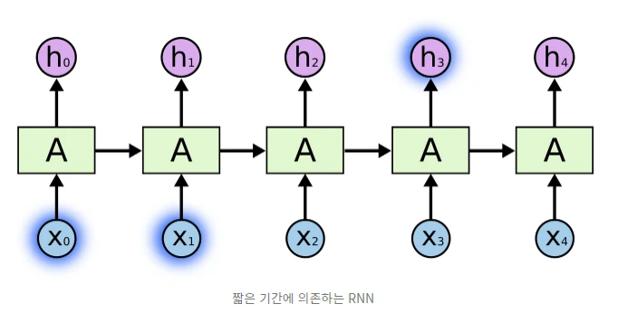

하지만 반대로, 더 많은 문맥을 필요로 하는 경우도 있다. “I grew up in France… I speak fluent French”라는 문단의 마지막 단어를 맞추고 싶다고 생각해보자. 최근 몇몇 단어를 봤을 때 아마도 언어에 대한 단어가 와야 될 것이라고 생각할 수는 있지만, 어떤 나라 언어인지 알기 위해서는 프랑스에 대한 문맥을 훨씬 뒤에서 찾아봐야 한다. 이렇게 되면 필요한 정보를 얻기 위한 시간 격차는 더욱 커지게 된다.

⇒ 안타깝게도 이 격차가 늘어날수록 RNN은 학습하는 정보를 계속해서 이어나가기가 힘들다.

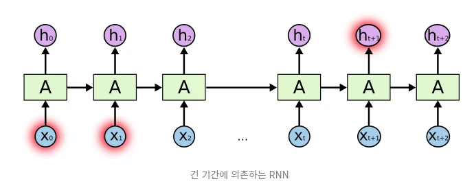

이론적으로는 RNN이 이러한 “긴 기간의 의존성(long-term dependencies)”를 완벽하게 다룰 수 있다고 한다. 그리고 단순한 예제에 대해서는 사람이 신중하게 hyper-parameter를 골라서 그 문제를 해결할 수도 있다. 하지만 RNN은 실제 문제를 해결하지 못하는 것이 슬픈 현실이다.

⇒ 다행히 LSTM은 문제가 없다.

## LSTM Networks

---

LSTM은 RNN의 특별한 한 종류로, 긴 의존 기간을 필요로 하는 학습을 수행할 능력을 갖고 있다. LSTM은 [Hochreiter & Schmidhuber (1997)](http://www.bioinf.jku.at/publications/older/2604.pdf)에 의해 소개되었고, 그 후에 여러 추후 연구로 계속 발전되고 유명해졌다. LSTM은 여러 분야의 문제를 굉장히 잘 해결했고, 지금도 널리 사용되고 있다.

LSTM은 긴 의존 기간 문제를 피하기 위해 명시적(explicitly) 설계되었다. 긴 시간 동안의 정보를 기억하는 것은 모델의 기본적인 행동이어야지, 모델이 그것을 배우기 위해서 몸부림치지 않도록 한 것.

모든 RNN은 Neural Network 모듈을 반복시키는 체인과 같은 형태를 하고 있다. 기본적인 RNN에서 이렇게 반복되는 모듈은 굉장히 단순한 구조를 가지고 있다. 예를 들어, tanh layer 한 층을 들수있다.

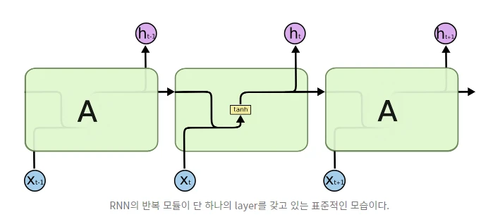

LSTM도 똑같이 체인과 같은 구조를 가지고 있지만, 각 반복 모듈은 다른 구조를 갖고 있다. 단순한 Neural Network Layer 한 층 대신에, 4개의 layer가 특별한 방식으로 서로 정보를 주고 받도록 되어 있다.

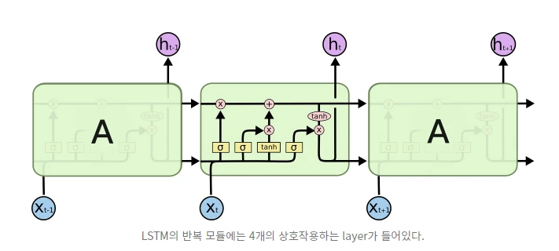

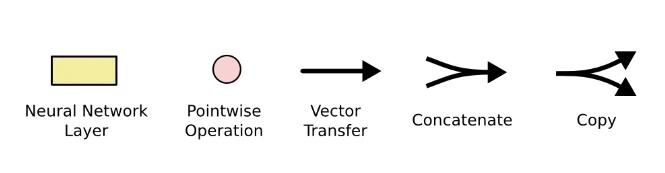

위 그림에서 각 선(line)은 한 노드의 output을 다른 노드의 input으로 vector 전체를 보내는 흐름을 나타낸다. 분홍색 동그라미는 vector 합과 같은 pointwise operation을 나타낸다. 노란색 박스는 학습된 Neural Network Layer다. 합쳐지는 선은 concatenation을 의미하고, 갈라지는 선은 정보를 복사해서 다른 쪽으로 보내는 fork를 의미한다.

- **LSTM의 핵심 아이디어**

LSTM의 핵심은 **cell state**인데, 모듈 그림에서 수평으로 그어진 윗 선에 해당한다.

Cell state는 컨베이어 벨트와 같아서, 작은 linear interaction만을 적용시키면서 전체 체인을 계속 구동시킨다. 정보가 전혀 바뀌지 않고 그대로 흐르게만 하는 것은 매우 쉽게 가능하다.

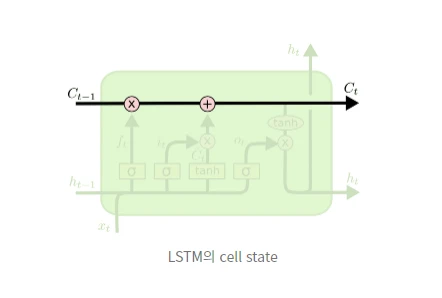

LSTM은 cell state에 뭔가를 더하거나 없앨 수 있는 능력이 있는데, 이 능력은 gate라고 불리는 구조에 의해서 조심스럽게 제어된다.

Gate는 정보가 전달될 수 있는 추가적인 방법으로, sigmoid layer와 pointwise 곱셈으로 이루어진다.

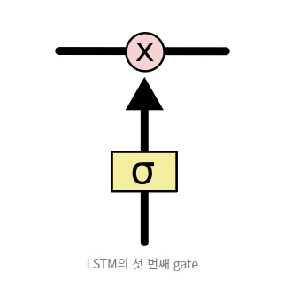

Sigmoid layer는 0과 1사이의 숫자를 내보내는데, 이 값은 각 컴포넌트가 얼마나 정보를 전달해야 하는지에 대한 척도를 나타낸다. 그 값이 0이라면 &lt;아무 것도 넘기지 말라&gt;는 의미가 되고, 값이 1이라면 &lt;모든 것을 넘겨라&gt;라는 의미가 된다.

LSTM은 3개의 gate를 가지고 있고, 이 문들은 cell state를 보호하고 제어한다.

- LSTM의 단계

1\. `forget gate layer`

LSTM의 첫 단계는 cell state로부터 어떤 정보를 버릴 것인지를 정하는 것으로, sigmoid layer에 의해 결정된다. 그래서 이 단계의 gate를 “forget gate layer”라고 부른다. 이 단계에서는 h(t-1)과 xt를 받아서 0과 1 사이의 값을 C(t-1)에 보내준다. 그 값이 1이면 모든 정보를 보존하는 것이고, 0이면 모두 버리는 것이다.

이전에 얘기했던 이전 단어들을 바탕으로 다음 단어를 예측하는 언어 모델 문제로 생각해보자면, 여기서 cell state는 현재 주어의 성별 정보를 가지고 있어서 그 성별에 맞는 대명사가 사용되도록 준비하고 있을 수도 있다. 그런데 새로운 주어가 왔을 때, 우리는 기존 주어의 성별 정보를 생각하고 싶지는 않을 것이다.

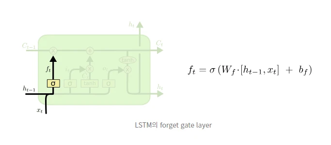

⇒ 정리하자면, h(t-1)과  xt를 받아서, 이 값들을 시그모이드에 통과시켜 Cell state에 전달할 값으로 만들어준다. f(t). 이 단계는 필요없는 정보를 버리고 잊어버리는 단계라고 해석할 수 있을 듯 하다.

2\. `Input gate layer`

다음 단계는 앞으로 들어오는 새로운 정보 중 **어떤 것을 cell state에 저장할 것인지를 정한다.** 그 다음에는 tanh layer가 새로운 후보 값들인 Ct라는 vector를 만들고, cell state에 더할 준비를 한다. 이렇게 두 단계에서 나온 정보를 합쳐서 **state를 업데이트할 재료**를 만들게 된다.

다시 언어 모델의 예제에서, 기존 주어의 성별을 잊어버리기로 했고, 그 대신 새로운 주어의 성별 정보를 cell state에 더하고 싶을 것이다.

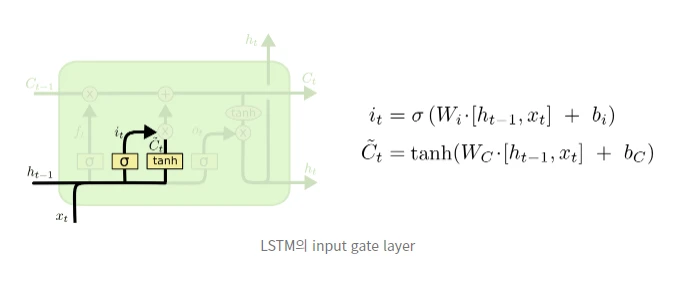

3\. `update`

이제 과거 state인 C(t-1)를 업데이트 해서 새로운 cell state인 Ct를 만들 것이다. 이미 이전 단계에서 어떤 값을 얼마나 업데이트해야 할 지 다 정해놨으므로, 여기서는 그 일을 실천만 하면 된다.

우선 이전 state인 C(t-1)에 ft를 곱해서 가장 첫 단계에서 잊어버리기로 정했던 것들을 진짜 잊어버린다. 그리고나서 it와 Ct를 더한다. 이 더하는 값은 두 번째 단계에서 업데이트하기로 한 값을 얼마나 업데이트할 지 정한 만큼 scale한 값이 된다.

또다시 언어 모델 문제로 돌아가보면, 이 단계에서 실제로 이전 주어의 성별 정보를 없애고 새로운 정보를 더하게 되는데, 이는 지난 단계들에서 다 정한 것들을 실천만 하는 단계임을 확인할 수 있다.

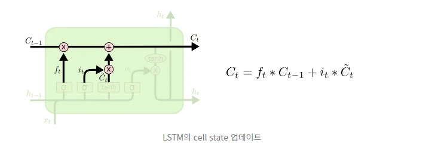

4\. `output selection`

마지막으로 무엇을 output으로 내보낼지 정하는 일이 남았다. 이 output은 cell state를 바탕으로 filter된 값이다. 가장 먼저, **sigmoid layer에 input 데이터를 태워서** cell state의 어느 부분을 output으로 내보낼 지를 정한다. 그러고나서 **cell state를 tanh layer에 태워서 -1과 1 사이의 값을 받은 뒤**에, **방금 전에 계산한 sigmoid gate의 output과 곱해준다.** 그렇게 하면 우리가 output으로 보내고자 하는 부분만 내보낼 수 있게 된다.

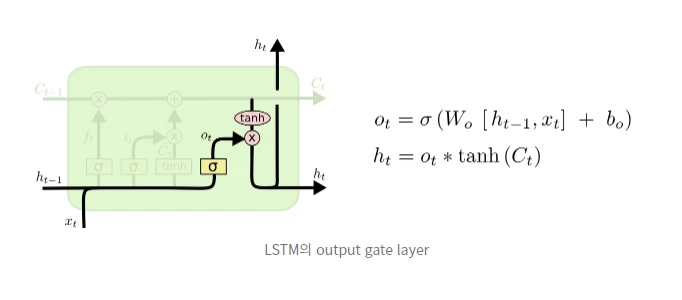

이제 언어 모델 예제를 생각해보면, 우리는 주어를 input으로 받았으므로 주어 다음에 오게 될 예측값인 output으로 적절한 답은 아마도 동사 개념의 무언가가 될 것이다. 예를 들어 최종적인 Output은 앞에서 본 주어가 단수형인지, 복수형인지에 따라 그 형태가 달라질 수도 있는 것이다.

---

[[딥러닝] LSTM 쉽게 이해하기](https://www.youtube.com/watch?v=bX6GLbpw-A4)

- 간단한 RNN 구조

    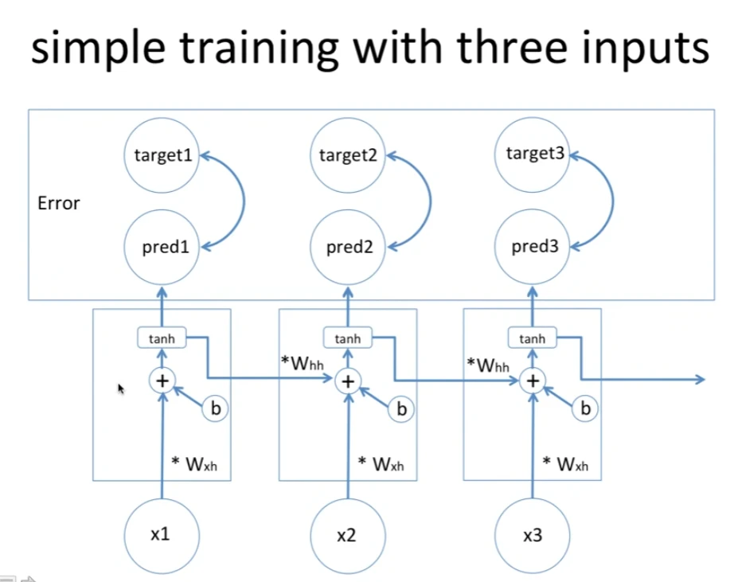

총 세 개의 Input을 받고, 세 개의 노드가 있으며, 세 개의 Prediction 값이 있다. 이에 따라 Supervised Learning을 하므로 답이 있다. 답은 Target이고, 예측값은 Prediction이며, 그 차이가 Error이다.

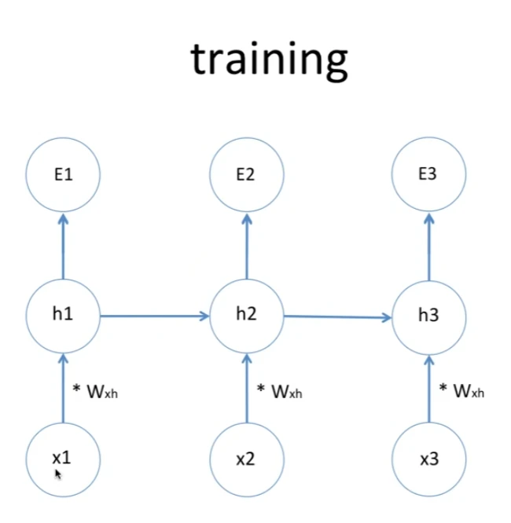

위의 그림을 간략화한 형태

---

- 학습에 앞서 알아야 할 것들

Gradient Descent(경사 하강)

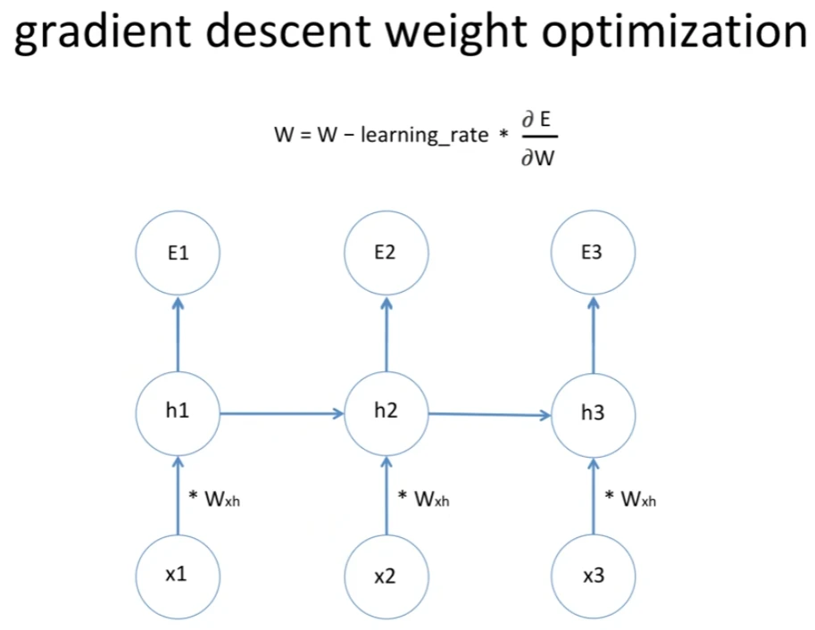

딥러닝 모델은 대부분 학습을 하는데 Gradient Descent를 사용한다. 이는 새로운 가중치를 업데이트 하는 방식을 설명하는 방법이다.

Gradient Descent에 따르면, 새로운 가중치는 기존의 가중치에서, 에러를 가중치로 미분한 값을 Learning Rate와 곱한 값을 뺀 것으로 만들어준다.

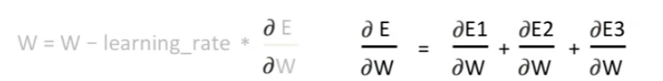

위의 이미지의 경우, 에러를 가중치로 미분한 값은 E1, E2, E3의 미분값을 더한 값과 같다.

- E3의 미분값을 구하는 과정(Chain Rule)

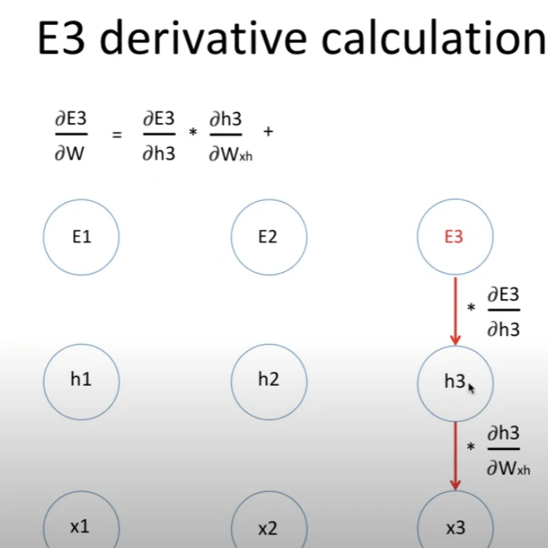

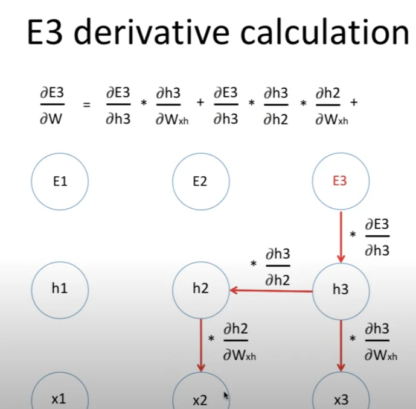

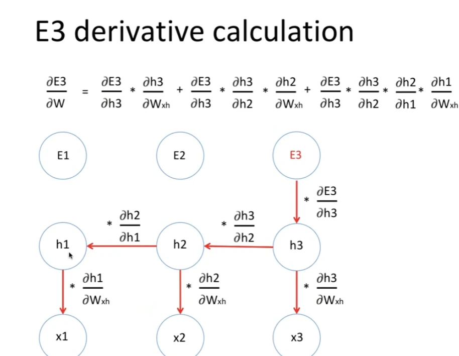

⇒ Backpropagation Through time을 통해서 미분값들을 여러 차례 곱하게 된다. 이렇게 짧은 Sequence의 경우에는 크게 문제가 되지는 않지만, 긴 Sequence의 경우에는 문제가 된다.

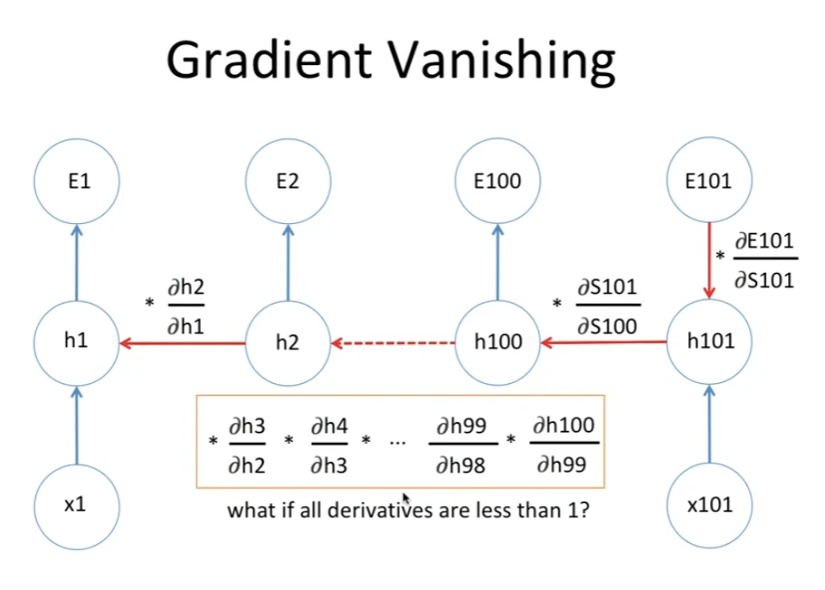

만약 이와 같은 경우에서, 미분 하나 하나의 값이 0.0… 이런 값이라면, 0과 가까운 값이 되기 때문에 **가중치의 업데이트가 일어나기 힘들 것이다.** 이럴 경우, **업데이트가 거의 되지 않으면서 학습이 비효율적으로 이루어진다.**   ⇒ 이를 `Gradient Vanishing` 이라고 한다.

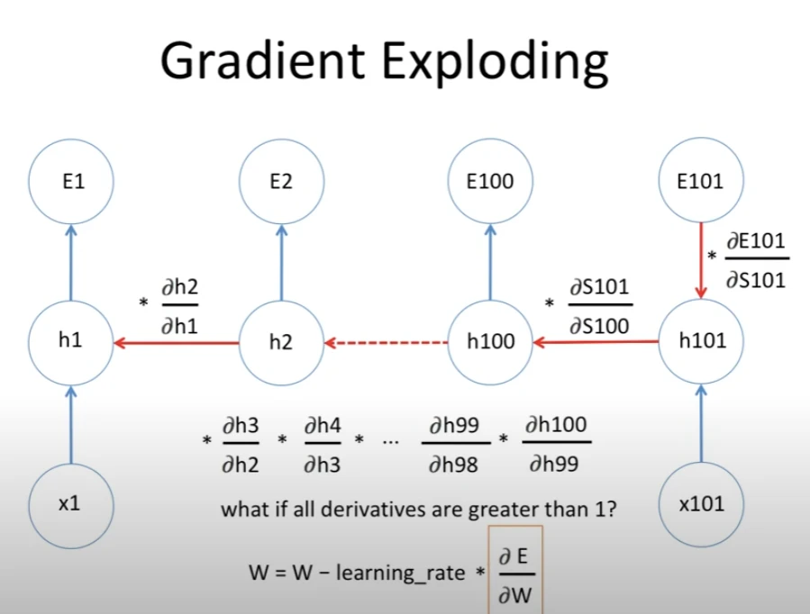

그런데, 이와 반대로 만약 모든 미분값들이 1보다 크다면? 가중치가 너무 커져서 Training 한 곳으로 가지 못하게 된다. ⇒ 이를 `Gradient Exploding` 이라고 한다.

---

이러한 문제 때문에 시퀀스가 길어지면, (NLP의 경우에는 단어가 많거나 문장이 긴 경우) RNN에서는 비효율적이라고 할 수 있다. 이를 극복하기 위해 나온 것이 LSTM이다. LSTM에는 RNN에서 하나의 라인이 추가가 된다. 이를 Memory Cell이라고 한다.

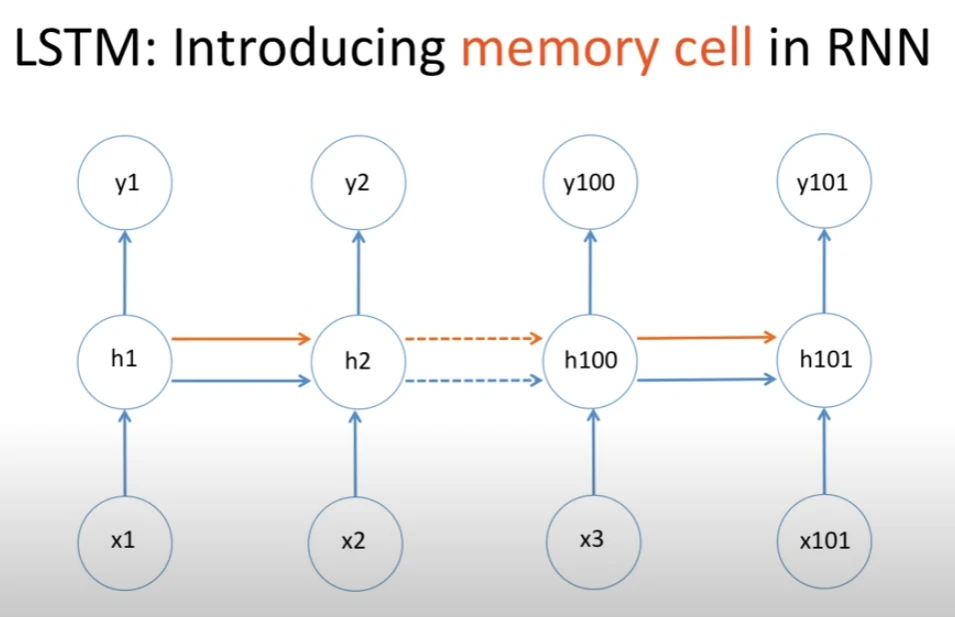

- Example

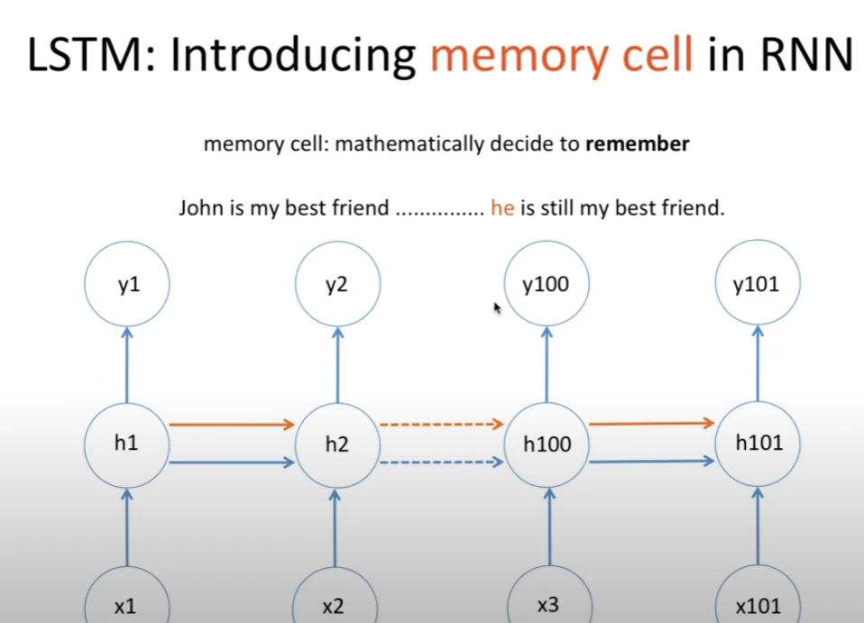

이 예시의 경우, 맨 앞에서 John이 나왔으므로 John에 대한 정보를 가지고 있어야 한다. 그리고 이후에 he라는 정보를 출력하게 될 것이다.

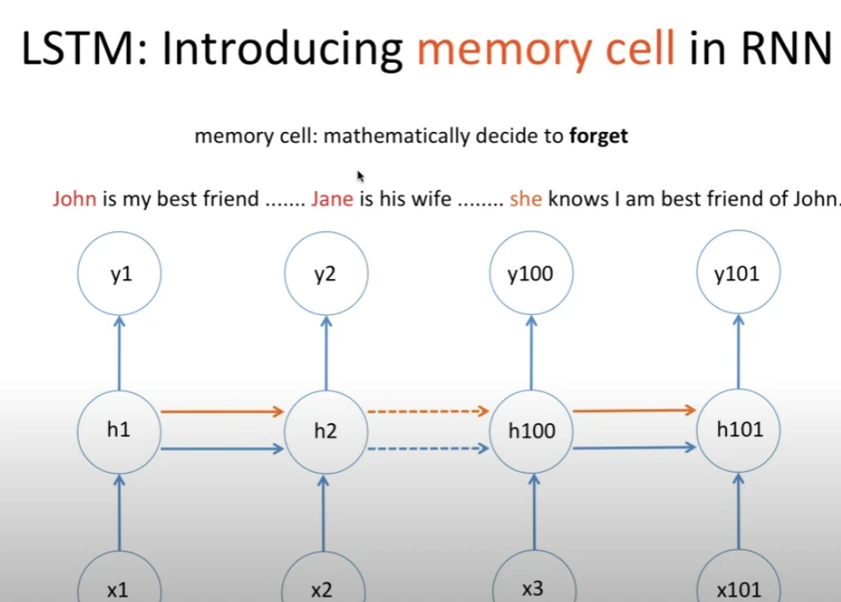

John이라는 사람에 대해 얘기를 하다가 최근에 Jane에 대해 얘기를 하게 되었다. 그러면 이후에 ‘주어를 선택해라’라고 한다면, Memory Cell은 John에 대한 생각은 잊고, Jane에 대한 Information을 기억하고 있어야 할 것이다. 이런 것처럼 어떠한 정보를 기억하고, 잊는 기능이 LSTM Cell에 포함되어 있다.

당연하게도 LSTM은 딥러닝 모델이고, 딥러닝은 수학적 모델이므로, 어떠한 정보를 잊고 기억하는 과정이 모두 수학적인 공식이다. 그 수학적 공식에 대해 알아보도록 한다.

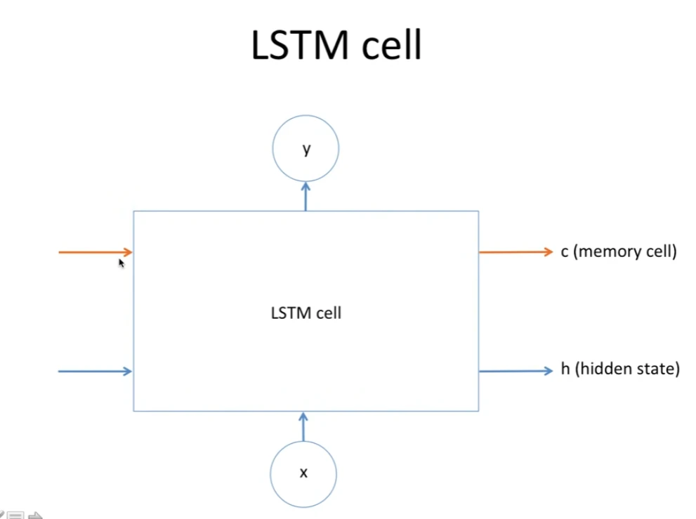

이 Cell은 가장 간단한 모양의 LSTM Cell이다. 오렌지 색 Line, 파란 색 Line이 있다. Output도 출력하지만, Memory Cell과 Hidden State가 계속해서 존재하며, 옆에 있는 Cell로 전달된다. 

- LSTM 기능의 수학적 메커니즘

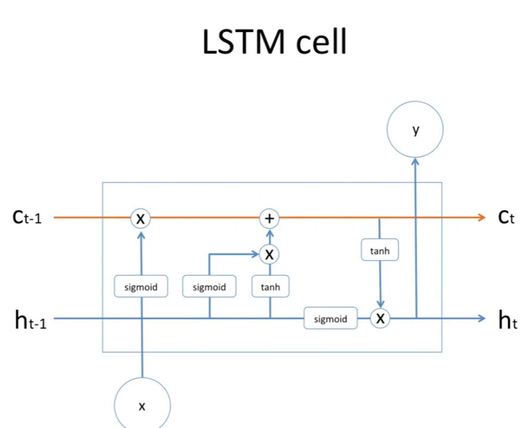

1\. LSTM cell : forget mechanism

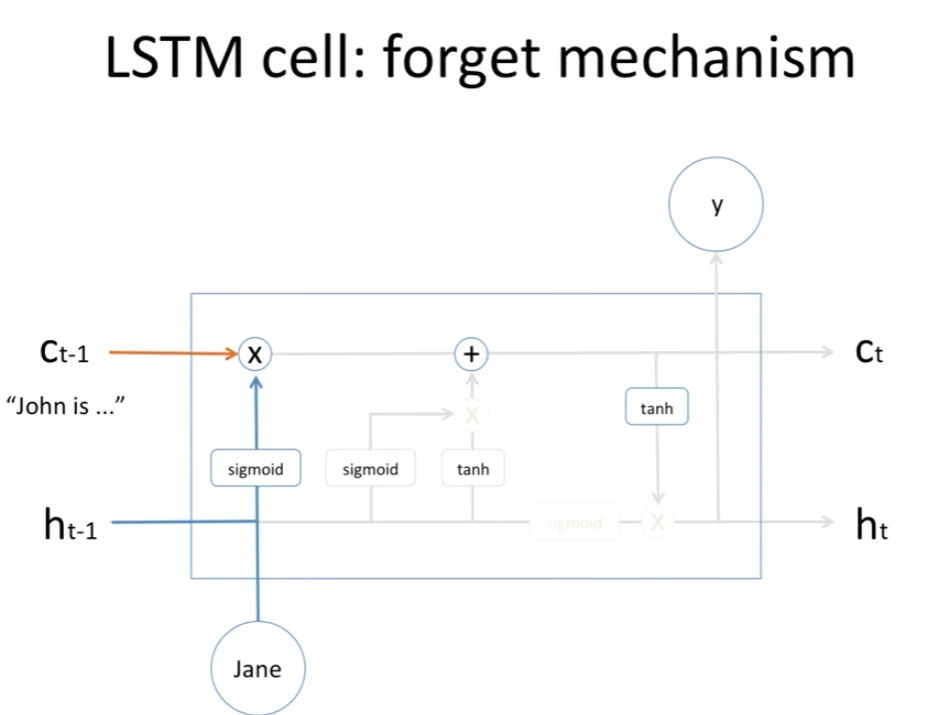

C(t-1)에 기존에 기억하던 정보가 전달되어진다. 그런데, 새로운 정보인 Jane이라는 정보가 들어오게 되었다. 이때 과거의 hidden state와 input이 함께 sigmoid로 전달된다.

- sigmoid

sigmoid의 출력은 0~1의 확률 값이다. 그렇다면, 몇 %로 출력이 나오게 되는 것이다.

C(t-1)과 sigmoid의 출력을 곱해주는데, 이것은 과거의 정보에 대해서 몇 %만 기억하라. 라는 의미로 해석될 수 있다. 예를 들어 sigmoid의 결과로 20%가 나왔다면, “John is…”에 대한 정보중 20%만을 기억하라고 명령할 수 있게 되는 것이다.

⇒ 물론, 학습 과정을 통해서 forget mechanism에서 Weight value와 Bias value가 학습되게 돼있다.

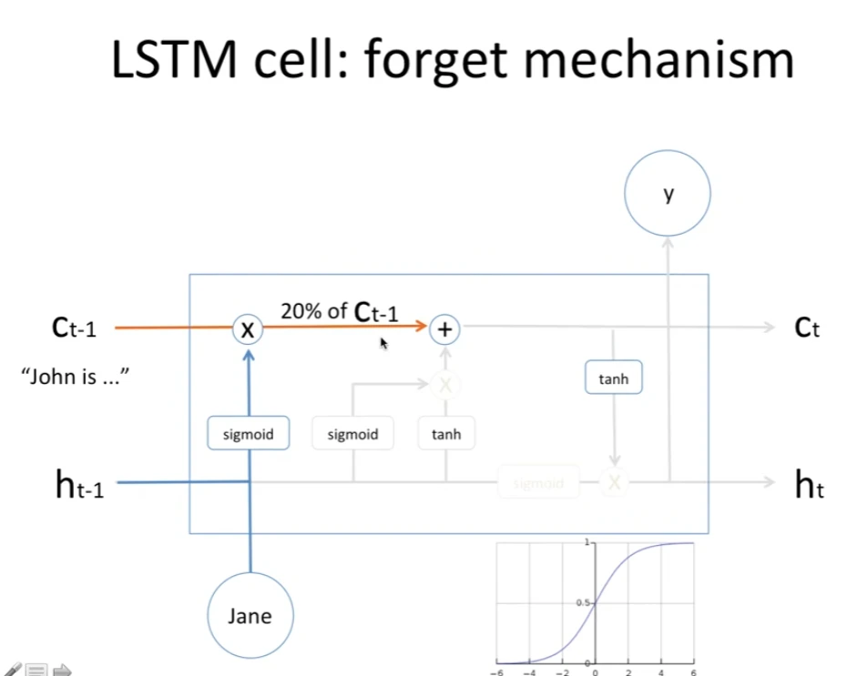

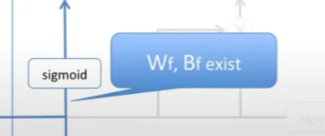

2\. LSTM cell: input mechanism

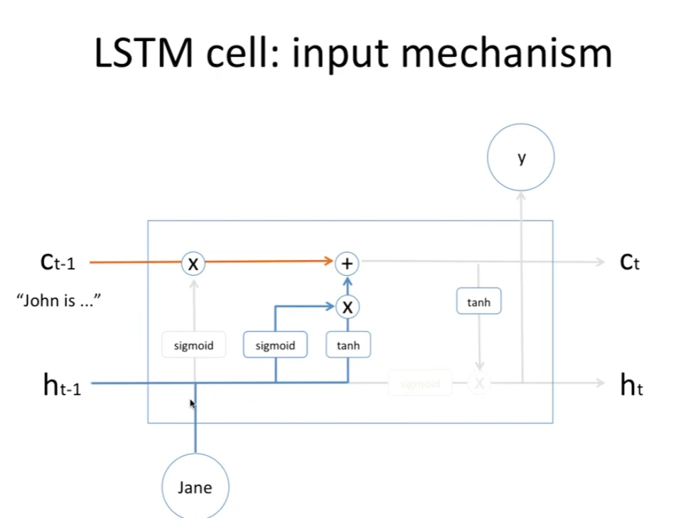

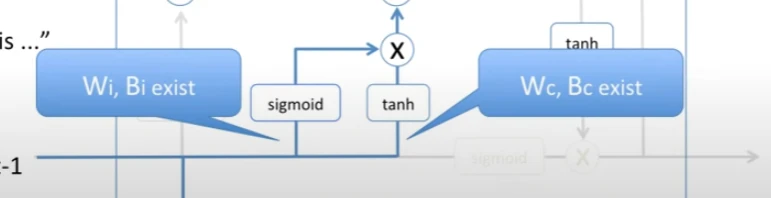

새로운 정보가 Memory Cell에 더해지는 과정이다. 수학적으로 새로운 정보를 더하고 있다. 물론, sigmoid와 tanh 앞에 weight value와 bias value가 있으며, 이것 역시 학습을 통해 optimize가 되도록 설계되어 있다.

3\. LSTM cell: output mechanism

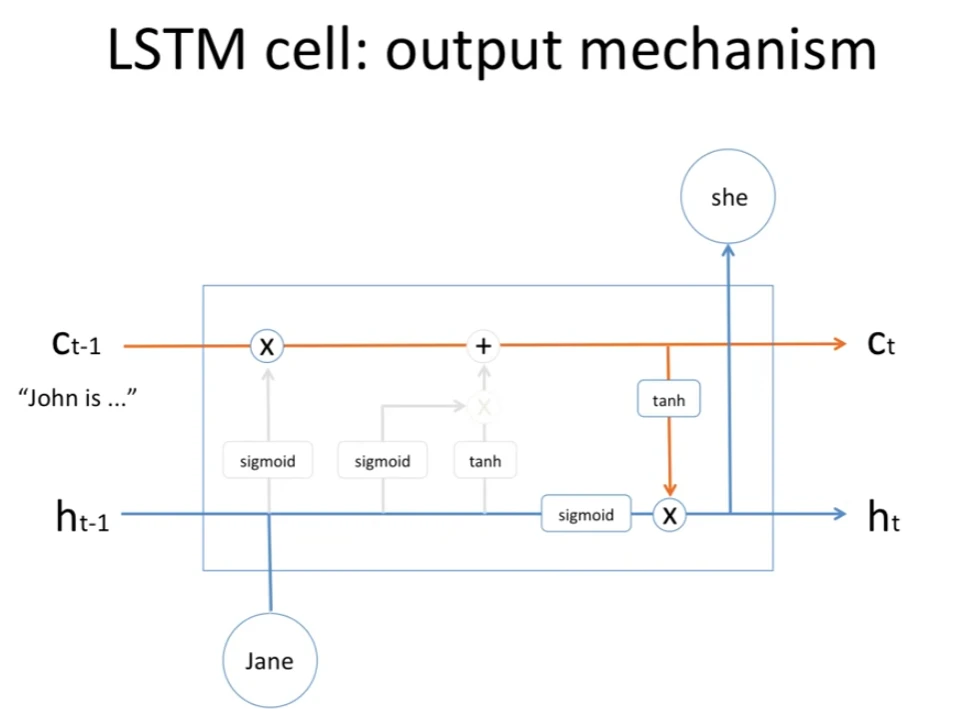

Memory Cell의 정보가 tanh를 통해서 들어오고, hidden state와 현재의 정보가 sigmoid를 통해서 들어오고 서로 곱해진다. 이렇게 곱해진 값이 output으로 출력이 되고, 또한 이 값이 다음 hidden state로 넘어가는 것을 확인할 수 있다.
