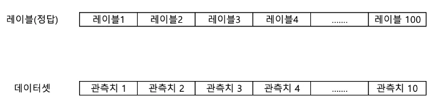

# batch size & epochs

작성일 2023-07-14
{ .post-date }

- batch size : 몇 개의 샘플로 가중치를 갱신할 것인지
- epochs : 전체 데이터 셋을 몇 번 반복 학습할 것인지

```python
# keras 모델 학습
model.fit(x, y, batch_size = 32, epochs = 10)
```

batch size는 몇 개의 관측치에 대한 예측을 하고, 레이블 값과 비교를 하는지 설정하는 파라미터이다. 예를 들어, 아래와 같이 100개의 관측치에 대해 데이터셋과 레이블 값이 존재한다고 가정해보자. 이때, 모델은 100개의 관측치에 대해 예측을 하며 레이블 값과 비교를 하며 학습을 한다.



배치사이즈는 몇 개의 관측치에 대한 예측을 하고, 레이블 값과 비교를 하는지를 설정하는 파라미터이다. 위의 예시에서 배치 사이즈가 100이면 전체 데이터에 대해 모두 예측한 뒤, 실제 레이블 값과 비교한 후 가중치 갱신을 한다. 배치 사이즈가 10이면 10개 데이터에 대해 예측한 뒤 실제 레이블 값과 비교하며 가중치 갱신도 10번 발생한다.

배치사이즈가 100인 경우, 어떤 한 유형에 대한 예측이 틀리면 이후 비슷한 유형에 대한 예측도 틀릴 수 있다. 하지만 배치 사이즈가 10인 경우에는, 데이터 10개마다 실제 레이블 값과 비교하기 때문에, 처음에 틀리게 예측하더라도 가중치 업데이트를 하면서 뒤에는 맞추게 될 확률이 높다.

배치 사이즈가 클수록 많은 데이터를 저장해두어야 하므로 용량이 커야 한다. 반면 배치사이즈가 작으면 학습은 촘촘하게 되겠지만 계속 레이블과 비교하고, 가중치를 업데이트 하는 과정을 거치면서 시간이 오래 걸린다.

- epochs

에폭은 하나의 데이터 셋을 몇번 반복 학습할지 정하는 파라미터이다. 같은 데이터셋이라 할지라도 가중치가 계속해서 업데이트되기 때문에 모델이 추가적으로 학습이 가능하다. 반복학습을 통해 모델의 성능을 향상시킬 수 있다. 하지만, 너무 많이 반복학습을 시키면 학습 data set에 대한 성능은 올라가지만, 관측되지 못한 test data set에 대해서는 성능이 떨어지는 overfitting이 발생하게 된다. 따라서 오버피팅이 일어날 것 같으면 학습을 종료할 수 있다. (`early stopping`)
