# 신경망 첫걸음 > 신경망 이론

작성일 2023-03-18 · 최종 수정일 2023-07-08
{ .post-date }

- `예측자` : 입력 값에 대해 출력 값이 어떻게 나올 지를 예측하는 역할을 하는 것.  
    ⇒ 이를 통해 예측 값과 실제 값의 차이를 구해서 오차를 계산할 수 있다.

iteration을 통해 error 값을 구하고, 이를 바탕으로 예측자에 적용되는 상수(parameter)값을 조정함으로써 예측자의 정확도를 높여간다.

parameter 값은 분류자(직선)의 기울기(slope)를 변화시키는 역할을 한다.

- `분류자` : 입력값을 예측하는데 사용되는 직선(분류하는 역할을 함)

⇒ parameter 값을 조정하는 것은 직선의 기울기. 즉, 분류자의 기울기를 조정하는 과정이다.

---

## 분류자 학습시키기

- `training data` : 예측자 또는 분류자에게 실제 값을 알려주는 역할을 수행하는 예제 데이터

> 예를 들어 손으로 쓴 숫자 이미지 속 숫자를 예측하는 경우에 학습 데이터는 아래와 같이 구성될 수 있다.  
>
>
> 1) 손글씨 이미지
>
> 2) 그 이미지의 실제 숫자(0~9) 쌍으로 구성된다.
>
> 이 실제 숫자와 같은 ‘정답’을 보통 레이블(**Label**) 이라고 한다.  
>
>
> 이 방식처럼 기계에게 정답을 알려주면서 학습을 시키는 방법을 지도 학습(supervised learning)이라고 한다. 학습 데이터와 대비되는 개념으로는 테스트 데이터(test data)가 있다. 이는 학습이 모두 끝난 이후에 실제로 예측을 잘 하는지 확인하는 용도로 사용되는 데이터를 말한다.

머신러닝에서 매우 중요한 개념은 바로 parameter 값을 조금씩 조정하는 것이다. 만약 특정 입력값에 대해서만 값을 조정하게 되면 특정 데이터에 편중된 결과가 도출될 수 있기 때문이다.

이 방식은 실제 현업에서 학습 데이터 자체에 문제가 있는 경우에 이 영향을 감소시키는 작용을 할 수 있다. 현업에서 측정되는 데이터들은 자체가 오차 또는 잡음을 많이 가지므로 완벽하게 정확하지 않으며 심지어 신뢰할 수 없는 경우가 많이 있다. 업데이트의 정도를 조정해가는 방법은 이러한 학습 데이터의 오차나 잡음의 영향을 약화시킬 수 있다.

머신러닝에서는 조정 인자 L을 `학습률`(**Learning Rate**)이라고 한다. 적절한 Learning Rate를 분류자에 적용하면 탁월하게 데이터를 분류하는 분류자를 손쉽게 얻어낼 수 있다.

- 분류자는 1개로 충분하지 않을 수도 있다.

선형 분류자는 불 논리곱 함수(AND)를 학습할 수 있으며, 마찬가지로 불 논리합(OR)도 학습 할 수 있다. 하지만, 배타적 논리합(XOR)은 학습이 불가능하다.

⇒ 이것이 선형 분류자의 한계이다. 단순한 선형 분류자는 당면한 문제가 단일 직선에 의해 구분되지 않는다면 아무 소용이 없게 된다. 이런 경우, 두 개의 분류자를 도입하면 XOR에 대해서도 학습이 가능하게 된다.

---

- `활성화 함수`(Activation Function)

입력 신호를 받아 특정 분계점을 넘어서는 경우에 출력 신호를 생성해주는 함수이다. 활성화 함수 중 가장 단순한 형태는 계단 함수(Step Function)이다.

딱딱한 계단 함수보다 좀 더 부드러운 형태를 가지는 함수가 바로 **시그모이드**(sigmoid) 함수이다.

Activation Function으로는 시그모이드 함수 외의 다른 함수도 많이 이용되지만, 시그모이드는 단순하면서도 전통적으로 많이 쓰여온 함수이기 때문에 처음 인공 신경망을 공부할 때는 안성맞춤이다.

시그모이드 함수는 때로 로지스틱 함수(Logistic Function)라고 부르기도 하며, 수식으로는 아래와 같이 표현된다.

$$
s(x)=1 / {1+e^{-x}}
$$

> Activation Function에는 시그모이드 함수 외에도 쌍곡탄젠트(tanh), ReLU, Leaky ReLU, Maxout, ELU 등 많은 종류가 있다.

시그모이드 함수는 다중 입력을 전달받고, 이 입력을 모두 더한 다음 그 값을 입력받아 Threshold를 넘는지, 안넘는지를 판단하게 된다.

뉴런을 인공적으로 모델화 하기 위해서는, 뉴런을 여러 계층(Layer)에 위치시키고, 각각의 뉴런은 직전 계층과 직후 계층에 있는 모든 뉴런들과 상호 연결되어 있는 식으로 표현하면 될 것이다. 이때 각각의 인공 뉴런을 `노드`라고 부른다.

이전에 학습 과정을 거치면서 선형 분류자의 기울기 상수를 조정해갔던 것처럼, 레이어를 다룰 때는 각각의 노드 간 연결의 강도를 조정해 나가는 방식으로 매개변수를 조정해 나간다.

각각의 노드의 연결은 모두 `가중치`(**weight**)를 가지며, 가중치가 작을수록 신호는 약화되고, 가중치가 클수록 신호는 강화된다.

Layer와 Layer 사이에 존재하는 모든 노드가 꼭 연결되어야만 하는 것은 아니며, 혹은 더 많이 연결될 수도 있다. 이는 필요에 따라 조정하면 된다. (모든 노드가 연결되는 것 : FC, Fully-Connected)

⇒ 학습을 통해 노드의 가중치를 조정하는 과정에서 일부 가중치는 학습의 결과에 영향을 미치지 않아 중요하지 않다고 판단되어서 가중치가 0에 가까워질 수도 있다.

- example

레이어가 두 개 있고, 각 레이어에 두 개의 노드가 존재한다고 해보자. 관습적으로 첫 번째 레이어는 값을 입력받는 역할을 하는 레이어이며, 추가적인 계산을 진행하지는 않는다. 레이어1의 각 노드가 레이어2의 각 노드에 대해 모두 연결을 가진다고 하고, 각각 임의의 가중치를 갖는다고 해보자.

이 상태에서 Activation Function을 Sigmoid Function으로 사용한다고 할 때, 레이어2의 노드1에 대해서 입력값을 계산하려면, 레이어1의 두 노드에 들어온 입력값에 대해서 레이어2의 노드1에 대한 가중치를 곱한 값을 모두 더하고, 이를 Sigmoid Function에 넣어준다. 그러면, 결과적으로 입력값에 대한 값이 나오게 된다.

⇒ 만약 레이어의 개수가 더 많고 노드의 개수가 더 많다면 이러한 계산은 매우 복잡해질 것이다. 이를 간편하게 수행하려면 행렬을 사용하면 된다.

- 행렬 사용의 이점

    - 복잡한 계산을 매우 간단한 형태로 압축해서 표현한다.
    - 프로그래밍 언어는 대부분 행렬 작업을 잘 처리하므로 빠르고 효율적인 처리가 가능하다.
    - 행렬을 이용하면 가중치 행렬을 X, 입력값 행렬을 I로 표현하여 Activation Function에 집어넣을 Input X를 손쉽게 얻어낼 수 있다.

$$
X = W·I
$$

---

## 3계층 신경망에 행렬곱 적용하기

- **입력 계층**(Input Layer) : 첫 번째 계층으로, 최초의 입력값을 전달받는 부분
- **출력 계층**(Output Layer) : 마지막 계층으로, 행렬곱 연산을 거쳐 나온 값을 출력하는 부분
- **은닉 계층**(Hidden Layer) : 입력 계층과 출력 계층의 사이에 있는 계층으로, 각 노드 간의 가중치와 입력값에 대하여 행렬곱을 연산하는 부분

입력값에 대하여 가중치와 행렬곱 연산을 해주고, 이를 Activation Function에 통과시킨다. 모든 Layer에 대해서 이와 동일한 연산 과정을 거치면 된다.

⇒ 이 연산 과정을 `전파법(순전파)` forward propagation이라고 한다.

---

## 여러 노드에서 가중치 학습하기

이전에 선형 함수의 매개변수인 기울기의 값을 조정해가면서 선형 분류자를 업데이트해 나가는 예제를 확인해 봤었는데, 이때 ‘오차’라는 개념을 통해서 실제 값과 예측 값의 차이를 확인하고 이를 바탕으로 선형 분류자를 정교화해 나갔다.

그런데, 만약 여러 개의 노드가 결과 값과 오차에 영향을 주는 경우라면 가중치를 어떻게 업데이트해야만 할까? 한 가지 방법은 모든 연결된 노드에 대해 오차를 균일하게 나누어 분배하는 것이다.

또 다른 방법은 오차를 나누어 분배하지만 차별을 두는 것인데, 더 큰 가중치를 가지는 연결에 더 큰 오차를 분배하는 것이다. 더 큰 가중치를 가진다는 것은 그만큼 오차의 형성에 더 큰 영향을 줬다는 의미이기 때문이다.

- 가중치의 이용

1) 한 레이어에서 다음 레이어로 신호를 전파하는 데 가중치를 이용한다. (Forward Propagation)

2) 오차를 한 레이어에서 이전 레이어로 전파하는데 사용한다. (Back Propagation)

- 다중 계층에서의 오차의 `역전파`

3계층을 예시로 들었을 때, 출력 계층의 오차를 이용해 출력 계층에 연결된 노드들의 가중치를 업데이트 하게 된다. 이를 조금 더 일반화해서 보면 출력 계층의 오차는 e(output)으로, 여기에서의 가중치는 W(ho) (hidden↔output)로 표현할 수 있다. 이때 e(output)은 가중치의 비율에 따라 다르게 전달될 것이다.

그런데, 출력 계층의 경우에는 출력 계층의 노드의 결과 값의 오차인 e(output)을 사용했지만, 은닉 계층의 노드에서 e(hidden)은 어떤 오차 값을 사용하면 될까? 

은닉 계층에서 각 노드는 다음 계층으로 연결되는 복수의 weight를 가지게 된다. 역전파 방식을 통해서 error 값을 전달하게 될 때, 각 error는 해당 노드에 연결된 weight의 비율에 따라 전달된다. (지속적으로 비율을 계산하면서 전달한다.)

오차의 역전파를 이용해 연결 노드에 대해 나뉜 오차를 재조합해야 한다. 따라서 은닉 계층의 첫 번째 노드의 오차는 이 은닉 계층에서 다음 계층으로 연결되는 모든 연결 노드에 있는 나뉜 오차들의 합이 된다. 예를 들어, e(output,1)은 w11과 연결되어 있으며, e(output,2)은 w12와 연결되어 있다. 이를 수식으로 쓰면 다음과 같다.

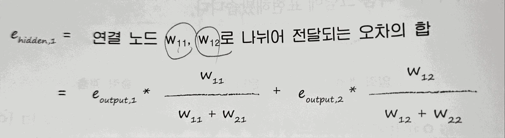

- 행렬곱을 이용한 오차의 역전파

오차의 역전파를 행렬곱으로 간결하게 만들 수 있다. 이런 방식을 ‘벡터화한다.’라고 한다. 이전 예제에서 설명된 대로 출력 계층에 존재하는 두 개의 노드의 error를 e1, e2라고 하자. 이때 은닉 계층의 각 노드에 전달되는 error 값을 구하면, 위의 공식과 같이 구해질 것이다. 이를 행렬곱으로 표현하면 아래와 같다.

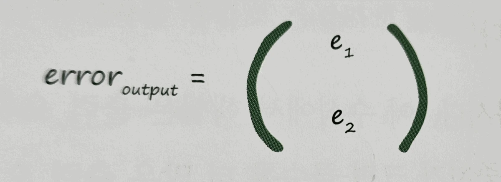

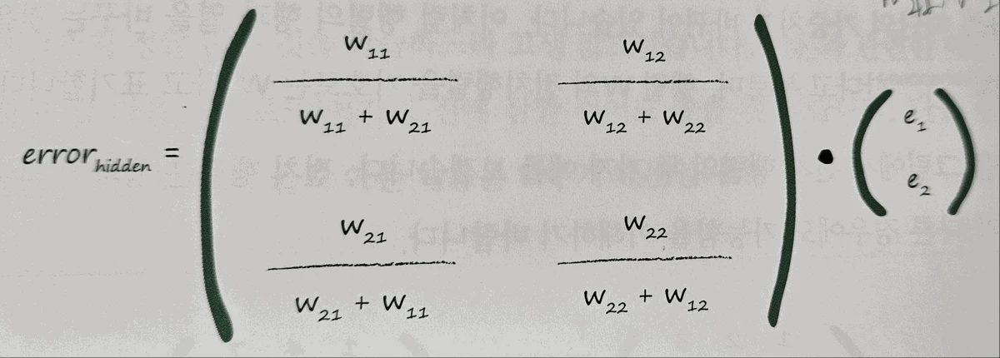

> 출력 계층의 첫 번째 노드에 전달되는 것이 w11, w21  
> 출력 계층의 두 번째 노드에 전달되는 것이 w12, w22  
>   
> 이 상황에서 은닉 계층의 첫 번째 노드의 error 값을 계산해 보면,  
> e1 * w11 / w11 + w21와 e2 * w12 / w12 + w22  
>   
> 그리고 은닉 계층의 두 번째 노드의 error 값을 계산해 보면,  
> e1 * w21 / w11 + w21와 e2 * w22 / w12 + w22

은닉 계층에서 하나의 출력 계층 노드로 들어가는 모든 가중치의 합과 해당 번호의 은닉 계층 노드의 가중치의 비율, 그리고 그것을 출력 계층의 error와 곱한 것이 e(hidden, n)

이때 분수에서 분모 부분은 일종의 정규화 인자라고 할 수 있다. 이 정규화 인자를 무시한다고 해도 되돌아오는 오차의 일정 비율 정도를 잃을 뿐이므로, 없애더라도 문제없이 작동하기 때문에 더 어려운 방법을 사용할 필요는 없다.

오차의 역전파는 가중치 행렬을 transpose(전치)한 것과 error 값의 행렬곱을 통해 표현 가능하다.

$$
error(hidden) = w^T(hidden-output) ·error(output)
$$

---

## 경사하강법

오차를 나타내는 함수에서 오차의 최저점을 찾기 위하여 값을 조금씩 업데이트하는 방식. 만약 한 번에 이동하는 step의 크기가 매우 크다면 최저점을 지나치게 되어 영원히 최저점에 도달하지 못하게 되는 overshooting 문제가 발생한다.

이 step의 크기를 기울기의 크기에 비례하도록 조정할 수 있다면 목적지에 거의 도달했을 즈음에는 보다 작은 step을 갖게 될 것이다. (이는 대부분의 매끄럽고 연속적인 함수에서 최저점에 가까워질수록 기울기가 완만해진다는 가정이 옳기 때문이다.) 하지만 `불연속` 함수에서는 이 가정이 통하지 않을 것이다.

예컨대 y를 오차라고 하고 y = (x-1)^2 + 1이라는 함수가 있다고 하면, 기울기가 양수일 때는 x값이 감소하고, 기울기가 음수일 때는 x값이 증가하게 된다.

경사 하강법을 이용한 예제를 볼 때, 우리는 y = (x-1)^2 + 1이 복잡하고 어려운 함수라고 가정했기 때문에 대수학을 이용해 한 번에 최저점을 구하지는 않았다. 비록 수학적 접근을 통해 기울기의 값을 정확히 구한 것은 아니었지만, 올바른 방향을 예측해 그 방향으로 이동할 수 있었다.

이러한 접근 방법은 많은 매개변수를 가지는 함수에서 빛을 발한다. 신경망의 결과 값 및 오차 값은 많은 가중치 매개변수에 의해 결정되는데, 보통 수백 개가 넘는다. 그런데, 경사하강법을 이용하면 실제 최저점이 아닌 잘못된 곳에 빠질 수도 있을 것이다. 이럴 경우에 대비하여 실제 출발점을 다르게 설정하여 여러번 학습하는 방법을 취할 수도 있다. ⇒ **즉, 인공 신경망에서는 가중치의 초기 값을 다르게 주는 것을 의미한다.** (이것이 parameter이기 때문으로 보인다.)

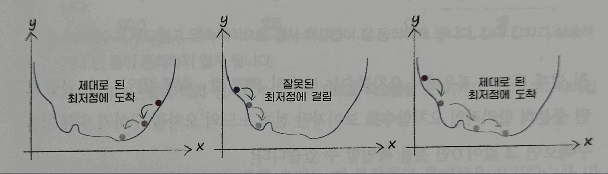

(제대로 된 최저점을 global minimum, 잘못된 최저점[국소적 최저점]을 local minimum이라고 한다.)

---

## 오차함수

경사하강법은 신경망에 적용할 수 있는 좋은 방식이며, 필요한 것은 `오차함수`를 올바르게 선택하는 것이다. 신경망의 결과 함수 자체는 오차함수가 아니다. 하지만, 오차는 학습 목표 값과 실제 값 간의 차이를 의미하므로 우리는 결과 함수를 쉽게 오차함수로 변환할 수 있다.

오차의 함수로 사용할 수 있는 후보는 크게 세 가지가 있다.

- (목표값 - 실제값)
- |목표값 - 실제값|
- (목표값 - 실제값)^2

첫 번째 방법은 오차가 서로 상쇄가 될 수 있다. (+, -가 모두 나올 수 있으므로) 그러므로 전체 오차를 구하는데 좋은 방법이 아니기 때문에 사용하기 힘들다.

두 번째 방법은 첫 번째 방법의 문제를 해결하기 위해서 절대값을 취한다. 하지만 이 방법은 잘 선호되지는 않는데, 그 이유는 **최저점 근처에 가면 기울기가 연속적이지 않으며, 이로 인해 경사 하강법이 잘 작동하지 않을 수도 있기 때문**이다. 이는 최저점 근처에서 기울기가 작아지지 않기 때문에 결국 오버슈팅(overshooting)하게 될 가능성이 높다는 것이다.

세 번째 방법은 두 값의 차이에 제곱을 해주는 방식이다. 이런 방식을 Squared Error라고 한다. 이 방식이 주로 사용되는 이유는 아래와 같다.

- 오차함수로 제곱오차 방식을 사용하면 경사 하강법의 기울기를 구하는 대수학이 간단해진다.
- 오차함수가 부드럽고 연속적이므로, 경사 하강법이 잘 동작하게 된다. 값이 갑자기 상승하거나 빈 틈이 존재하지 않게 된다.
- 최저점에 접근함에 따라 경사가 점점 작아지므로 목표물을 오버슈팅할 가능성이 작아진다.

이것보다 더 복잡한 오차함수를 만들 수도 있기는 하지만, 더 일을 복잡하게 만들 가치는 없다.

---

## 미분으로 오차함수 구하기

경사하강법을 사용하려면 가중치에 대한 오차함수의 기울기를 구해야 한다. 이 작업을 하기 위해서는 `미분`이 필요하다. 우리의 관심사는 신경망 내에서 오차함수가 가중치에 의해 얼마나 영향을 받는가이다. 다르게 표현하면, ‘오차는 가중치의 변화에 얼마나 민감한가’라고 할 수도 있다.

즉, 경사하강법에 사용되는 함수는 최소화하고자 하는 신경망의 오차를 나타내는 함수라고 볼 수 있는 것이다. 이때 다듬어가고자 하는 매개변수는 가중치이다.

그런데 신경망에는 수많은 가중치가 존재하기 때문에 오차함수는 다차원 함수로 표현될 수 있다. 많은 매개변수를 가지는 함수는 오차를 시각화하기는 어렵지만, 그 경우에도 경사 하강법을 이용해 최저점을 찾아가는 방식은 여전히 동일하다.

$$
∂E/∂w(jk)
$$

우리가 구하고자 하는 바는 이와 같이 가중치의 변화에 따른 error 값의 변화율이다. 다시 말해 이 값은 최저점의 방향으로 감소하기 원하는 오차함수의 기울기이다.

우선은 은닉 계층(j)과 최종 출력 계층(k) 사이에 존재하는 연결 가중치에 집중해서 봐보도록 하자. 

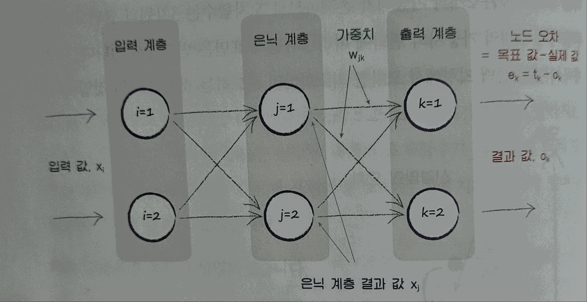

- 오차함수의 전개

오차함수는 n개의 노드에 대해 목표 값과 실제 값의 차를 구해 이를 제곱한 다음 모두 더한 합이다. 

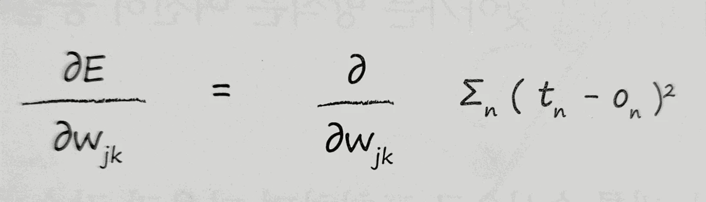

이는 단지 오차함수인 E를 풀어 쓴 것일 뿐이다.

노드 n에서의 결과값 On은 오직 이와 연결되는 연결노드로부터만 영향을 받는다. 다시 말해 노드 k의 결과값인 Ok는 그와 연결되는 가중치 wjk에 의해서만 영향을 받는다는 뜻이다.

다른 관점에서 보면 노드 k의 결과 값은 가중치 wjb 에는 영향을 받지 않는다고 말할 수 있다. (k ≠ b)

왜냐면, 가중치 wjb는 노드 k와 연결되지 않기 때문이다. 즉, 가중치 wjb는 출력 노드 b와 연결되지 않는 k와는 연결되지 않는다.

그러므로, 이 합으로부터 wjk의 연결 노드인 Ok 외의 모든 On을 제거할 수 있게 되며, 그 이유는 노드의 결과 값은 오직 연결된 가중치에 의해서만 영향을 받기 때문이다.

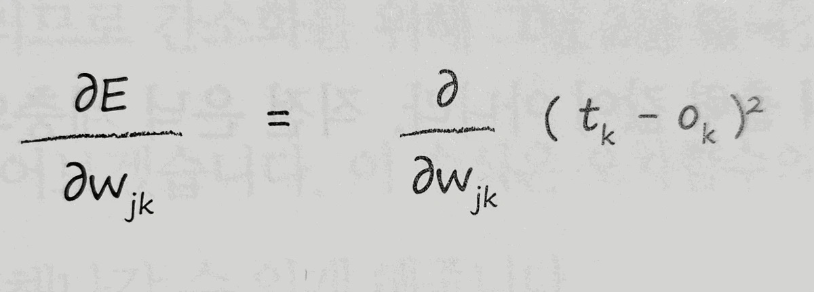

그러므로 수식을 이와 같이 간결하게 표현할 수 있게 된다. 이 식을 미분하면 tk는 상수이므로 wjk에 영향을 받는 Ok만 처리하면 된다.

이를 `연쇄 법칙`을 이용해서 몇 개의 조각으로 나눌 수 있다. 

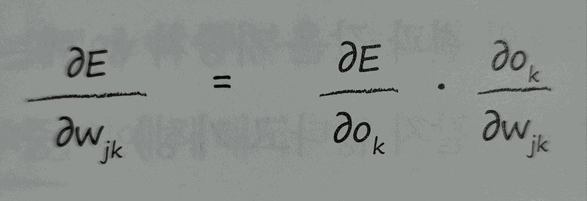

E = (tk - Ok)^2 이었으므로, 이에 대한 미분을 계산하면 다음과 같다.

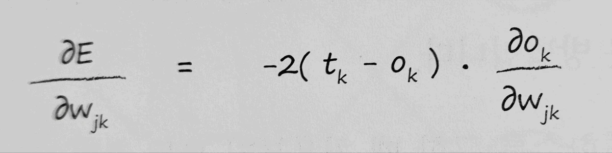

Ok는 노드 k의 결과 값으로, **입력 신호의 가중치 합에서 시그모이드 함수를 적용한 것**이다. 이를 적용하면 아래와 같이 풀어 쓸 수 있다.

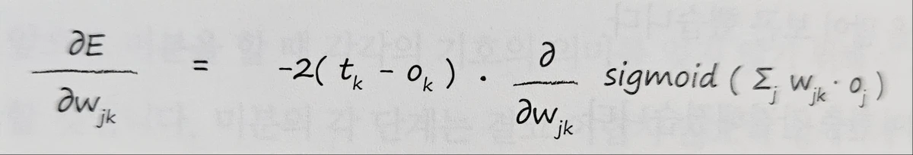

Oj는 최종 출력 계층의 출력 값이 아니라, 직전 은닉 계층의 노드로부터의 출력값이다.

시그모이드 함수의 미분은 널리 알려져 있으므로, 이를 적용하면 아래와 같은 결과가 나오게 된다.

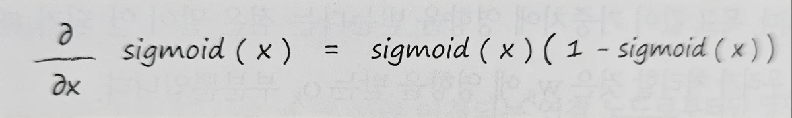

그리고 이 결과를 적용해보면 아래와 같이 식이 정리된다.

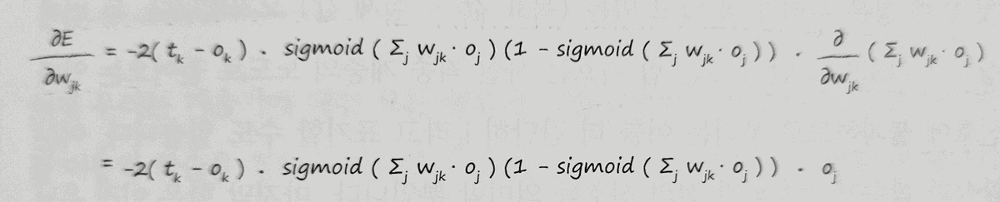

이때 시그모이드 항까지는 이해가 가능한데, 다음 항은 무엇일까? 그 다음 항은 시그모이드 함수 내의 표현식도 한 번 더 미분되어야 하기 때문에 나오는 결과이다.

결과를 보는데 상수는 큰 의미가 없으므로, 상수를 제거하여 정리하면 아래와 같다.

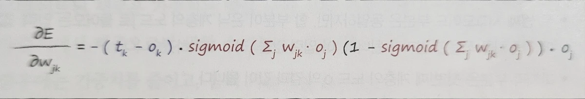

- 첫 번째 항은 (목표값 - 실제값)의 오차이다.
- 두 번째 항의 시그모이드 안에 있는 합 기호는 사실 최종 계층의 노드로 들어오는 입력 신호에 불과하므로, 이를 더 간단하게는 ik라고 표현할 수도 있다. 이는 **활성화 함수**(activation function)가 적용되기 이전의 신호를 의미할 뿐이다.
- 마지막 항은 이전 은닉 계층의 노드 j의 결과 값이다.

이제 최종적으로 한 단계가 남아있다. 위의 수식은 은닉 계층과 출력 계층 사이에 있는 가중치를 업데이트 하기 위한 것이다. 이제 입력 계층과 은닉 계층 사이에 있는 가중치들에 대해서도 유사하게 오차 기울기를 찾아보아야 한다.

- 첫 번째 부분의 오차인 (목표값 - 실제값)이 은닉 계층에서 재조합된 역전파 오류가 된다. 이 값을 ej라고 한다.
- 두 번째 시그모이드 부분은 동일하지만, 합 부분이 은닉 계층의 노드 j로 들어오는 입력값에 가중치를 적용한 결과가 된다. 이 입력값을 ij라고 표기한다.
- 마지막 부분은 첫 번째 계층의 노드 Oi의 결과값이 된다.

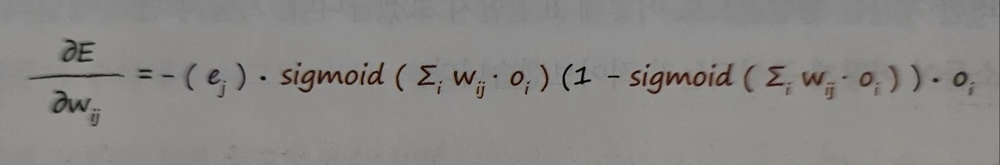

---

## 학습률

가중치는 기울기와 반대 방향으로 진행된다. (기울기가 양수이면 최저점을 찾기 위해 값을 감소시켜야 하고, 기울기가 음수이면 반대로 값을 증가시켜야 하기 때문) 그리고 학습률 인자를 적용함으로써 변화의 정도를 조정할 수 있다. 

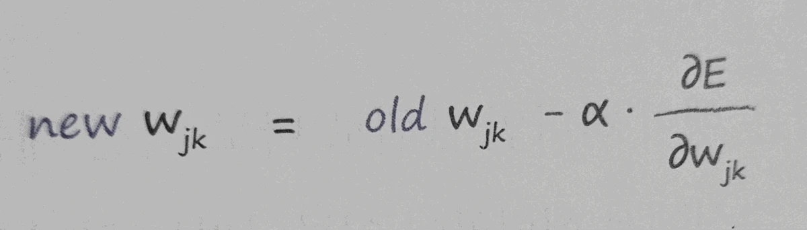

업데이트된 새로운 가중치는 방금 구한 오차 기울기에 상수 a를 곱한 값을 원래 가중치에서 빼줘서 구할 수 있다. 빼는 이유는 양의 기울기일 경우 가중치를 줄이고, 음의 기울기일 경우에는 가중치를 늘리기 위해서이다.

여기서 상수 a는 오버슈팅을 방지하기 위해 변화의 강도를 조정하는 역할을 하는 `학습률`이다. 이 수식은 은닉 계층과 출력 계층 사이의 가중치뿐만 아니라, 입력 계층과 은닉 계층 사이의 가중치에도 동일하게 적용된다. 앞에서 구한 두 가지 오차 기울기 수식을 경우에 따라 다르게 사용하면 된다.

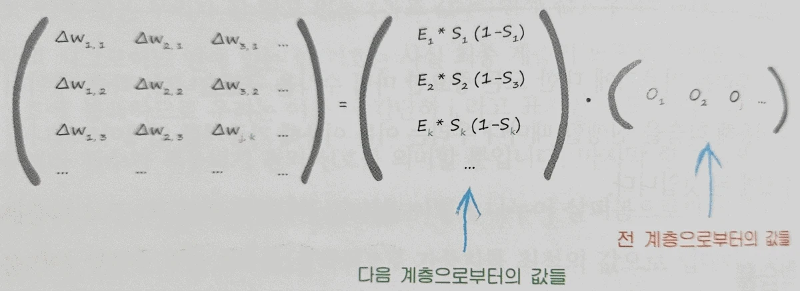

이러한 계산을 행렬곱으로 표현하면 위와 같이 나오게 되며, 여기서는 학습률 a를 생략했지만, 이것은 그저 상수일 뿐이기 때문에 행렬곱을 수행하는 데에는 아무런 영향이 없다.

가중치 변화의 행렬은 한 계층의 노드 j와 다음 계층의 노드 k를 연결하는 가중치 wjk를 조정하는 역할을 한다. 앞의 수식에서 앞 항은 다음 계층(노드k)으로부터의 값들을 이용하며, 뒤 항은 전 계층(노드 j)으로부터의 값들을 이용한다는 것을 볼 수 있다.

앞의 그림에서 뒤 항은 행이 하나인 행렬로, 바로 직전 계층 Oj로부터의 결과 값의 전치 행렬이다. 수식에서 행렬곱이 이루어지는 하나의 예시로 색상을 구분해 표시한다. 따라서 이러한 가중치 업데이트 행렬은 다음과 같이 표현할 수 있다.

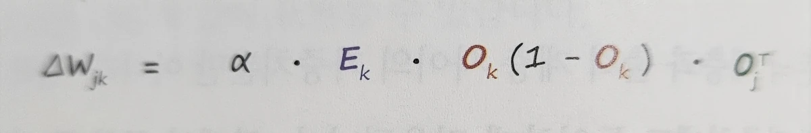

---

## 여러 번 수행을 통한 신경망의 개선

데이터 모음에 대해 학습을 여러 번 반복함으로써 신경망의 성능을 개선할 수 있다. 한 번의 수행을 주기(epoch)라고 한다. 10번의 주기로 학습한다는 것은 전체 학습 데이터 모음에 대해 학습을 10번 반복하는 것이라는 의미이다. 왜 이런 반복을 해야 할까?

이런 반복 작업이 가치있는 이유는 경사 하강법에 의해 가중치의 값이 업데이트  되는 과정에서 더 많은 가능성을 제공해주기 때문이다.

일반적으로 학습을 많이 진행할 수록 좋은 성능을 얻게 되지만, 일부 경우에서는 학습을 너무 많이 하게 되면 신경망이 학습 데이터에 오버피팅(과적합)되어 이전에 보지 못한 신규 데이터에 대해서는 성능이 오히려 떨어지므로, 지나친 학습은 좋지 않다.

이렇듯 오버피팅(overfitting)은 신경망에서 뿐만 아니라 머신러닝의 다양한 분야에서 세심한 주의를 기울여야 하는 특성 중 하나이다.

- learning rate에 따라 epoch을 진행해보면서 결과가 달라지는 것을 확인할 수도 있다.

⇒ 교재에서는 learning rate 0.1, 0.2로 각각 epoch을 돌려본 결과, 0.1일 때 5가 최적의 주기임을 확인할 수 있었다.

> 이렇게 임의의 값을 지정하는 것이 과학적인 방식은 아니며, 제대로 하기 위해서는 각각의 학습률과 주기의 다양한 조합에 대해서 여러 번 실험을 함으로써 경사 하강법에 내재되어 있는 임의적인 요소를 최소화해야 한다.

---

## 신경망 구조 변경을 통한 신경망의 개선

이전에는 학습률을 바꿔서 신경망을 개선했었지만, 이번에는 신경망의 구조를 바꿔서 신경망을 개선하도록 한다. 중간에 있는 은닉 계층의 노드 수를 변경한다.

- 은닉 노드의 개수를 변경하면 어떻게 되는가?

은닉 계층은 학습이 일어나는 계층이며, 입력 노드는 그저 입력 신호를 가져올 뿐이고 출력 노드는 신경망이 제시하는 답을 출력할 뿐이다. 입력 값이 답을 낼 수 있도록 학습하는 부분이 바로 은닉 계층이다. (즉, 학습이 실제로 발생하는 곳이라는 뜻)

물론 실제로 학습을 하는 것은 은닉 노드 앞뒤에 존재하는 연결 노드의 가중치이지만, 이 의미를 내포하고 있다고 볼 수 있다.

- 은닉 노드의 개수

만약 너무 적은 수의 노드를 갖는다면 학습을 할 공간이 부족해 학습을 진행할 수 없게 된다. 예컨대, 3개의 좌석을 가지는 자동차에 10명의 사람을 태우려고 하는 셈이라고 볼 수 있다.

⇒ 컴퓨터 과학자들은 이를 **학습 용량**이라고 칭한다. **신경망은 학습 용량 이상을 학습할 수 없다.**

이와 반대로, 너무 큰 학습 용량을 가진다면 전체 용량을 채워 학습시키기 어렵기 때문에 epoch을 매우 크게 잡아야만 한다.
