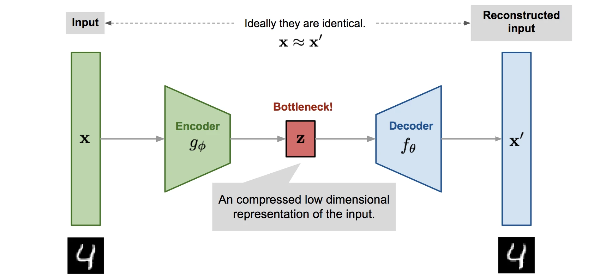
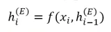
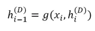
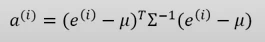

# Deep Learning 강의 > Anomaly Detection for Time Series Data With Autoencoder

[[Open DMQA Seminar] Anomaly Detection for Time Series with Autoencoder](https://www.youtube.com/watch?v=Zzt4Ept-zYs)

---

- 시계열(Time Series) 데이터

    - 관측치가 시간적 순서를 가진 데이터 셋의 집합

        - 단변량 시계열(Univariate time series) : 동일한 간격의 시간의 증가에 대해 순차적으로 기록된 한 개의 변수 관측치로 구성된 시계열
        - 다변량 시계열(Multivariate time series) : 동일한 간격의 시간의 증가에 대해 순차적으로 기록된 두 개 이상의 변수 관측치로 구성된 시계열

    - 센서, Edge devices 등 산업 전반의 다양한 도메인에서 발생하는 데이터
    - 시계열 데이터를 발생시키는 어플리케이션의 증가로, 시계열 데이터의 이상 탐지(Anomaly Detection)에 대한 수요가 증가하고 있다.

    ---

- 시계열 데이터의 이상 현상

    - 시스템이 비정상적으로 작동하는 시점(Point) 또는 기간(Duration)으로 정의한다.

    1) 시점 이상 : 비정상적인 값에 도달한 단일 시점 또는 연속적인 시점의 집합

    2) 기간 이상 : 특정 구간에서 이상 현상 발견

---

- 시계열 데이터에 대한 이상(Anomaly) 탐지의 어려움

    - 여러 비즈니스 영역에서 활용이 가능하기 때문에 **발생할 수 있는 이상 유형이 다양**하다.

    - 정상과 비정상 데이터를 정확히 구분하여 **라벨링(Labeling)하기가 어려움.**

        - 이상 여부를 판별하기 위해서는 많은 양의 전문적인 도메인 지식이 요구됨.
        - 시간과 비용이 많이 소모됨.
        - 정상과 이상의 경계가 불분명함.

    - 정상 데이터에 비해 **비정상 데이터의 비율이 훨씬 적기 때문에** 데이터 불균형(Imbalanced Data)이 발생 ⇒ 분류(Classification) 문제의 장애물이 된다.

---

- 정상, 비정상을 명확히 구분해 낼 수 있다면, 수월하게 이상을 탐지할 수 있을 것이며 이에 대해 지도 학습(Supervised Learning)을 진행할 수 있을 것이다.

- 하지만 정상과 비정상을 명확히 구분할 수 없고, 정의된 이상 유형뿐만 아니라 예상치 못한 이상 유형이 항상 존재하게 된다.

    - 그러므로 최근 이상 탐지 분야는 다양한 데이터 유형에 대해 비지도(Supervised Learning)이 많이 연구되었다.

    - 이는 데이터의 숨겨진 패턴과 특성을 분석하는 방식을 말한다.

        - Similarity(유사도 기반)
        - Prediction(예측 기반)
        - Reconstruction(재구성 기반) ⇒ 이 글은 Reconstruction에 사용되는 [Autoencoder]를 주로 다루게 된다.

---

- `Autoencoder`

    - 입력된 데이터를 재복원하는 비지도학습 방법론
    - 입력된 값과 최대한 비슷하게 출력되도록 재구성하는 것이 목표 (일종의 압축과 유사해 보인다)

    - 두 개의 구조로 구성된다. Encoder + Decoder

        - Encoder : 데이터를 압축하여 중요한 정보만 살리는 feature로 변환
        - Decoder : 압축된 feature를 이용하여 입력 데이터를 최대한 원본과 가깝게 복원
        - 이 과정에서 중간에 만들어지는 Vector를 ‘**Latent Vector**’라고 한다.

- Autoencoder를 사용한 이상 탐지

    - 초기에는 입력 데이터로 정상 데이터만을 사용한다. (**정상 데이터가 뭔지는 아는 경우**)
    - Encoder의 입력 데이터와 Decoder의 결과인 복원 데이터의 차이를 줄이면서, **Autoencoder**는 정상 데이터의 특징을 학습한다.
    - 이때, 비정상 데이터는 학습되지 않았기 때문에 비정상 데이터가 모델에 입력되면 복원된 데이터가 입력과 많은 차이가 발생하게 된다.
    - **복원 에러**(Reconstruction Error) = (입력 데이터) - (복원 데이터)
    - 임계치(Threshold)를 정하고, 복원 에러가 임계치를 넘게 되면  **이상 탐지**(Anomaly Detection)가 가능해진다.

---

## LSTM-Autoencoder

- LSTM-Autoencoder

    - Sequence 데이터를 위한 LSTM 구조를 사용하는 Autoencoder
    - 시계열 데이터의 Anomaly Detection은 시간적인 특성(Temporal Information)을 고려
    - 이전의 정보를 현재의 문제 해결에 활용할 수 있는 **LSTM 네트워크**를 이용

- EncDec-AD(Model)

    - Training(1)

        - 정상 데이터 사용

        - Encoder : 시계열 데이터를 순차적으로 입력받는다.

            - Step = i에서 Hidden Vector는 이전 단계의 Hidden Vector(hi-1)와 입력값(xi)을 활용하여 구하게 된다.

            

            - 마지막 Hidden vector가 Latent Vector가 되어 Decoder 단계의 최초 Hidden Vector로 사용된다.

    - Training(2)

        - Decoder

            - Step t = (i - 1)의 Hidden vector는 이전 단계의 Hidden vector와 입력값(xi)을 활용하여 구하게 된다.

            

    - Training(3)

        - Encoder의 입력값과 Decoder의 출력값의 MSE가 최소가 되도록 학습을 진행한다.

- Inference(추론 단계)

    - 학습을 통해 만들어진 모델을 실제로 새로운 입력 데이터에 적용하여 결과를 내놓는 단계
    - Step t = (i -1)의 Hidden vector는 이전 단계의 Hidden vector와 Decoder의 출력값을 활용하여 구할 수 있게 된다.

- 본 모델에서는 데이터를 훈련, 검증, 테스트 등 용도 별로 분류하여 사용한다.

- 그 중 학습 조기 종료를 위해 분리한 데이터 셋을 이용하여 Reconstruction Error를 계산한다.

    - 입력값과 복원값의 차이에 대한 Error vector를 계산하고, 이를 정규 분포로 가정하여 평균과 표준 편차를 추론한다.
    - 이렇게 추론한 데이터의 평균과 표준 편차를 이용해 다음 수식으로 Anomaly Score 수식을 결정할 수 있게 된다.

    - Anomaly Score

        - Anomaly Score는 Error Vector와 추론한 데이터 분포 사이의 거리를 의미하고, Vector와 Data 분포의 거리가 임계값보다 멀어지면 비정상 데이터로 판단한다.

    
