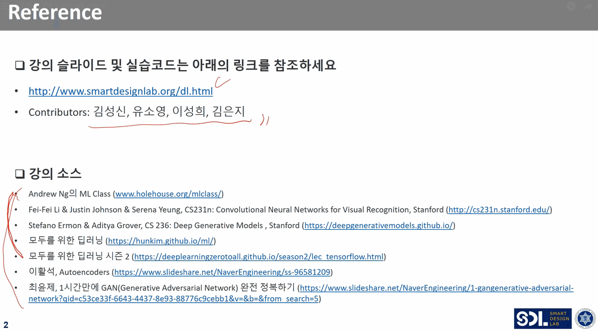
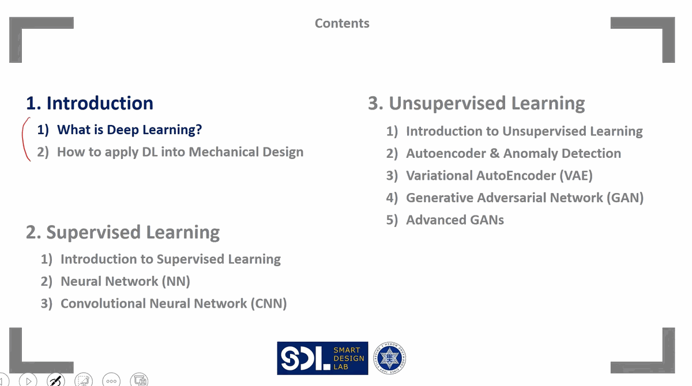
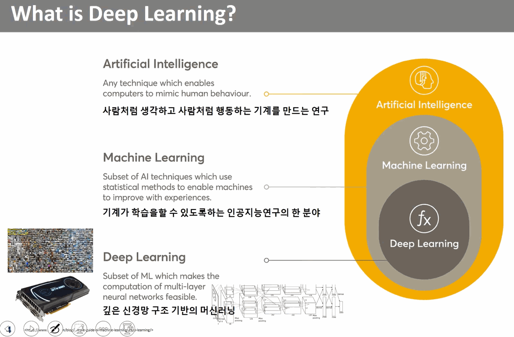
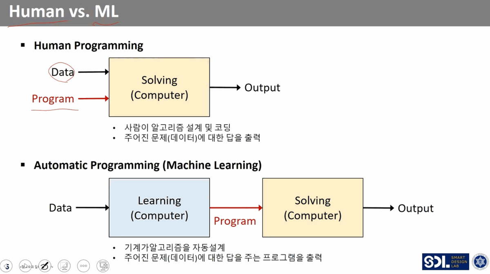
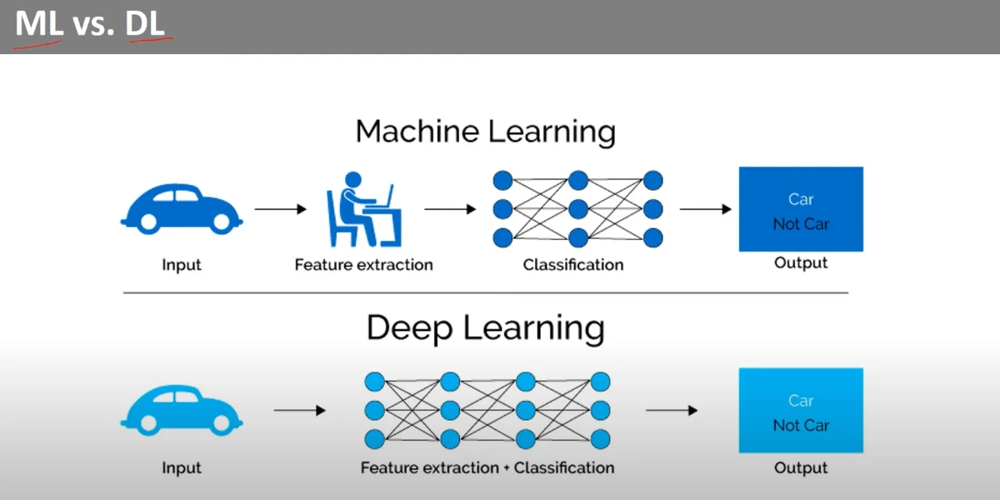
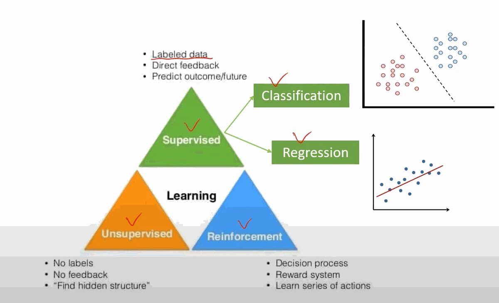
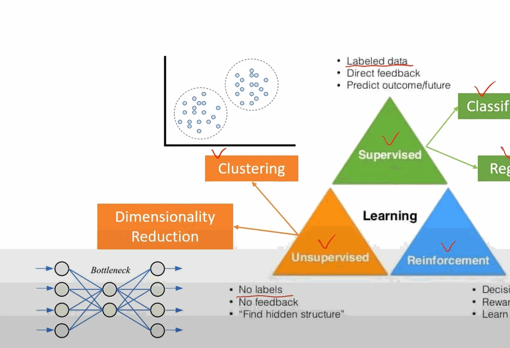
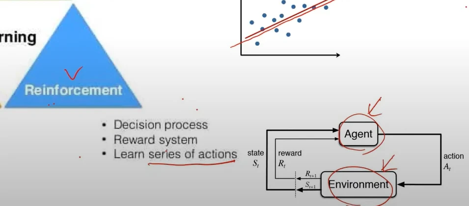
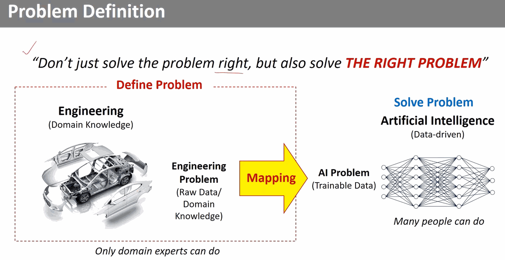

# Deep Learning 강의 > Ch1. Introduction

---

---

## Deep Learning이란?

- **인공지능(AI, Artificial Intelligence)** : 사람처럼 생각하고 사람처럼 행동하는 기계를 만드는 연구를 부르는 말. 데이터를 기반으로 학습을 하던, 규칙(Rule)기반으로 하던, 사람처럼 생각하고 행동하는 모든 것을 인공지능이라고 할 수 있다.

- **머신러닝(ML, Machine Learning)** : 기계가 학습을 할 수 있도록 하는 인공지능의 한 연구 분야를 말한다. **학습을 통해 이루어진다는 것이 특징적**이다.

    - 회귀 분석 등의 방법론이 존재함.

- 딥러닝(DL, Deep Learning) : 깊은 신경망 구조 기반의 머신러닝이다. 신경망 구조(NN, Neural Network)란, Input과 Output 사이에 Layer가 존재하는 구조인데, 가운데에 존재하는 Hidden Layer가 많아질수록 Deep해지기 때문에, NN이 발전하여 DNN(Deep Neural Network)이 된다.

- 인공지능 연구에서 딥러닝이 발전하는데 오래 걸린 이유

    - 데이터를 얻을 수 있는 수단이 매우 부족했다. 현재는 인터넷, IoT 기술이 발전하면서 빅데이터를 얻기가 매우 수월해졌다.
    - 병렬처리가 가능한 GPU가 발전하면서 요구되는 연산량을 충족할 수 있게 되었다.
    - 딥러닝 학습에 필요한 Architecture 기술이 많이 발전되었다. 여러 Bottleneck이 존재했었는데, 그 중요한 이유들을 해결하게 되었다.
    - 이와 같은 문제들이 해결되면서 딥러닝이 점차 발전하게 되었다.

---

## 사람과 Machine Learning의 차이

- 사람과 ML의 차이

    - 사람이 알고리즘을 만들고 코딩을 하면 그 알고리즘을 거쳐서 Input에 대한 Output이 나오는 것이 사람의 프로그래밍 방식이다.

    - ML은 Automatic하게 프로그래밍을 하는 방법이다. 예를 들어, Input은 데이터만 필요하고, 프로그램은 사람이 짜지 않는다. 컴퓨터가 데이터를 바탕으로 학습을 해서 프로그램을 짠다고 생각하면 된다. (즉, Model을 스스로 생성하는 것이다.) 그러면 그 Model이 문제를 풀고, Input에 대한 Output을 만들어 내게 된다.

        - 즉, 기계가 Model을 직접 짜서 답을 출력하게 되는 것.

---

## Machine Learning과 Deep Learning의 차

- ML vs DL

    - ML은 NN을 사용하고, DL은 DNN을 쓴다.
    - 좀 더 자세한 차이는 다음과 같다.
    - `ML`은 전문가(사람)가 **중요한 Feature들을 추출**하고, 그런 값들을 가지고서 **단순한 Model**을 만들게 된다. (Classification) 그러면 **그 분류를 통해서 Output을 도출**하게 된다.
    - `DL`은 **고차원의 데이터에서 중요한 Feature를 스스로 뽑아내고 이를 바탕으로 결과를 도출**하는 방식을 말한다. 예를 들어 이미지를 다룬다면, 이미지의 각 픽셀마다 분석을 하고, 그 픽셀로부터 알아서 Feature를 추출해 내게 된다. 그러면 DL이 스스로 Feature를 추출해내는데, 사람은 이때 나오는 값의 의미를 해석하기 어렵다. 이후에는 DL이 해당 Feature들을 바탕으로 Output을 만들어내게 된다.

---

## 학습의 종류

- `Supervised`(지도 학습) : 정답이 있기 때문에 정답을 학습하는 방식.

    - **Labeled Data** : 정답(레이블)을 바탕으로 학습을 진행하게 되는 학습 방식.

        - Classification : 예를 들어, 개와 고양이를 구분하려고 한다면 인공지능은 개와 고양이를 나눌 수 있는 Boundary를 학습을 하게 되는데, 이를 Classification이라고 한다.
        - Regression : Continuous한 값에 대하여 예측을 하는 것이다. 예를 들어 날씨 예측이나 주가 예측 등이 가능할 것이다.

    

- `Unsupervised`(비지도 학습) : 정답(Label)이 없는 경우에 데이터를 학습하는 방식.

    

    - 주로 **Clustering**을 할 때 사용된다.

        - Clustering이란? : 정답이 없는 데이터를 일단 학습해서, 특징이 비슷한 것들끼리 묶어준다. 그렇게 되면 모델을 통해서 각 학습된 것들을 묶어놓고 들여다 봤더니, 한 쪽은 개고, 한 쪽은 고양이다. 이런 식으로 분석할 수 있게 되는 것. 마치 지도 학습의 Classification과 비슷하지만, 이것은 정답이 없는 상황에서 유사성을 바탕으로 특징적인 그룹을 찾아내는 것을 말한다.

    - **Dimensionality Reduction**(차원 축소) : 어떤 고차원의 Input 데이터가 있을 때, 그 데이터의 차원을 어떠한 연산 과정을 거쳐서 축소 시킨다. 이렇게 축소된 데이터를 다시 기존 데이터로 복원시켜서 Input과 동일하게 나올 수 있도록 만드는 과정이다.

        - 예컨대, 사차원의 데이터가 Input으로 들어왔을 때, 차원 축소를 거쳐서 이차원 데이터로 만들어 내고, 다시 기존의 Input과 동일한 사차원 데이터로 바꾸는 과정이 존재하게 될 수 있다.

        > 차원 축소(Dimensionality Reduction)을 할 수 있으면, 생성 모델(Generative Model)을 만들 수 있게 된다. 

- `Reinforcement`(강화 학습) : Series가 있는, 순차적인 Action에 대해서 학습을 하는 방식을 말한다. 지도 학습, 비지도 학습의 경우에는 순차적인 것이 아니라 딱 한 번 Decision을 내리는 것에 대해 학습을 하게 되는 것인데, 강화 학습은 바둑, 마리오등과 같은 순차적인 Action이 필요한 것에 대해 학습을 진행하게 된다.

    - 강화 학습은 Input 데이터가 주어지지 않고, 스스로 데이터를 수집하면서 Try & Error를 스스로 시도하고, 이를 데이터로 사용하여 스스로 학습해 나간다.

    

    - 이때 Agent가 시도하는 주체이고, Environment는 그 주체에 영향을 줄 수 있는 환경적 요소들을 말한다.
    - 상황이 변화함에 따라 Agent에게 적절한 Reward가 주어지게 된다.

---

## 각 학습 방식별로 주로 도입되는 것

- Supervised

    - CNN(Convolutional Neural Network) : **Classification**에서 가장 많이 사용되는 방식이다. 이미지를 분석하는 방식에 주로 사용된다.
    - 뿐만 아니라 DNN도 Classification에 주로 사용될 수 있다.
    - RNN(Recurrent Neural Network) : 시계열 데이터를 학습하는 DL 방식을 말한다.

- Unsupervised

    - Generative Models(VAE, GAN, Auto-encoder) : Dimensionality Reduction에 주로 사용되는 방식들.

        - VA 방식이 깊은 확률적인 이론을 바탕으로 만들어지고, Practical하게 좋은 결과들이 많이 나오기 때문에 가장 어렵다.

- Deep Reinforcement Learning

    - DQN
    - A3C
    - PPO

---

## DL에서의 문제 정의

- 최근에는 AI 자체가 너무 인기가 많아서 **문제를 해결하는 것 자체**에 집중이 많이 되어있다. 문제는, 정작 산업 현장에 가보면 **인공지능으로 풀어야 되는 문제를 정의하지 못해서** 어려움을 겪고 있다. 
- 또한, 아무리 좋은 인공지능 모델이 있어도, 문제 자체가 제대로 정의되지 않으면 좋은 결과를 도출해낼 수 없다. 어떤 문제를 해결할 것인지 정확히 정의하고, 정제되어 있지 않은 데이터들을 Domain 지식을 바탕으로 Cleaning해야 한다.
- 그리고 이 데이터를 바탕으로 AI가 풀 수 있는 문제와 Mapping해서 Trainable Data로 바꿔주어야 한다.

> 따라서, 본인이 잘 이해하고 있는 Domain 지식이 필요하고, 그와 동시에 AI를 이해할 수 있어야 한다. 그래야 AI로 올바른 문제를 해결할 수 있게 된다.
