# Deep Learning 강의 > Ch2-1. Introduction to Supervised Learning

## Linear Regression

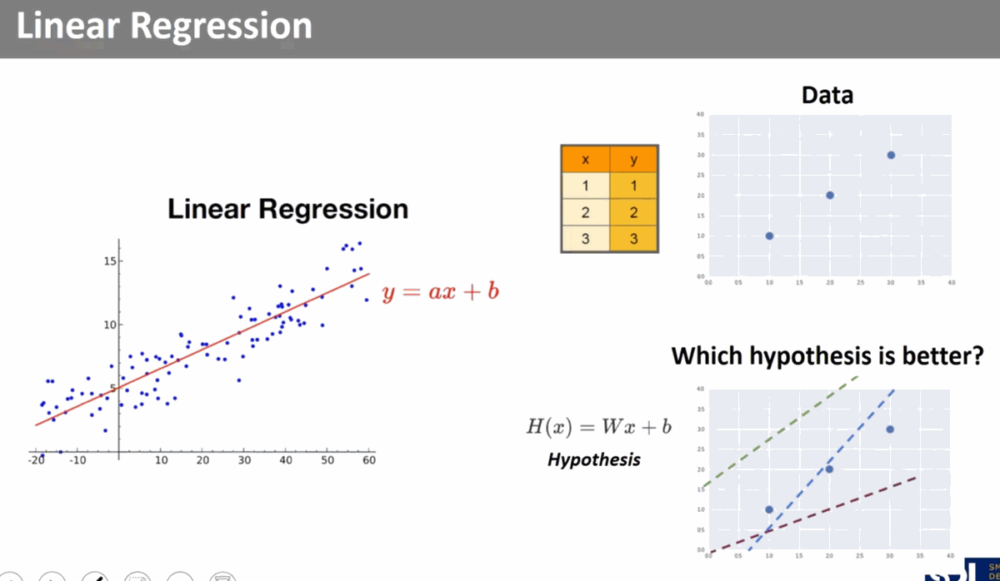

- Linear Regression(선형 회귀 분석) : 어떤 데이터들이 있을 때, 그, 데이터를 가장 잘 설명할 수 있는 Fit한 직선을 찾는 것이 Linear Regression이다. (y = ax + b) x, y는 주어지는 데이터이므로, 여기서 우리가 구하려고 하는 것은 a, b이다.

    - 이렇게 만들어지는 직선은 가설이므로 Hypothesis라고 하고, a에 해당하는 것을 W(weight)라고 하고, b에 해당하는 것은 bias라고 한다.
    - 우측 하단의 그래프를 보면, 세 개의 점에 대해서 Hypothesis 세 개가 존재하는데, 얼핏 보면 세 개 중에서 파란색 직선이 데이터를 가장 잘 설명하는 것처럼 보인다. 이렇게 가설을 하나 정하게 되면, 성능을 판단할 수 있는 성능 지표가 필요하다.

- 성능 지표

    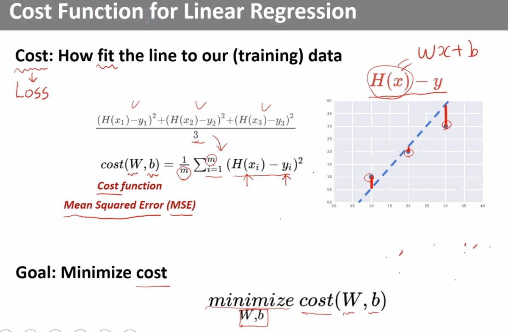

    - Cost : How fit the line to our (training) data

        - 여기서는 데이터와 직선 사이에서 y값에 대한 Euclidean 거리를 구하고, 이를 바탕으로 MSE를 구하게 된다. 그러면, 이렇게 구해진 MSE가 해당 직선(Hypothesis)의 Cost가 된다.
        - MSE : Mean Squared Error
        - Deep Learning에서 어떤 Continuous한 값을 예측하는 문제를 풀 때는, Cost Function을 Mean Squared Error를 사용하게 된다.

        - 이후에는 주로 `Loss Function`이라는 말로 사용하게 된다.

            - 우리의 목적은 Cost를 Minimize하는 것이다.

- 어떻게 Cost를 Minimize 할 수 있는가?

    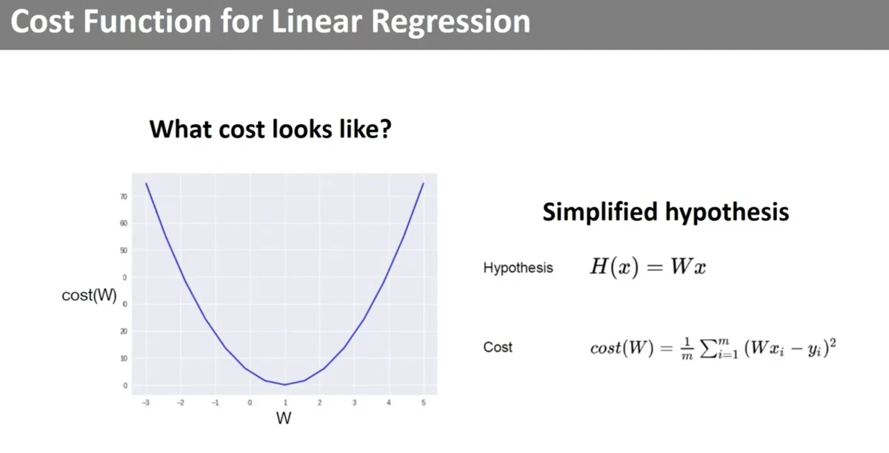

    - Loss Function이 위와 같이 나타날 때, 당연하게도 최소가 되는 점은 꼭짓점일 것이다.
    - 그렇다면 이 꼭짓점을 어떻게 찾아가는가?

    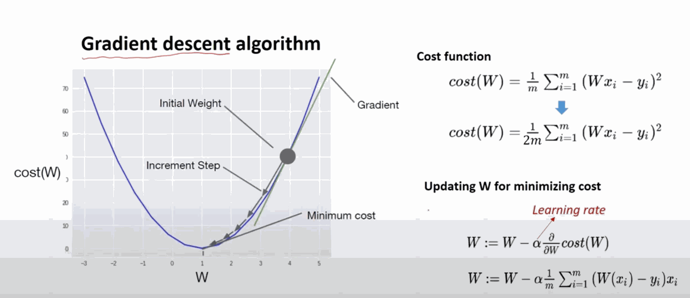

    - **Gradient Descent Algorithm**(경사 하강법) : 기울기를 기반으로 하는 최적화 기법은 두 가지를 선택하게 되어 있다.

        - 초기값에서 방향(**Direction**)을 설정 : -Gradient. 기울기의 반대 방향으로 가야 Minimum Cost로 가까워질 수 있기 때문에 Direction은 현재 지점의 Gradient에 -를 붙인 것.
        - 얼마나 갈 지 (**Step Size**)를 결정 : DL에서는 이를 Learning Rate라고 한다. 이것이 너무 크다면 내가 찾으려고 하는 값을 찾지 못해서 발산해 버릴 수도 있고, 반대로 너무 작으면 학습 속도가 너무 느려질 수 있음.

    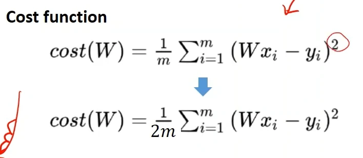

- 여기서 Gradient를 구한다는 것은, 일차미분을 한다는 것이다. 그런데, 일차미분에서는 미분되어 2가 앞의 상수로 오기 때문에, 사전에 2를 그냥 미리 나눠 놓는다. 이렇게 해도 값에 차이는 존재하지 않게 된다.

- 이제 Cost(W)라는 함수를 W에 대해서 편미분을 하고, Learning Rate alpha를 곱해준 다음, Gradient에 대해 -를 곱해주면, 아래와 같이 표현이 된다.

    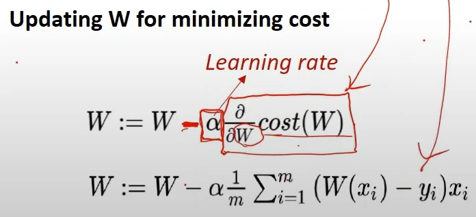

    - W에 대해 미분하게 되는데, 합성함수의 미분을 통해서 상수 xi만 남아 앞으로 나오게 된다. 그러므로 cost(W)는 위와 같이 표현된다.

---

## Logistic Regression

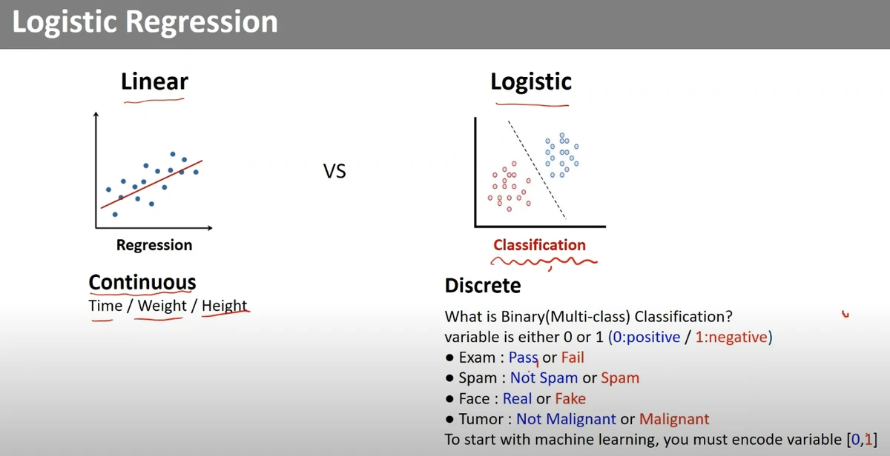

- Linear Regression은 Continuous한 값을 예측하는 것이고, 그렇게 하면 Time/Weight/Height 등에 대하여 적용할 수 있다.
- 이와 다르게 Logistic은 Discrete한 값(Binary, Positive/False, True/False) 등에 대한 Classification을 다루는 문제에 적용될 수 있다.

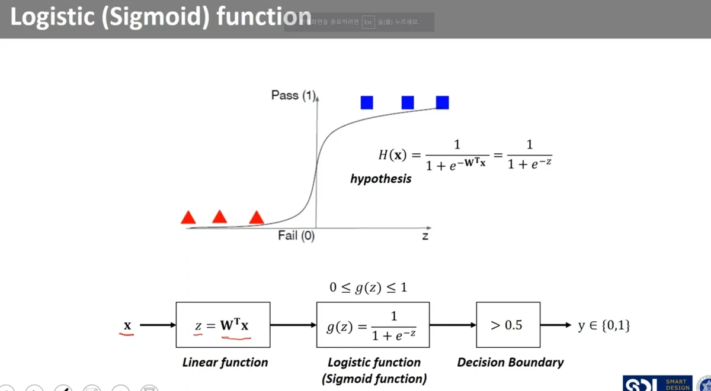

- Input값 x에 대해서 W를 곱해주면, (벡터 곱이므로 W에 Transpose) z라는 값이 나오게 된다. (이때 W는 이전에 Linear Function에서 다뤘던 alpha, 즉, Weight에 해당한다.) 
- 이 데이터를 Logistic Function(Sigmoid Function)에 넣게 되면, 항상 0~1의 값이 나오게 된다.
- 그러면, Decision Boundary(0인지 1인지를 결정할 Boundary)를 만들어준다. 예를 들어, 0.5보다 크다면 1이라고 하고, 0.5보다 작으면 0이라고 한다. 이렇게 되면 Classification이 가능하다.

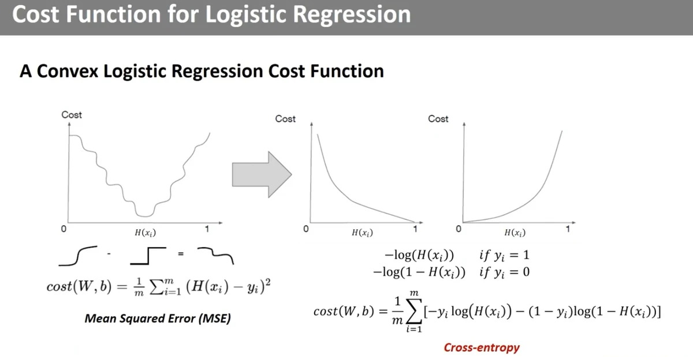

- Logistic Regression을 했다면, Cost Function을 정하고 그걸 Minimize 해주어야 한다.

    - 이전에 Linear Regression에 사용됐던 것처럼 MSE를 이용할 수 있다.
    - 문제는, Logistic Regression은 이전의 Linear Regression과 다르게 **Decision Boundary에 의해 값이 할당되어 Binary한 값**이 나오게 된다는 것이다.
    - 그러므로, 이전과 같이 Convex(볼록한)한 함수가 나오지 않고 구불구불한 함수가 나오게 된다는 것을 알 수 있다.

- 그래서 Cost Function에 약간의 변형을 가한다.

    - -log(H(xi)) if yi = 1

        - 1로 가면 갈수록, Cost가 작아진다.

    - -log(1-H(xi)) if yi = 0

        - 0으로 가면 갈수록, Cost가 작아진다.

    이렇게 값을 적용하면, 위와 같은 결과가 나오게 된다. 그런데, 이것은 if문으로 구분이 필요하므로 하나의 식으로 정리하면 구분이 필요하지 않게 된다.

    - Cross-Entropy

    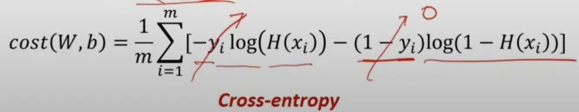

    이렇게 나온 값을 모두 더하고, 평균을 구하면 이것이 Logistic Regression의 Cost가 된다.

- Logistic Regression의 Convex한 Cost Function을 구했다.
- 이번에는 **Multinomial Classification**을 구해보자.

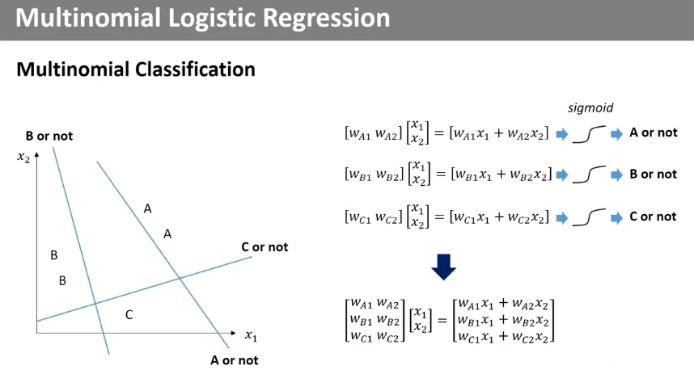

A 직선은 A이냐 A가 아니냐를 구분할 수 있다.

B 직선은 B이냐 B가 아니냐를 구분할 수 있다.

C 직선은 C이냐 B가 아니냐를 구분할 수 있다.

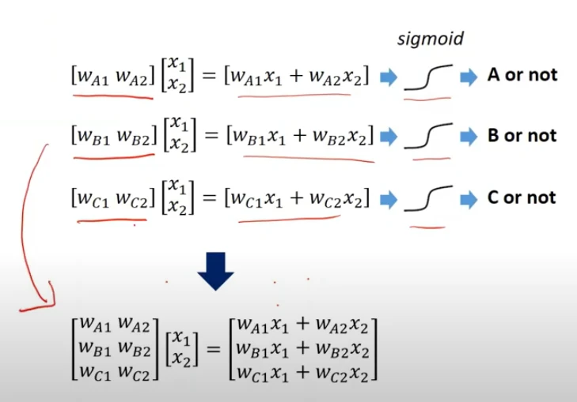

그래서 위와 같이 하나의 Matrix로 계산해버리고 Sigmoid를 통과시키면, A, B, C에 대해서 Classification을 할 수 있게 된다.

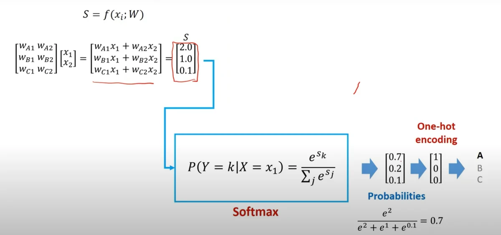

- 그런데, 그냥 Sigmoid는 항상 0 또는 1이므로, Multinomial에 대해서 Classification 통과할 수가 없다. 따라서 기존의 Sigmoid가 아닌 다른 것을 통과시켜야 한다.
- 우선 Linear 식으로 만들고, 그 Linear 식의 Output을 Score라고 한다. (S값)
- 이번에는 Sigmoid가 아니라 **Softmax**라는 것을 활용한다. 이를 통해 확률을 구할 수 있게 된다.

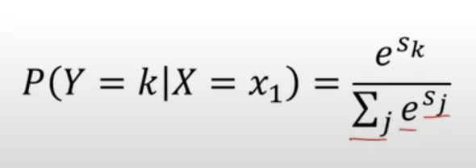

- 분모는 각 S값에 exponential를 취한 것의 합을 분모로 만들고, 내가 구하고자 하는 Class에 exponential을 취한 것을 분자로 만든다. ⇒ 이것이 Input이 x일 때, k라는 class에 속할 확률을 구하는 방법이다.

    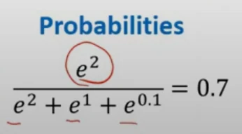

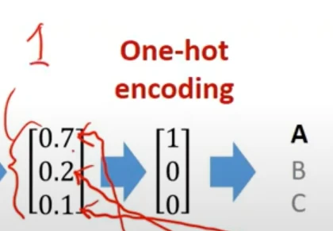

- 이렇게 구해진 [0.7, 0.2, 0.1]’ 에 대해서 **One-hot encoding**을 하고, 가장 큰 값을 1로 두고 나머지를 0으로 두게 된다. 위의 예시의 경우, 해당 Class는 A Class에 해당하게 된다.

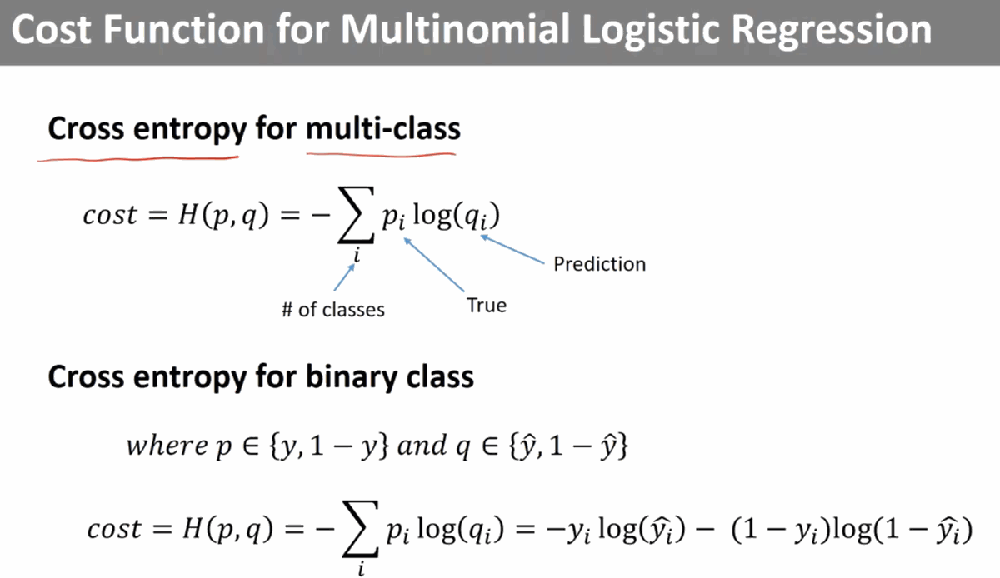

- Multi-class에 대한 Cross-Entropy는 일반적으로 위와 같이 표현이 가능하다.

    - cost = H(p, q) = -sum pi log(qi)

- Binary Class에 대한 Cross-Entropy

    - 두 가지 경우만 존재하기 때문에, sum을 고려하지 않고 위와 같이 표현할 수 있다.

---

## Regression Metrics

- Regression 기법에 대한 성능 지표

    - RMSE(Root Mean Squared Error) : MSE한 것에 Root를 씌운 것이다. 이 값이 작으면 작을수록, 정확도가 높다고 판단할 수 있다.

        - 그런데 이렇게 하면, 예측하려는 값의 크기에 의존적이라는 한계가 있을 수 있다.
        - 차선책으로 MSE를 사용할 수도 있다.

    - MAPE(Mean Absolute Percentage Error) : 예측한 값과 Target 값 간의 비율을 보는 것이다. 비율이므로, 항상 Percent로 나오게 된다.

    - 예를 들어 3%가 나온다는 것은, 3%의 차이가 있다는 것이다. 그러므로 예측하려는 값의 단위가 크게 상관없고, 비율로 표현하기 때문에 인간이 직관적으로 해석하기에는 더 편하다.

        - 다만, 예측하려는 값이 항상 1 이상이어야 한다는 한계가 있다. 예측하려는 값으로 나눠주기 때문에, 만약 예측 값(At)이 1보다 작다면 Percent가 굉장히 크게 나올 수 있다.
        - MAPE가 아니라면, 차선책으로 MAE를 구할 수도 있다. 이러면 예측하려는 값이 1 이상이어야 한다는 한계는 사라지게 된다.

---

## Confusion Matrix for Classification

Classification은 Confusion Matrix를 그리고, 다양한 성능 지표를 계산하게 될 수 있다.
