# Deep Learning 강의 > Ch2-2. Neural Network

## Neural Network

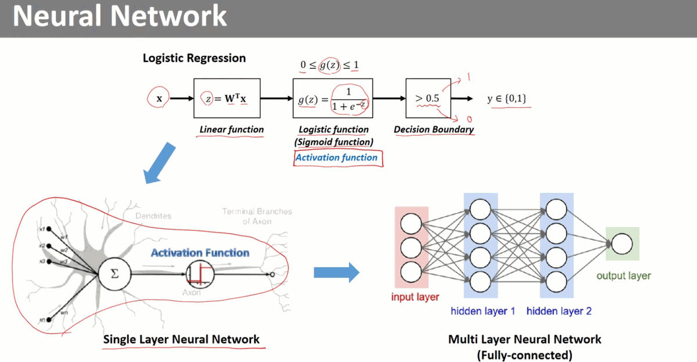

Logistic Regression은 **Input x에 대해서 Weight를 곱**해주는 **Linear Function**을 지나 대표값이 계산이 되면, **Logistic Function(Sigmoid Function)을 통과**시킨다. 이렇게 돼서 **0에서 1사이의 값 g(z)를 출력**하게 되고, **Decision Boundary**를 정할 수 있게 된다. (예를 들어 0.5보다 크다면 무조건 1, 0.5보다 작거나 같으면 0이라는 Boundary를 줄 수 있다.) 이렇게 되면 **Discrete한 값을 Classification** 할 수 있는 **Logistic Regression을 학습**하게 되는 것이다.

사실 Logistic Regression은 우리가 갖고 있는 Neuron과 유사한 형태이다. 그런 Neuron들이 여러 개 모이고, 그 층이 한 층이 아닌 다층구조를 이루게 되면, 그것을 **Multi Layer Neural Network**, 혹은 **Fully-Connected Neural Network**라고 부른다.

기본적인 Neural Network에서 **Hidden Layer가 두 개 이상** 되는 경우를 **Deep Learning**이라고 부른다고 생각하면 된다.

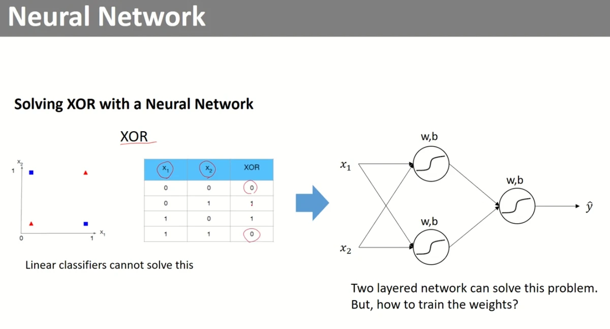

- 위와 같이 XOR의 결과를 판단하는 문제를 푼다고 생각할 때, 하나의 직선(Linear Classifier)만으로는 XOR의 모든 상태를 판단할 수는 없을 것이다. 하지만, 두 개의 직선으로는 구분할 수 있다.
- 그렇기 때문에 **Two Layered Network**가 필요하게 된다. 두 개의 Logistic Regression이 주어지고, 다시 하나의 Logistic Regression이 이루어지는 Neural Network라고 생각하면 된다.
- 그런데, 이 방식의 문제점은 **어떻게 Weights를 학습 시킬 것인가?** 이다.

---

## Back Propagation(역전파) - Chain Rule [1986 by Hinton]

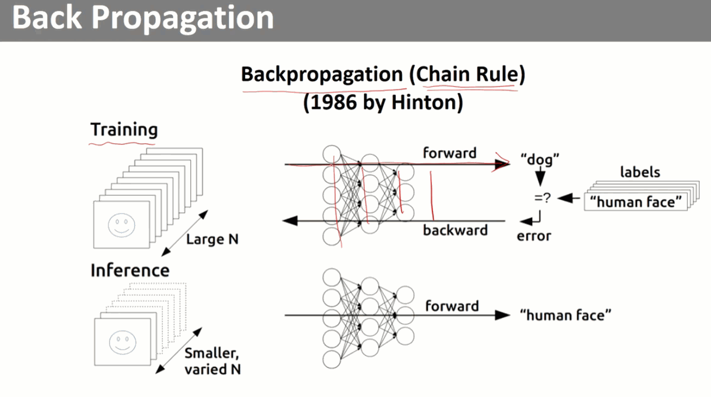

Multi-Layer Neural Network에 Training data를 넣게 되면 Forwarding을 거치게 된다. 각각의 뉴런들을 통과하면서 계산을 하게 되고, 이 그림은 “개”라는 Classification 결과가 나왔다고 해보자.

그런데, Label은 Human Face였다면, Dog라는 결과와 Human Face의 Error를 구할 수 있을 것이다. 그러면 이 Error값을 Backward로 전달을 해서, Error값에 대해서 다시 한 번 Weight 값을 최적화하게 된다. 이 과정을 계속 거치면서 최적화를 거치게 된다.

⇒ 이렇게 구해진 Error 값을 Backward로 전달하는 것을 **Backpropagation**이라고 한다.

이렇게 최적화가 되고 나서, 새로운 데이터를 넣었을 때 Forwarding을 거치면 “Human Face”라는 결과가 나오게 된다. 이 과정을 **Inference**(새로운 데이터에 대해 예측을 하는 것)라고 한다.

- 최적화를 한다는 것은 결국 Gradient(기울기)를 구해야 하는 문제가 된다. 이 기울기를 구하는 방법이 Numerical하게 구할 것이냐, 아니면 Analytical하게 구할 것이냐. 로 나뉘게 된다.

    - Numerical : Weight 값을 조금씩 바꿔가면서 언제가 Error 값이 최소가 되는지를 검사하는 방법이다. 다만 이 방법은 시간이 매우 많이 소요된다. (Neuron들이 매우 많기 때문)
    - Analytical(계산적) : 이 방법이 효율적이므로, back propagation은 Analytical하게 Gradient를 구하는 방법이라고 생각하면 된다.

---

## Back Propagation Simple Example

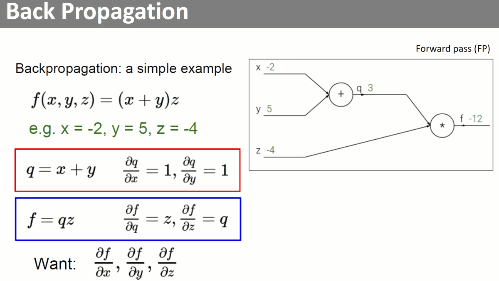

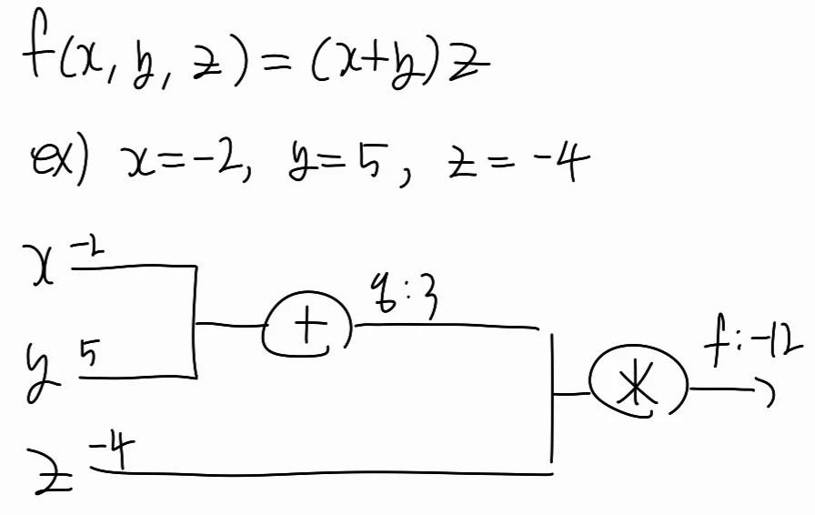

Chain Rule을 이용하면, 앞에서부터 차례차례 구해진 값들을 곱해가면서 결국, 맨 끝에 내가 원하는 값을 얻을 수 있게 된다.

내가 원하는 값이라는 것은, Input 값이 변할 때 최종 Output 값이 변하는 기울기를 구하기를 원하는 것인데, 그 사이에 여러 층들이 있을 경우에는 앞에서부터 차근차근 Upstream Gradient를 구하면서 결국 최종에는 Local Gradient를 곱해 내가 원하는 Gradient를 구할 수 있게 된다.

---

## Back Propagation Another Example

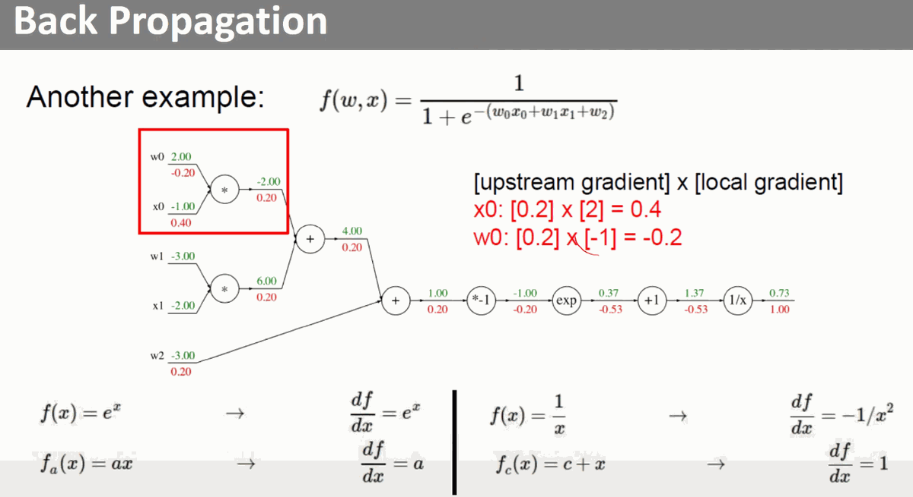

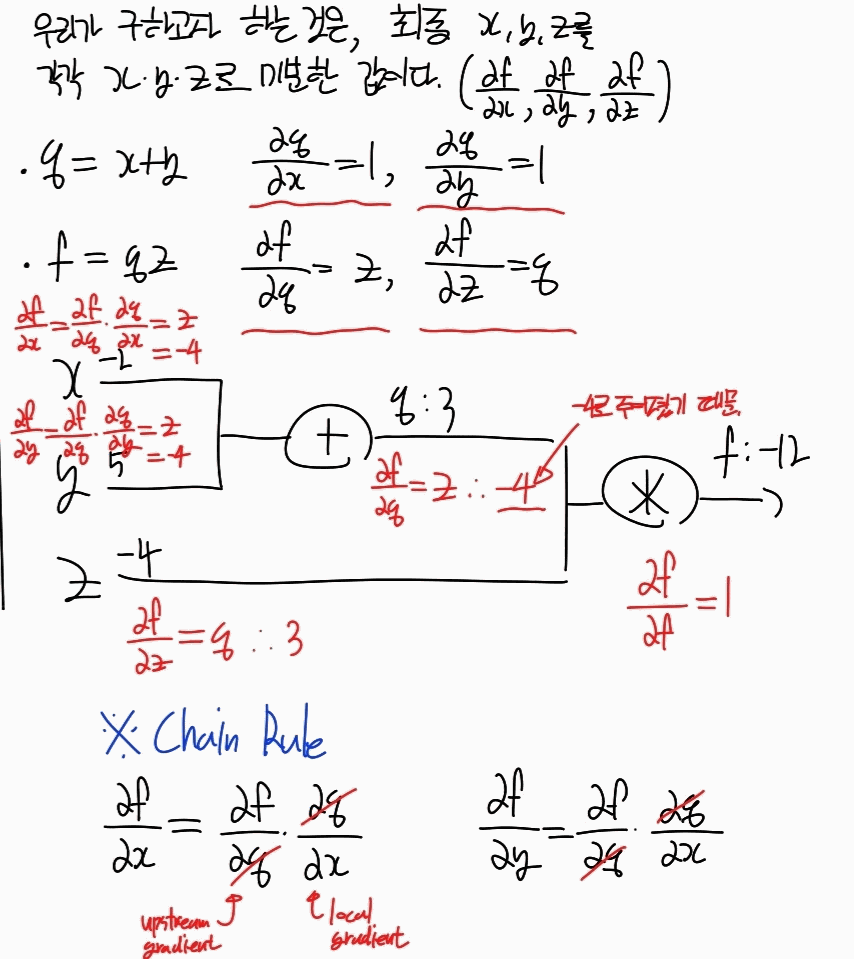

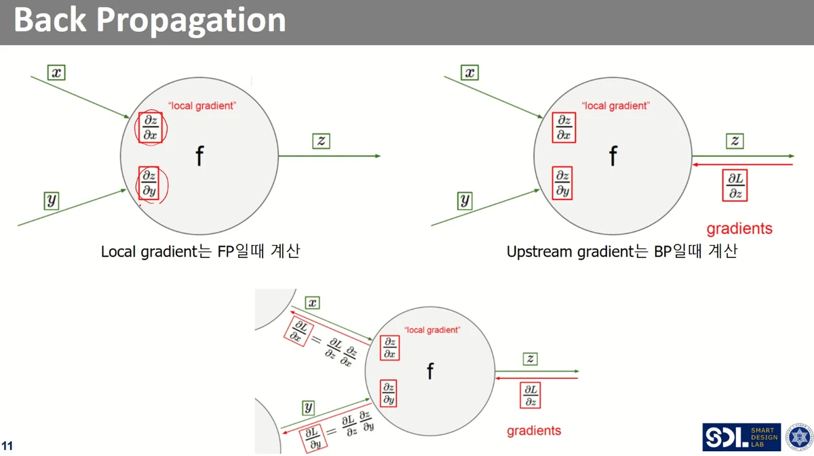

- Local Gradient는 Forward 과정에서 미리 계산해둘 수 있다.
- 이후에 Backward(Back Propagating) 과정을 거치면서 이전에 구해두었던 Local Gradient를 차례차례 곱해가면서 Upstream Gradient를 계산하고, 최종적으로 Gradient를 구하게 된다.

---

## Vanishing Gradient

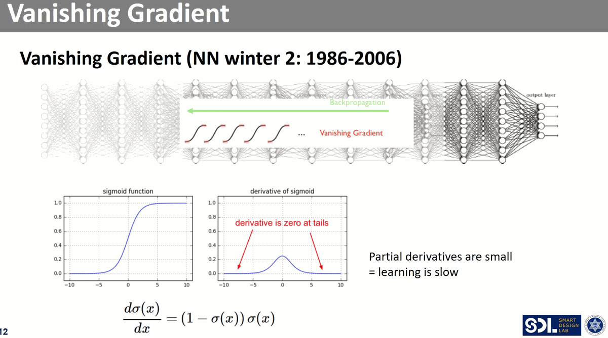

- 이와 같이 Back Propagating을 통해서 Gradient를 구할 수 있음에도 불구하고, Deep Learning이 왜 그렇게 긴 침체기를 겪었을까? 그 이유는, 작은 수를 계속해서 곱해나가게 되면, 뒤로 갈수록 숫자가 굉장히 작아져서 0에 가까워지게 된다.

    - Active Function으로 쓰이는 Sigmoid Function을 미분해보면, 위의 그림과 같이 나오게 되는데, 이를 살펴보면 거의 좌/우의 기울기 값이 거의 0이고 중간에만 살짝 값이 높은 것을 알 수 있다. 그 말은, Sigmoid Function의 Partial Derivative 값이 작다는 뜻이고, 그 값들이 계속 누적돼서 곱해지다 보면 굉장히 작은 수가 된다.

    ⇒ **그렇다면 이걸 어떻게 해결할 것인가?!**

    > 이전의 Sigmoid Function의 문제를 해결해주는 다른 Activation Function들이 등장

---

## ReLU

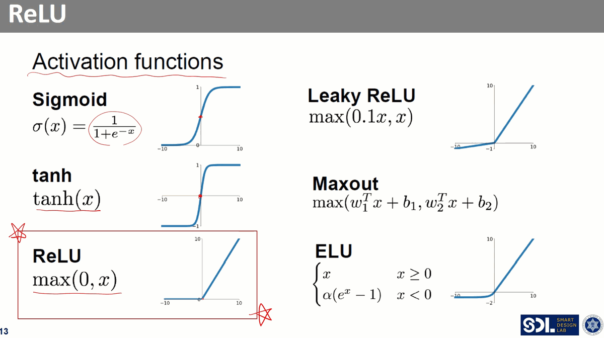

- `ReLU`는 -일 때는 0이고, +일 때는 y = x의 형태를 갖게 된다. 이렇게 되면 어디에서 미분을 해도 큰 값을 갖게 될 것이다.

- 그러나, 음수인 영역에서는 여전히 기울기가 0이기 때문에, `Leaky ReLU`라는 것이 사용된다.

    - Leaky ReLU는 -영역에서는 y = 0.1x가 사용된다.

- 그 외에는 Maxout이라는 함수를 사용하거나, ELU를 사용하기도 한다.

    - Leaky ReLU는 0에서 그래프가 꺾이기 때문에, 미분이 불가능해진다. 이를 방지하기 위해 ELU 함수는 a(e^x-1)을 사용하여 smooth하게 그래프를 그리게 된다.

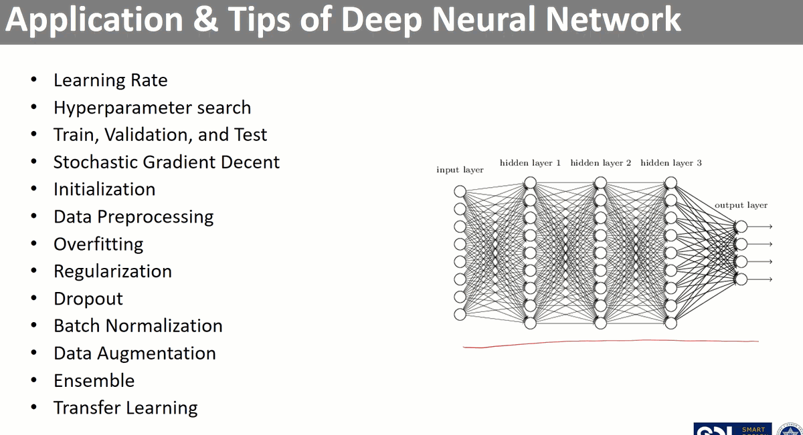

- Neural Network를 만드는데 있어서 Tip으로 알아야 할 것들. 각각의 개념에 대해서 알아본다.

---

## Learning Rate

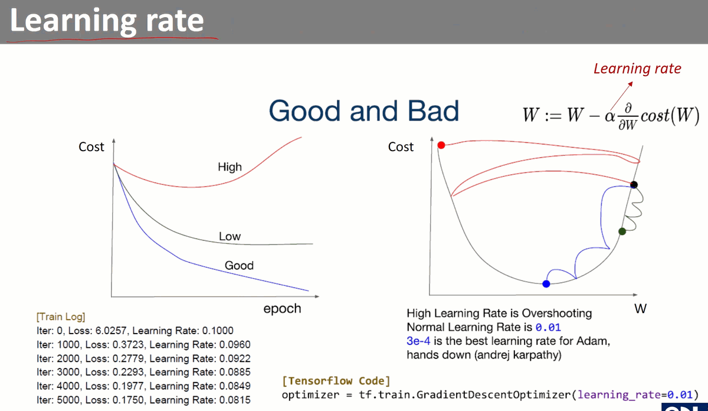

- Gradient Descent 방식을 사용할 때, 기존에는 Weight에다가 Cost Function을 미분한 값에 Learning Rate를 곱해주고 -를 달아서 Update를 시켰었다. 그런데, Learning Rate 자체가 어떤 적절한 값을 갖느냐에 따라 학습이 잘 이루어지기도 하고, 안 이루어 지기도 한다.
- Learning Rate이 작은 경우에는, 잘게 잘게 스텝을 가기 때문에, 굉장히 오래 걸려서 해를 찾게 될 것이다. 반대로 너무 큰 경우에는, 발산하게 될 수도 있다.
- 그러므로 적절하게 Learning Rate를 설정해야 최소점에 잘 도달하게 된다.
- Epoch을 돌릴 때, Learning Rate이 너무 크다면 값이 발산해 버리고(붉은색)
- Learning Rate이 너무 작다면, 학습이 너무 오래 걸린다.(녹색)
- 그래서 Learning Rate이 적절한 경우에 학습이 적절하게 이루어지게 된다.

> 그러므로, 학습을 진행할 때 Learning Rate를 적절하게 바꿔가면서 학습을 진행해 보는 것이 좋다. ⇒ 이 값은 Hyperparameter라고 하며, Deep Learning을 만든 사람이 정해주어야 하는 값을 말한다.

---

## Hyperparameter Search

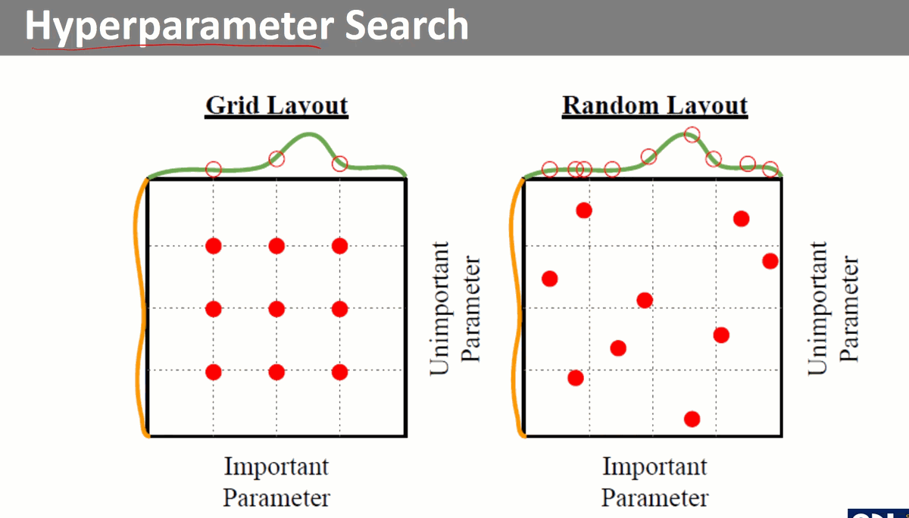

- Hyperparameter는 Trial & Error로 구할 수밖에 없다. 그렇게 하더라도, 예를 들어 9번의 테스트를 한다면 어떻게 9번을 하는게 나을까?를 아는게 좋을 수 있다.
- (좌) 그림처럼 Grid Layout 형식으로 Parameter를 정해버리면, **중복되는 구간이 생기기 때문에** 좋은 Parameter의 역할을 할 수 없다.
- (우) 그러므로 우측 그림처럼 **Random한 Parameter를 뽑아** 테스트해 보는 것이 더 좋다.

---

## Training, Validation and Test

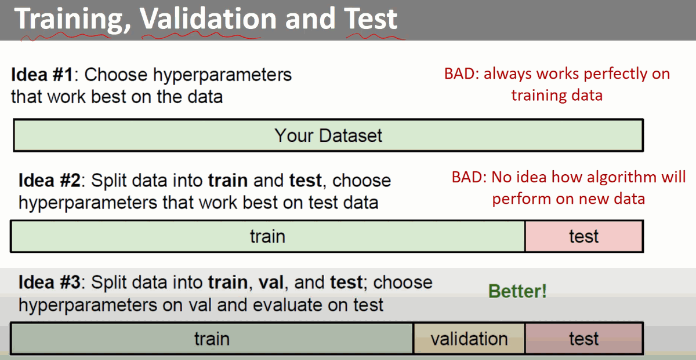

> `Idea 1` : 간혹 잘못된 방식으로 데이터를 사용하는 경우가 있는데, 예를 들어 내가 100개의 데이터를 갖고 있다면, 그것을 Training에만 사용하는 경우로 볼 수 있다.  
>   
> 내가 가진 데이터의 Loss 값을 최소화하는 딥러닝을 학습하면, 당연히 성능이 잘 나오게 된다. 하지만, Training Data에 대해서만 잘 나오게 되는 것이지, 새로운 데이터를 넣으면 올바르게 예측을 하지 못할 것이다.

`Idea 2` : 그러므로 Train 데이터로 학습을 시키고, 이때 Learning Rate 같은 Hyperparameter 값이 뭐가 좋은지 모르기 때문에 이걸 여러가지로 바꿔가면서 Test를 하면서 Hyperparameter 값을 고를 수 있다. 이 방법은 앞선 방법보다는 좋지만, 새로운 데이터가 들어왔을 때 그 값을 잘 맞출 수 있는지는 확인하지 못한 경우이다.  
⇒ Validation Data는 내 모델의 Hyperparameter를 선택하는데 사용되는 데이터이다.

`Idea 3` : 따라서 내가 가진 데이터를 Train, Validation, Test 세 가지의 종류로 나누는 것이다. Training 데이터로 학습을 진행하는데, 이 과정에서 Hyperparameter를 다양하게 변경해 보아야 한다. 그 다음 Validation Set을 통해 성능을 확인해서 가장 잘 나오는 Hyperparameter 모델을 선택한다. 그리고 나서 Training에 전혀 사용되지 않은 Test Data를 학습된 모델에 넣어봄으로써 성능을 확인한다.  
⇒ Validation Set을 통해 정해진 Hyperparameter를 통해서, 내 모델이 한 번도 보지 못했던 데이터에 대해 어떤 성능을 갖는지를 테스트해본다.

---

## Stochastic Gradient Descent

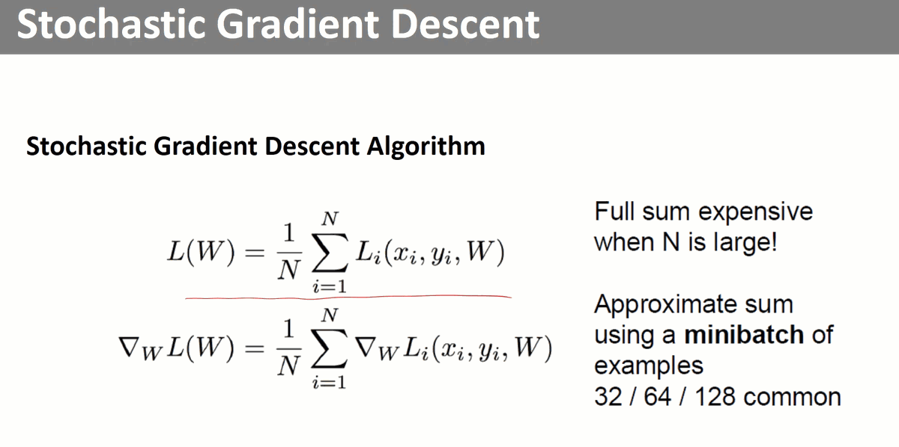

- 딥러닝의 데이터가 너무 많기 때문에, 전체 데이터를 바탕으로 업데이트하는 것이 아니라 전체 데이터를 minibatch로 나눠서, 각각의 minibatch를 돌아가면서 계산하며 update를 하는 방식

---

## Initialization

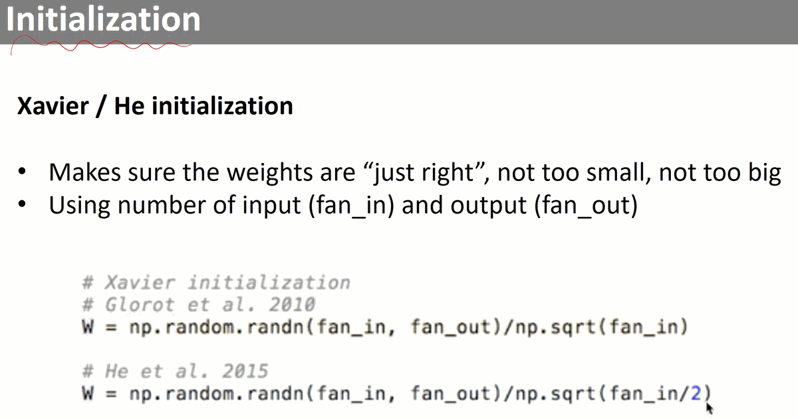

- 최적화에서 가장 중요한 값중 하나가 Initialization이다.

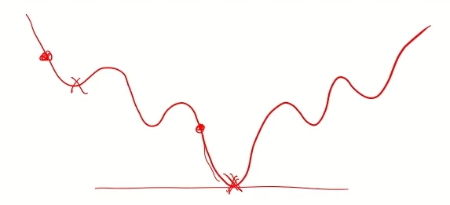

- 이와 같이 복잡한 함수가 있을때, 안좋은 Initial 값을 가진다면 Local한 Optimal에 빠질수도 있지만, 좋은 Initial 값을 가진다면 Global Optimal 값에 도달할 수 있을 것이다.

    - 특히 Gradient based 방식에서는 Initial 값이 굉장히 중요하다.

- 나의 Initial Weight 값이 좋은 값인지, 아니면 안좋은 값인지 알 수 없기 때문에 랜덤하게 사용하는 경우는 최적해를 찾기 힘들 수도 있다.

    - 하지만 이전의 연구자들이 다양한 Initialization 방식을 찾아냈다. 
    - 단순히 Neuron의 input의 개수와 output의 개수들의 관계식으로 W 값을 찾아내게 되었다.
    - Xavier, He 방식 등이 있다.

    ⇒ 이것도 다양하게 테스트를 하면서 우리 데이터에 맞는 Initializer를 찾아보아야 한다.

---

## Data Preprocessing(데이터 전처리)

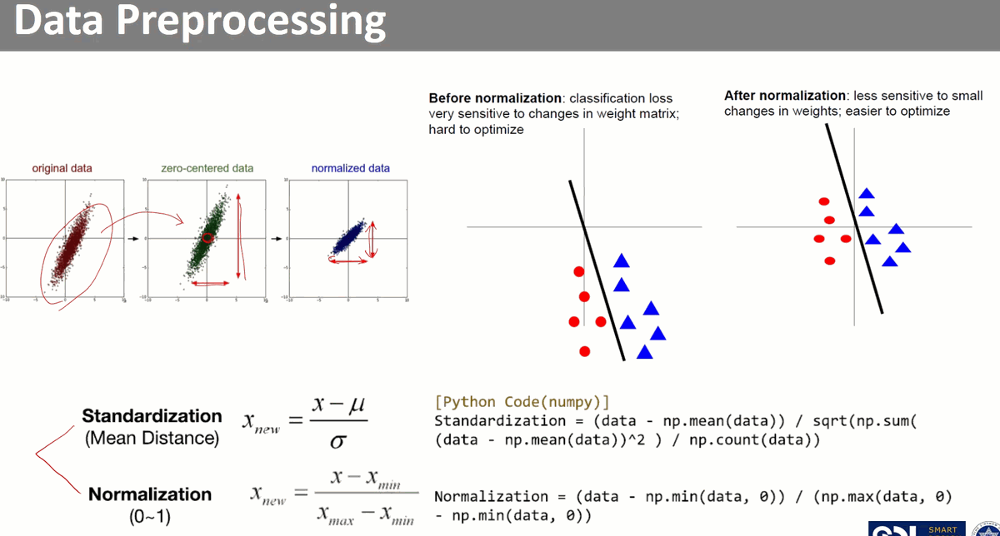

- Original Data가 있다면 이 데이터들을 항상 Zero-centered data로 바꿔주고, 동일한 크기로 normalization을 시켜주면 최적화 관점에서 학습이 더 잘 된다.

    - Standardization(Mean Distance) : 표준 편차를 이용해 상대거리로 나타내는 것.

        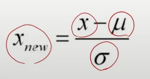

    - Normalization : 0~1 사이의 값으로 값을 바꿔주는 것.

        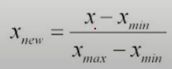

---

## Overfitting

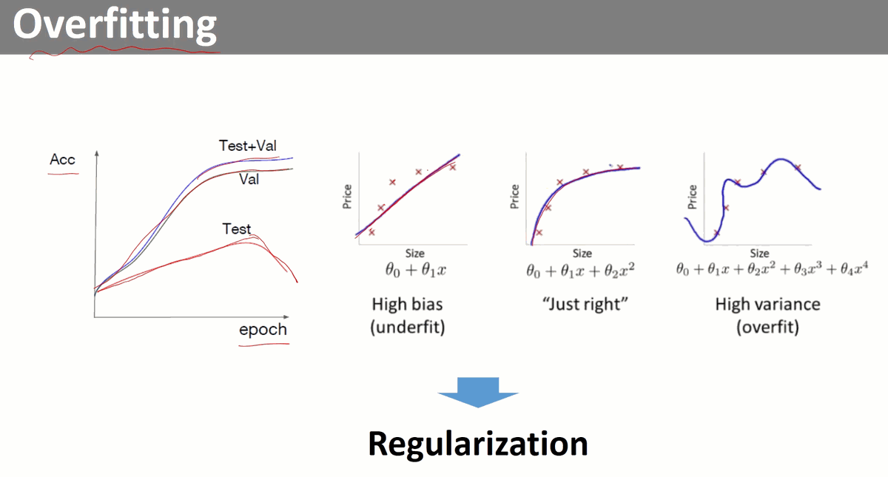

- 학습을 하다보면 **epoch**을 지나면 지날수록 **accuracy<strong>(예측 확률)</strong>가 높아져야 한다.** 그런데, 내가 사용한 Train, Validation 데이터는 괜찮아지는데 새로운 Test 데이터는 갑자기 성능이 떨어지는 경우가 발생할 수 있다.

    - 이 경우, `Overfitting`이 발생한다고 생각할 수 있다.

- Underfit : 데이터의 실제값에 대한 예측 성률이 낮은 경우.

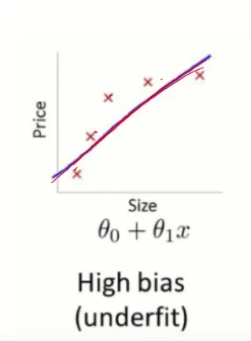

- Just Right

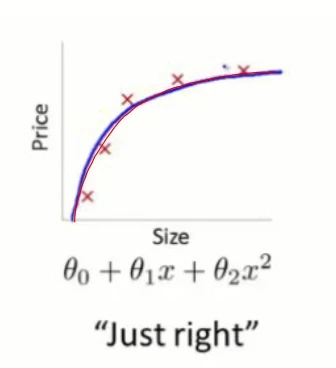

- Overfitted : 내 Train Data에 대해 너무 과도하게 fit하게 학습이 된 경우. 이러면 새로운 데이터에 대해서 예측을 성공시키기 어려워지게 된다.

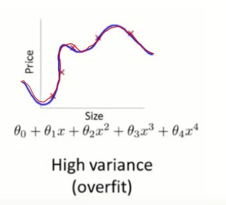

- 이와 같은 현상을 방지하기 위해서 하는 것이 바로 Regularization이다.

---

## Regularization

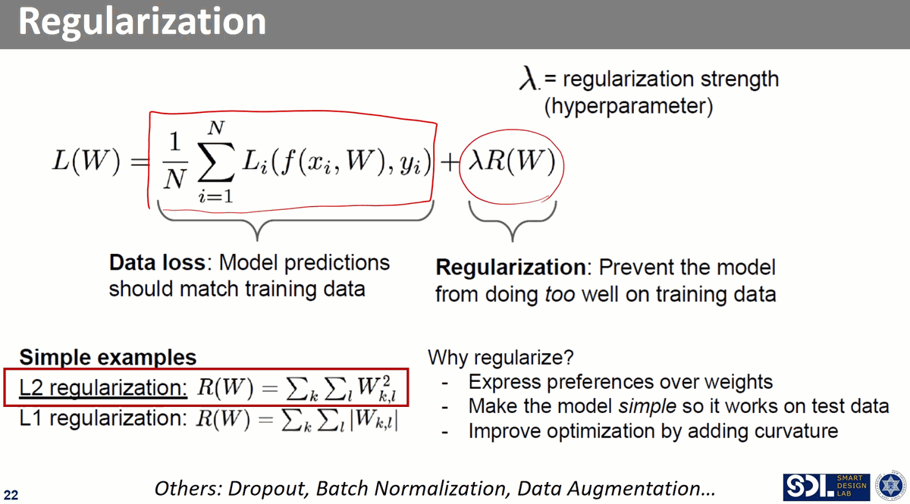

- Loss Function : 우리가 이전에 다루었던 Loss Function은 이와 같은 형태였다. 여기에다가 Regularization Term을 하나 붙여준다.

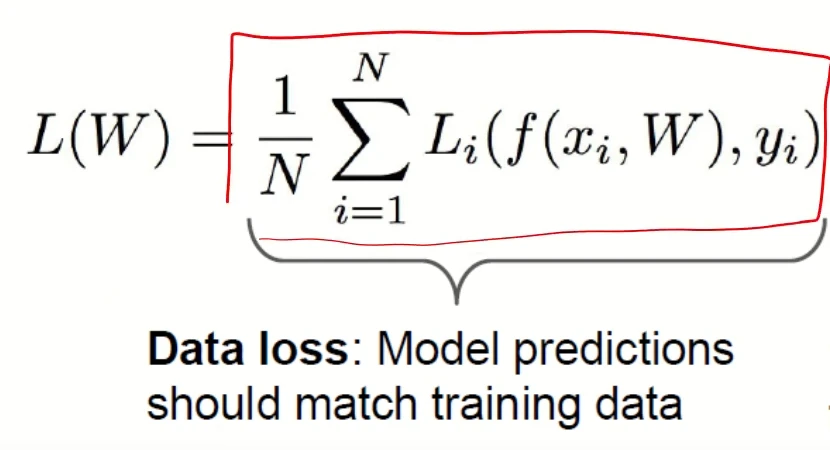

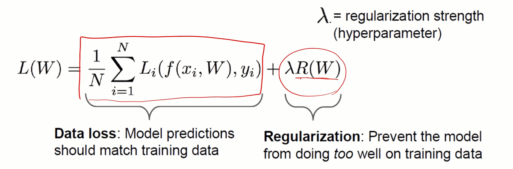

- Regularization Function에다가 람다(regularization strength. 일종의 hyperparameter이다.)를 더해준다. 이를 통해 모델이 너무 overfitting되지 않도록 만들어 준다.

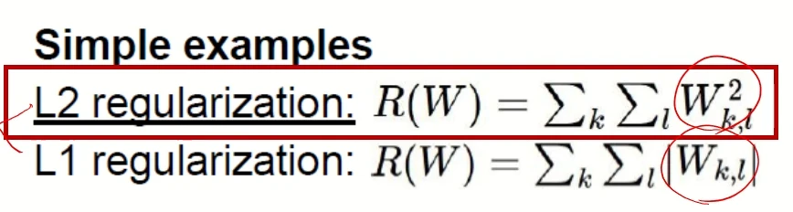

- L2 regularization : 학습하려는 Weight 들의 제곱의 합
- L1 regularization : 학습하려는 Weight 들의 절대값 합

⇒ 이 값들이 동시에 Minimization 해주려고 하는 것이다. 즉, Loss 값을 줄임과 동시에 W의 크기도 줄이려고 하는 것이다. W가 크게 되면 함수가 굉장히 구불구불해진다. W값이 작으면 굉장히 Smooth한, Classifier를 만들 수 있다.

- 만약 Regularization Strength. 람다값을 크게 하면 람다R(W)에 더 집중적으로 Minimization이 들어간다. 

    - Lambda값이 크다면 : Regularization을 더 하고, Data Loss를 좀 희생하자.
    - Lambda값이 작다면 : Data Loss를 집중적으로 줄이고, Regularization을 좀 희생하자.

    ⇒ 이 뿐만 아니라 Drop out, Batch Normalization, Data Augmentation 등도 적용 가능하다.

---

## Drop out

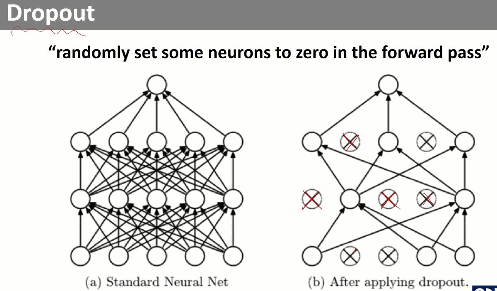

- 학습을 하는 도중에, 몇몇 노드들을 꺼버려서 학습을 오히려 방해하는 것이다.

⇒ 그러면 무슨 일이 일어날까?

- 학습이 특정 뉴런에 의지하지 않고 학습을 하기 시작한다. 그렇게 되면, 좀 더 General 하게 학습을 하게 된다. 이를 통해 Overfitting을 방지할 수 있게 된다.
- 코드를 작성할 때, 코드에서 몇 %를 Drop out할지를 설정하고 자동으로 몇 %의 뉴런들을 학습할 때마다 꺼주게 된다. 그리고 나중에 Test를 할 때는 모든 뉴런을 다 살려서 하게 된다.

---

## Data Augmentation

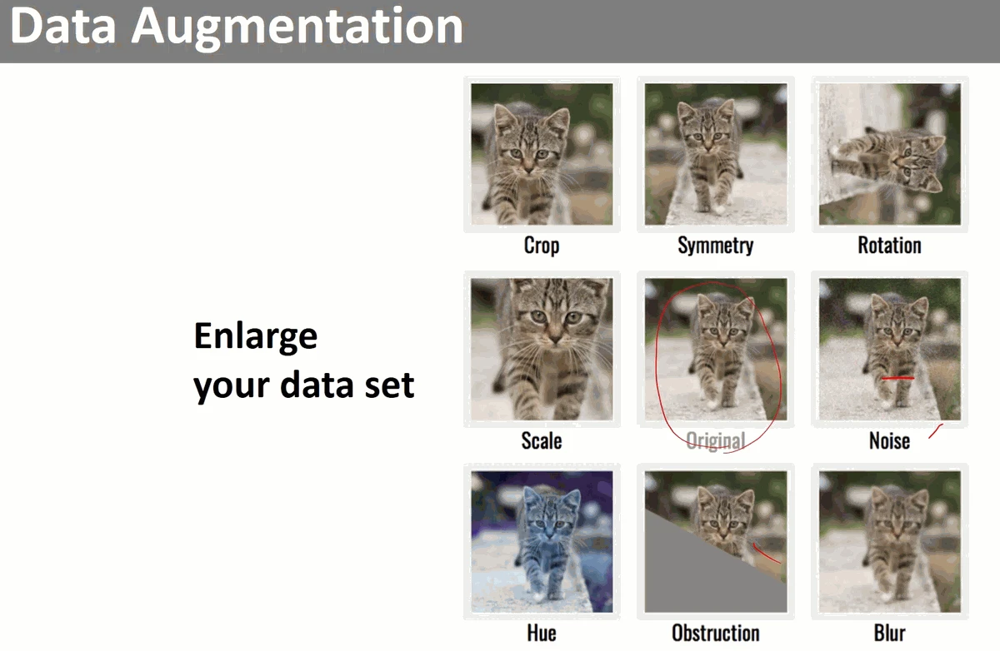

- 보통 데이터의 수가 너무 적다면 데이터의 크기를 늘리는, 증대하는 방법이 필요하다. 

    - Crop
    - Symmetry
    - Rotation
    - Noise
    - Scale(Enlarge)
    - Hue
    - Blur

    위와 같은 기법 등을 적용하여 데이터의 수를 늘려 학습을 진행하는 것이 Practical하게 많이 사용되고 있다. (데이터가 적으면 적을수록 Overfitting이 많이 발생한다.)

---

## Ensemble(앙상블)

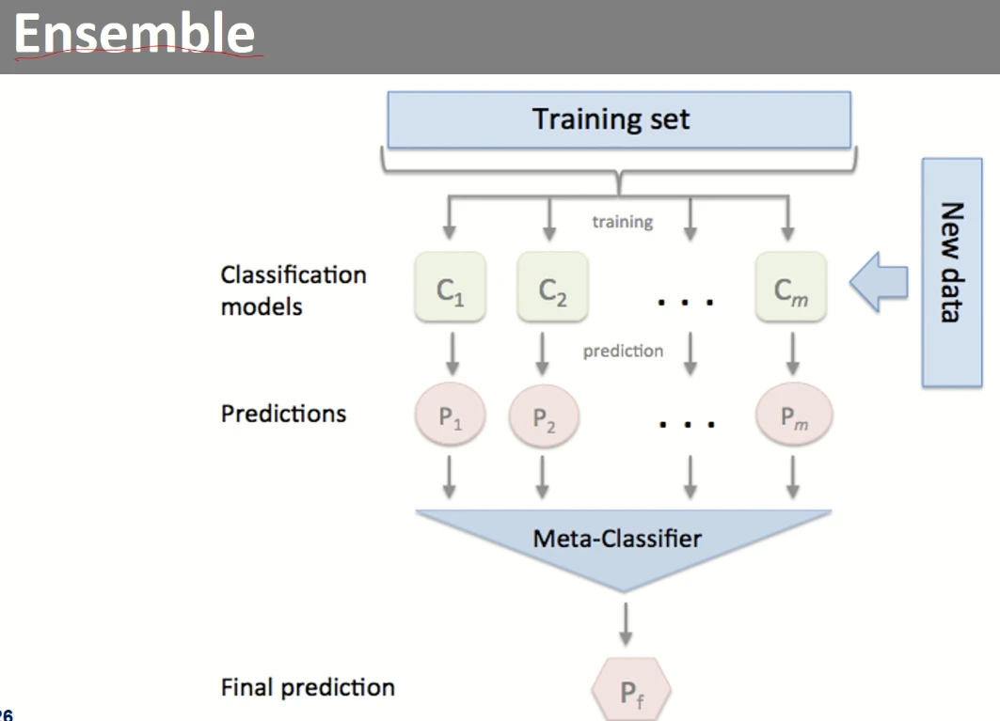

- 모델을 하나만 학습하는 것이 아니라, 여러 개의 Neural Network를 학습하는 것이다. 왜냐면, 각각이 초기값이나 batch 사이즈에 따라 다르게 학습할 수도 있고, 다른 Hyperparameter 값을 가질 수도 있다. 똑같은 Data Set으로 학습을 하더라도 다른 모델이 만들어질 수도 있고, 서로 다른 예측값을 내놓게 된다. 그럼 그것을 Average해서, 그 값이 Final Prediction 값이 되도록 하는 것이 바로 Ensemble이다.

    > 일반적으로 Ensemble을 통해 학습한 값이 하나의 모델을 가지고 학습을 진행한 것보다 성능이 좋게 나오게 된다.

---

## Transfer Learning

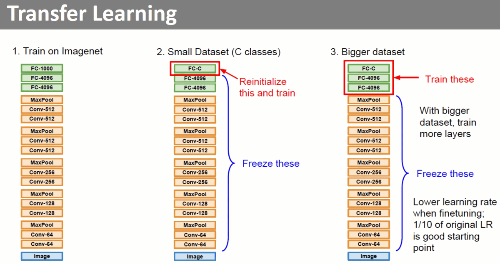

- 보통의 경우 학습을 하려는 데이터가 많이 없기 때문에, 데이터가 많은 영역에서 미리 학습을 해놓은 Pre-trained Model을 가지고 와서 Fine Tuning을 하는 방법이다.
