# Deep Learning 강의 > Ch2-3. CNN(Convolutional Neural Network)

작성일 2023-06-03 · 최종 수정일 2023-06-04
{ .post-date }

## CNN

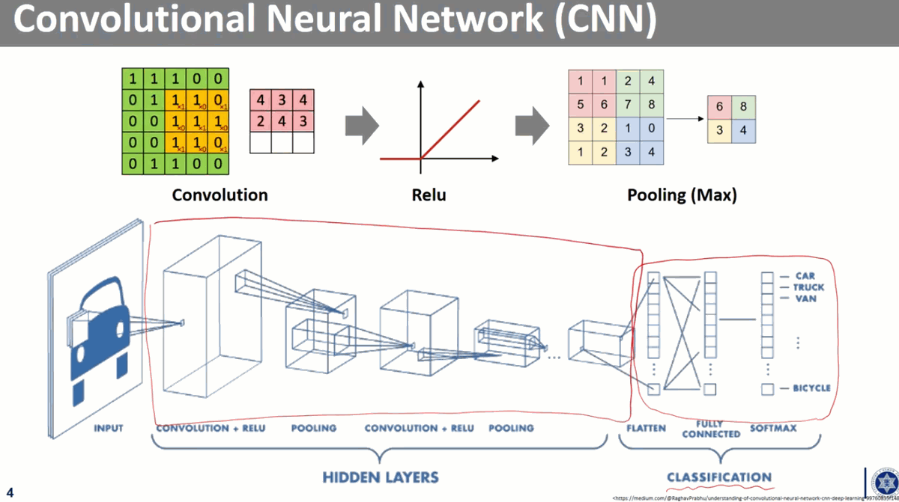

- Neural Network 파트가 Classification을 하는 Classifier의 역할을 한다고 생각하면 된다. 
- Neural Network에 넣기 전에, Convolutional(Hidden Layers) 만의 층을 가지게 되는데, 이 층이 이미지나 영상 등에서 가장 중요한 Feature들을 뽑아내는 역할을 한다고 보면 된다. 이렇게 뽑힌 Feature들을 바탕으로 Neural Network를 통과하면 좀 더 Classification을 잘 할 수 있다는 것을 밝혀냈다.

- Progress

    - Convolution
    - ReLU (Activation Function)
    - Pooling(Max) : Down Sampling을 통한 **Dimensional Reduction**

    이러한 역할을 하는 층을 여러번 반복해서 쌓다 보면 중요한 Abstract Feature들이 뽑아내진다.

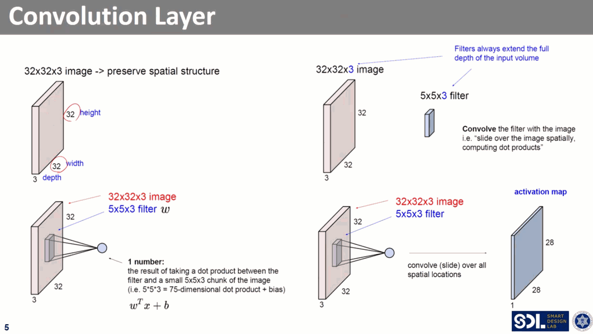

- **32\*32\*3의 크기를 갖는 RGB 값이 있다고 해보자.** 여기에 filter를 적용한다.
- filter란, 마치 사람이 그림을 부분적으로 훑어보는 것처럼 그림을 훑어 보는데, 그 때 훑어볼 크기를 의미한다. 예를 들어 5\*5 크기로만 이미지를 훑어본다고 생각해보자. filter의 크기는 architecture를 만드는 사람이 설정하는 것이며, **depth**는 **항상 input의 depth와 동일해야 한다.**
- 이 filter를 차례차례 이동시키면서 이미지를 본다고 생각하면 된다. 그렇다면, 그 filter 안에는 총 75개의 값이 들어있게 될 것이다. 이 filter의 값과 주어진 데이터에서 일치하는 위치의 값들을 서로 곱하고, 이렇게 곱해진 모든 값들을 더하면 하나의 Scalar 값이 나오게 된다.
- 이 방식을 한 칸씩 옮겨가면서 모두 연산해주면, 28\*28\*1으로 축소가 일어나게 된다.

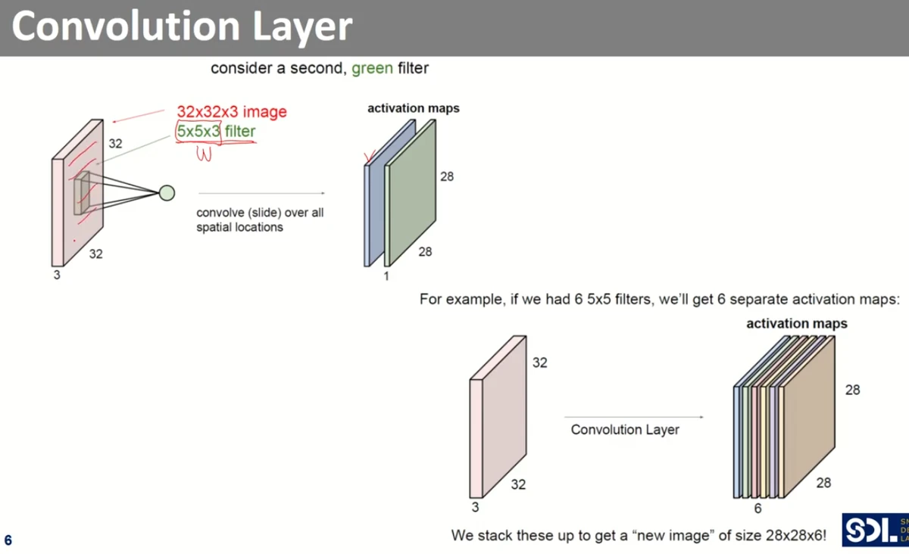

이후에, 32\*32\*3의 RGB 값에다가 다른 값을 가진 5\*5\*3 filter를 적용해 컨볼루션 연산을 하면, 새로운 값이 나오게 될 것이다. 이런 방식으로 6개의 filter에 대해 컨볼루션 연산을 하면, depth가 1인 28\*28\*1의 `Activation Maps`가 6개 나오게 될 것이다.

결국, 우리가 얼마의 크기를 갖는 n\*m filter를 쓸 것이냐, 몇 개의 filter를 쓸 것이냐를 통해 `Activation Maps`가 결정되는 것이다. (중요한 것은, depth는 동일해야 한다.)

---

## Convolution Layer - Stride and Pad

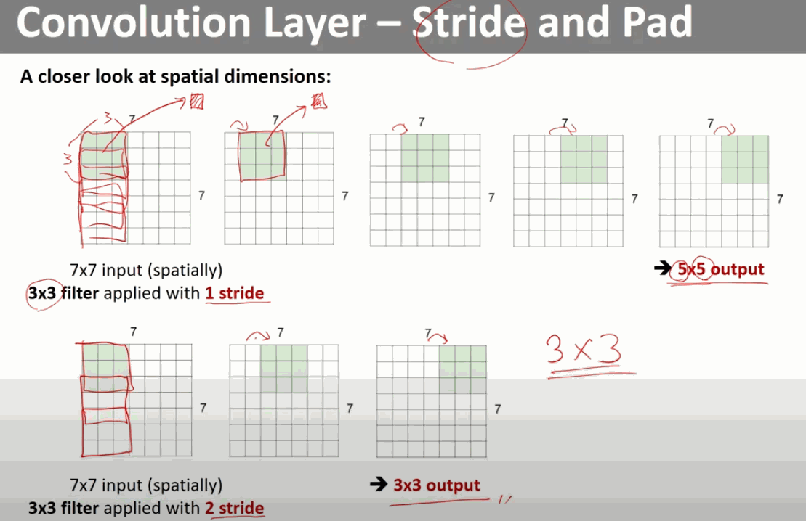

- Stride : filter가 한 번의 Convolution을 마쳤을 때, 몇 칸을 움직일 것인가? 이걸 Stride라고 한다. (움직이는 크기는 Horizontal 방향, Vertical 방향에 대해 모두 동일하게 적용된다.)

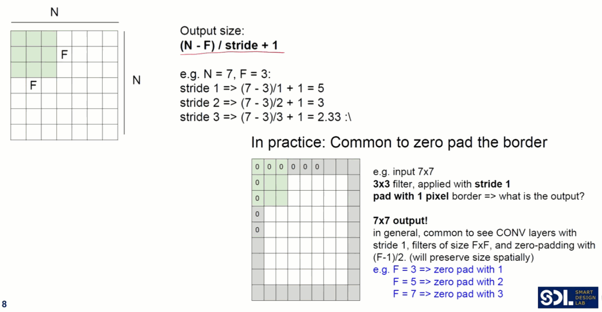

- Output의 Dimension을 써가면서 알아낼 수도 있지만, 공식으로 구할 수도 있다. 

    - **{ (N - F) / stride } + 1**로 계산하면, 얻어낼 Activation Map의 Size를 알 수 있게 된다.
    - 그런데, 식을 구하다보면 크기가 딱 나누어 떨어지지 않는 경우가 존재할 수도 있다. (예시3)

- 이런 경우에 대비하여 Practical하게 사용하는 것이 바로 Pad이다.

    - 예컨대, 내가 사용하는 데이터가 7\*7 크기일 때, 가장자리에 Zero Pad를 추가해서 특정 Filter크기와 Stride 하에서 나오는 Activation Map의 크기가 나누어 떨어지도록 만들 수 있다. 
    - Zero Pad의 크기는 반드시 한 줄이어야 하는 것은 아니고, **여러 줄을 추가**해도 된다.
    - Zero Pad를 반드시 사방면에 두어야 하는 것이 아니라, **원하는 방향에만 추가**할 수도 있다.

    ⇒ 이를 통해 원하는 Output이 나오도록 적절하게 설정할 수 있다.

> 일반적으로  
> F = 3 → zero pad with 1  
> F = 5 → zero pad with 2  
> F = 7 → zero pad with 3  
> Tensorflow가 잘 돼 있어서, 이런 수치를 면밀하게 고려하지 않아도  
> Input과 Output의 개수를 정확히 맞출 수 있게 잘 설계가 되어있다.

---

## Convolution Layer의 동작

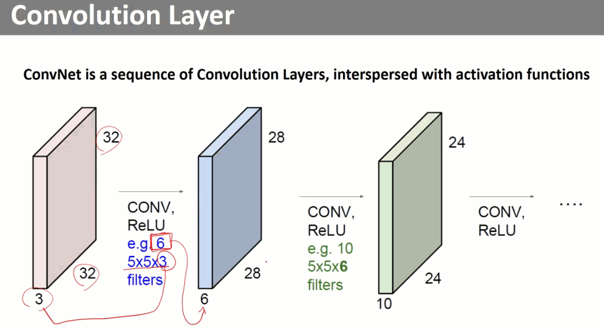

32\*32\*3 RGB 이미지에 대하여 5\*5\*3 filter를 통과시킨다. (이때, 반드시 depth는 원본 이미지와 동일해야만 한다.) 이때 사용한 filter의 사이즈와 stride에 따라 Activation Maps의 크기가 결정된다.

Convolution Layer를 통과한 이후에 ReLU를 통과하게 되며, 이렇게 나온 Output에 대해서 또 Convolution/ReLU 작업을 거친다. 이번에는 5\*5\*6의 filter 10개를 통과시킨다고 해보자.

그러면 24\*24\*10의 크기를 갖는 Output이 또 나오게 된다. 이런 작업을 반복적으로 수행하는 것이 바로 CNN이다.

---

## Pooling Layer

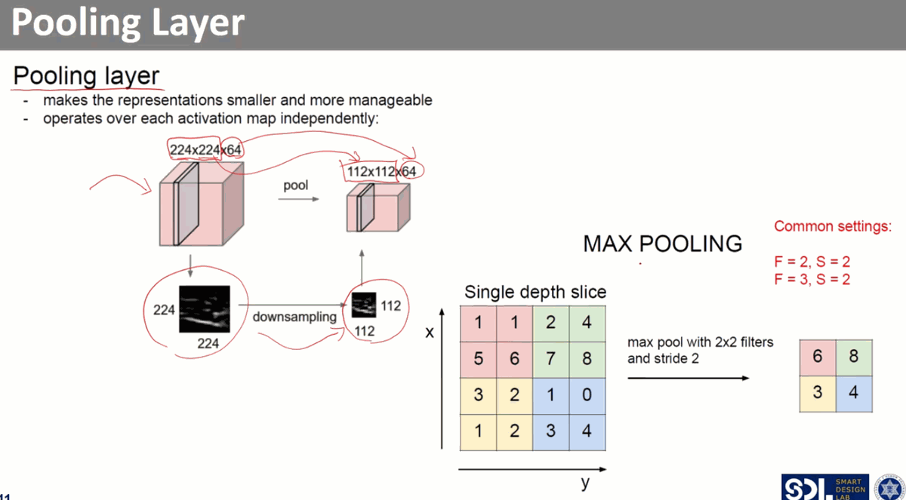

그런데, Convolution Neural Network에 CNN Layer만 있는 것이 아니라, Pooling Layer라는 것이 존재하게 된다. 이것은 큰 이미지를 **Down-Sampling**해서 좀 더 **Abstract**하게 만들어주는 것이다.  
⇒ 중요한 데이터만 취한다고 생각하면 된다.

- Max-Pooling(주로 사용되는 방식) : Filter Size와 Stride Size를 정해준다. 이를 바탕으로 원본 데이터를 Slice해서 한 구역 내에서 가장 큰 값만 뽑아온다. (위의 이미지에서 Single depth slice) 이렇게 추출된 데이터를 바탕으로 Dimension을 축소할 수 있다.

    - 이렇게 되면 중요한 값들만 가져올 수 있게 돼서 좀 더 축약된 정보를 갖게 한다.

- Average-Pooling

---

## Fully Connected Layer

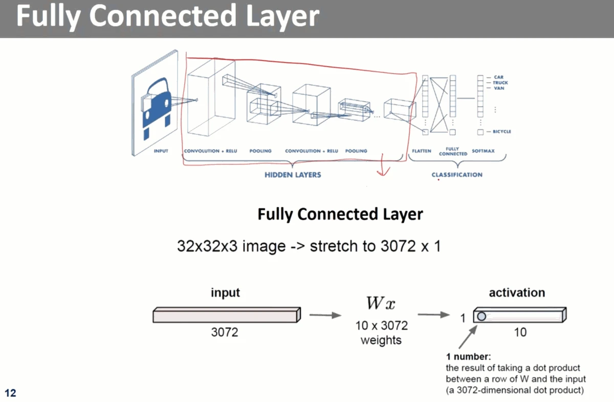

- **Hidden Layers** : 초기에 Convolution & ReLU를 진행해서 Output을 얻고, 이렇게 한 다음에 다시 Pooling Layer를 통과시켜서 축소시킨다. 이 과정이 `Feature Extraction`의 역할을 하게 된다.

- **Classification** : 이 다음에 Fully-Connected 과정에서 Classification을 수행하는데, 여기서 하는 역할은 Feature Extraction에서 나온 Feature들을 바탕으로 분류를 진행하는 것이다. 그것이 바로 Neural Network가 하는 일이다.  
    ⇒ 이 과정을 수행하기 위해서 Feature Extraction의 마지막 과정에서 모든 데이터를 Flatten 시킨다. 즉, 일차원 벡터 형태로 데이터를 나타내도록 한다. 예컨대 32\*32\*3의 image였다면, 3072\*1의 크기의 일렬 벡터로 만들어버리는 것이다.

    - 이후에는 Weight를 곱해줘서 (예를 들어 10개의 Weight가 있다면) 1\*10의 Output을 구한다. 그리고 이 데이터를 **Activation Function**에 통과시킨다.

---

## CNN Summary

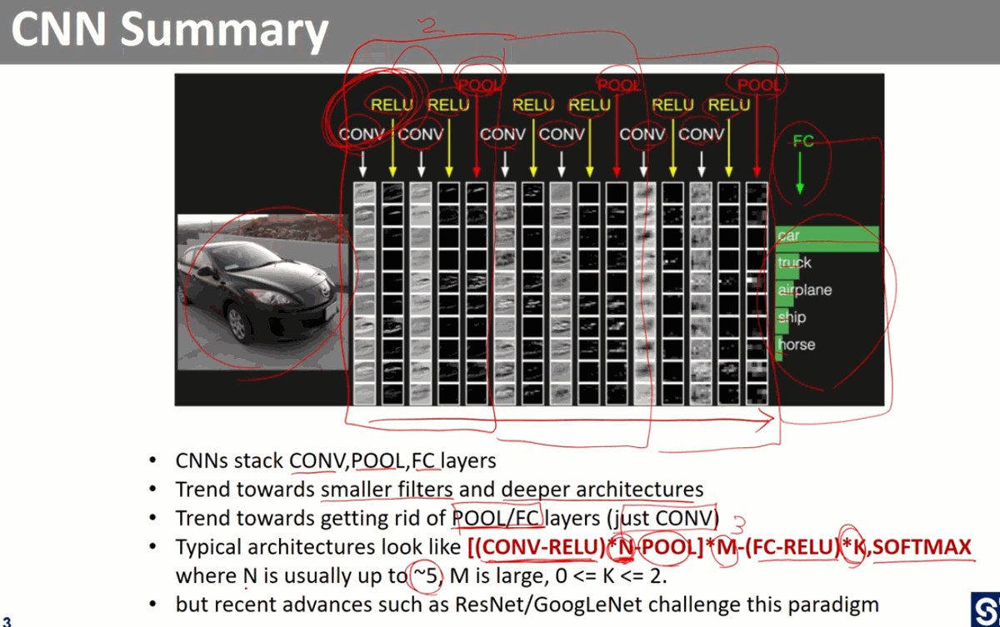

- CNN은

    - Convolution Layer, ReLU
    - Pooling Layer
    - Fully-Connected Layer (Soft-max Layer)

    를 겹쳐서 만든 것이다.

- 트렌드를 보면 작은 필터들을 사용하고, 대신 깊이를 깊게 가져가는 것이 트렌드라고 한다.
- 갈수록 Pooling Layer와 Fully-Connected Layer는 줄이는 경향이 있고, Convolution Layer를 깊게 쌓는 경향이 있다.
- 일반적으로 많은 사람이 실험을 해봤을 때,  [ (Convolution→ReLU) * N → Pooling ] * M의 구조를 많이 취하고, 이것이 끝나면 (FC→ReLU) * K 이와 같이 Fully-Connected → ReLU 구조를 K번 취하게 된다.
- 위의 예제에서는 N = 2, M = 3정도가 된다. 그런데 보통 N이 다섯 번 정도를 하고 Pooling을 가져오게 되고, 그렇게 하는 조합에서 M은 굉장히 Large하게 한다. (위의 예제는 세 번이지만, 실제는 매우 깊게 한다고 보면 된다.) 하지만 마지막 Fully-Connected Layer는 0 ≤ k ≤ 2번 정도만 수행하게 된다.

⇒ 하지만 정해진 Rule이 있는 것은 아니다.

---

## Implementation Flow in TensorFlow

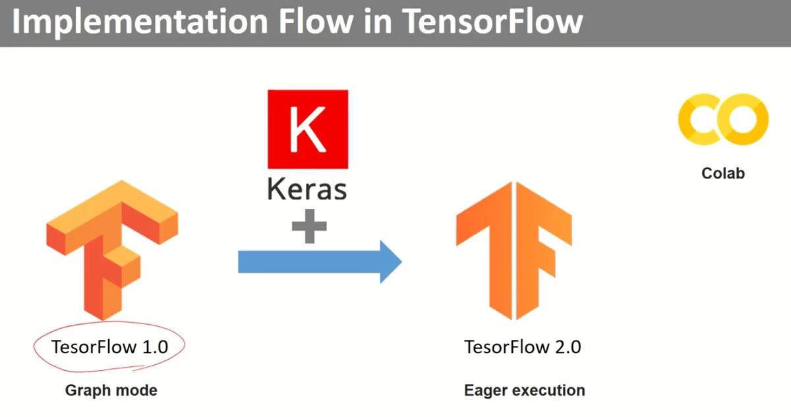

- TensorFlow 1.0에서는 그래프를 만들어 두고 실제로 Run을 해야 연산이 수행되었다. 하지만 이 방식이 직관적이지 못했기 때문에, TensorFlow 2.0에서는 Run을 하지 않아도 바로 수행되도록 수정되었다.
- Keras가 TensorFlow 2.0에 내장되어서 굉장히 단순해지고 통일성을 갖게 되었다.
- 그리고 Colab을 이용하면 온라인 상에서 Jupyter Notebook을 사용하고 GPU를 사용할 수 있게 되었다.
- **Neural Network Implementation Flow in TensorFlow**

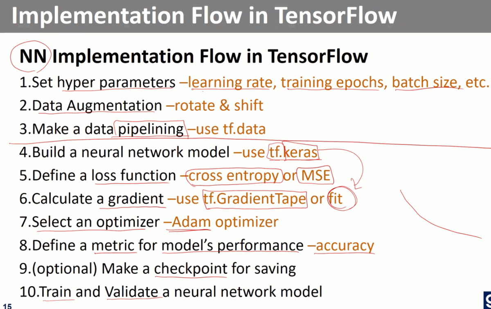

1. Set Hyperparameters - learning rate, training epochs, batch size, etc…
2. Data Augmentation - rotate & shift
3. Make a data pipelining - use [tf.data](http://tf.data) (데이터의 형식에 따라서 맞춰서 데이터를 받아내면 된다.)

    ⇒ 이 부분까지 끝나게 된다면, TensorFlow 2.0에서는 이후 부분이 매우 간단해진다.

4. Build a neural network model - use tf.keras 
5. Define a loss function - cross entropy or MSE(Loss Function은 크게 두 가지. Cross Entropy는 Classification을 할 때 사용하고, MSE는 regression, continuous한 값을 예측할 때 사용한다.)
6. Calculate a gradient - use tf.GradientTape or fit(최적화를 하기 위해서는 Gradient를 기억해서 Backpropagation을 해야 하는데, 이때 tf.GradientTape을 사용하면 Gradient 값을 기억할 수 있게 된다. 혹은 Keras를 사용하면 fit이라고 하는 굉장히 단순한 명령어를 이용해 쉽게 학습을 시킬 수 있게 된다.)
7. Select an optimizer - Adam optimizer
8. Define a metric for model’s performance - accuracy(예측 성공률 등)
9. (optional) Make a checkpoint for saving(중간중간 저장하고 싶다면)
10. Train and Validate a neural network model

<!-- -->

- Building a NN model

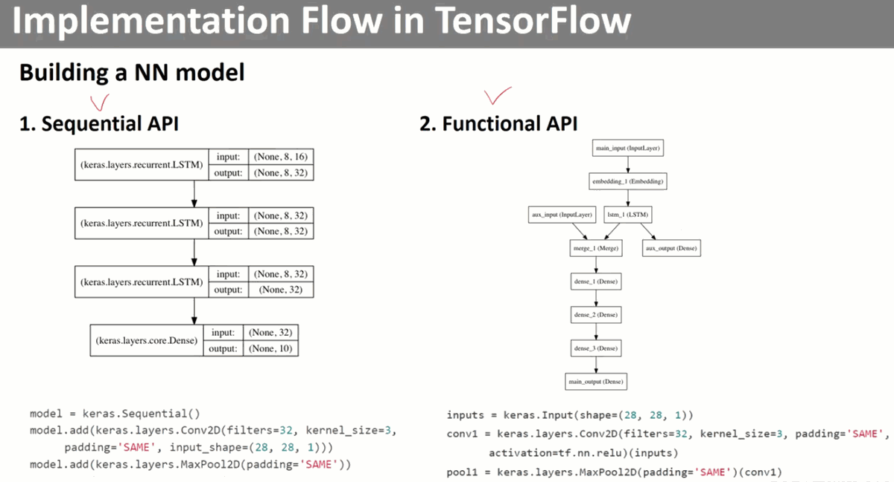

Neural Network Model을 Building 하는데 두 가지 큰 축이 있다.

1) Sequential API : Layer를 차례대로 Sequential하게 쌓아가는 것을 말한다. 각각의 모델에 층을 쌓기만 하면 된다. ⇒ 이렇게 하면 반드시 이전 Layer의 Output이 다음 Layer의 Input으로 들어간다는 가정을 갖게 된다.

2) Functional API : Input이 뒤에서 오다가 갑자기 분기가 나뉘거나 외부에서 새로운 Input이 들어오는, 다양한 경우가 존재할 수 있다. 이런 경우에는 Functional API를 이용하여 항상 어떠한 Layer의 Input이 뭔지를 정해줄 수도 있다.
