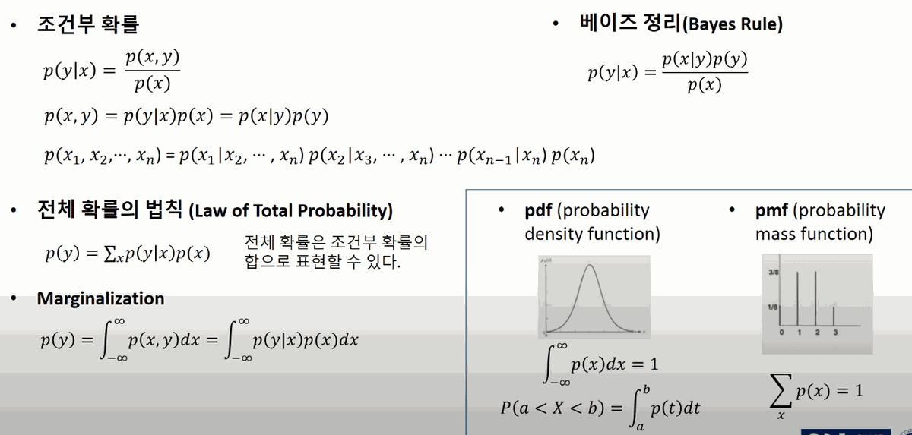
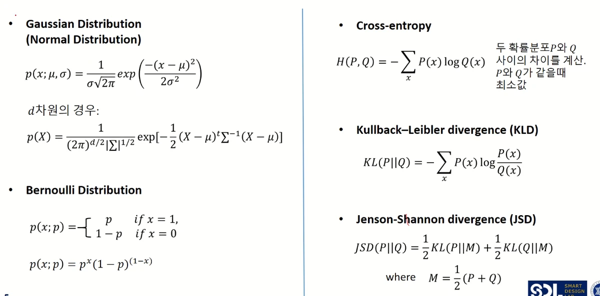
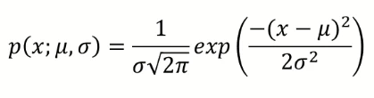
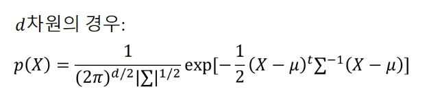
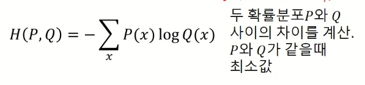
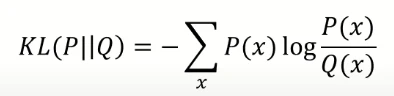
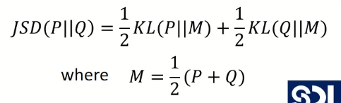
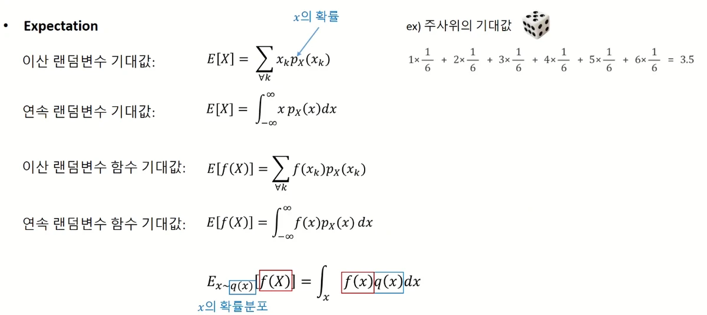
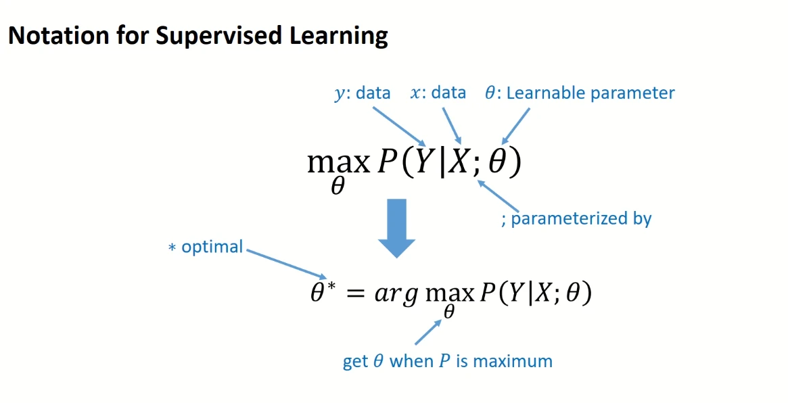
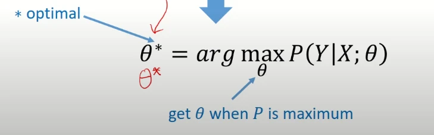

# Deep Learning 강의 > Ch3-1. 비지도학습 기초 A

[딥러닝 Ch3.1 비지도학습기초A](https://www.youtube.com/watch?v=V9HcvXliJmw&list=PLQASD18hjBgyLqK3PgXZSp5FHmME7elWS&index=5)

지도 학습에서는 확률적인 얘기가 많이 나오지 않는다. 하지만 비지도학습에서는 확률적인 개념이 들어가기 때문에, 확률에 대해 다시 한 번 확인해본다.

- **조건부 확률**

x가 일어났을 때, y가 일어날 확률은 x, y가 동시에 일어날 확률에서 x가 일어날 확률을 나누는 것.

이 식을 정리하면 아래와 같이 나타낼 수 있다.

$$
p(x,y) = p(y|x)p(x) = p(x|y)p(y)
$$

이때, 위의 식을 정리하여 다시 다음과 같이 만들 수 있다. 이를 **베이즈 정리**라고 한다.

$$
p(y|x) = \cfrac{p(x|y)p(y)}{p(x)}
$$

- **전체 확률의 법칙**(Law of Total Probability)

이 법칙은 예를 들면 아주 쉽게 설명될 수 있다. 주사위가 1이 나오고 동전이 앞면이 나올 확률, 주사위가 2가 나오고 동전이 앞면이 나올 확률, 주사위가 3이 나오고 동전이 앞면이 나올 확률, …, 주사위가 6이 나오고 동전이 앞면이 나올 확률을 모두 더하면. 그냥 동전이 앞면이 나올 확률이 된다는 뜻이다. 공식을 풀어보면 

$$
p(y|x)p(x)
$$

위의 식은 조건부 확률에 의해서 그냥 p(x|y). 두 사건이 동시에 일어날 확률과 같기 때문에 p(x, y)에서 모든 x의 경우를 다 더한 것이므로 그냥 p(y)와 같다.

- **Marginalization** (전체 확률의 법칙을 discrete가 아닌, continuous하게 나타낸 것.)
- PDF(Probability Density Function)

x가 continuous한 경우. 즉, x가 실수인 경우이다. 이런 경우 막대 그래프로 확률을 나타낼 수 있는 상황이 아니라 distribution의 형태로 나타내진다. 즉, y값이 확률을 의미하는 것이 아니므로 면적을 구해야만 한다. 이때의 모든 구간 내에서의 적분 값은 1이다.

PDF에서는 적분으로 확률을 구할 수 있기 때문에, 단일한 x값에 대한 확률을 구할 수는 없다. 대신 특정 구간 내에서의 확률을 구할 수 있게 된다.   
  
(단일한 x값에 대해서 확률을 구할 수는 있으나, 이것은 넓이가 없기 때문에 확률이 0이다!)

- PMF(Probability Mass Function)

x가 discrete한 경우. 쉽게 말하면 주사위이다. 주사위는 1, 2, 3, …, 6이 나올 확률을 막대 그래프로 나타낼 수 있다. 이러한 경우를 PMF라고 한다. PMF에서는 P(x)를 모두 더하면 1이 된다.

---

- 비지도 학습에서 가장 많이 나오는 확률 분포들

    - Gaussian Distribution(Normal Distribution)
    - Bernoulli Distribution

- Gaussian Distribution

    - Mean, Standard Deviation(표준편차) 값이 있는 경우.

    이런 경우에는 확률 분포를 아래와 같이 표현한다.

    $$
    p(x; \mu, \sigma)
    $$

    

    

- Bernoulli Distribution

    - 베르누이 분포는 동전 던지기로 볼 수 있다. 
    - 가우시안 분포가 평균과 표준 편차를 가졌다면, 베르누이 분포는 한 사건이 일어날 확률 p만 알면 된다. 다른 확률은 1-p이기 때문이다.

$$
p(x; p) = p^x(1-p)^{(1-x)}
$$

⇒ x가 1일 때는 p가 나오고, x가 0일 때는 1-p가 나온다.

비지도학습에서 많이 나오는 내용 중 하나가, 확률 분포 P와 Q가 같냐 틀리냐를 많이 체크한다. 이걸 계속해서 체크하게 된다. 예를 들어보자.

P는 실제 분포이고, Q는 예측하는 분포(Distribution)라고 하자. 실제 현상 P라는 예측을 맞추기 위해서, 우리는 Q를 학습한다. 나중에는 학습된 Q가 P와 얼마나 다른가를 평가하게 된다. 혹은 그 차이를 최소화하게 된다. 그럼 이 차이를 어떻게 표현할까?

- 표현 방법

    - Cross-entropy
    - kullback-Leibler divergence (KLD)
    - Jensen-Shannon divergence (JSD)

- Cross-entropy

    

    Cross-entropy 값이 작을수록 P, Q의 차이가 적어진다.

- kullback-Leibler divergence (KLD)

P와 Q의 차이에 대해서 얘기하는건 동일하다. 그런데 식이 Cross-entropy와 약간 다르다. 그런데, KLD는 P와 Q의 순서에 따라서 값이 달라지기 때문에 단점이 존재한다. 그래서 나온 것이 바로 JSD.

- Jensen-Shannon divergence (JSD)

이전에 사용된 KLD를 이용하여, 순서에 따른 차이를 제거한다.

이후에 비지도학습에서 수식을 유도할 때 위와 같은 값이 나온다.

---

- Expectation

    - 이산 랜덤변수 기대값 : 이산 랜덤변수 기대값은 나올 수 있는 눈의 값에 나올 확률을 곱한 것을 모두 더한 것이다. 이산 랜덤변수는 이와 같은 방식으로 구할 수 있다.
    - 연속 랜덤변수 기대값 : 연속 랜덤변수 기대값은 이산 랜덤변수처럼 구할 수 없으므로, 적분을 해주면 된다.

    - 이산 랜덤변수 함수의 기대값 : f(x)라고 계산한 값에다가, x가 나올 확률을 곱하고 모두 더해주면 된다. 예를 들어 f(x) = 2x이고, 주사위에 대한 기대값을 다루는 함수라면, 이전에 구한 이산 랜덤변수 기대값에서 각 항에 2를 곱해준 것과 결과가 같을 것이다.

        - 2\*1\*(1/6) + 2\*2\*(1/6) + … + 2\*6(1/6) = …

    - 연속 랜덤변수 함수 기대값 : 적분을 해주면 된다. 연속 랜덤변수 함수 기대값의 식 표현은 자주 나오며, 이 의미대로 해석하면 된다.

        x의 확률 분포가 q(x)를 따른다.

---

- 위의 식이 무슨 의미일까?

위의 확률을 Maximize해야 하는데, 이 확률은 X가 주어졌을 때 Y가 나올 확률이다. 그런데, 그 확률 분포의 Parameter가 Theta인 경우이다. Gaussian Distribution에서는 ;으로 mean과 standard deviation이 구분되었던 것처럼, 위의 예시에서는 ;으로 parameter theta가 구별되는 것이다.

즉, Learnable parameter theta를 학습하면, 내가 갖고 있는 데이터 X가 들어가면 Y값이 나오는 확률을 최대화 할 수 있도록 하는 것이다.

X라는 Image 데이터가 있으면, Y는 토끼라는 Label일 것이다. 이런 경우, X라는 Image 데이터가 들어왔을 때 Y가 토끼가 될 확률을 최대화 하는 것이다. 이때 Learnable parameter가 theta인 것이고, 여기에 필요한 parameter theta를 찾는 것이다. 이 parameter가 Neural Network로 표현될 수 있다.

⇒ 즉, 우리가 하는 것은 최적화된 parameter theta를 찾는 것인데, X가 들어왔을 때, 맞는 Label 값을 이야기 해 줄 수 있는 확률을 최대화 하는 것이다.

최적화에서는 theta를 &lt;**최적해**&gt;로 표현할 수 있다. 

Optimal한 theta는 theta\*라고 표현한다. 이 theta는 P를 maximize 할 수 있는 parameter이다.
