# Deep Learning 강의 > Ch.3-1 비지도학습 기초 B

## Maximum Likelihood

딥러닝에서 아주 중요한 개념으로, 이를 정확히 이해해야 지도학습/비지도학습의 원리를 정확히 이해할 수 있다.

전통적인 머신러닝 기법들을 살펴보면, 입력이 있고, 머신러닝 모델이 있고, 출력이 있게 된다. 이 과정에서 모델은 보통 f라는 함수로 나타낼 수 있는데, 그 모델의 parameter인 θ가 존재하게 된다.

이때 새로운 x가 들어왔을 때 그 모델을 통과해서 나오는 예측값이 나오게 되고, y는 그 데이터의 실제 값이 된다.

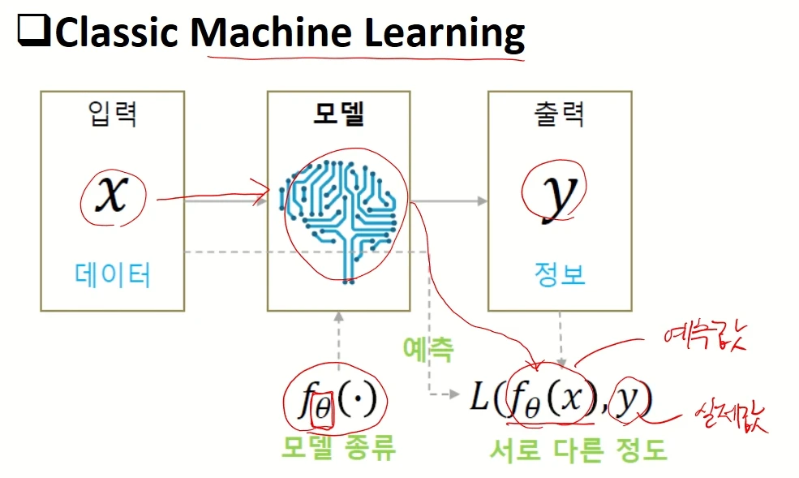

즉, 모델은 x만을 가지고 출력을 예측한 값과 실제 값(Label)을 구할 수 있게 된다. 이때 두 값이 서로 다른 정도를 얻어내는 것이 바로 Loss 함수이다. 머신러닝이 하는 일은, Loss함수가 구한 차이를 최소화 하는 parameter의 값을 구해내는 것이다. 일반적인 Neural Network라고 한다면, w, b가 θ가 되는 것이다.

그렇다면 우리가 하는 일은 무엇인가? 우리가 하는 것은 optimal한 θ를 구하는 것이다. 그 방법은 Loss function을 minimize하는 θ를 찾는 것이다. 즉, 주어진 데이터를 가장 잘 설명하는 모델을 찾는 것이 classical한 machine learning의 목적이다. 그렇게 되면 최적화된 θ를 가지고 f 함수를 만들 수 있고, 새로운 x가 들어왔을 때, 새로운 y값 출력을 예측할 수 있게 된다.

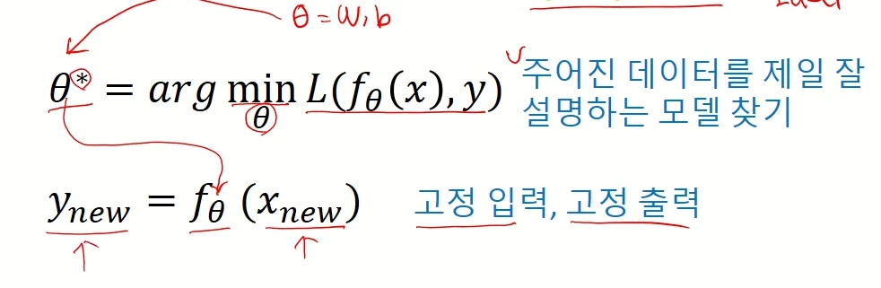

⇒ 이것이 Classical한 ML이다.

---

- Deep Neural Networks

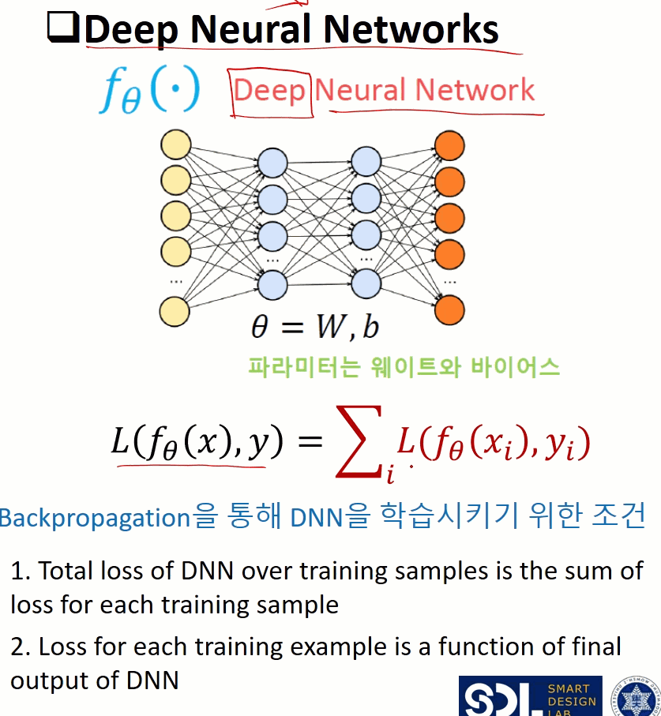

Deep Learning도 원리는 비슷하다. Hidden Layer가 두 개 이상 있는 경우를 Deep Learning이라고 하는데, 추가적인 부분은 Input Data가 굉장히 많을 것인데, 여기에서 Loss값은 모든 input에 대한 Loss를 더한 값이다.

Neural Network는 Backpropagation을 하게 되는데, 사실 항상 Backpropagation을 할 수 있는 것은 아니다. 특별한 가정이 있을 때만 가능하다.

- **Backpropagation의 가정**

    1. Total loss of DNN over training samples is the sum of loss of each training sample  
        ⇒ DNN의 총 loss는 모든 데이터의 loss에 대한 합으로 표현되어야 한다.
    2. Loss for each training example is a function of final output of DNN  
        ⇒ 최종적으로 나온 output을 바탕으로 Loss function을 만들어야 한다.

---

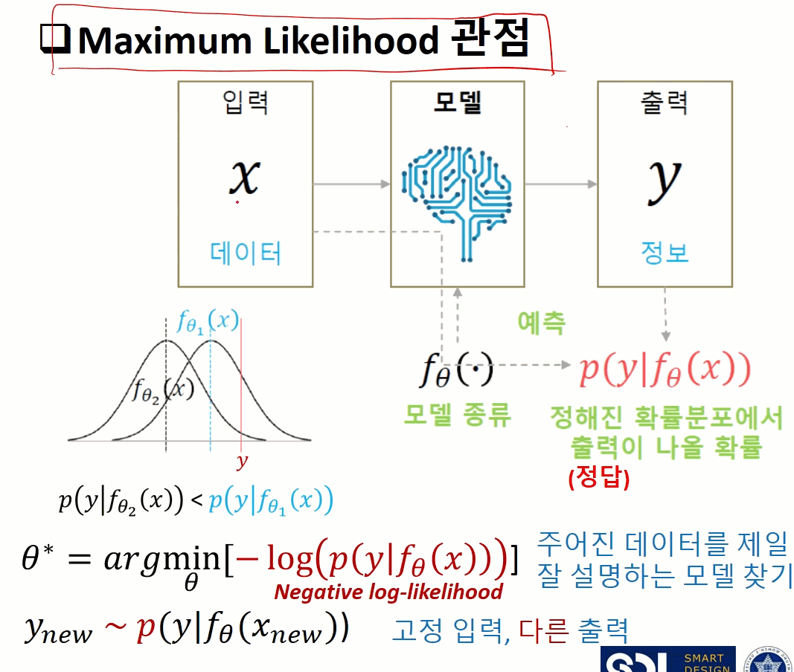

- Maximum Likelihood 관점에서 바라본 Loss Function

Neural Network와 Deep Neural Network는 Loss Function을 만드는 방법은 동일하다. 하지만, Maximum Likelihood 관점에서 바라보면 function을 통해 나오는 출력은 단일 스칼라 값이 아니라, `확률`로 나오게 된다. 즉, 아래와 같이 표현이 된다.

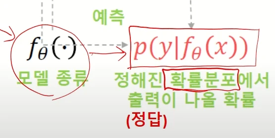

fθ(x)가 주어졌을 때, 거기서 y가 나올 확률이 output이 된다. 이전에는 아래와 같은 결과가 나왔었다.

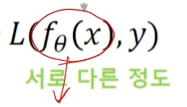

이와 같이 x가 fθ(x)에 들어가면, 바로 y에 대한 예측값이 나와서 바로 Label과 비교가 가능했다. 하지만, Maximum Likelihood 관점에서는 y일 확률이 나오는 것이다.

기존의 Classical한 ML에서는 x가 모델에 들어가면 항상 하나의 Scalar 값이 나온다고 생각을 했는데, 이제는 모델을 통과한 output이 Scalar 값이 아니라 어떠한 확률 분포로 나오게 된다는 것이다. 즉, 어떠한 Distribution이 나오게 된다.

예를 들어, fθ(x)를 학습시켰더니, fθ1(x), 또는 fθ2(x)가 되었다고 한다면, 이건 확률 분포인 것이다. 

이 경우에는 기존의 Loss function이 `Negative log-likelihood`라는 function으로 나타나게 된다.

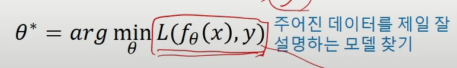

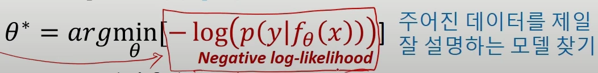

위의 이미지에서 L(…) 부분이 바로 이전의 Loss Function이었다면, Maximum Likelihood 관점에서는 아래 이미지의 형태인 Negative log-likelihood 형태로 간다. 즉, 저 값을 minimize 할 수 있는 최적화된 θ를 구하게 되는데, 우리는 결국 확률 분포를 구하게 되는 것이다.

새로운 x가 들어왔을 때, y가 나오는 확률 분포를 얻게 되는 것이다!

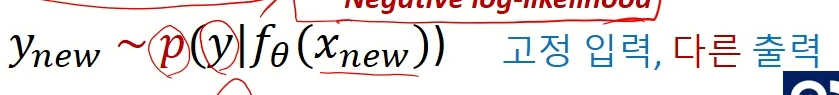

그러므로, 이제는 고정적인 입력이 나와도 y에 대한 확률 분포가 나와서 sampling을 할 수 있게 된다. 내가 어디서 sampling을 하느냐에 따라서 y값이 달라지게 되는 것이다. 즉, min에 해당하는 y값이 나올 확률이 가장 높을 것이고 양쪽 끝단으로 갈수록 확률은 낮아질 것이지만, 나올 수는 있다.

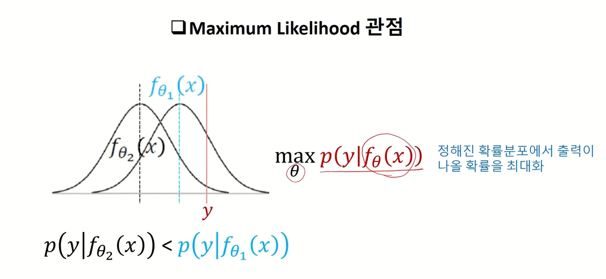

- 확률을 Maximization 하는 θ를 찾는게 무슨 의미인가?

주어진 모델에 x를 넣었을 때, y가 나올 확률. (y는 실제 값)

실제값이 위의 분포 상에서 수직선 y라고 할 때, 학습이 fθ2(x)로 되었다고 한다면, 이 확률 분포에서 Sampling 했을 때 y가 나올 확률은 **매우 작다**!

그런데 더 학습을 시켰더니, 확률 분포가 fθ2(x)가 되었다. 그랬을 때, true y값(ground y)이 나올 확률이 높아졌다. 즉, fθ2(x)보다 fθ1(x)에서 y가 나올 확률이 더 크다. 이 말은, 계속 최적화를 해서 어떤 확률 분포가 나오는 것이 최고가 되는 것일까? 바로, **y가 mean값이 되는 확률 분포**이다.

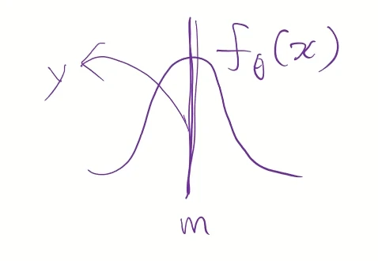

⇒ 이렇게, 확률론적으로 y가 나올 확률이 m이 되도록 분포를 찾는 것이 Maximum Likelihood 관점.

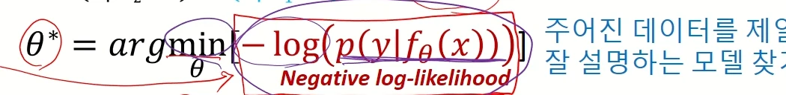

그런데, 위에서는 y가 나올 확률을 Maximization 했으면서 왜 Negative log-likelihood로 만드는가?

---

## Negative log-likelihood

⇒ i.i.d : independent and identically distributed

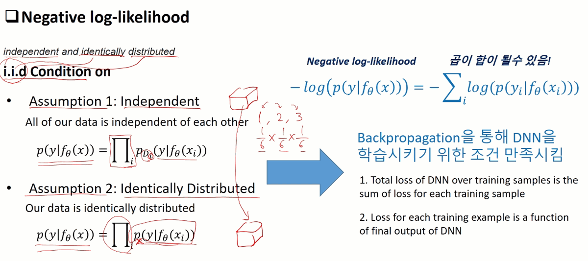

- Assumption 1 : **independent**

    All of our data is independent of each other, 모든 데이터들이 서로 독립인 경우.  
    예를 들어 주사위에서 각 눈이 나올 확률은 서로 독립적이기 때문에, 세 개가 동시에 나올 확률을 구하려면 곱해주면 된다. (ex. 주사위에서 1이 나올 확률, 그리고 2, 3이 나올 확률은 1/6 * 1/6 * 1/6이 된다.)

- Assumption 2 : identically Distributed

    Our data is identically distributed, 어떤 데이터이든 시간에 따라 확률이 바뀌지 않고 분포가 동일하다는 것.

- Negative log-likelihood의 장점 

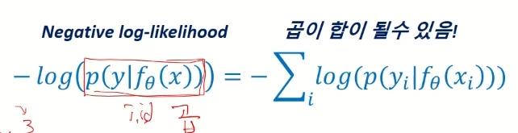

식이 곱셈으로 나타나면 미분이 어렵지만, 합으로 나타나면 미분이 쉬워진다. 즉, 곱미분이 어렵지만, 합미분은 쉬운 것.

⇒이 때문에 Backpropagation이 가능해진다. 왜냐면, Backpropagation의 조건이, Total loss가 training sample들의 loss의 합이었다. 이런 조건을 만족시키려면 반드시 Negative log-likelihood를 만족해야만 한다.

---

## Maximum Likelihood를 바탕으로한 딥러닝의 기본 과정

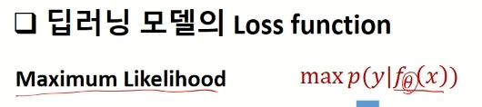

Maximum Likelihood 관점에서 보면, 내 함수(모델)가 fθ(x)이다. 내 모델의 parameter가 θ일때, 이 모델에서 실제 True 값인 (Ground true) y가 나올 확률이 가장 커지도록 θ를 구하는게 바로 **Maximum Likelihood**이다.

이렇게 될 경우 i.i.d condition에 따라 계산을 하면 데이터 별로 확률을 곱해줘야 하는데, 곱해주지 않기 위해서 더해주는 역할을 하고자 Negative log-likelihood를 써서 y가 나올 확률을 Maximize 하기 위한 θ를 찾는 것이 Negative log-likelihood를 Minimize 하는 것과 같아진다.

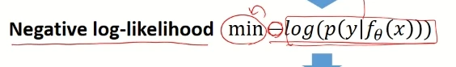

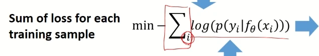

그래서, 여기까지 왔을 때 Backpropagation이 가능해진다.그래서, Loss 값을 어떻게 계산할 것인가? Loss값을 계산하기 위해서는 Likelihood의 분포를 가정해야만 한다.

- Case 1) Gaussian distribution ⇒ 항상 MSE로 Loss 계산
- Case 2) Categorical distribution(베르누이 분포) ⇒ Cross-Entropy Loss

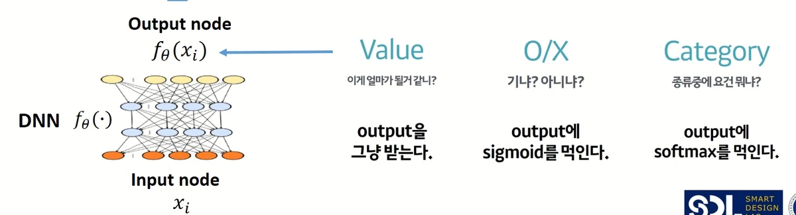

결국, 내가 DNN을 가지고 있을 때, input이 fθ(x)를 통과를 하면, output이 나오게 된다. 이 값을 통해서 Sum of loss for each training sample을 계산한다. 이 값은 Scalar 값이 아니라, 어떠한 Distribution으로 값이 나오게 된다.

- Activation

만약 딥러닝을 하는 목적이 어떠한 Value 값을 얻기 위해서라면 마지막에 Activation Function을 사용하지 않고 Output을 사용한다.

**혹은 O/X. 즉, Binary Output인 경우에는 sigmoid Active Function을 통과시켜야 한다.**  
⇒ 이상인지 정상인지를 판별하는 경우가 여기에 속한다.

혹은 Category. Input의 종류를 구별하는 것이라면 output에 softmax를 적용하면 나타낼 수 있다.

---

- 가정한 분포가 Gaussian Distribution일 때 Loss가 MSE가 되고, Bernoulli distribution일 때는 Cross-Entropy가 되는 이유를 살펴보자.

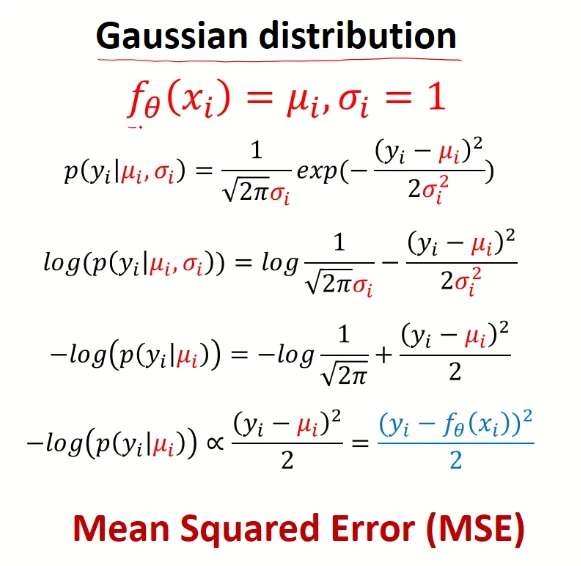

Gaussian Distribution에서는 Output이 μ값과 σ값이면 되는 것이다. 즉, input이 나의 모델(함수)을 통과한 결과로 μ, σ가 나오면 된다. 

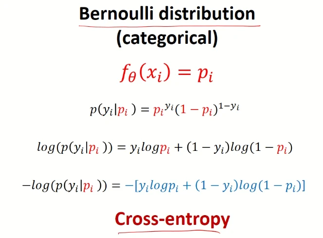

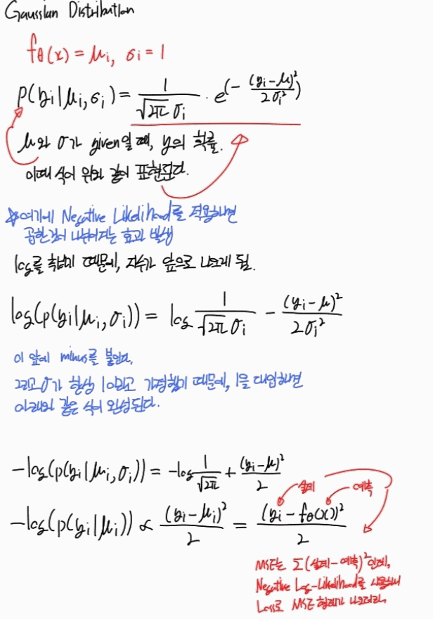

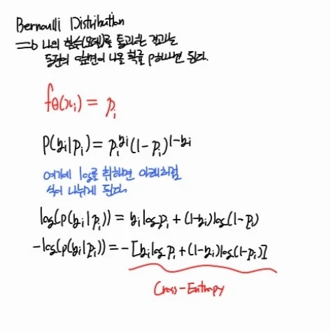

---

- 그동안에 자주 사용되던 지도학습 모델은 분류하는 모델이었다. 그런데 이와 반대로, 만약 개와 고양이를 생성할 수 있는 모델이 있다면 그것은 데이터를 더욱 정확히 설명하고 있다고 말할 수 있을 것이다.

- Generative Model의 목적은 실제 내가 가진 데이터의 확률 분포와 동일한, 가장 가까운 확률 분포를 학습하는 것이다.

    - Pdata(x)를 만들어낼 수 있는 Pmodel(x)를 찾아내는 것.

- Pmodel(x)를 찾기위한 가정

    - Explicit density estimation : Gaussian을 따른다고 가정하고 P를 찾는 것.
    - Implicit density estimation : 특정한 확률 분포를 따른다고 가정하지 않고 P를 찾는 것.

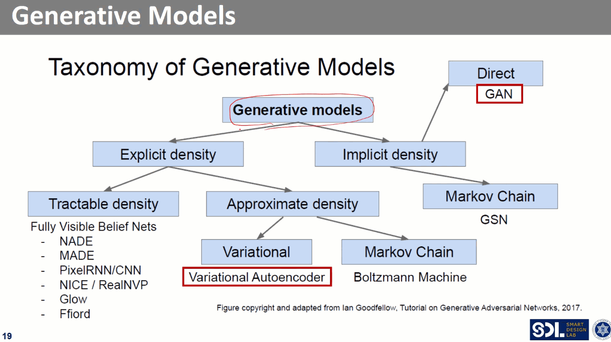

- Generative Model은 Density를 정확히 Define하는 것과 Define하지 않는 것으로 나눌 수 있다.

    - 그 중 가장 대표적인 방법이 Variational Autoencoder이다.

- Density를 Define하지 않고 만드는 방법 중 가장 대표적인 것은 GAN이다.

---

- Why Generative Models?

    - Generative Model은 특정한 이미지 등을 만들어낼 수도 있을 뿐만 아니라, Time-Series Data까지 만들어낼 수 있다.
    - 가장 중요한 Generative Model의 목적은 바로 **차원 축소**이다. (Manifold Learning)

---

- Curse of dimensionality

차원이 증가할수록 데이터의 분포분석 또는 모델 추정에 필요한 샘플 데이터의 개수가 기하급수적으로 증가하게 된다.

예를 들어, 1차원에서 10칸으로 나뉘어진 데이터가 있다면. 우리는 그 중 6개만 있어도 데이터의 60%를 설명할 수 있다. 하지만 이것이 2차원이 되면 60%를 설명하기 위해서 60개의 데이터가 필요하게 된다. 마찬가지로 3차원이 된다면 60%를 설명하기 위해서 600개의 데이터가 필요하다.

그런데, 실제 데이터의 분포를 살펴봤더니. 대부분이 비어있고 오히려 데이터가 특정한 저차원의 Manifold에 위치해있다는 것을 알 수 있었다. 즉, 데이터가 3차원인 것 같지만, 사실은 2차원 평면에 위치한 데이터처럼 볼 수 있다는 것이다.

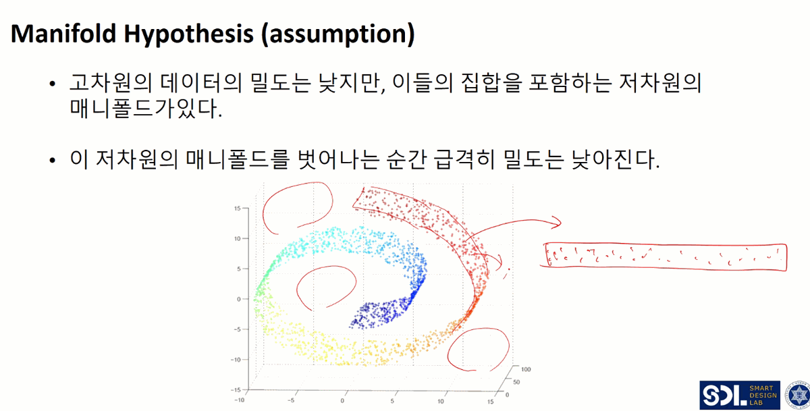

즉, 이러한 Manifold를 찾을 수만 있다면 그 Manifold 상에서 데이터를 분석할 수 있다는 것을 알 수 있다.

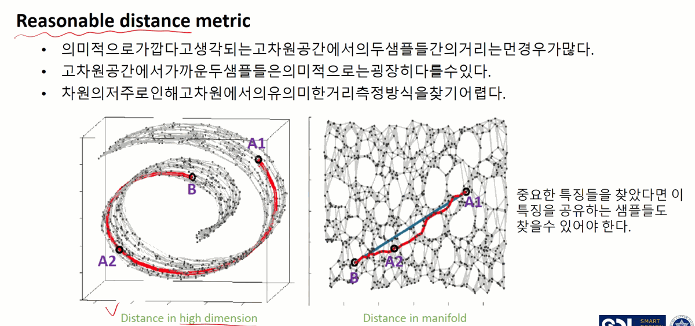

저차원의 Manifold에서는 의미있는 거리를 분석할 수 있다. 보통 거리가 같으면 그 데이터가 유사할 확률이 높다. 3차원(High Dimension)에서 살펴보면, A1, B가 비슷하고, A1, A2가 굉장히 다른 데이터라고 생각할 수 있다. 하지만 Manifold 상에서는 A1, A2가 더 가깝고, A1, B가 더 먼 것을 볼 수 있다.

⇒ 그래서 실제로는 Manifold 상에서의 거리가 더 중요하다. 즉, 데이터의 실제 특성을 알아내기 위해서는 Dimensionality Reduction이 가장 중요하다.
