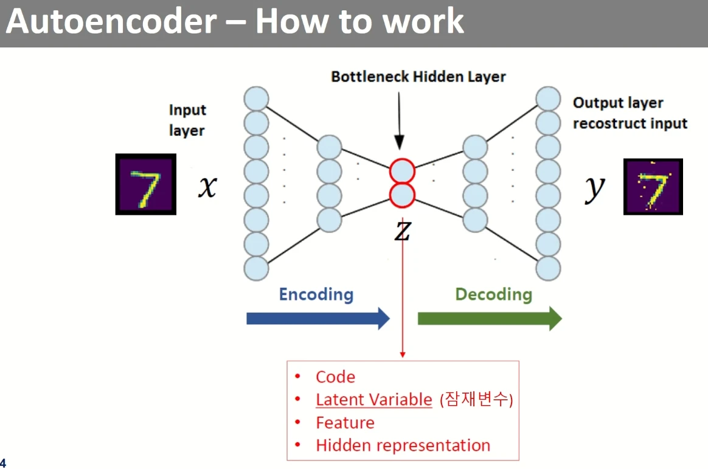
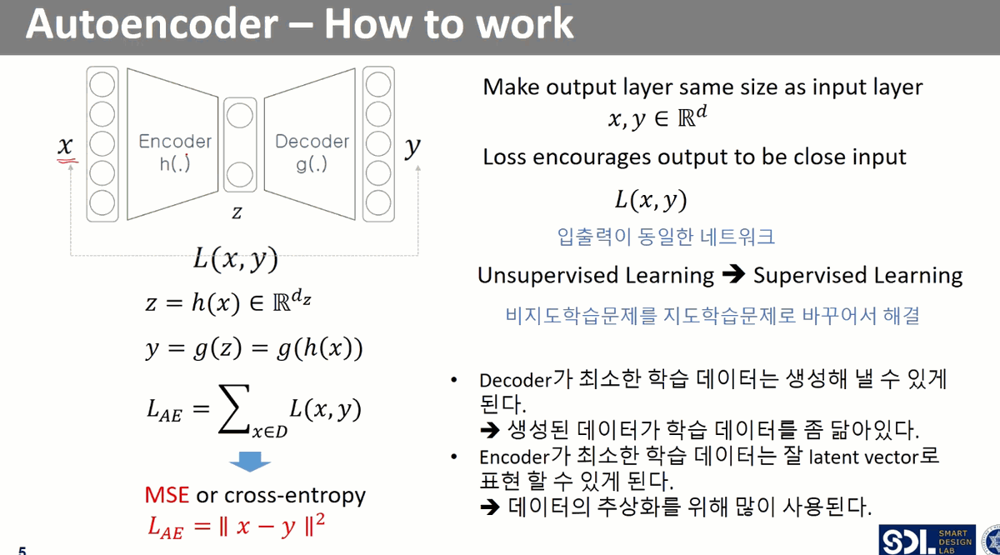
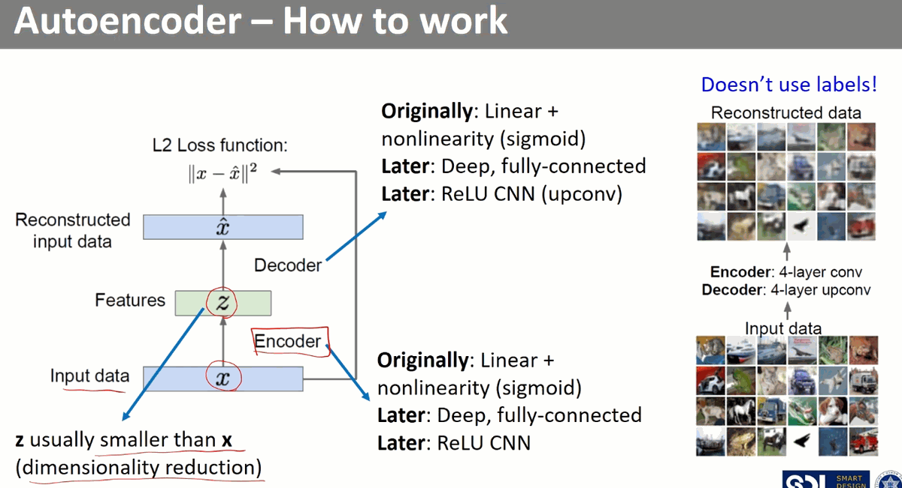
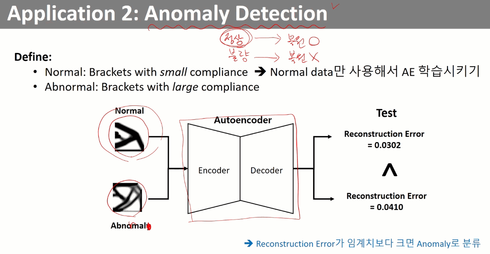
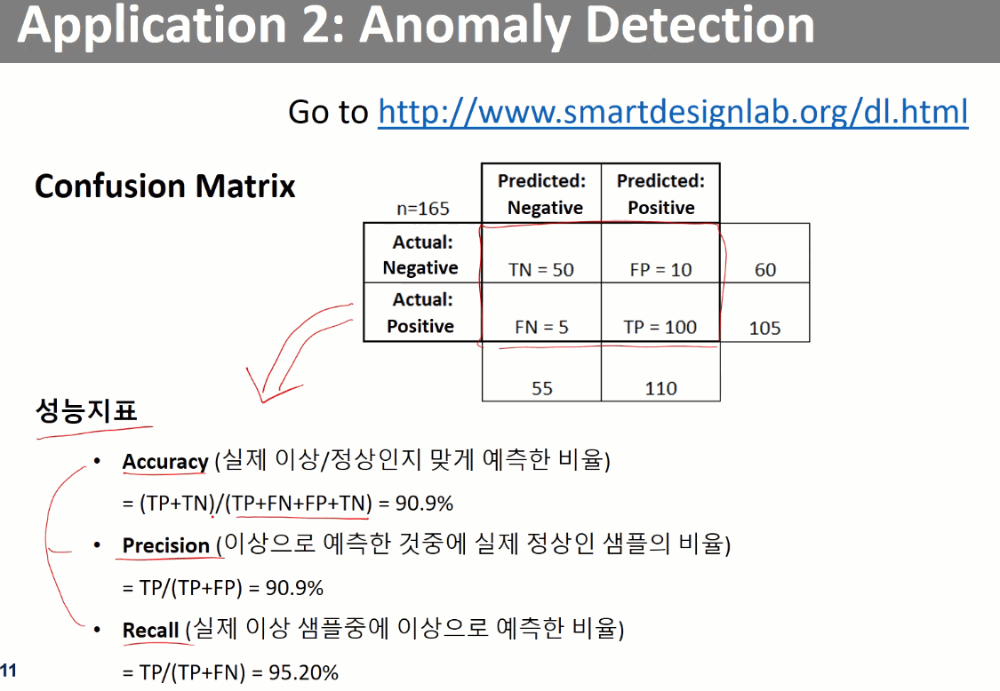

# Deep Learning 강의 > Ch.3-2 Autoencoder & Anomaly Detection

- Autoencoder는 Input과 Output이 동일한 Deep Learning Model이다.

    - 예를 들어, MNIST 데이터에 대해서 Autoencoder를 적용한다면, 중간 과정에서 Encoding을 통해서 저차원으로 압축을 하게 된다. (Dimensionality Reduction)
    - 이렇게 압축된 것을 Decoding 시켜서 결국에는 y가 나오게 되는데, 그 y가 x와 동일한 값이 나오게 만들면 된다.

    - 이때 중간에 있는 Bottleneck Hidden Layer를 아래와 같은 용어로 부르기도 한다.

        - Code
        - Latent Variable (잠재 변수)
        - Feature
        - Hidden Representation

- Encoding → Decoding을 거쳐서 원래 데이터를 복원할 수 있다는 것은, Z가 아주 중요한 데이터를 함축하고 있다는 의미로 볼 수 있다.

x라는 input이 Encoder를 거쳐서 Z가 되고, 이것이 다시 Decoder를 거쳐서 y가 나오게 된다. 이때 x와 y가 동일하게 만들어지도록 하는 것이 바로 Autoencoder이다.

$$
z = h(x)
$$

$$
y = g(z) = g(h(x))
$$

x는 encoder를 통해서 Z가 되고, 다시 decoder를 거쳐서 Z가 된다.

Autoencoder의 Loss function은 Loss x와 y의 차이이고, Dimension에 따라서 계산을 하게 될 것이다. 예를 들어 이차원 데이터라면, 각 픽셀에 대하여 데이터를 비교하면 전체 그림이 얼마나 동일한지 그 차이를 구할 수 있을 것이다.

⇒ 이런 경우에 Loss function은 어떤 모양이 되는가? 가장 간단한 것은 각 픽셀의 값의 차이를 구하는 것이므로, MSE를 쓰면 가장 편하다. 하지만 Maximum Likelihood 관점에서 보면, 확률 분포가 Normal Distribution을 따르면 MSE를 쓸수도 있지만, 만약 Bernoulli Distribution을 쓴다면 Cross-Entropy를 쓸 수도 있을 것이다.

VAE에서는 MSE와 Cross-Entropy 두 개를 동시에 쓰기도 한다. 하지만 보통은 Autoencoder에서 MSE를 쓰기도 한다.

Autoencoder 문제는 비지도학습문제이지만, 사실은 자기 자신을 Label로 사용하여 지도학습문제로 바꾸어서 해결하는 방식이라고도 볼 수 있다.

이 방식을 이용하면 Encoder와 Decoder를 통해서 최소한 학습 데이터는 생성해 낼 수 있게 된다.

**사실 Autoencoder는 Decoder가 중요한게 아니라, Encoder를 쓰려고 만든 것이다. 그래서 Decoder의 성능은 좋지 않고, 데이터를 압축하는 용으로 사용한다고 생각해야 한다.**

⇒ 즉, 데이터의 추상화를 위해 많이 사용하게 된다.

---

- input data x가 있으면, Encoder를 통해서 Z로 압축을 시킨다. 당연히 Z는 x보다 차원이 작다.
- 그리고 다시 Decoder를 지나서 Z가 y로서 출력이 나오게 되는데, 이때 x와 y의 차이가 최소가 되도록 만들어야 한다.
- 이때 Encoder와 Decoder는 보통 Linear + Nonlinearity (sigmoid)를 합친 형태였다가, 최근에는 Deep, fully-connected나 ReLU CNN 구조로 구현이 되고 있다.

⇒ 이렇게 해서 나오게 되는게 Convolutional AE라고 해서, CAE라고 불리운다. 이미지의 Classification에서 CNN의 성능이 아주 좋았던 것처럼, 이미지를 압축할 때도 CAE의 성능이 매우 잘 나온다.

---

## Applications of Autoencoder

1. Supervised Learning
2. Anomaly Detection(이상 탐지)

만약에 공장에서 제품을 생산할 때, 항상 불량인 제품이 만들어지게된다. Autoencoder가 정상 데이터만 학습을 하면, 정상 데이터에 대해서는 복원이 잘 되지만, 불량 데이터에 대해서는 복원이 잘 되지 않게 된다.

정상 데이터만 학습했기 때문에, 정상 데이터를 복원했을 때는 Reconstruction Error가 작게 나오고, 기존과 다른 유형에 대해서는 Reconstruction Error가 크게 나온다. 즉, 복원이 잘 되지 않게 된다.

Reconstruction Error가 Threshold보다 크면 Abnormal로 분류하는 것이 Anomaly Detection이다.

보통의 경우, 아무리 많은 데이터가 있어도 비정상 데이터는 많지 못하다. 하지만 Anomaly Detection을 사용하면 정상 데이터만을 사용해서 비정상을 검출할 수 있다는 장점이 있다.

- Anomaly Detection의 성능 분석 : Confusion Matrix

    - 예측한 것도 정상(Negative)이고, 실제로도 정상(Negative)이면 TN(True Negative)
    - 예측한 것은 비정상(Positive)이나, 실제로는 정상(Negative)이면 FP(False Positive)
    - 예측한 것은 정상(Negative)이나, 실제로는 비정상(Positive)이면 FN(False Negative)
    - 예측한 것은 비정상(Positive)이고, 실제로도 비정상(Positive)이면 TP(True Positive)

    ⇒ 예측을 기준으로 설명함. 이것을 보면, Autoencoder가 어느 경우에 대해서 잘 못맞추고 잘 맞추는지 확인할 수 있게 된다.

- Accuracy : 실제 이상/정상을 맞게 예측한 비율

    - (TP + TN) / (TP + FN + FP + TN)

- Precision : 이상으로 예측한 것 중에 실제 이상인 샘플의 비율

    - TP / (TP + FP)

- Recall : 실제 이상 샘플 중에서 이상으로 예측한 비율

    - TP / (TP + FN)
