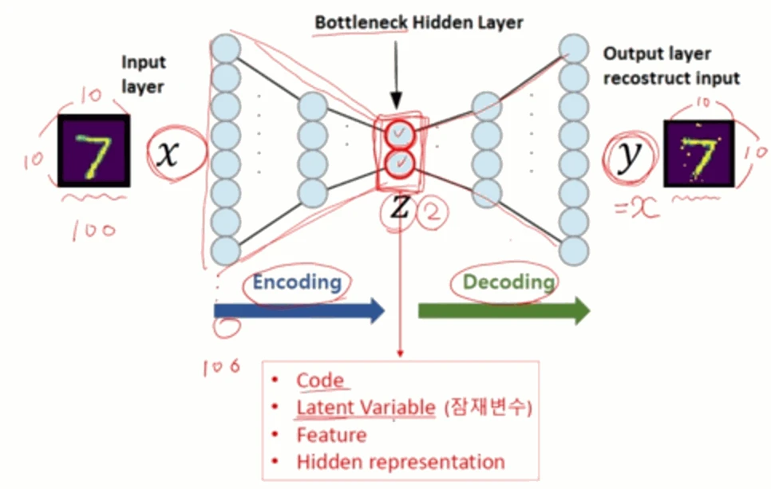
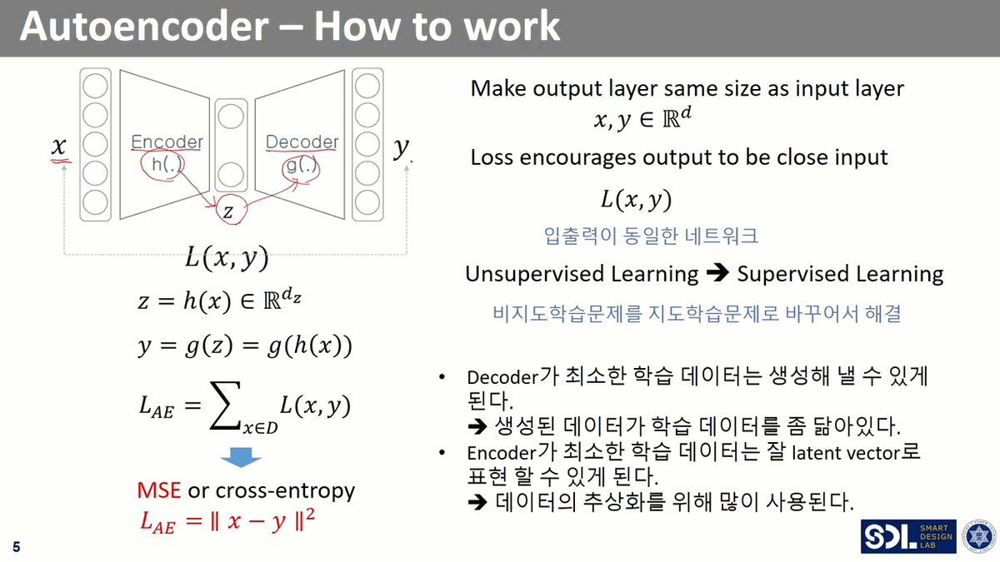
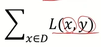
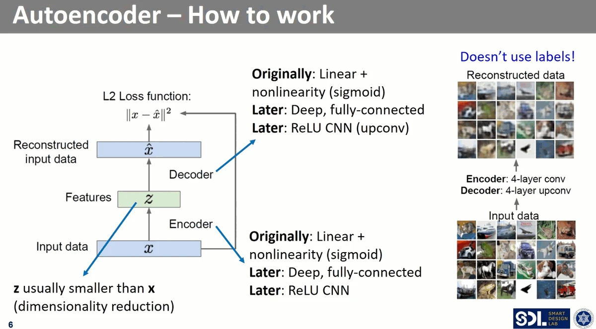

# Deep Learning 강의 > Autoencoder & Anomaly Detection

- 고차원 데이터를 저차원으로 압축하게 된다. (Encode)
- 이후에는 압축한 데이터를 다시 확장해서, 기존의 값과 동일한 값이 나오도록 만든다.

- Bottleneck Hidden Layer를

    - Code
    - Latent Variable (잠재 변수)
    - Latent Space
    - Feature
    - Hidden Representation

    등으로 부르게 된다.

---

- 이 저차원 데이터(Latent Space)를 그대로 복원(Decode)하게 되는데, 이것이 원본 데이터와 동일하다는 의미는, 이 저차원 정보가 굉장히 중요한 정보를 압축해서 담고 있었다는 의미가 된다.

    - 차원 축소(차원 축소를 할 수 있는 가장 기본적 모델이 Autoencoder)

- Loss Function : L(x, y)

z는 x를 encode h에 넣어서 나온값. h(x)

y는 decoder g에다가 z를 다시 넣어서 나온 값. 그러므로, y = g(h(x)) 가 된다.

- Autoencoder의 Loss Function

    - L(AE) : LossX와 Y의 차이이다.

    

    예를 들어 x, y의 픽셀이 각각 있다면, 대응되는 위치에 대하여 비교해서 차이값을 구하면 된다. 그러므로 MSE(Mean Squared Error)를 이용하면 가장 편리할 것이다. 

    하지만, 좀 더 고차원적으로 Deep Learning의 Loss Function을 구할 수도 있다.

    - Maximum likelihood 관점에서 볼 때, 확률 분포가 Normal Distribution을 따르면 MSE로 구할 수도 있다.
    - 만약에 확률 분포가 베르누이를 따르면 Cross-entropy 방식으로 구할 수도 있다.

    ⇒ 그런데, MSE가 좀 더 직관적이기는 하다. 하지만 Cross-entropy의 사용도 가능하다. 이 두 가지를 동시에 사용할 수도 있다.

- Autoencoder는 입/출력이 동일한 네트워크이다. 

- 비지도학습이지만, Label을 제공하지 않고 그 Label을 Input값으로 바꿔 지도학습문제로 해결함.

    - 즉, Input Data 자체를 Label로 사용하는 것.

- Autoencoder는 사실 Encoding 용으로 만든 것이기 때문에, Decoding의 성능이 좋지는 않다. 그러므로 Autoencoder는 데이터를 압축하는 용이라고 생각해야 된다.

---

- Input Data x가 존재하면, x를 z(Latent Space)로 Encoding(Compression)한다.

    - 이때 z의 dimension은 x보다 작을 것이다.

- 이렇게 얻어진 z값을 Decoding 하고, 이렇게 나온 Output Data y의 값과 Input Data x의 값이 차이가 없도록 학습하게 된다.

    - 이 과정에서 MSE를 사용하기 때문에 L2 Loss Function을 사용한다.

- Encoder는 초반에는 Linear + nonlinearity (sigmoid) 를 합친 일반적인 Neural Network 방식.
- 최근에는 Deep하게 쌓아서 Deep Neural Network (Fully-Connected)를 만들었음.
- 그 후에는 CNN이 발전을 하면서, ReLU, CNN 구조로 Encoder를 만들게 되었음.

- Convolutional AE (CAE)

    - Autoencoder에 Neural Network를 사용하지 않고, CNN을 사용함.
    - **이미지의 압축에서는 CAE가 성능이 굉장히 좋다.**
