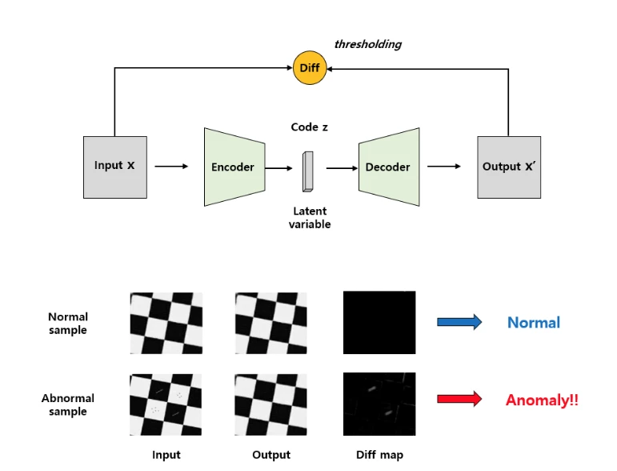

# About Anomaly Detection

[Anomaly Detection 개요： [1] 이상치 탐지 분야에 대한 소개 및 주요 문제와 핵심 용어, 산업 현장 적용 사례 정리](https://hoya012.github.io/blog/anomaly-detection-overview-1/)

Anomaly Detection은 학습 데이터 셋에 비정상적인 Sample이 포함되는지, 각 Sample의 label이 존재하는지, 비정상적인 Sample의 성격이 정상 Sample과 어떻게 다른지, 정상 Sample의 Class가 단일 Class인지 Multi-Class인지 등에 따라 다른 용어를 사용하게 된다.

이와 관련하여 학계에서 다뤄지고 있는 용어들을 정리해보자.

## 1. 학습시 비정상 Sample의 사용 여부 및 Label 유무에 따른 분류

- **Supervised Anomaly Detection**

    주어진 학습 데이터 셋에 **정상 sample**과 **비정상 sample**의 **Data와 Label**이 모두 존재하는 경우, Supervised Learning 방식이기 때문에 **Supervised Anomaly Detection**이라고 부른다.

    Supervised Learning 방식은 다른 방법 대비 정확도가 높은 특징이 있다. 그래서 높은 정확도를 요구로 하는 경우에 주로 사용되며, 비정상 Sample을 다양하게 보유할수록 더 성능이 좋다.

    하지만 Anomaly Detection이 적용되는 일반적인 산업 현장에서는 정상 sample보다 비정상 sample의 발생 빈도가 현저히 적기 때문에 **Class-Imbalance(불균형)** 문제가 자주 발생한다. 이러한 문제를 해결하기 위해 **Data Augmentation(증강)**, **Loss Function의 재설계**, **Batch Sampling** 등 다양한 연구가 진행되고 있다.

    - 장점 : P/N 판정 정확도가 높다.
    - 단점 : 비정상 Sample을 취득하는데 시간과 비용이 많이 든다. Class-Imbalance 문제를 해결해야 한다.

- **Semi-supervised (One-Class) Anomaly Detection**

    Class-Imbalance가 매우 심한 경우 정상 Sample만 이용해서 모델을 학습하기도 하는데, 이 방식을 One-Class Classification(혹은 Semi-supervised Learning)이라고 한다. 이 방법론의 핵심 아이디어는 정상 sample을 둘러싸는 discriminative boundary를 설정하고, 이 boundary를 최대한 좁혀 boundary 밖에 있는 sample들을 모두 비정상으로 간주하는 것이다. [One-Class SVM](https://www.jmlr.org/papers/volume2/manevitz01a/manevitz01a.pdf)이 One-Class Classification을 사용하는 대표적인 방법론으로 알려져 있으며, 이 아이디어에서 확장해 Deep Learning을 기반으로 One-Class Classification 방법론을 사용하는 [Deep SVDD](http://data.bit.uni-bonn.de/publications/ICML2018.pdf) 논문이 잘 알려져 있다.

    - 이 외에도 다양한 방법론들이 적용되고 있다. (자세한 내용은 상단 북마크 참고)
    - 장점 : 비교적 활발하게 연구가 진행되고 있으며, 정상 sample만 있어도 학습이 가능하다.
    - 단점 : Supervised Anomaly Detection 방법론과 비교했을 때, 상대적으로 P/N 판정 확정도가 떨어진다고 볼 수 있다.

- **Unsupervised Anomaly Detection**

    위에서 설명한 Semi-supervised Anomaly Detection은 정상 sample이 필요하다. 수많은 데이터 중에서 어떤 것이 정상 Sample인지 알기 위해서는 반드시 정상 Sample에 대한 Label을 확보하는 과정이 필요하다. 이러한 점에 주목해, 대부분의 데이터가 정상 sample이라는 가정을 취득하여 Label 취득 없이 학습을 시키는 Unsupervised Anomaly Detection 방법론도 연구가 이루어지고 있다.

    가장 단순하게는 주어진 데이터에 대해 Principal Component Analysis(PCA, 주성분분석)을 이용하여 차원을 축소하고 복원을 하는 과정을 통해 비정상 Sample을 검출할 수 있다. Neural Network 기반으로는 대표적으로 Autoencoder 기반의 방법론이 주로 사용되고 있다. Autoencoder는 입력을 code 혹은 latent variable로 압축하는 Encoding과, 이를 다시 원본과 가깝게 복원해내는 Decoding 과정으로 진행이 되며 이를 통해 데이터의 중요한 정보들만 압축적으로 배울 수 있다는 점에서 데이터의 주성분을 배울 수 있는 PCA와 유사한 동작을 한다고 볼 수 있다.

    

    Autoencoder를 이용하면 데이터에 대한 Labeling을 하지 않아도 데이터의 주성분이 되는 정상 영역의 특징들을 배울 수 있다. 이때, 학습된 Autoencoder에 정상 Sample을 넣어주면 위의 그림과 같이 잘 복원을 하므로 input과 output의 차이가 거의 발생하지 않는 반면, 비정상적인 Sample을 넣으면 Autoencoder는 정상 Sample처럼 복원하기 때문에  Input과 Output의 차이를 구하는 과정에서 차이가 도드라지게 발생하므로 비정상 Sample을 검출할 수 있게 된다.

    다만 Autoencoder의 coder size(= latent variable의 dimension) 같은 hyper-parameter에 따라 전반적인 복원 성능이 좌우되기 때문에, 양/불 판정 정확도가 Supervised Anomaly Detection에 비해 다소 불안정 하다는 단점이 존재한다. 또한 Autoencoder에 넣어주는 input과 output의 차이를 어떻게 정의할 것인지 (= 어떤 방식으로 difference map을 계산할지) 어느 loss function을 사용해 autoencoder를 학습시킬지 등 여러 가지 요인에 따라 성능이 크게 달라질 수 있다. 이렇듯 성능에 영향을 주는 요인이 많다는 약점이 존재하지만, 별도의 Labeling 과정 없이 어느정도 성능을 낼 수 있다는 점에서 장단이 뚜렷한 방법론이라고 할 수 있다.

    - Autoencoder 기반 Unsupervised Anomaly Detection을 다룬 논문들은 다음과 같다.

    [https://arxiv.org/pdf/1807.02011.pdf](https://arxiv.org/pdf/1807.02011.pdf)

    [https://arxiv.org/pdf/1804.04488.pdf](https://arxiv.org/pdf/1804.04488.pdf)

    [https://www.mvtec.com/fileadmin/Redaktion/mvtec.com/company/research/mvtec_ad.pdf](https://www.mvtec.com/fileadmin/Redaktion/mvtec.com/company/research/mvtec_ad.pdf)

    - 장점 : Labeling 과정이 필요하지 않다.
    - 단점 : P/N 판정 정확도가 높지 않고, hyper parameter에 매우 민감하다.

- Autoencoder 기반의 Anomaly Detection 방법론을 다룬 블로그 게시글

    [Autoencoder based Anomaly Detection - Ki's blog](https://kh-kim.github.io/blog/2019/12/15/Autoencoder-based-anomaly-detection.html)

---

- 정리

Unsupervised Anomaly Detection 방식에서는 Autoencoder 기반 방법이 적합하다. Autoencoder 기반 방법들은 큰 틀은 비슷하고, 일부 적용되는 방법론에 차이가 있다.
