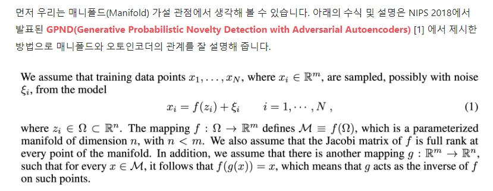
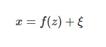

# About Anomaly Detection using AE

[Autoencoder based Anomaly Detection - Ki's blog](https://kh-kim.github.io/blog/2019/12/15/Autoencoder-based-anomaly-detection.html)

오토인코더는 입력을 그대로 출력(복원)해내도록 하는 목적 함수를 갖는다. 따라서 보통 MSE 손실 함수를 사용하며, 중간에 bottle-neck(병목)이 있어, 고차원 공간 상의 입력 데이터를 저차원의 공간으로 매핑(mapping)하여 잠재적인 변수로 표현(latent representation)하였다가, 다시 입력과 같은 고차원의 공간으로 복원해내야 한다.

여기서 인코더와 디코더는 여러 개의 non-linear 계층을 가질 수 있고, non-linear activation function을 없애서 linear한 형태로 오토인코더를 구성할 경우 PCA처럼 동작하게 된다.

---

## Anomaly Detection with AE(AutoEncoder)

- 입력 샘플을 인코더를 통해 저차원으로 압축
- 압축된 샘플을 디코더에 통과시켜 다시 원래의 차원으로 복원
- 입력 샘플과 복원 샘플의 복원 오차(reconstruction error)를 구함
- 복원 오차는 이상 점수(Anomaly Score)가 되어 Threshold와 비교를 통해 이상 여부 판단

위의 과정에서 오토인코더는 복원 오차를 최소화하기 위해서 병목 구간을 지날 때 최소한의 정보량을 잃기 위해 자동으로 학습된다. MNIST를 예로 들면, 주변부에 항상 숫자가 존재하지 않는 뻔한 pixel들은 굳이 기억하지 않아도 되고, 중간 pixel들을 좀 더 효율적으로 기억하도록 학습하게 될 것이다. (MNIST에서 숫자 이미지를 형성하는 주요 픽셀들은 대체로 중앙 부분에 위치하고 있으므로, 가장자리의 픽셀은 기억하지 않아도 된다는 의미이다.)

정상 샘플을 충분히 학습하고 나면, 비정상 샘플이 테스트 과정에서 주어질 때, 오토인코더는 주어진 샘플에 대해서 효과적으로 압축과 복원을 수행하지 못한다. 결국 주어진 샘플들의 특징을 잘 추출해내지 못하므로, 복원 오차가 커져서 비정상 샘플을 판별할 수 있다.

하지만 때때로 표현에 필요한 최적의 병목 구간 크기에 비해서 실제 병목 구간의 크기가 너무 클 경우, 오토인코더는 identity function이 되어 입력을 그대로 복사해내는 능력을 갖게 될 것이다. 즉, 학습 과정에서 보지 못했던 비정상 샘플이 주어져도 그냥 그대로 복사해버리는 능력을 가질 수 있다. 따라서 우리는 병목 구간의 크기를 하이퍼 파라미터(hyper-parameter)로써 적절하게 잘 조절할 필요성이 있다.

---

## Nonlinear Dimension Reduction (AE)

오토인코더도 차원 축소를 통해 특징을 추출하는 방법을 학습한다. 다만, 비선형적인 차원 축소를 다룬다는 점에서 PCA와 큰 차이점을 지닌다. 또한 차원 축소를 다룬다는 점에서 여러가지 생각할 점들이 많다.

**Nonlinear Dimension Reduction**

선형 관계와 비선형 관계란?

- 선형 관계의 예시

선형 관계는 직선 형태로 표현될 수 있는 관계이다. 예시로는 키와 몸무게, 집의 크기와 가격의 상관 관계 등을 들 수 있다. 대표적인 선형 차원 축소 방법인 PCA는 데이터의 분산을 최대화하는 방향으로 차원을 줄이는 방법이다.  
⇒ 따라서, PCA는 데이터들 간의 선형적 상관 관계를 나타내면서 차원을 축소하는 방법.

- 비선형 관계의 예시

비선형 관계는 직선 형태로 표현할 수 없는 관계이다. 예를 들어, 날씨에 따른 다른 사람들의 기분 등은 직선 형태로 표현될 수 없으며, 나이와 지능지수의 관계는 비선형적이라고 볼 수 있다.

선형 축소는 데이터의 선형 관계를 잘 표현할 수 있지만, 비선형 관계를 잘 표현할 수 없다. 반면, 비선형 차원 축소는 데이터의 비선형 관계를 잘 표현할 수 있다. 그러나, 선형 관계를 잘 표현하지 못한다.

⇒ 비선형 차원 축소 방법인 Autoencoder는 입력 데이터의 비선형적인 특징과 구조를 잠재 공간(Latent Space)에 잘 포착할 수 있어, 이러한 비선형 관계를 다루는 데 효과적이다.

- Manifold Hypothesis

Manifold 가설에 따르면, 우리에게 주어진 데이터 샘플 x는 매니폴드 f(z)에 노이즈 e가 더해진 형태가 된다.

이때 저차원 공간에서 고차원 공간으로의 매핑 함수 f에 의해서 정의된 매니폴드 M에 f(z)가 속하는 것을 알 수 있다. 그리고 저차원의 z가 속하는 공간 Ω가 정상 데이터들의 집합임을 알 수 있다.

**Autoencoder Manifold Hypothesis Explanation By Bard**

Autoencoder의 설명에 사용되는 Manifold Hypothesis는 데이터가 낮은 차원의 매니폴드에 존재한다는 가설이다. ⇒ 3차원 공간에서 존재하던 데이터가 차원이 축소되면 어떠한 평면 상에 존재하게 되는 형태를 말하는 것으로 보인다.

매니폴드는 고차원 공간에서 저차원 공간으로 매핑된 데이터의 집합이다. Autoencoder는 이 매니폴드를 학습하고, 입력 데이터를 매니폴드로 매핑한 다음 매니폴드에서 원래 데이터를 복원하게 된다.

Manifold Hypothesis는 Autoencoder가 이미지, 텍스트, 음성 등 다양한 데이터에 효과적으로 적용될 수 있는 이유를 설명한다. Autoencoder는 데이터의 고차원 특성을 저차원 특성으로 추출하고, 이 저차원 특성으로 원래 데이터를 복원한다. 이 과정은 데이터의 저차원 특성을 학습하고, 이 특성을 사용하여 데이터를 표현하는 방법을 찾는 것이다.

**Autoencoder Manifold Hypothesis Explanation By GPT**

Manifold Hypothesis(다양체 가설)은 차원 축소와 관련된 개념으로, 고차원의 데이터가 저차원의 잠재 공간에서 구조화되어 표현될 수 있다는 가설이다. 다양체란, 간단히 말해 국부적으로는 고차원이지만 전체적으로는 저차원으로 구성된 공간을 의미한다. (즉, 입력 데이터에 비해 차원이 축소된 영역을 말함.) 이 가설은 차원 축소 알고리즘인 Autoencoder의 동작 원리를 설명하고 이해하는 데 도움을 준다.

Manifold Hypothesis에 따르면, 실제 세계의 고차원 데이터는 저차원의 다양체(Manifold)에 가깝게 분포되어 있다. 예를 들어, 얼굴 이미지 데이터 셋을 고려해보면, 각 얼굴 이미지는 고차원(픽셀의 수 만큼)의 특성 공간에 존재하지만, 이러한 얼굴 이미지들은 실제로는 얼굴형태와 특징에 따라 저차원(얼굴 형태 공간)에 분포되어 있을 것이다.

Autoencoder는 이러한 Manifold Hypothesis를 활용하여 차원 축소를 수행한다. 이는 입력 데이터를 저차원의 잠재 공간으로 인코딩하고 다시 디코딩하여 재구성하는데, 입력 데이터의 비선형 구조와 특징을 잘 포착하기 위해 비선형 변환을 수행한다.

Manifold Hypothesis에 따르면, 잠재 공간은 입력 데이터의 저차원 다양체에 해당하며, 이 다양체는 입력 데이터의 분포를 잘 표현할 수 있는 구조를 가지고 있다. 따라서 Autoencoder는 입력 데이터를 잠재 공간으로 인코딩함으로써 입력 데이터의 비선형적인 구조와 특징을 효과적으로 포착할 수 있다.  

**LSTM Autoencoder**

Sequence 데이터를 위한 LSTM 구조를 사용하는 autoencoder

현재 관측치와 이전 관측치 사이에 관계가 있는 데이터를 Sequence 데이터라고 한다. Time Series Data(시계열 데이터)는 Sequence 데이터의 극히 일부분일 뿐이다.

그런데, 시계열 데이터라고 하더라도 서로 관련이 없는 데이터도 존재하기는 한다. 그런 것들은 Sequence 데이터가 아니기 때문에 LSTM을 적용할 수 없다.

- CAE : Encoder Decoder에 Convolutional Network를 사용하는 것.
- Variational Autoencoder : Latent Space를 만들때, 정규분포를 따른다고 가정해서 좀 더 체계적인 구조를 이루도록 하는 것.
- Adversarial Autoencoder : 추가적인 판별기를 두어서, 실제 데이터의 분포와 새롭게 만들어진 분포를 비교해서 좀 더 학습이 잘 되도록 만드는 것.

- **Latent Space**

오토 인코더는 학습 데이터 내에서 샘플을 잘 설명할 수 있는 특징(Feature)을 추출해낸다. 이것은 PCA에서 분산(variance)을 최대화 하는 방향으로 PC를 찾는 것과 비슷하다고 볼 수 있다.

좁은 병목을 통과해야 하기 때문에, 정보량이 높은 특징들을 우선적으로 추출해낸다. 그리고 이 과정에서 인코더의 레이어를 통과하며, 복원에 덜 필요한 특징들은 버려지게 된다. 즉, 각 레이어의 결과물들은 복원에 필요한 정보들이 남아있게 된다.

이러한 의미에서 이상적인 상황에서 Latent Space에 표현된 Latent(or hidden) Representation은 비정상 데이터에 대한 정보는 남아있지 않다. 즉, 비정상 데이터를 통과시키더라도, 정상 데이터와 다름을 알려줄 수 있는 (비정상 데이터에 대한) 정보는 남아있으리라는 보장이 없다.
