# LSTM Autoencoder Example

[LSTM Autoencoder for Anomaly Detection](https://towardsdatascience.com/lstm-autoencoder-for-anomaly-detection-e1f4f2ee7ccf)

위 Column은 Python, Keras, TensorFlow를 사용하여 AI deeplearning을 구현, 이를 통해 anomaly detection을 하는 내용을 다루고 있다.

딥러닝 이론에 관해서 깊은 영역까지는 다루지는 않지만, 더 공부하길 원하는 유저를 위해 자세한 이론에 대한 설명을 다루는 링크가 달려있다.

- Analysis Dataset

이 칼럼에서는 NASA에서 제공하는 데이터셋을 사용한다. 이 데이터는 10분의 간격을 두고 1초 동안의 진동 신호 스냅샷을 기록한 개별 파일들로 구성되어 있다. 각 파일은 1개의 베어링당 20kHz로 읽어들인 20,480개의 센서 데이터 포인트를 포함하고 있다.

파일의 사이즈가 커서 분리되어 있으므로, 이들을 unzip해서 하나의 directory로 만들어주어야 한다.

- Anomaly Detection

Anomaly Detection은 정상에서 벗어난 것을 찾아내는 과정이다. 이는 Neural Network를 활용해 &lt;비지도학습/자기지도학습&gt;을 하게 된다. (이는 모든 input에 대해서 대응되는 output label이 존재하는 지도학습과는 반대의 개념이다.)  

사용가능한 정상 데이터가 충분히 존재할 때, 이러한 정상 데이터가 &lt;정상적 양상&gt;이 되며, &lt;비정상적 양상&gt;은 &lt;정상&gt;이라는 판단이 가능한 모델이 있을 때, 이 모델에서 &lt;정상이 아닌 양상&gt;이 나타나는 경우를 말한다.

이 칼럼에서는 Autoencoder를 사용한 딥러닝 신경망을 활용하여, 진동 센서 데이터에서 이상을 감지하게 될 것이다. 목표는 미래에 일어날 bearing의 오작동을 사전에 감지하는 것이다.

---

- LSTM Networks

이 연구의 주요 개념은 Vegard Flovk 박사의 연구 “Machine learning for anomaly detection and condition monitoring”에서 비롯되었다. 이 연구에서, 저자는 dense neural network cells를 활용한 autoencoder model을 사용한다.

우리는 autoencoder model로서 LSTM(Long Short-Term Memory)를 사용한다.

순환 신경망(Recurrent Neural Networks)에서 중요한 사항 중 하나는, 이후에 네트워크에서 사용하기 위하여 정보를 지속하는 능력이나 각 셀의 상태를 지속하는 능력이다. This makes them particularly well suited for analysis of temporal data that evolves over time.

LSTM networks는 다양한 곳에서 사용되며, 이번 경우와 같이 sequential sensor readings for anomaly detection에도 사용될 수 있다.

안드레 카파시가 RNN에 대해 다룬 칼럼

[The Unreasonable Effectiveness of Recurrent Neural Networks](http://karpathy.github.io/2015/05/21/rnn-effectiveness/)

---

## Load, Pre-Process & Review Data

처음에 할 것은 Python Library들을 불러오는 것이다.

```python
# import libraries
import os
import pandas as pd
import numpy as np
from sklearn.preprocessing import MinMaxScaler
import joblib
import seaborn as sns
sns.set(color_codes=True)
import matplotlib.pyplot as plt
%matplotlib inline

from numpy.random import seed

# set_random_seed는 tensorflow에서 제거되고 numpy로 옮겨갔음.
# from tensorflow import set_random_seed 

import tensorflow as tf
import logging

# logging은 tensorflow 2.0에서 제거되었음.
# 대신 logging를 단일로 import할 수 있음.
# tf.logging.set_verbosity(tf.logging.ERROR)
tf.get_logger().setLevel(logging.ERROR)

from keras.layers import Input, Dropout, Dense, LSTM, TimeDistributed, RepeatVector
from keras.models import Model
from keras import regularizers
```

```python
np.random.seed(42)
tf.random.set_seed(42)
```

We then set our random seed in order to create roproducible results.  
⇒ 무작위 시드를 설정

**코드 내용 분석**

- pandas : 데이터 분석에 사용되는 주요 라이브러리
- numpy : 다차원 배열 및 행렬 연산에 사용되는 주요 라이브러리

- scikit-learn(sklearn) : 파이썬에서 머신러닝 분석을 할 때 유용하게 사용할 수 있는 라이브러리이다. 여러가지 머신러닝 모듈로 구성되어 있다.

    이번 예제에서는 sklearn.preprocessing에서부터 MinMaxScaler를 import하여 데이터를 Scaling하는데 사용한다.

    Q. **Normalization과 Standardization의 차이**

    먼저 정규화와 표준화가 필요한 이유에 대해 알아보자. 머신러닝을 하다보면 기본적으로 많은 양의 데이터를 처리하게 된다. 그리고 그 데이터안에 target과 관련있는 특성(feature)을 뽑아낸다. 하지만 서로 다른 특성은 단위와 기준치가 다르기 때문에 절대적 값으로 비교할 수가 없다. **그래서 각 특성들의 단위를 무시하고 값으로 단순 비교할 수 있게 만들어 줄 필요가 있다.** 그것이 **정규화/표준화**를 진행하는 이유이다. 정규화/표준화하는 것을 특성 스케일링(feature scaling) 또는 데이터 스케일링(data scaling)이라고 한다.

    - 정규화(Normalization)

        - 값의 범위(scale)를 0~1 사이의 값으로 바꾸는 것.
        - 학습 전에 Scaling하는 것.
        - ML에서 scale이 큰 Feature의 영향이 비대해지는 것을 방지
        - 딥러닝에서 Local Minima에 빠질 위험 감소(학습 속도 향상)

        ⇒ scikit-learn에서 MinMaxScaler를 사용한다.

        정규화는 스케일링 시 최대, 최소값을 사용하며, 피처의 크기가 다를 때 사용한다.

        이는 분포에 대해 모를 때 유용하다고 할 수 있다.

    - 표준화(Standardization, Z score Normalization)

        - 값의 범위(scale)를 평균 0, 분산 1이 되도록 바꿔주는 것.
        - 학습 전에 Scaling하는 것.
        - ML에서 scale이 큰 Feature의 영향이 비대해지는 것을 방지
        - 딥러닝에서 Local Minima에 빠질 위험 감소(학습 속도 향상)
        - 정규분포를 표준정규분포로 변환하는 것과 같음.

        ⇒ scikit-learn에서 StandardScaler를 사용한다.

        표준화는 스케일링 시 평균과 표준편차가 사용되며, 평균이 0, 표준편차가 1인 것을 확인하고 싶을 때. 혹은 그렇게 만들고 싶을 때 사용한다.

        피처가 정규분포(가우시안 분포)인 경우 유용하다.

    - 통상적으로는 표준화를 통해 이상치를 제거하고, 그 다음 데이터를 정규화해 상대적 크기에 대한 영향력을 줄인 다음 분석을 시작한다고 한다.

- joblib : disk에서 Python object를 불러오거나 저장하는 역할을 함.
- seaborn : 데이터 시각화에 사용되는 주요 라이브러리
- matplotlib.pyplot : plotting에 사용되는 주요 라이브러리
- tensorflow : ML Framework
- logging : Python에 내장된 로깅, 디버깅에 사용되는 모듈

- keras : high-level 신경망 API로써, Tensorflow와 조화롭게 사용될 수 있음.

    - keras.models : 머신러닝에 사용할 Model을 정의할 수 있는 class
    - regularizers : overfitting이 생기는걸 방지하도록 최적화 과정에서 신경망의 parameter들에 penalty를 부여하는 역할을 함

이전에 얘기했던 기술적인 가정에 따르면, 베어링에서 기술적 결함이 시간이 갈수록 점진적으로 쌓이게 된다. 그러므로 우리는 한 데이터 포인터를 10분 간격으로 사용할 것이다. 

각각의 10분 간의 센서 데이터 파일은 Mean Absolute Value를 통해 산출될 것이며, 이후에 단일 Pandas dataframe으로 병합한다.

```python
# load, average and merge sensor samples
data_dir = './sensor_data'
merged_data = pd.DataFrame()

for filename in os.listdir(data_dir):
  file_path = os.path.join(data_dir, filename)
  if os.path.isfile(file_path):
    dataset = pd.read_csv(os.path.join(data_dir, filename), sep='\t')
    dataset_mean_abs = np.array(dataset.abs().mean())
    dataset_mean_abs = pd.DataFrame(dataset_mean_abs.reshape(1,4))
    dataset_mean_abs.index = [filename]
    merged_data = merged_data.append(dataset_mean_abs)

merged_data.columns = ['Bearing 1', 'Bearing 2', 'Bearing 3', 'Bearing 4']
```

⇒ data set 안에 디렉터리가 있어서 isfile() 메서드를 추가했음.

**코드 내용 분석**

- file_path = os.path.join(data_dir, filename) # 해당 파일의 경로를 얻어냄

    - os.path.join을 통해서 특정 경로 내의 filename의 경로를 반환 가능.

- os.path.isfile(file_path) # 해당 경로에 있는 것이 파일인지 판단함

- pd.read_csv(os.path.join(data_dir, filename), sep=’\\t’) # 구분자를 tab으로 지정하여 csv 파일로부터 데이터를 읽어온다. pandas에서 지원하는 메서드.  
    ⇒ 읽어온 데이터는 어떤 형태로 저장되는가? Pandas에서 지원하는 DataFrame 객체 반환.

    지정한 구분자를 바탕으로 데이터를 읽어와 객체로 반환한다. 현재 사용하고 있는 예제 .csv 데이터 파일의 구조는 아래와 같다.

    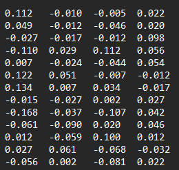

    별도의 index가 지정되어있지 않은 상황이다. 이 상황에서 데이터를 전달받으면 아래와 같이 출력된다.

    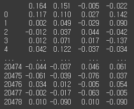

    row number가 약간씩 밀렸지만, column의 이름 없이 row의 번호만 출력되고 있는 상황. 이번에는 index를 추가하는 named parameter는 넣어보자.

    ```python
    dataset = pd.read_csv(os.path.join(data_dir, filename), sep='\t', names=['data1', 'data2', 'data3', 'data4'])
    ```

    위와 같이 입력하면 아래와 같이 출력된다.

    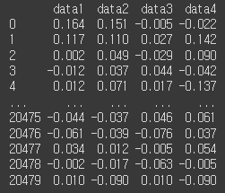

- np.array(dataset.abs().mean())

dataset.abs() : dataFrame의 모든 값에 절대값을 취한다.

dataset.mean() : dataFrame의 column을 기준으로 mean을 구한다. 만약, 행을 기준으로 mean을 구하고 싶다면 dataset.mean(axis=1)을 사용하면 된다. 이렇게 구해진 결과는 1차원 배열의 형태로 반환되기 때문에, 2차원 형태로 유지하려면 reshape을 해주어야 한다.

- pd.DataFrame(dataset_mean_abs.reshape(1,4))

새로운 DataFrame객체를 만들어서 반환함. 1차원 배열을 넣으면 변환할 수 있는 것으로 보인다.

- dataset_mean_abs.index = [filename]

index는 row의 이름을 말함. 현재 filename이 데이터가 측정된 시각으로 설정되고 있으므로, 그대로 지정해준다.

⇒ 그런데, 왜 list 형태로 전달함? : 그냥 그렇게 정해진 것. 규격임.

- merged_data.columns = ['Bearing 1', 'Bearing 2', 'Bearing 3', 'Bearing 4']

columns의 이름을 Bearing 1, Bearing 2, Bearing 3, Bearing 4로 지정해준다.

```python
# transform data file index to datetime and sort in chronological order
merged_data.index = pd.to_datetime(merged_data.index, format='%Y.%m.%d.%H.%M.%S')
merged_data = merged_data.sort_index()
merged_data.to_csv('Averaged_BearingTest_Dataset.csv')
print("Dataset shape:", merged_data.shape)
merged_data.head()
```

**코드 내용 분석**

- merged_data.index = pd.to_datetime(merged_data.index, format='%Y.%m.%d.%H.%M.%S')

정규식을 활용하여, 현재 인덱스를 datetime으로 변경함.

- merged_data = merged_data.sort_index()

현재 index를 datetime으로 지정했으므로 정렬이 가능. sort_index()로 시간순으로 정렬.  
(chronological : 연대적, 시간적)

- merged_data.to_csv(’…’)

현재 DataFrame을 .csv로 저장함.

- merged_data.head()

DataFrame의 처음 n줄을 출력함. default n =5이다.

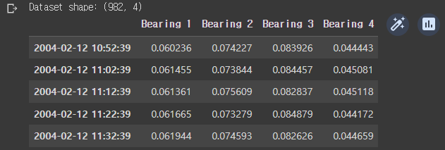

다음으로는 training data set과 testing data set을 구분해야 한다. 이를 위해 data set에서 train시킬 정상 데이터를 구분하고, test시킬 이상 데이터를 구분한다. 

```python
train = merged_data['2004-02-12 10:52:39': '2004-02-15 12:52:39'] # train로 사용할 데이터를 만들기 위해 자를 구간 설정
test = merged_data['2004-02-15 12:52:39':] # test로 사용할 데이터를 만들기 위해 남은 구간 설정

# (row, column)
print("Training dataset shape: ", train.shape)
print("Test dataset shape: ", test.shape)
```

**코드 내용 분석**

현재 merged_data는 index가 지정된 DataFrame 객체이고, sort도 된 상태이다. 현재 내가 다루고자 하는 데이터는 sequence(time series) 데이터이기 때문에 이런 방식으로 정렬이 가능하다.

이 데이터에서 train/test로 사용할 데이터를 구분해 새로운 train, test 객체로 만든다.

이후, .shape property를 활용하여 현재 각 데이터가 어떻게 구성되어 있는지 확인한다.

Training dataset shape: (445, 4)

Test dataset shape: (538, 4)

⇒ column이 네 개이고, row의 개수가 각각 445, 538이다.

이렇게 하면 train, test 데이터를 불러오는데 모두 성공한 것이다. 우선 베어링의 정상 상태를 담당할 train 데이터를 출력해보자.

```python
fig, ax = plt.subplots(figsize=(14, 6), dpi=80)

ax.plot(train['Bearing 1'], label='Bearing 1', color='blue', animated=True, linewidth=1)
ax.plot(train['Bearing 2'], label='Bearing 2', color='red', animated=True, linewidth=1)
ax.plot(train['Bearing 3'], label='Bearing 3', color='green', animated=True, linewidth=1)
ax.plot(train['Bearing 4'], label='Bearing 4', color='black', animated=True, linewidth=1)
plt.legend(loc='lower left')

ax.set_title('Bearing Sensor Training Data', fontsize=16)
plt.show()
```

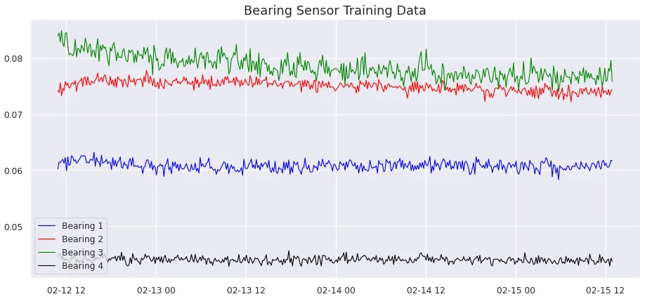

이 다음에는, test할 data잠시 들여다보자.

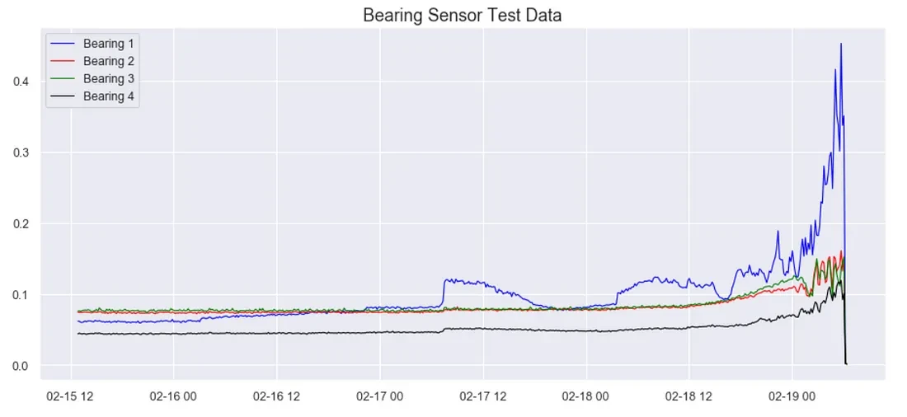

데이터 셋의 중간쯤부터, 센서 데이터의 패턴이 변화하기 시작한다. 베어링의 실패 지점(failure point) 부근에서는 베어링의 진동이 매우 강해지며 위아래로 강하게 진동한다. (oscilate wildly). 이 데이터를 약간 다른 관점에서 바라보기 위해서, Fourier Transform을 사용해 해당 데이터를 time domain에서 frequency domain으로 바꾸어보자.

```python
# transforming data from the time domain to the frequency domain using fast Fourier transform

train_fft = np.fft.fft(train)
test_fft = np.fft.fft(test)
```

```python
# frequencies of the healthy sensor signal
fig, ax = plt.subplots(figsize=(14, 6), dpi=80)

ax.plot(train_fft[:, 0].real, label='Bearing 1', color='blue', animated=True, linewidth=1)
ax.plot(train_fft[:, 1].imag, label='Bearing 2', color='red', animated=True, linewidth=1)
ax.plot(train_fft[:, 2].real, label='Bearing 3', color='green', animated=True, linewidth=1)
ax.plot(train_fft[:, 3].real, label='Bearing 4', color='black', animated=True, linewidth=1)
plt.legend(loc='lower left')

ax.set_title('Bearing Sensor Training Frequency Data', fontsize=16)
plt.show()
```

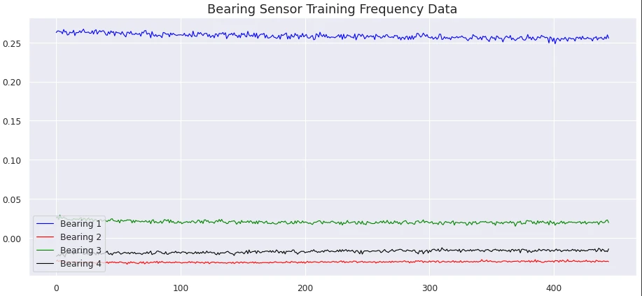

정상 데이터인 Train Data에 대해서는 크게 주목할 점이 보이지 않는다. 이번에는 비정상 데이터인 Test Data를 Frequency Domain에서 살펴봐보자.

```python
# frequencies of the degrading sensor signal
fig, ax = plt.subplots(figsize=(14, 6), dpi=80)

ax.plot(test_fft[:, 0].real, label='Bearing 1', color='blue', animated=True, linewidth=1)

ax.plot(test_fft[:, 1].imag, label='Bearing 2', color='red', animated=True, linewidth=1)

ax.plot(test_fft[:, 2].real, label='Bearing 3', color='green', animated=True, linewidth=1)
ax.plot(test_fft[:, 3].real, label='Bearing 4', color='black', animated=True, linewidth=1)
plt.legend(loc='lower left')

ax.set_title('Bearing Sensor Training Frequency Data', fontsize=16)
plt.show()
```

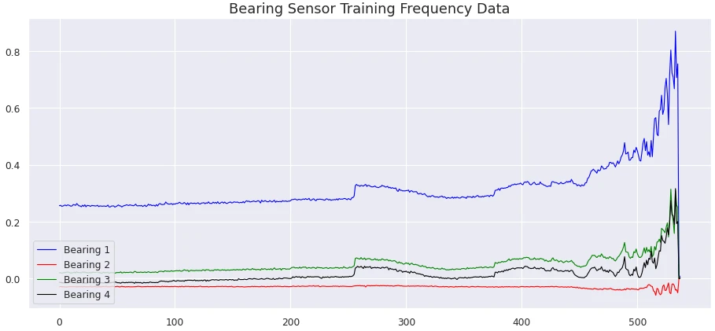

Test Data를 Frequency Domain으로 살펴보자, Frequency Amplitude와 Energy에 큰 상승이 나타나는 것을 확인할 수 있다.

데이터에 대한 전처리 과정을 완료하기 위해서, 우리는 아래의 과정을 거쳐야 한다.

1. 먼저 모든 데이터를 1과 0 사이의 값으로 정규화(normalization)를 해야 한다. 
2. 그 다음, 데이터의 형태를 LSTM에 입력하기 편한 형태로 reshape해야 한다.

LSTM의 셀들은 [data samples, time steps, features]로 구성된 3차원 tensor를 필요로 한다. (이때 tensor란, 쉽게 말해 다차원 배열을 말한다.) 아래 코드에서 LSTM에 입력되는 각 샘플들은 타임 스텝과 네 개의 features (한 타임 스텝당 네 개의 베어링으로부터 얻어지는 센서 데이터)를 나타낸다.

```python
# normalize the data
scaler = MinMaxScaler()
X_train = scaler.fit_transform(train)
X_text = scaler.transform(test)

scaler_filename = "scaler_data"
joblib.dump(scaler, scaler_filename)
```

**코드 내용 분석**

- scikit-learn : ML을 위한 가장 강력한 라이브러리이다. 여기서 제공하는 메서드 중 `fit_transform()`과 `transform()`에는 무슨 차이가 있을까?

`fit_transform()`은 train dataset에만 사용된다. 우리가 만든 모델은 train data에 있는 mean과 variance를 학습하게 된다. 이렇게 학습된 Scaler()의 parameter는 test data를 scale하는데 사용된다. 다시 말해, train data로 학습된 Scaler()의 parameter를 통해서, test data의 feature 값들이 스케일 된다.

`transform()` : train data로부터 학습된 mean 값과 variance 값을 test data에 적용하기 위해 transform() 메서드를 사용. 

⇒ 그렇다면, 왜 test data에서는 `fit_transform()`을 사용하지 않을까?

만약에 `fit_transform()`을 test data에도 적용하게 된다면, test data로부터 새로운 mean값과 variance 값을 얻게 된다. 즉, 우리의 모델이 test data도 학습하게 된다. test data는 ‘Surprise’한 데이터 셋이기 때문에, 이를 학습하게 된다면 우리의 모델이 처음 보는 데이터에 대해서 어떤 성능을 갖는지 알기가 힘들다.

또한, `joblib.dump()`를 사용하여 훈련된 스케일러 객체를 "scaler_data"라는 파일에 저장한다. 이렇게 하면 추후에 스케일러를 재사용하여 추론이나 배포 과정에서 새로운, 이전에 보지 못한 데이터를 스케일링할 수 있게 된다. ⇒ 새로운 데이터에 대해서 `scaler.transform()`을 적용하기 위해 파일로서 저장해두는 것.

```python
# reshape inputs for LSTM (samples, timesteps, features)
X_train = X_train.reshape(X_train.shape[0], 1, X_train.shape[1])
print("Training data shape: ", X_train.shape)

X_test = X_test.reshape(X_test.shape[0], 1, X_test.shape[1])
print("Test data shape:", X_test.shape)
```

**코드 내용 분석**

이 부분은 LSTM 모델에 데이터를 입력하기 위해 데이터의 형태를 재구성하는 부분이다. LSTM 모델은 3D 형태의 입력을 받는데, `(samples, timesteps, features)` 형식으로 데이터를 구성한다.

이때, samples는 데이터의 개수, features는 각 샘플의 특성의 개수를 나타낸다. (네 개의 별도의 데이터 소스가 존재함.) LSTM 모델은 시퀀스 데이터를 다루기 때문에, timesteps라는 개념을 도입해서 각 시점의 데이터를 나타내는 차원을 추가해야 한다. (LSTM 모델에 입력되는 데이터의 시간 단계 개수를 의미. 즉, LSTM 모델에 입력되는 데이터가 한 시간 단계씩 처리된다는 의미이며, LSTM 모델은 이전 시간 단계의 정보를 활용하여 해당 시간 단계의 값을 예측하거나 분류하는데 사용된다. 이것은 LSTM 모델이 순차적인 시계열 데이터를 처리하는 특성에 기인한 것이다.)

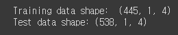

LSTM을 사용하는 장점 중 하나는 **다변수 분석(multivariate features)이 가능**하다는 것이다. 

---

## Neural Network Model

Autoencoder Architecture는 본질적으로 “identity” function을 학습한다. 이는 input data를 취득하여 차원 축소(dimensionality reduction)를 통해 데이터를 압축하고, 그 속에서 데이터의 핵심적인 특징(core/primary driving features)를 뽑아내고, 이를 이용해 데이터를 다시 복원하는 것을 학습한다.

(rationale : 이론적 해석)

Anomaly Detection의 이론적 해석은 정상 데이터를 학습하고 reconstruction error를 결정하는 것이다. 그러면, 만약 Autoencoder가 정상 범위(norm)를 벗어나는 데이터를 만나게 된다면, 모델을 거쳐 나온 reconstruction error가 정상 범주를 벗어나는 것을 확인할 수 있고, 이를 통해 Anomaly Detection을 할 수 있게 되는 것이다.

이제 Keras Library 내의 Python Function들을 사용하여 Autoencoder를 위한 Neural Network Model을 만들어보자.

```python
# define the autoencoder network model
def autoencoder_model(X):
  inputs = Input(shape=(X.shape[1], X.shape[2]))
  L1 = LSTM(16, activation='relu', return_sequences=True,
            kernel_regularizer=regularizers.l2(0.00))(inputs)
  L2 = LSTM(4, activation='relu', return_sequences=False)(L1)
  L3 = RepeatVector(X.shape[1])(L2)
  L4 = LSTM(4, activation='relu', return_sequences=True)(L3)
  L5 = LSTM(16, activation='relu', return_sequences=True)(L4)
  output = TimeDistributed(Dense(X.shape[2]))(L5)
  model = Model(inputs=inputs, outputs=output)

  return model
```

**코드 내용 분석**

- Input

    ```python
    inputs = Input(shape=(X.shape[1], X.shape[2]))
    ```

    Autoencoder 모델의 입력을 정의하는 부분이다.

    - Input : Keras에서 사용하는 입력 레이어를 입력하는 함수. Keras Tensor를 초기화하는 역할을 한다. autoencoder_model 함수의 parameter가 X이고, X는 Pandas의 DataFrame 객체일 것이다. 그러므로 X.shape[1], X.shape[2]를 넣어서 관련 정보를 전달한다.  
        이전의 코드에서 X_test.reshape(…)을 통해서 이미 X_test의 shape을 바꿨다. (train 데이터도 마찬가지) 그러므로 현재 X.shape[1]은 timesteps이고, X.shape[2]는 feature의 수이다. 따라서 1, 4가 들어가게 될 것.

    - LSTM은 시계열 데이터를 다루기 때문에 각 시간 단계별로 특성(feature)값을 갖는다.

        **about timesteps**

        timestep이 의미하는 것은 아래 자료와 같다.

        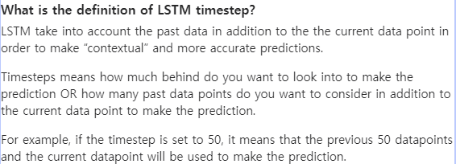

        정리하자면, 예측을 하는데 고려할 과거의 데이터 포인트의 수를 결정하는 것으로 보인다.

- L1

    ```python
    L1 = LSTM(16, activation='relu', return_sequences=True,
                kernel_regularizer=regularizers.l2(0.00))(inputs)
    ```

    - 첫 번째 LSTM 레이어를 정의한다.
    - LSTM은 Keras의 LSTM 레이어를 나타낸다.
    - 16은 LSTM 레이어의 유닛 수를 의미한다.
    - activation=’relu’는 활성화 함수로 ReLU를 사용한다는 것을 의미한다.
    - return_sequences=True는 LSTM 레이어의 출력을 Sequence로 반환하도록 설정한다.
    - kernel_regularizer=regularizers.l2(0.00)는 L2 정규화를 적용하여 과적합을 제어하는 정규화 방법 중 하나이다.

- L2

    ```python
    L2 = LSTM(4, activation='relu', return_sequences=False)(L1)
    ```

    - 두 번째 LSTM 레이어를 정의한다.
    - 4는 LSTM 레이어의 유닛 수를 의미한다.
    - activation=’relu’는 활성화 함수로 ReLU를 사용한다는 것을 의미한다.
    - return_sequences=False는 LSTM 레이어의 출력을 시퀀스가 아닌 마지막 시간 단계의 출력만 반환하도록 설정한다.

- L3

    ```python
    L3 = RepeatVector(X.shape[1])(L2)
    ```

    - 입력을 복제하여 특정 횟수만큼 반복하는 레이어를 정의한다.
    - RepeatVector는 입력을 주어진 횟수만큼 반복하는 Keras 레이어이다.
    - X.shape[1]은 입력 데이터의 시간 단계(timesteps) 수를 나타낸다.
    - 이 레이어는 입력을 LSTM 레이어와 연결하기 위해 사용된다.

- L4

    ```python
    L4 = LSTM(4, activation='relu', return_sequences=True)(L3)
    ```

    - 세 번째 LSTM 레이어를 정의한다.
    - 4는 LSTM 레이어의 유닛 수를 의미한다.
    - activation=’relu’는 활성화 함수로 ReLU를 사용한다는 것을 의미한다.
    - return_sequences=True는 LSTM 레이어의 출력을 Sequence로 반환하도록 설정한다.

- L5

    ```python
    L5 = LSTM(16, activation='relu', return_sequences=True)(L4)
    ```

    - 네 번째 LSTM 레이어를 정의한다.
    - 4는 LSTM 레이어의 유닛 수를 의미한다.
    - activation=’relu’는 활성화 함수로 ReLU를 사용한다는 것을 의미한다.
    - return_sequences=True는 LSTM 레이어의 출력을 Sequence로 반환하도록 설정한다.

- output

    ```python
    output = TimeDistributed(Dense(X.shape[2]))(L5)
    ```

    - 출력 레이어를 정의한다.
    - TimeDistributed은 Keras의 레이어를 시퀀스 데이터에 적용하는데 사용된다.
    - Dense는 Fully-connected 레이어를 나타낸다.
    - X.shape[2]는 출력의 차원 수를 나타낸다. 여기서는 입력 데이터와 동일한 차원 수를 갖는다.

- model

    ```python
    model = Model(inputs=inputs, outputs=output)
    ```

    - 입력과 출력을 지정하여 모델을 정의한다.
    - Model은 Keras의 모델을 정의한다.
    - inputs는 모델의 입력이며, output은 모델의 출력을 나타낸다.

LSTM autoencoder architecture에서, 처음 두 개의 layer는 input data를 압축하는 Encoder의 역할을 한다.

그 다음에는 repeat vector layer를 이용해 압축된 데이터 벡터를 decoder로 넘긴다. (We then use a repeat vector layer to distribute the compressed representational vector across the time steps of the decoder.)

마지막 layer는 input data가 복원된 값이다.

이제는 Neural Network Optimizer인 Adam을 사용해 모델을 동작시키고, Mean Absolute Error를 Loss Function으로 사용한다.

```python
# create the autoencoer model
model = autoencoder_model(X_train)
model.compile(optimizer='adam', loss='mae')
model.summary()
```

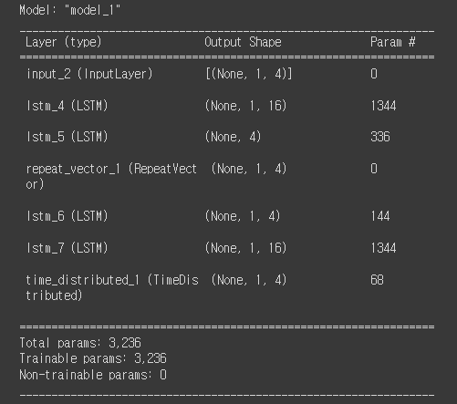

마지막으로, 100 epochs를 지정하여 데이터를 학습한다. 그런 다음에는 모델의 성과를 보이기 위하여 loss를 출력하도록 한다.

```python
# plot the training losses
fig, ax = plt.subplots(figsize=(14, 6), dpi=80)

ax.plot(history['loss'], 'b', label='Train', linewidth=2)
ax.plot(history['val_loss'], 'r', label='Validation', linewidth=2)

ax.set_title('Model loss', fontsize=16)
ax.set_ylabel('Loss (mae)')
ax.set_xlabel('Epoch')
ax.legend(loc='upper right')

plt.show()
```

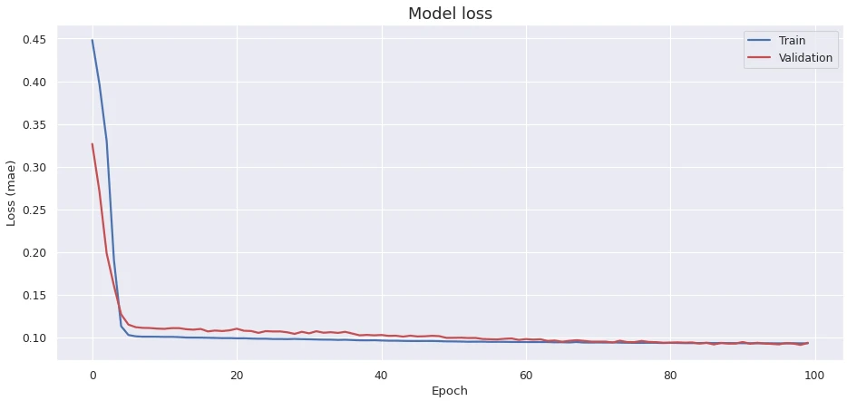

---

## Loss Distribution

training data set에서 계산된 loss의 분포를 plotting 함으로써, 우리는 &lt;비정상&gt;을 식별하는데 적절한 임계치(Threshold)를 설정할 수 있다. 이 과정에서 임계치가 “noise level” 위에 설정되게 함으로써 \**FP(False Positive)가 나오지 않도록 보장할 수 있어야 한다.*

(\*FP : 실제로는 정상이나, 비정상이라고 판단하는 경우)

```python
# plot the loss distribution of the training set
X_pred = model.predict(X_train)
X_pred = X_pred.reshape(X_pred.shape[0], X_pred.shape[2])
X_pred = pd.DataFrame(X_pred, columns=train.columns)
X_pred.index = train.index

scored = pd.DataFrame(index=train.index)
Xtrain = X_train.reshape(X_train.shape[0], X_train.shape[2])
scored['Loss_mae'] = np.mean(np.abs(X_pred-Xtrain), axis=1)

plt.figure(figsize=(16, 9), dpi=80)
plt.title('Loss Distribution', fontsize=16)
sns.distplot(scored['Loss_mae'], bins=20, kde=True, color='blue')
plt.xlim([0.0, .5])
```

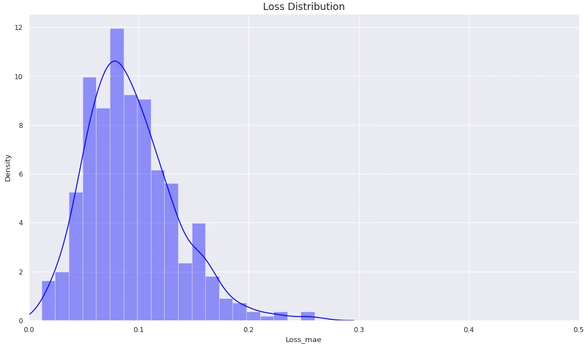

위의 결과(Loss distribution)를 바탕으로 0.275를 anomaly threshold로 설정해보자. 그리고 test data set에 대하여 reconstruction loss를 구하고, anomaly threshold와 비교해보자.

```python
# calculate the loss on the test set
X_pred = model.predict(X_test)
X_pred = X_pred.reshape(X_pred.shape[0], X_pred.shape[2])
X_pred = pd.DataFrame(X_pred, columns=test.columns)
X_pred.index = test.index

scored = pd.DataFrame(index=test.index)
Xtest = X_test.reshape(X_test.shape[0], X_test.shape[2])

scored['Loss_mae'] = np.mean(np.abs(X_pred-Xtest), axis = 1)
scored['Threshold'] = 0.275
scored['Anomaly'] = scored['Loss_mae'] > scored['Threshold']

scored.head()
```

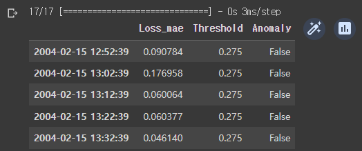

```python
# calculate the same metrics for the training set
# and merge all data in a single data frame for plotting
X_pred_train = model.predict(X_train)
X_pred_train = X_pred_train.reshape(X_pred_train.shape[0], X_pred_train.shape[2])
X_pred_train = pd.DataFrame(X_pred_train, columns=train.columns)
X_pred_train.index = train.index

scored_train = pd.DataFrame(index=train.index)
scored_train['Loss_mae'] = np.mean(np.abs(X_pred_train-Xtrain), axis = 1)
scored_train['Threshold'] = 0.275
scored_train['Anomaly'] = scored_train['Loss_mae'] > scored_train['Threshold']
scored = pd.concat([scored_train, scored])
```

시간에 따른 데이터의 흐름을 한 번에 보기 위하여 모든 데이터를 하나의 dataFrame에 합쳤다. 아래 graph에 나오는 red line은 우리가 지정한 threshold인 0.275를 의미한다.

```python
# plot bearing failure time plot
scored.plot(logy=True, figsize=(16, 9), ylim=[1e-2, 1e2], color=['blue', 'red'])
```

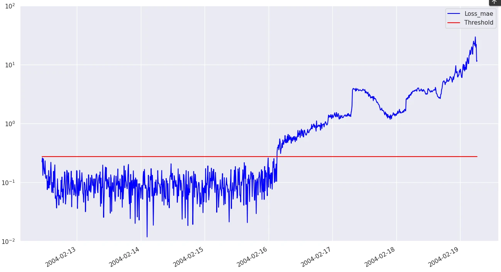

우리의 anomaly detection을 위한 neural network가 센서 데이터로부터 성공적으로 abnormal한 상황을 detect 할 수 있게 되었다.

이제 이렇게 만들어진 모델을 weights와 함께 h5 format으로 저장하자.

```python
# save all model information, including weights, in h5 format
model.save("Cloud_model.h5")
print("Model Saved Successfully...")
```
