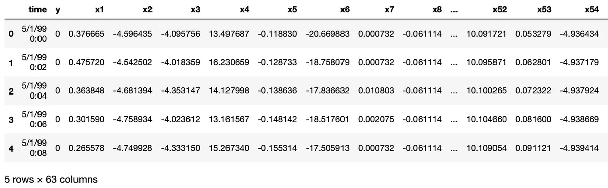
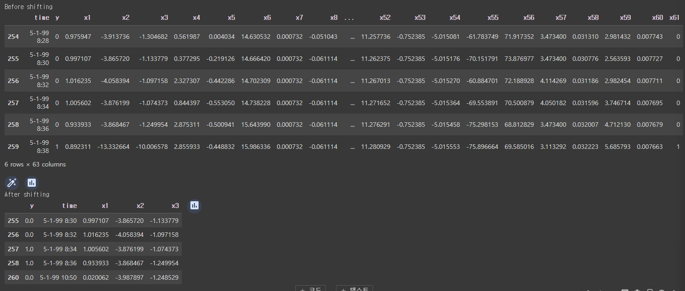
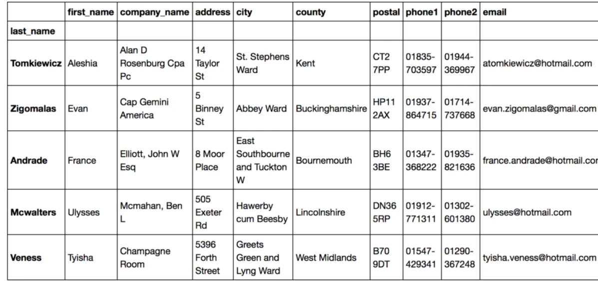

# Concepts of LSTM > 2)

[LSTM Autoencoder for Extreme Rare Event Classification in Keras](https://towardsdatascience.com/lstm-autoencoder-for-extreme-rare-event-classification-in-keras-ce209a224cfb)

## Data Preparation

LSTM은 time-series data로부터 얻어진 정보를 통해 3차원 배열을 전달받아야 한다. 이 부분은 **실수를 하기 쉬운 부분이므로**, (error prone step) 이후에 자세하게 살펴본다.

- Read Data

```python
df = pd.read_csv("data/processminer-rare-event-mts - data.csv") 
df.head(n=5)  # visualize the data.
```



- Curve Shifting

rare-event problem의 목표는 sheet-break를 사전에 예측하는 것이다. 그러므로 event의 발생을 4분 앞서 예측하는 것을 목표로 잡는다. 제공된 데이터 셋에 대해서 label을 2 row 위로 올리면 된다.

df.y = df.y.shift(-2)

 하지만 이렇게 하기 위해서 아래의 작업을 해야만 한다.

- 1(abnormal)한 y를 갖는 row n이 있다면, (n-2):(n-1)의 값도 1로 만들어주어야 한다. 이를 통해서, 우리는 문제 발생 4분 전부터 문제가 발생할 것이라고 예측할 수 있게 된다.
- row n을 제거해야 한다. 왜냐면, 우리는 break(종이 씹힘)가 발생한 순간을 모델에 학습시키려는 것이 아니라 그 이전을 학습시키려는 것이기 때문이다.

아래 lambda function을 통해서 curve shifting을 구현할 수 있다.

```python
sign = lambda x: (1, -1)[x < 0]

def curve_shift(df, shift_by):
    '''
    This function will shift the binary labels in a dataframe.
    The curve shift will be with respect to the 1s. 
    For example, if shift is -2, the following process
    will happen: if row n is labeled as 1, then
    - Make row (n+shift_by):(n+shift_by-1) = 1.
    - Remove row n.
    i.e. the labels will be shifted up to 2 rows up.
    
    Inputs:
    df       A pandas dataframe with a binary labeled column. 
             This labeled column should be named as 'y'.
    shift_by An integer denoting the number of rows to shift.
    
    Output
    df       A dataframe with the binary labels shifted by shift.
    '''

    vector = df['y'].copy()
    for s in range(abs(shift_by)):
        tmp = vector.shift(sign(shift_by))
        tmp = tmp.fillna(0)
        vector += tmp
    labelcol = 'y'
    # Add vector to the df
    df.insert(loc=0, column=labelcol+'tmp', value=vector)
    # Remove the rows with labelcol == 1.
    df = df.drop(df[df[labelcol] == 1].index)
    # Drop labelcol and rename the tmp col as labelcol
    df = df.drop(labelcol, axis=1)
    df = df.rename(columns={labelcol+'tmp': labelcol})
    # Make the labelcol binary
    df.loc[df[labelcol] > 0, labelcol] = 1

    return df
```

이제 데이터를 shift하고 맞게 shifting이 되었는지 확인해볼 것이다. 다음 섹션에서는, 몇가지 스텝이 더 남아있다. 이 작업들은 데이터 준비 과정이 올바르게 진행되었는지 확인하기 위한 작업들이다.

```python
print('Before shifting')  # Positive labeled rows before shifting.
one_indexes = df.index[df['y'] == 1]
display(df.iloc[(np.where(np.array(input_y) == 1)[0][0]-5):(np.where(np.array(input_y) == 1)[0][0]+1), ])

# Shift the response column y by 2 rows to do a 4-min ahead prediction.
df = curve_shift(df, shift_by = -2)

print('After shifting')  # Validating if the shift happened correctly.
display(df.iloc[(one_indexes[0]-4):(one_indexes[0]+1), 0:5].head(n=5))
```

⇒ 이 시점에는 input_y가 정의되어 있지 않아 실행되지 않는다. 아래에서 input_y를 정의하는 코드를 먼저 실행하면 실행된다.



여기까지 진행하면, 이전에 존재했던 positive label 5/1/99 8:38이 n-1, n-2로 옮겨졌으며, row n은 drop된 것을 알 수 있다. 또한, break row (n) 이후 다음 row와 차이가 꽤 큰 것을 볼 수 있는데, 이것은 한번 break가 일어나면 machine이 한동안 break status에 있기 때문이다. 이 동안에는, 계속해서 y = 1인 row만 연속적으로 만들어지게 된다. 제공된 데이터에서는 이 연속적인 break rows가 제거되었는데, 이는 우리의 모델(classifier)이 break가 일어난 이후를 학습하는 것을 막기 위해서이다.

계속해서 이어나가기 위해, 먼저 데이터에서 time과 다른 카테고리 columns를 drop하도록 하자.

```python
# Remove time column, and the categorical columns
df = df.drop(['time', 'x28', 'x61'], axis=1)
```

**iloc(), loc()**

Pandas에서 특정 행/열을 선택하는 방법이다.

1\. **행번호(row number)로 선택하는 방법(.iloc)**

다시 표현하자면, 행이든 열이든 숫자로 location을 나타내서 Selecting or Indexing 하는 방법이다.

예를 들어, row number가 0부터 전체 row 수까지 있다고 해보자. data.shape[0]를 하면, data라는 이름의 dataFrame의 전체 row 수를 출력할 수 있다. 즉, .iloc은 이 번호로 특정 data를 선택할 수 있도록 해주는 것이다.

물론 열도 마찬가지이다!

- 단일 데이터

```python
data.iloc[0] # data의 첫번째 행만
data.iloc[1] # 두번째 행만
data.iloc[-1] # 마지막 행만
# Columns:
data.iloc[:,0] # 첫번째 열만
data.iloc[:,1] # 두번째 열만
data.iloc[:,-1] # 마지막 열만
```

- 복수 데이터

```python
data.iloc[0:5] # 첫 5개행만
data.iloc[:, 0:2] # 첫 2개열만
data.iloc[[0,3,6,24], [0,5,6]] # 1st, 4th, 7th, 25th 행과 + 1st 6th 7th 열만
data.iloc[0:5, 5:8] # 첫 5개 행과 5th, 6th, 7th 열만
```

.iloc을 사용할 때 중요한 점은, 어떻게 선택하느냐에 따라서 Series로 값이 반환될 수도 있고, DataFrame으로 반환될 수도 있다는 것이다.

그리고, 여러 개의 행과 열을 선택할 경우 [1:5]이면 1, 2, 3, 4이고 5는 해당되지 않는다.

2\. **label이나 조건 표현으로 선택하는 방법(.loc)**

- Label과 인덱스의 활용을 통한 .loc



이와 같은 Data가 있다고 할 때, last_name이 Andrade와 Veness로 되어있는 행을 선택하려고 한다. .loc으로는 어떻게 할 수 있을까?

```python
data.loc['Andrade'] # Andrade 행만 선택
data.loc[['Andrade', 'Veness']] # Andrade와 Veness 둘다 선택
```

⇒ 하지만 중요한 것은, 여기서 첫 번째는 Series를 반환하고 두 번째는 DataFrame을 반환한다는 것이다. 같은 방법으로 열도 가능하다.

```python
data.loc[['Andrade', 'Veness'], ['first_name', 'address', 'city']]
```

⇒ 역시 이렇게 하면 DataFrame으로 반환될 것.

그런데, 이렇게 하면 타이핑을 하기가 너무 길어지므로 아래와 같은 방법으로도 표현이 가능하다. (범위 표현 방법)

```python
data.loc[['Andrade', 'Veness'], 'city':'email']
```

- 참/거짓, logical index와 .loc 활용

data의 first_name이 ‘Antonio’라는 행을 선택하고 싶다면?

```python
data[data['first_name'] == 'Antonio']
```

만약 이 조건에서 특정 열까지 선택하고 싶다면?

```python
data[data['first_name'] == 'Antonio', 'email']
```

이 방식으로 출력하면 series로 출력되므로, DataFrame으로 출력하고 싶다면 아래와 같이 출력하자.

```python
data[data['first_name'] == 'Antonio', ['email']]
```

- **Prepare Input Data for LSTM**

LSTM은 다른 모델에 비해서 손이 많이 가는 편이다. 많은 양의 시간과 주의를 기울여 LSTM에 들어갈 데이터를 만들어야 하기 때문이다. 하지만 그만큼 수고를 들일 가치는 있다.

LSTM의 input data는 3차원 array이다. array는 [samples, lookback, features] 형태로 구성된다.

- samples : 데이터의 개수
- lookback : LSTM 모델은 과거를 보도록 설계되었다. 그말은, t time에 t-lookback만큼의 과거 데이터를 보면서 예측을 하게 된다.
- features : input 데이터에 나타나는 feature의 수

우리는 먼저, features와 response를 추출해야 한다.

```python
input_X = df.loc[:, df.columns != 'y'].values  # converts the df to a numpy array
input_y = df['y'].values

n_features = input_X.shape[1]  # number of features
```

input_X는 2차원 array로서, samples * features의 크기를 가진다. 우리는 이 2D array를 samples * lookback * features의 크기를 갖는 3D array로 바꿔야 한다. 이에 따라, 우리는 temporalize 함수를 만든다.

```python
def temporalize(X, y, lookback):
    '''
    Inputs
    X         A 2D numpy array ordered by time of shape: 
              (n_observations x n_features)
    y         A 1D numpy array with indexes aligned with 
              X, i.e. y[i] should correspond to X[i]. 
              Shape: n_observations.
    lookback  The window size to look back in the past 
              records. Shape: a scalar.

    Output
    output_X  A 3D numpy array of shape: 
              ((n_observations-lookback-1) x lookback x 
              n_features)
    output_y  A 1D array of shape: 
              (n_observations-lookback-1), aligned with X.
    '''
    output_X = []
    output_y = []
    for i in range(len(X) - lookback - 1):
        t = []
        for j in range(1, lookback + 1):
            # Gather the past records upto the lookback period
            t.append(X[[(i + j + 1)], :])
        output_X.append(t)
        output_y.append(y[i + lookback + 1])
    return np.squeeze(np.array(output_X)), np.array(output_y)
```

이 함수를 테스트하기 위해, lookback을 5로 설정한 example을 돌려보자.

(lookback이 5이면, 10분 전까지의 과거 데이터를 보는 것과 동일)
