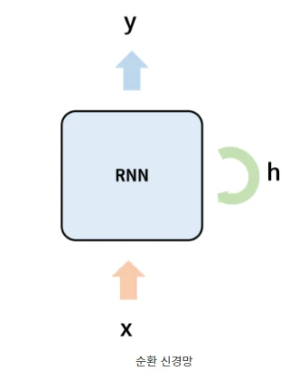
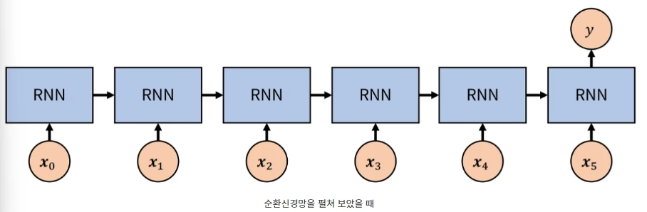

# LSTM TensorFlow

[Tensorflow&Keras - LSTM 개념 및 사용법 정리](https://simpling.tistory.com/19)

LSTM은 Long Short Term Memory의 줄임말로, 주로 시계열 처리나 자연어 처리에 사용된다. LSTM에서 중요한 것은 데이터의 ‘순환’ 개념이다. 흔히 아래와 같은 그림으로 LSTM을 나타낸다.



Input으로 x가 들어가면, 여러번의 순환을 거쳐 output인 y가 나오는 구조이다. 이때 h는 그 중간 다리 역할을 하는 hidden state라고 한다. 위의 구조를 펼쳐서 보면 아래의 그림과 같다.



Input 데이터인 x는 Sequence를 가지는 데이터가 되는데, 위의 경우는 길이가 6인 데이터이기 때문에 총 6번의 Input이 들어가게 된다. (예를 들면 단어가 6개인 문장) RNN 사이에 있는 화살표는 hidden state의 전달을 표현한다. 최종적으로 y값이 나오는 데는 hidden state와 연속적인 x의 입력에 의해 결정되게 한다.

RNN은 보통 LSTM이나 GRU를 사용한다. LSTM은 input 값을 받으면 hidden state와 cell state를 가지게 된다. cell state는 LSTM이 굴러가게 하는데 일종의 체인 역할을 하며, 기억을 오랫동안 유지할 수 있는 구조로 되어 있다. hidden state는 위의 설명처럼 계층의 출력이 되며, 다음 타임 스탭으로 정보를 넘기게 된다.

Tensorflow에서 LSTM으로 cell state와 hidden state에 대한 출력을 바꾸는 변수로는 return_state와 return_sequences가 있다. 두 개의 변수는 boolean 형태로 주어지게 되며, 둘다 False일 경우, 아래와 같이 마지막 결과값(마지막 hidden state)만 출력하게 된다.

```python
# lstm을 그냥 쓸 경우 최종 결과값만 도출한다.
from tensorflow.keras.models import Model
from tensorflow.keras.layers import Input
from tensorflow.keras.layers import LSTM
from numpy import array

inputs1 = Input(shape=(3, 1))
lstm1 = LSTM(1)(inputs1)
model = Model(inputs=inputs1, outputs=lstm1)

data = array([0.1, 0.2, 0.3]).reshape((1,3,1))

print(model.predict(data)) # [[0.04836999]]
```

`return_sequences = True`로 설정할 경우 **각 time step 별 hidden state를 모두 출력**하게 된다. 예를 들어, 위의 예시에서처럼 길이가 6인 경우에는 총 6개의 hidden state 값이 모두 나오는 것이다. 이렇게 출력을 하는 것은 보통 **Attention**을 사용하기 위함이다.

```python
# return_sequences = True를 한 경우에는 각 time step별 hidden state들이 출력된다.
from tensorflow.keras.models import Model
from tensorflow.keras.layers import Input
from tensorflow.keras.layers import LSTM
from numpy import array

inputs1 = Input(shape=(3, 1))
lstm1 = LSTM(1, return_sequences=True)(inputs1)
model = Model(inputs=inputs1, outputs=lstm1)

data = array([0.1, 0.2, 0.3]).reshape((1,3,1))

print(model.predict(data)) 
# [[[0.01184901]
#  [0.03267556]
#  [0.05920978]]]
```
