# 시계열 분석

작성일 2024-05-03 · 최종 수정일 2024-05-04
{ .post-date }

- **소스코드 및 강의자료**

[GitHub - kloud80/urban-data-mining: 한양대학교 도시공학과 머신러닝](https://github.com/kloud80/urban-data-mining)

---

## &lt;시계열 데이터의 종류&gt;

### 1. **백색잡음 데이터**

어떤 범주 안에서 데이터가 굉장히 랜덤하게 발생하는 데이터, 대표적으로 센서 데이터이다. 이것을 분석하는 방법은 다른 것과는 조금 다르다.

> 이전 값과는 무관하게 나타나는 결과

### 2. **확률보행과정** (Random Walk Process)

직전 데이터에서 일정 특정한 분포로 값이 오르거나 내리는 데이터이다. 주가와 같은 가격과 관련한 데이터가 이러한 양상을 띈다.

> 직전 데이터에서 위 아래로 랜덤하게 변화가 발생

### 3. **정상확률과정** (Stationary Process)

정상성을 만족하는 시계열 데이터이다. 뉴럴 네트워크가 나오기 전까지는 시계열 분석은 모두 이 데이터에 대한 분석을 말했다. 대표적으로 ARIMA 모델이 있다.

```python
#정상 확률 과정 (Stationary Proecess)

data = np.array([0])
A_corr = 0.5

for i in range(99):
  data = np.append(data, data[-1] * A_corr + np.random.normal(0, 1, 1))

plt.plot(data)
plt.axhline(0, 0, 100, color='red', linestyle='--')
plt.show()
```

⇒ 직전 데이터에서 0.5 정도의 기여분을 가져오고, 이후에 랜덤 값을 더한다.

- **Auto Regression**: 전 데이터가 그 다음 데이터에 몇 % 정도 영향을 미치는지 회귀분석으로 가져가는 모델. 

> 확률보행과정은 이전 값을 100% 반영하는 것이고, 정상확률과정은 A_corr 수치가 유지 됨.

---

## &lt;시계열 분석 모델의 종류&gt;

### ARIMA (AutoRegressive Integrated Moving Average)

- **Box-Jenkins**: 데이터가 시계열적으로 정상성을 띄고 있느냐라는 것을 분석하는 것. 정상성이란 데이터가 어느 시점에 어느 데이터를 빼내더라도 동일한 변동성과 상관관계를 갖는 것. 이러한 데이터가 흔치는 않다.

    - AR: 직전 값이 다음 값에 영향을 주는 모델
    - MA: 직전의 랜덤 변동성이, 다음 값에도 영향을 준다. 이전에 +였다면, 다음 값에도 +가 더 유리하게끔 만들어진 모델이다.

    > AR, MA에 모형이 적용될 수 있는 데이터가 시장에 많지 않다. 그래서 Integrated 과정으로 **차분**을 많이 수행한다. 즉, 변동성 데이터들은 일반적으로 정상성을 띄는 경우가 많아서, 변동성만 정상성 분석을 실시하는 것이다.

> ARIMA 모델은 과거의 패턴이 미래에도 지속될 것이라는 강한 믿음으로 데이터가 구성되므로, 이러한 문제를 해결하기 위해 계절성을 넣기 위한 계절 변수를 추가한 Seasonal ARIMA 모델 등을 만들었다.  
>   
> ARIMA, ETS 등의 기법은 소수의 시계열 데이터와 잘 작동하며, NPTS는 간헐적인 스파이크에 적합한 모델이다.

### Fourier Transform

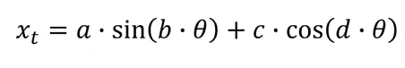

위의 공식에서 a, c 그리고 b, d를 어떻게 설정하냐에 따라서 삼각함수의 파형이나 주기가 바뀐다. 이러한 데이터를 결합하면 어떠한 파형의 형태든 만들어낼 수 있다. 즉, 모든 데이터를 sin, cos의 결합으로 만들어 낼 수 있는 것이다.

- **장점**

따라서 푸리에 트랜스폼을 한 이후, a, b, c, d 값을 저장해 둔다. 이걸 하나의 list 안에 저장해두면 데이터셋이 되고, 음성인식 등에 이걸 사용할 수 있다.

ex. ‘안녕하세요’라는 말을 녹음해서 푸리에 트랜스폼을 한 다음 저장된 값을 다차원 공간에 던진다. 그러면 생각보다 그 값들이 한 공간에 모여있어서, 이후에 들어온 음성이 어디에 가까운지를 인지하는 것이다.

> 연속형 데이터를 float 데이터로 바꿀 수 있다. 범주를 굉장히 넓게 잡으면 범용적으로 사용할 수 있는 음성인식 모델이 되며, 범주를 굉장히 타이트하게 잡으면 특정 사람이 아니면 음성인식이 되지 않는 모델로도 만들 수 있다.

### Hidden Markov Model

마코프 프로세스란, 현재 내가 가지고 있는 데이터만으로 다음에 나올 값을 충분히 예측할 수 있는 프로세스다. Hidden Markov Model인 이유는, 이러한 마코프 프로세스가 내가 눈에 보이는 데이터가 아니라 숨어있는 어떤 히든 레이어 상에서 진행되고 있다고 가정을 하는 것이다.

⇒ 최근에는 크게 인기있지는 않음.

### 브라운 운동 분석

확률보행을 하는 데이터에 대한 분석 모델

### Prophet

어려운 데이터를 백색잡음으로 만들고 정상성을 검출하는 과정들을 일반인들이 수행하기는 너무 어렵기 때문에, 최근의 트렌드는 회사 내부에서 쓰는 다양한 시계열 알고리즘을 라이브러리 형태로 많이 공개하고 있는 상황이다.

- **Prophet**

Prophet은 Facebook이 비즈니스 분야에 적합하게 만든 시계열 예측 알고리즘이며, 시계열 추세에 **계절적 요소**와 **휴일 요소**를 추가하여 비즈니스에 적합하게 구성했다.

⇒ 데이터에서 이상치를 검출하거나 미래를 예측하거나 범위를 만드는 기능도 제공

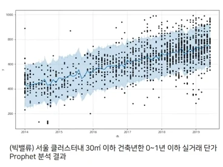

Prophet을 이용하여 서울 클러스터내 30m^2 이하의 공동주택의 실거래가를 분석한 것이다. 파란색 안에 있는 것은 예측가능한 범주에 있는 안정적인 데이터이며, 이걸 벗어난 것은 이상치라고 판단하는 것이다. 이렇게 정상성을 깨는 데이터를 제외하고 예측에 사용하게 된다.

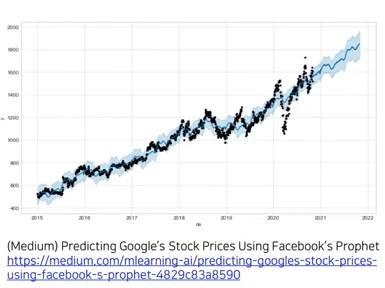

> 여기까지는 통계학적 모델을 따르고 있다.

---

## &lt;RNN&gt;

> 부동산원의 주택 매매가격 지수를 예측하는 모델을 만든다.

### 학습 데이터셋 생성

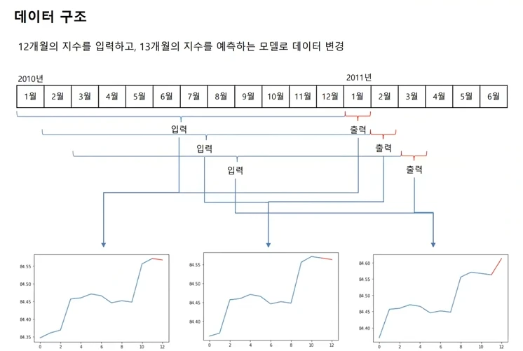

12개월 치 데이터를 입력 데이터로 만들고, 13개월 차에 있는 데이터를 출력 데이터로 구성한다. 이렇게 Shift 하면서 계속해서 데이터셋을 만들어 나간다.

### 순환신경망 (RNN)

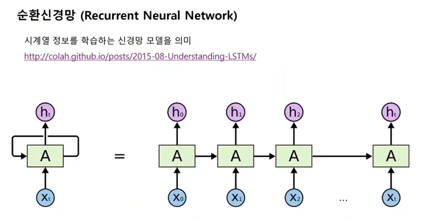

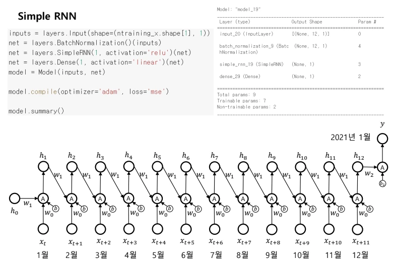

만약 Dense Layer(Fully Connected Layer)를 사용한다고 하면, 가중치 12개가 사용될 것이다. 하지만 Simple RNN에서는 12달의 데이터를 넣을 때 하나의 가중치 $w_{1}$, $w_{0}$,  $b$를 공유한다. 

⇒ 즉, Backpropagation의 대상이 $w_{1},w_{0}$,  $b$라는 것이다.

첫 단계에서 xt라는 입력값이 feed Forward로 들어가게 되고, Activation Function을 통과하면, h1이라는 Hidden Value가 나오게 된다. 그러면 h1이 다시 h0의 역할을 하며 다시 모델에 들어가게 된다.

만약 100개월치 데이터를 Feed Forward를 하더라도 $w_{1}$, $w_{0}$, $b$는 딱 1개씩만 사용한다.

> 이렇게 같은 가중치를 계속해서 사용하기 때문에 Recurrent라고 하는 것이다. 각각의 가중치는 무슨 역할을 할까?   
>   
> 전 달까지의 정보는 h1에 저장된다. h1에 저장된 과거의 흐름 데이터와 이번 달의 데이터를 합쳐서 다음달을 예측할 수 있는 것이다.

이렇게 Feed Forward를 모두 거치고 나면 h12라는 하나의 값이 나오게 된다. 최종 출력 값인 h12가 나온 이후에는 $w_{2}, b_{2}$라는 parameter만 사용된다.

- **만약 RNN의 개수를 늘린다면?**

RNN의 개수를 늘린다면 하나의 RNN Cell이 일렬로 연결되어 hidden 값이 여러 개가 출력되지만, 결국 h1, h2, h3, … h12는 하나만 나오게 된다.

다만, hidden cell과 x가 여러 개 연결되어야 하기 때문에 가중치의 개수는 늘어난다.

그렇게 최종적으로 h12까지 값을 출력하게 되는데, 이때의 값을 Context Vector라고 한다. 이것이 시계열 데이터의 맥락을 가지고 있는 것이다. 마지막에 있는 Layer는 맥락을 전달해 줄테니, 최종적으로 출력을 하라고 전해주는 것이다.

일반적으로 simpleRNN에서는 h12만 사용하지만, h1 ~ h12를 모두 쓰는 경우도 있다.

- **Batch Normalization**

Input Data의 값이 -1 ~ +1 사이의 값을 갖도록 하는 것이 좋은게, 가중치들이 그렇게 분포가 되어 있으므로 sigmoid 등에서의 Vanishing 이슈를 줄이려면 Normalization을 하는 것이 좋다.

그런데, 위의 SimpleRNN에서는 Batch Normalization Layer라는 것 자체가 존재한다. Normalize 하려면 단순히 평균에서 표준편차를 나누면 될 것 같지만, Batch 단위 데이터로 학습해버려서 n개의 가중치를 통해 Normalization을 하는 방식으로 진행한다.

⇒ 역시 Backpropagation이 가능하기 때문에 이와 같은 방식으로 학습이 가능하다.

- **코드**

```python
np.random.seed(1)
tf.random.set_seed(1)

inputs = layers.Input(shape=(ntraining_x.shape[1], 1))
net = layers.BatchNormalization()(inputs)
net = layers.SimpleRNN(1, activation='relu')(net)
net = layers.Dense(1, activation='linear')(net)
model = Model(inputs, net)

model.compile(optimizer='adam', loss='mse')

model.summary()
```

- **학습 결과**

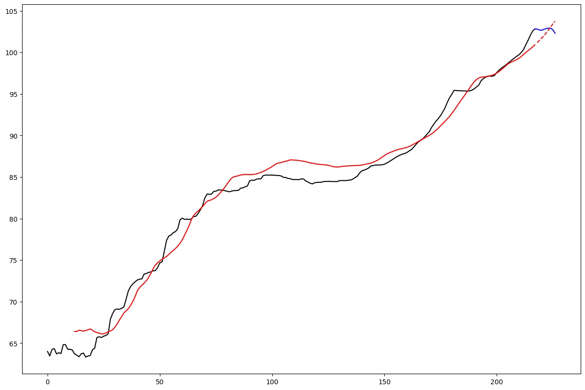

### 다변량 시계열 예측

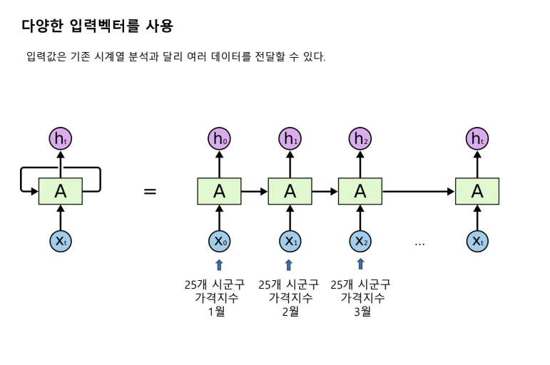

입력값은 여러 개의 데이터를 넣을 수도 있다.

- **코드**

```python
np.random.seed(1)
tf.random.set_seed(1)

inputs = layers.Input(shape=(ntraining_x.shape[1], ntraining_x.shape[2]))
net = layers.BatchNormalization()(inputs)
net = layers.SimpleRNN(20, activation='relu')(net)
net = layers.Dense(50, activation='relu')(net)
net = layers.Dense(25)(net)
model = Model(inputs, net)

model.compile(optimizer='adam', loss='mse')

model.summary()
```

25개 시군구의 데이터를 넣어서 결과를 예측한다.

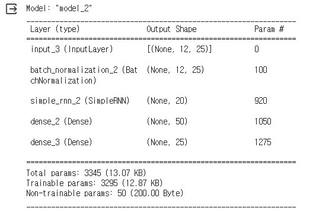

- **학습 결과**

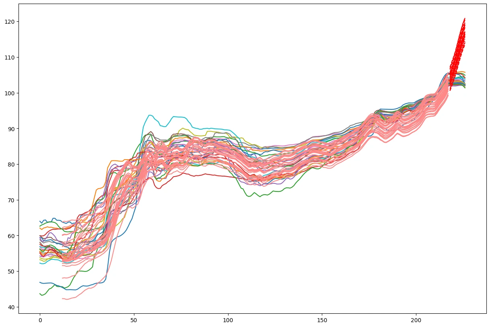

분홍색이 학습된 데이터이고, 빨간색이 예측된 데이터이다. 모두 상승할 것이라고 예상했지만, 현재 시장이 이상해서 예측이 모두 틀린 것을 알 수 있다.

> 과거의 데이터를 통해 시계열성을 지속적으로 추종하기 때문에 가중치가 많더라도 내재된 데이터가 다르면 이렇게 될 수밖에 없다.

> Neural Network는 조립식이기 때문에, 외생 변수를 넣어서 분석할 수도 있다.

---

## &lt;LSTM&gt;

> LSTM의 한계점은 과거의 데이터가 전달이 되는 과정에서 가중치가 똑같기 때문에, 나중에는 과거의 맥락이 끝까지 전달되기가 매우 어렵다. 그래서 Gradient Vanishing이 발생해서 학습 자체가 불가능하게 된다.  
>   
> 만약 Stationary 데이터를 다룬다면 RNN이 예측을 매우 잘 할 수 있다. 하지만 대체로 현실에 존재하는 데이터는 Stationary Data가 아니기 때문에 항상 들어맞지는 않는다.  
> ⇒ 이 때문에 LSTM 모델이 등장하게 된다.

### 구조

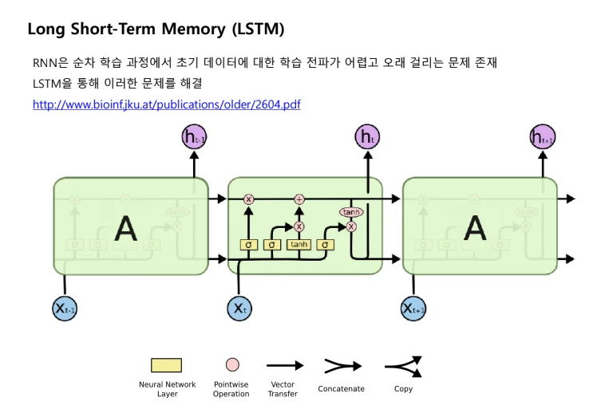

- **Forget Gate**

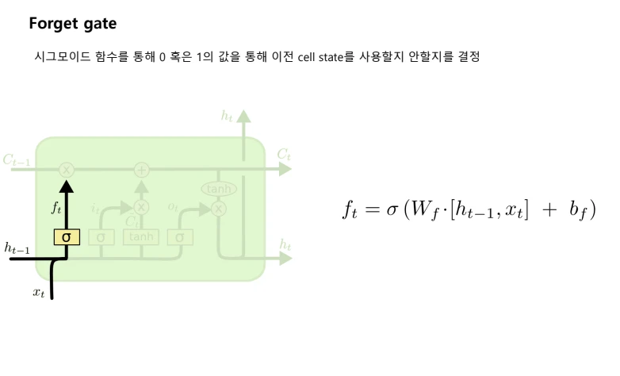

이전에 RNN에서 사용했던 hidden(h), input(x) 값은 그대로이지만, 이번에는 condition(c) 값이 추가되었다. **시그모이드 함수의 특징은 Switch이다.**

- **Input Gate**

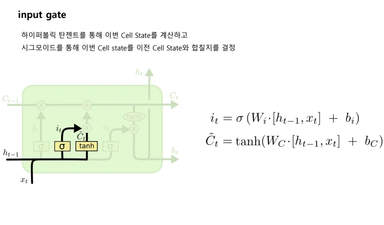

그 다음에는 hidden, input 값을 Input Gate에 전달하게 되는데, 여기서는 시그모이드를 통해서 합칠지 말지를 결정해 준다. 이후에는 $h_{t-1}$, $x_{t}$의 Cell State를 만들어 준다.

> 즉, 지금까지의 맥락인 $h_{t-1}$과 $x_{t}$를 가지고 와서, $tanh$를 통해 Condition이라는 노드를 만들게 되는데, 이 값이 시그모이드에 의해서 위로 전달될지 말지가 결정되는 것이다.  
> 따라서 Sigmoid가 0이면 Condition에 값이 전달되지 않으며, 1이면 Condition에 값이 들어간다.

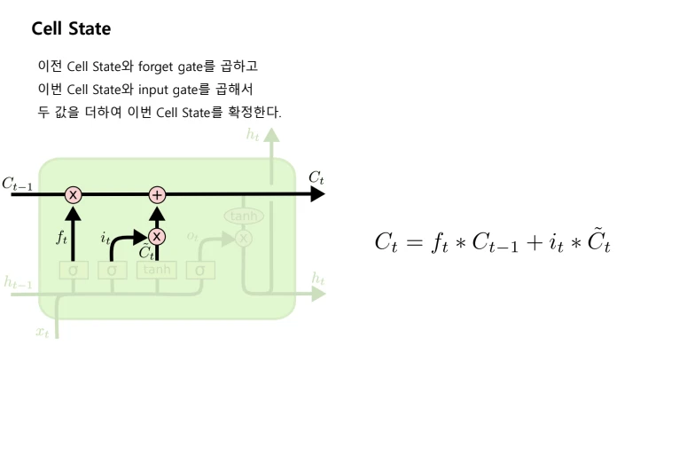

1. 과거에서 전달된 Cell State ($C_{t-1}$)에다 Forget Gate에서 넘어온 값 $f_{t}$를 곱해주면 과거의 Cell State를 잊어버리게 된다.  
    (*Sigmoid가 1로 $f_{t}$를 넘겨줬다면 과거의 Cell State를 잊어버리고 새로운 Cell State를 강하게 전달한다.*)
2. 만약 Input Gate가 동작하지 않았다면, 현재의 Cell State는 넘겨주지 않고 과거의 Cell State는 넘겨주게 된다.

> 결론적으로 원하는 것은 과거에 임팩트 있었던 사건을 시계열로 넘겨주는 것이라고 할 수 있다. 그래서 LSTM 모델이 RNN보다 과거의 사건이나 임팩트를 미래에 더 잘 전달해준다.  
> (이러한 역할을 Switch가 해 준다고 볼 수 있음.)

- **코드**

```python
np.random.seed(1)
tf.random.set_seed(1)

inputs = layers.Input(shape=(ntraining_x.shape[1], ntraining_x.shape[2]))
net = layers.BatchNormalization()(inputs)
net = layers.LSTM(20, activation='relu')(net)
net = layers.Dense(50, activation='relu')(net)
net = layers.Dense(25)(net)
model = Model(inputs, net)

model.compile(optimizer='adam', loss='mse')

model.summary()
```

⇒ 이전에 작성한 코드에서 SimpleRNN을 LSTM으로만 바꿔주면 된다.

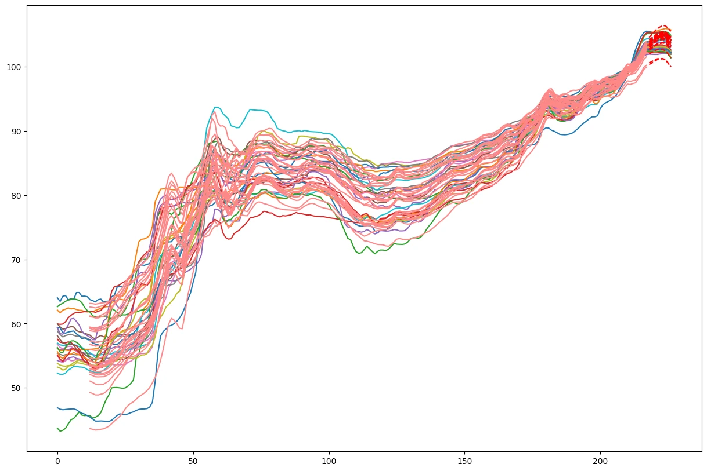

⇒ 이전보다 예측이 훨씬 잘 된 것을 확인할 수 있다.

> 분명히 seed를 고정해 놨는데 왜 학습 결과가 매번 달라질까?

[PyTorch KR | Facebook](https://www.facebook.com/groups/PyTorchKR/posts/1756153997857607/?locale=ko_KR)

---

## &lt;순환신경망 응용&gt;

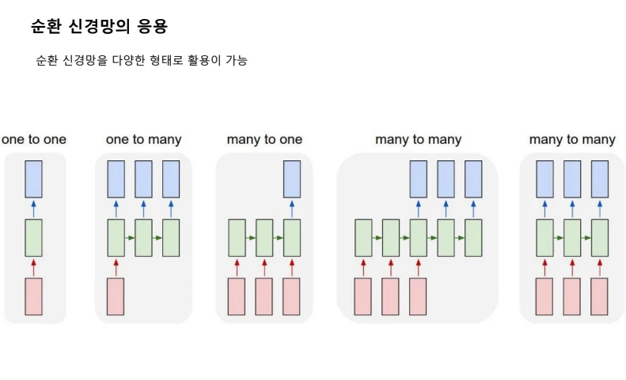

순환 신경망은 다양한 구조로 활용될 수 있으며, 위에서 사용한 모델은 many to one 모델이라고 볼 수 있다. SimpleRNN이나 LSTM 모델을 보면, 중간 Hidden Node를 마지막에 한 번에 추출할 수 있는 옵션도 있다.

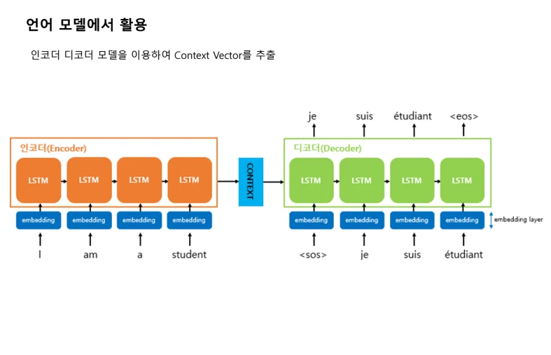

LSTM은 특히 언어 모델에서 각광을 받기도 했다. Context Vector를 생성하면, 해당 Vector는 어떠한 차원의 특정 위치에 있는 좌표라고 볼 수 있는데, 여기에 문장의 맥락이 담겨 있어서, 이걸 Decode하면 번역이 되는 방식이다. 단, 최근에는 이러한 맥락의 전달이 개선된 Attention Model이 사용된다.

### CNN과 LSTM의 결합

CNN과 LSTM을 연결하여 학습을 하는 경우도 많다. 먼저 CNN으로 이미지에서 latent vector를 뽑은 다음, 해당 vector를 LSTM에 Feed Forward하여 예측하는 것이다. 예를 들자면, 도시의 상황이나 미세먼지의 확산 등에도 사용될 수 있다.

### 국가교통정보센터

모든 도로를 노드화해서 표준 노드화 하고 있으며, 서울시에서는 각 도로에서 시간대별 평균속도를 제시하고 있다. 이걸 연결하면 서울시 도로에서 시간대별 차량들의 속도를 알 수 있다.

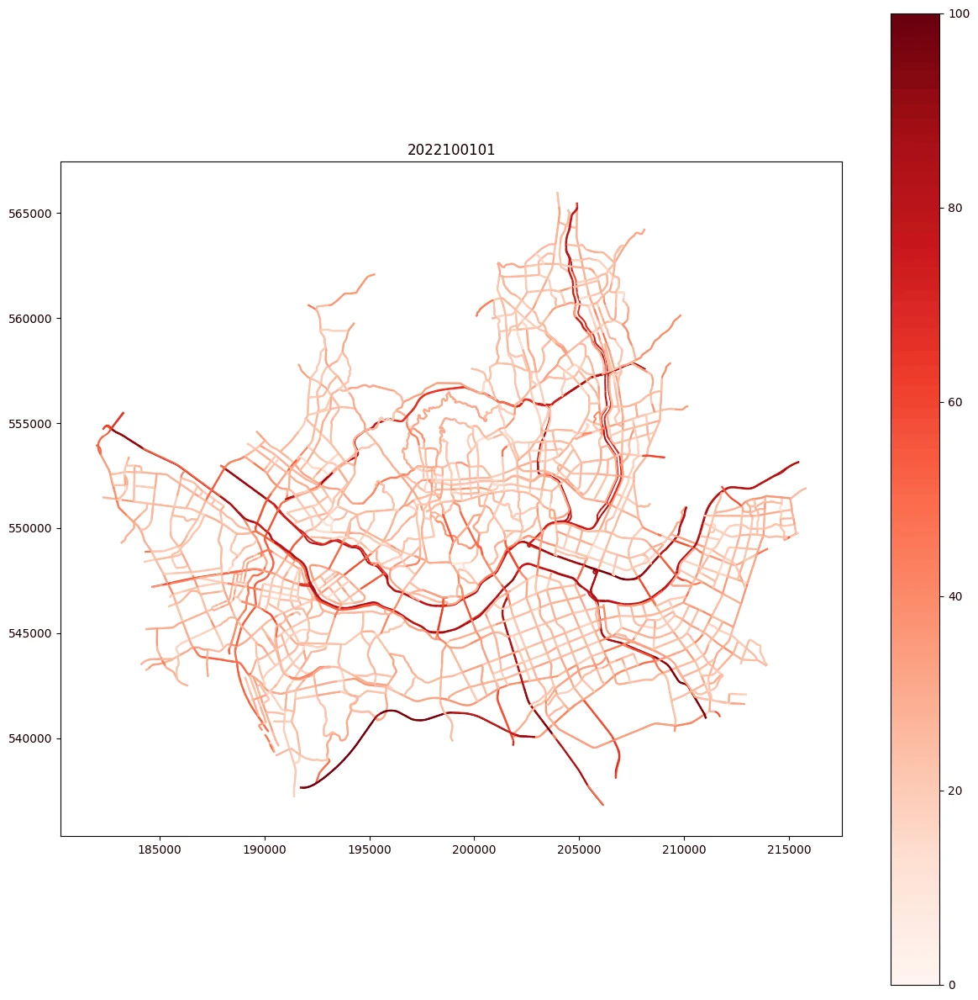

2022년 10월 1월 01시의 도로별 차량 평균속도이다.

이걸로 무엇을 할 수 있는가? 강남구 도로의 시간대별 속도 데이터를 3시간 전, 혹은 며칠 전부터 가져와서 LSTM 모델로 묶어가지고 학습시킨 다음, 내가 예측하고 싶은 도로에서의 평균 속도를 목적 함수로 설정해도 된다.

```python
np.random.seed(1)
tf.random.set_seed(1)

inputs = layers.Input(shape=(ntraining_x.shape[1], ntraining_x.shape[2]))
net = layers.BatchNormalization()(inputs)
net = layers.LSTM(100, activation='relu')(net)
net = layers.Dense(100, activation='relu')(net)
net = layers.Dense(4)(net)
model = Model(inputs, net)

model.compile(optimizer='adam', loss='mse')

model.summary()
```

⇒ 여기서는 서울시의 모든 도로 5023개를 Input으로 넣고 다음 한 시간 후의 도로의 속도를 예측하는 모델로 학습을 진행했다.

> 이는 서울시 도로의 평균속도 데이터를 통해 속도에 대한 맥락을 추출하는 것이다.

---

> **0 또는 1로 귀결되는 스위치를 만들 때 유용하다. 데이터를 전달할지 말지를 학습시킨다.**
