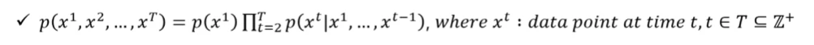
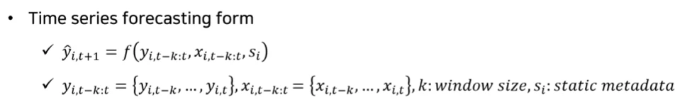
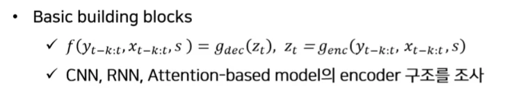
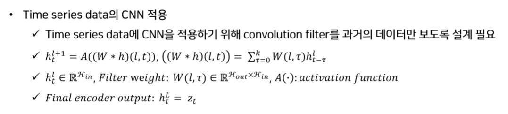

# Time Series Forecasting With Deep Learning: A Survey + Stationarity(정상성)

작성일 2024-05-03
{ .post-date }

## &lt;1. Introduction&gt;

### Overview

- CNN, RNN, Attention Mechanism을 이용한 Time Series Forecasting
- Quantitative time series model과 Deep Learning Model을 결합한 Hybrid Model

### Time Series Data?

- 시간의 경과와 함께 일정한 간격마다 관측 값이 기록되어 있는 데이터

    - **일정한 간격마다 관측값이 기록되어 있어야 모델링이 가능하다.**

- Time Series Data를 통해 일상생활/산업현장에서 다양한 적용이 가능하다.

### Properties of Time Series

1\. **Temporality**

동일한 interval로 구성된 Time Series Data에 대해 현재의 Data는 과거의 Data에 Dependent하다.

Joint Distribution을 Chaining Rule을 통해 다음과 같이 변형이 가능하다.

> 현재의 데이터가 과거의 데이터에 대해 Dependent한 특성을 보인다는 것을 의미

2\. **Dimensionality**

- Univariate: 단변량 데이터 → 스칼라
- Multivariate: 다변량 데이터 → 벡터

3\. **Nonstationarity** (비정상성)

- **Stationarity**(정상성): Time Series 데이터에서 Data에 대해 Slicing이 어디에서 되던지, Time Window의 사이즈가 같다면 Statistical Property는 변하지 않는다.

- **Statistical Property**

    - **Seasonality**(계절성): 데이터가 일정한 주기를 가지고 반복되는 패턴을 보이는 현상

        - 날씨, 휴일, 경제활동 등 계절적 요인에 영향을 받을 수 있다.

    - **Concept Drift**(개념 이동): 시간이 지남에 따라 시계열 데이터의 통계적 속성이 변화하는 현상. 이는 기존의 데이터 패턴이나 관계가 변경되어 모델이 예측하는 데 어려움을 겪을 수 있음을 의미한다.

        > 머신러닝이나 데이터 마이닝 등의 예측 분석에서 Drift란, 어떠한 예측하지 못한 변화에 의해 모델의 예측 성능이 시간이 경과함에 따라 떨어지는 것을 말한다.  
        >   
        > 이 중에서도 **Concept Drift**란, 입력 데이터에서 예측하려고 하는 정답 라벨(목적 변수)의 의미/개념/통계적 특성이 모델 훈련 때와 비교하여 변화가 있음을 말한다.  
        >   
        > 추가적으로 **Data Drift**란, 입력 데이터의 통계적 분포와 테스트 시 실제 배포 환경에서의 입력 데이터의 통계적 분포가 어떠한 변화에 의해 차이가 발생하는 것을 말한다.

        - Concept Drift (cont.): Concept Drift는 목적 변수의 개념이 바뀐 것이다. 예를 들어 스팸을 탐지하는 머신러닝 모델이 있었다면, 스팸을 전달하는 방식이 바뀌어서 스팸을 스팸이라고 판단해내지 못하는 경우를 말한다.
        - Data Drift (cont.): Data Drift는 목적 변수의 개념은 동일하지만, 데이터의 분포 자체가 바뀌어 버린 것이다. 예를 들어 스팸 차단 모델이 아침 일찍 SNS에 게시글을 투고하는 사람을 스팸을 보내는 사람으로 분류할 가능성이 높다고 할 때, 스팸을 보내는 방식은 똑같지만(목적 변수는 동일하지만), 시니어 층의 SNS 참여율이 높아지면서 아침에 SNS에 게시글을 투고하는 사람이 많아지자 이러한 유저를 스팸을 보내는 사람으로 오검출 하게 되는 경우를 말한다.

    - **Change Points**(변화점): 시계열 데이터에서 예상치 못한 중요한 변화가 발생하는 시점을 말하며, 자료의 평균, 분산 등의 통계적 속성에서 급격한 변화를 말한다. 종종 외부 사건이나 시스템 내부의 변화에 의해 발생할 수 있으며, 대표적인 예로 대규모 산업 사고가 발생하여 제품 생산량이 갑자기 감소한다면 이는 생산 데이터의 변화점으로 볼 수 있다.

> 대부분의 Time Series Data는 Nonstationary해서 위의 특성을 만족하지 않는다.

[Stationarity(정상성)](#stationarity)

4\. **Noise**

Model이 조절 할 수 없는 Error

---

## &lt;2. Deep Learning Architectures&gt;

### Overview

1. CNN
2. RNN
3. Attention-based Model

> Time series forecasting은 t-k 시점부터 t 시점까지의 데이터를 넣어서 t 시점을 예측하는 방식. t-k~t 시점까지의 y, x 데이터를 넣고, 변하지 않는 메타데이터인 s를 넣는 것이라고 해석한다.

- Encoder를 통해 Latent Vector를 도출하고, 이 Vector를 Decoder에 넣어서 최종적 예측을 수행하는 것이라고 이해할 수 있다.

### CNN

컨볼루션 필터가 과거의 데이터만 볼 수 있도록 설계가 필요하다. Encoder에서는 최종적으로 Latent Vector가 나온다고 볼 수 있다.

- **Dilated Convolutions**

기존 Convolution의 계산을 줄여주기 위해 도입

### RNN

- Sequential한 데이터에 적합한 구조이며, Time Series에도 잘 동작할 수 있다.
- Memory State를 통해 과거의 정보를 기억할 수 있는 구조

- Backpropagation 과정에서 Gradient Vanishing이 나타나는 문제 발생

    - Long-range Dependency 발생 ⇒ **LSTM**으로 해결

### LSTM(Long Short-term Memory)

- RNN의 Gradient Vanishing 문제 해결
- Input Gate, Output Gate, Forget Gate, Hidden State, Cell State로 구성

### Attention Mechanism

- 자연어 처리에서 굉장히 중요한 개념 중 하나이다.
- Attention은 과거의 중요한 Time Step에서 직접 정보를 가져와 예측에 사용하는 Mechanism이다.

---

## Stationarity(정상성) { #stationarity }

### 정상성

정상성을 가진 시계열 데이터는 시간에 따라 통계적 속성이 일정하다는 특징을 갖는다. 즉, 데이터의 평균, 분산, 공분산이 시간에 따라 변하지 않는다.

### 정상성의 조건

1. 평균 일정성: 시계열 데이터의 평균이 시간에 따라 변하지 않아야 한다.
2. 분산 일정성: 시계열 데이터의 분산이 시간에 따라 일정해야 한다.
3. 공분산 일정성: 시계열 데이터의 두 시점 간의 공분산이 오직 두 시점의 차이에만 의존해야 하며, 구체적인 시점에 의존해서는 안된다.

### 예시

1. 모든 조건을 만족하는 예시 (완전한 정상성)

    시뮬레이션을 통해 생성된 백색 잡음 데이터. 백색 잡음은 모든 시점에서 평균이 0, 분산이 일정하며, 시점 간의 공분산이 0이다.

2. 일부 조건을 만족하는 예시 (평균 일정성만 만족)

    계절별 패턴을 보이는 시계열 데이터. 예를 들어 매년 여름에는 기온이 상승하지만, 여름의 평균 기온이 매년 비슷할 수 있다. 이 경우, 평균은 일정할 수 있지만 분산은 계절에 따라 달라진다.

3. 모든 조건을 충족하지 않는 예시 (비정상성)

    경제 성장률 데이터. 경제가 성장함에 따라 경제 성장률은 시간이 지날수록 증가하거나 감소할 수 있다. 이는 평균이 일정하지 않고, 불안정한 경제 상황에 따라 분산도 크게 변할 수 있으며, 시점에 따라 공분산의 구조가 변할 수 있다.

### 시계열 데이터에 대한 이해 및 분석

- 데이터 시각화: 시계열 플롯, 자기상관함수(ACF) 및 부분자기상관함수(PACF) 플롯을 사용하여 데이터 패턴과 자기상관 구조를 파악한다.
- 요약 통계: 평균, 분산 등을 계산하여 시간에 따른 변화를 조사한다.

### 정상성 검정

- 데이터가 정상성을 만족하는지 공식적으로 검정한다.
- ADF 테스트, KPSS 테스트 등을 수행하여 데이터의 정상성 여부를 검증한다.

### 데이터 변환

- 데이터의 정상성을 확보하기 위해 변환을 수행한다.
- 차분, 로그 변환, 계절 차분 등을 실시한다.
