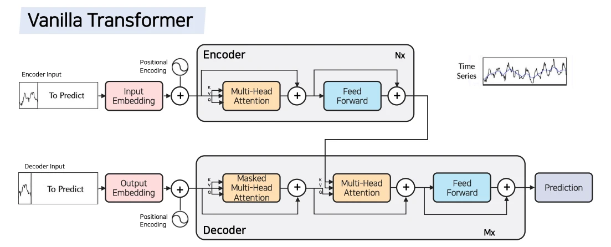
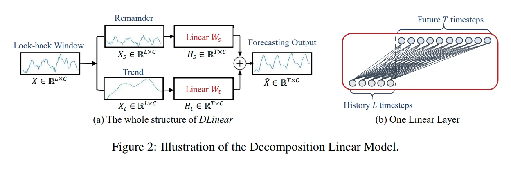
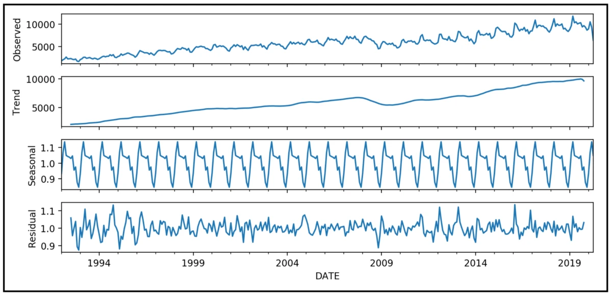
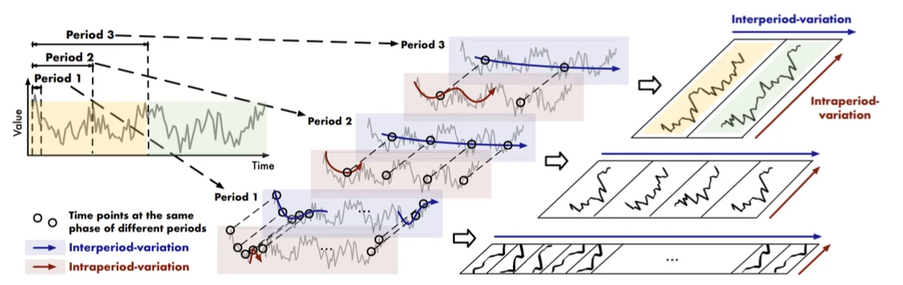
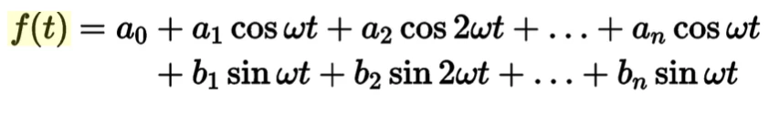
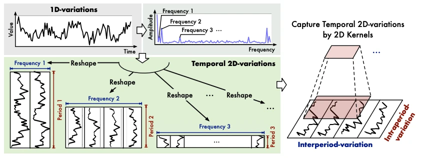
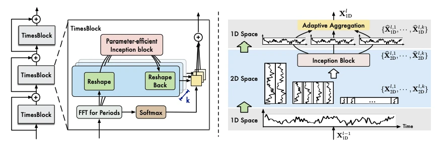

# 딥러닝 시계열 예측 모델 관련 소개

## ARIMA 예측 모델

자기 회귀(AR), 차분(I), 이동평균(MA)의 세 가지 구성 요소를 결합하여 시계열을 분석하는 전통적인 시계열 예측 모델이다. (AR) **자기 회귀**는 **과거 값의 영향을 모델링**, (MA) **이동평균**은 **시계열의 오차를 모델링**하고 (I) **비정상성 데이터를 정상화하기 위해 차분을 사용**한다.

## 딥러닝을 활용한 시계열 분석 모델

시계열 분석을 위한 대표적인 모델은 RNN, LSTM 등이 대표적이다. RNN의 장기 의존성 문제를 해결하기 위하여 LSTM이 개발되었다.

LSTM은 RNN보다 장기 의존성을 다루는 능력이 많이 향상되었지만, 매우 긴 시퀀스의 데이터에서는 여전히 정보 손실이 발생할 수 있다. 또한 RNN 모델의 특성 상 병렬처리가 어려워 학습시간이 길었고, 구조 자체가 복잡하기도 했다.

이때 Transformer라는 모델이 소개되었다. Transformer에서 사용하는 Attention 메커니즘은 시퀀스 내의 모든 단어 간의 관계를 동시에 고려하여 한 문장 안에서 문맥을 파악하는데 유용했다. 이를 응용하여 시계열 데이터의 각 타임스텝이 다른 타임스텝과 관계가 어떤지 학습하여 각 시간 단계가 과거, 현재 및 미래의 모든 시간 단계와 상호작용을 파악하는게 시간에 따라 다른 패턴과 종속성을 파악하는데 도움이 되었다.

- **Vanilla Transformer Architecture**

이후에 AutoFormer, FEDFormer 등의 알고리즘 등이 만들어졌지만, Transformer는 지역성을 잘 표현하지 못하기도 하고, 시계열 데이터가 연속적으로 변화하는 특징들을 잘 잡아내지 못한다는 문제가 발생하기도 했다.

이때 마침 DLinear라는 간단한 선형모델이 추세와 잔차들을 분석하는 구조로 기존 Transformer 모델 성능을 뛰어넘어 SOTA가 되기도 했다.

- **DLinear Architecture**

- **Timesnet**

Timesnet은 현시점 시계열 분석 계열 SOTA 모델이다. 이는 추세, 계절성, 주기성을 갖는 시계열 데이터에서 **주기성**에 초점을 둔 모델이다. 추세, 계절성, 잔차들은 관찰된 시계열데이터를 분해해서 구할 수 있다.

1. 주기성: 주기, 진폭을 가지며 발생하는 신호와 같은 데이터. 불규칙적 시간 간격으로 발생하는 반복적인 패턴을 나타낸다.
2. 계절성: 규칙적이고 균일된 기간에서 예측 가능한 패턴

>  ex. 특정 기간마다 진행되는 미국 선거기간에 따라 주가가 영향을 받는 건 계절성, 우리가 예측할 수 없는 긴축 사이클, 경제의 호황과 불황 사이클 등은 주기성이다. 이는 일정한 시간 간격으로 발생하지 않고, 원인과 지속시간도 다양하다.

- **Multi Periodicity**

시계열데이터는 주기를 갖고 있으며, 한 주기만 있을 뿐만 아니라 여러 주기를 가지고 있고, 하나의 주기 안에도 많은 데이터가 담겨있다. Timesnet은 이런 여러 주기들 사이와 주기 안에서의 데이터를 파악하는 데서 시작한다.

- Intraperiod(주기 안)
- Interperiod(주기 간)

⇒ 두 개의 Variation들을 2차원 텐서로 변환하여 사용한다.

> 긴축 사이클 내에서도 다양한 변수들이 있고, 긴축 사이클과 유동성 사이클 내에서도 영향을 주는 포인트들이 있을 수 있다. 우리가 모르는 이런 주기들의 내외적 패턴들을 캡처해 내겠다는 뜻이다.

- **Fourier Transform**

그래서 우리가 모르는 데이터의 특성을 어떻게 파악할 것인가? 푸리에 트랜스폼을 통해 알아낼 수 있다. 주기함수로 입력받은 데이터를 분석하는데, 주기별 Period, Amplitude를 분석한다. 여러 주기함수도 분해하는 이유는, 주기를 가진 파동은 아무리 복잡하게 이루어져 있더라도 단순한 파동의 결합으로 이루어질 수 있다는 이론적 접근에서 시작된다. 즉, 주기성을 파악해 두면 복잡한 파동들을 결국 간단한 식으로 나타낼 수 있다.

위와 같이 시계열 데이터 t를 sin, cos 삼각함수로 표현되는 주기로 나타낼 수 있고, Euler Equation을 통해 하나의 간단한 식으로 표현할 수도 있다.

- **Timesnet Structure**

먼저, 데이터에 대해서 Fast Fourier Transform을 적용한다.

FT: $O(n^2)$

FFT: $O(nlogn)$

이를 통해서 Top K 개의 의미 있는 주기를 찾아낸다. 이때 의미 있는 주기라는 것은, Amplitude 값이 높은 것을 찾는 것으로 한다. 선정된 Top K 개의 Frequency에 해당하는 Period를 구하고, Reshape 하는 과정을 진행한다. Frequency와 Period를 바탕으로 K개의 2D Tensor 형태로 변환한다. 이제 이 변환된 텐서들에서 Variation들을 Capture 해 나가면 된다.

2D Tensor를 Inception Block을 통해서 처리한다. 이는 이미지 분류 작업에서 많이 사용되는데, 주요 컨셉은 다양한 크기의 Conv 필터를 적용하여 다양한 스케일 특징을 잡아내는 것이다.

대략적으로 설명하자면, 상관관계를 파악한다 정도로 이해하면 된다.
