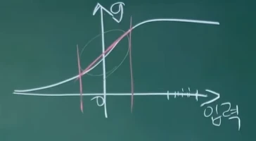
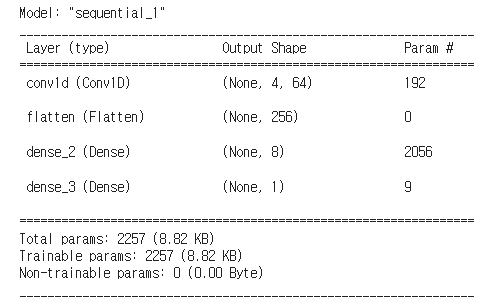
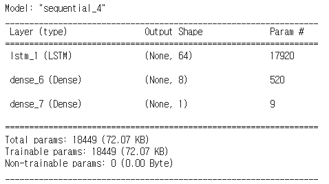
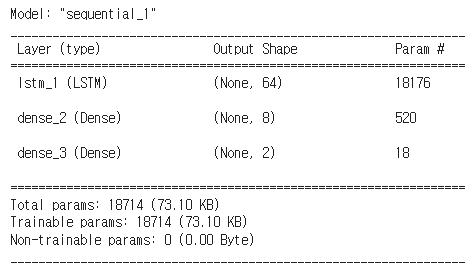
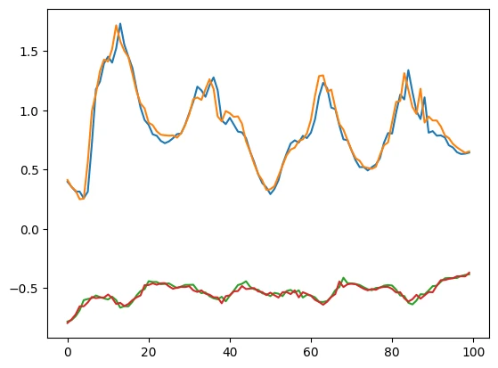

# LSTM Time Series Forecasting

## &lt;데이터&gt;

2009년 1월 1일부터 2017년 1월 1일까지 10분 간격으로 측정한 기후 데이터이다. 데이터의 양이 너무 많으므로, 매 시 정각의 데이터만 가져와서 사용한다.

- 데이터 분리

```python
# 다섯 시간의 데이터를 받아서, 다음 한 시간의 온도가 뭔지 예측해본다.
# 학습을 위한 데이터를 생성할 것인데, 1시~5시의 데이터가 학습 데이터라면
# 6시의 데이터는 Label이 된다. 그 다음에는 2~6시의 데이터가 학습 데이터가 되고,
# 7시의 데이터는 Label이 된다. 이러한 과정을 반복하여 Training Data와 Label,
# 그리고 Test Data와 Label을 생성한다.

# Input Vector / Label
# Input Vector는 사실 Column Vector이며,
# 이후에 Multivariate로 변환할 것이기 때문에 이중 list이다.

# [[[1], [2], [3], [4], [5]]] / [6]
# [[[2], [3], [4], [5], [6]]] / [7]
# [[[3], [4], [5], [6], [7]]] / [8]

def df_to_X_y(df, window_size=5):
  """
  2024.05.04, jdk
  Training/Test Data와 Label을 생성하는 함수
  """
  df_as_np = df.to_numpy()

  X = [] # Data
  y = [] # Label

  # 이렇게 반복하면, 맨 끝까지 window_size의 크기를 유지한 채
  # 한 칸씩 Sliding Window를 만들 수 있음.
  for i in range(len(df_as_np) - window_size):

    # Training/Test Data를 row로 추출, (i ~ i+window_size-1)까지
    # 이때, Multivariate로의 확장을 고려하여
    # 각각의 element는 list로 만든다.

    # 이때, row는 2차원 list로 결과가 나오게 되는데,
    # 이를 사전에 list로 만들어 두었던 X에 추가하므로
    # 데이터는 3차원 tensor가 된다.
    row = [[a] for a in df_as_np[i:i+window_size]]
    X.append(row)

    label = df_as_np[i+window_size]
    y.append(label)

  # return tuple of a numpy array by using np.array()
  return np.array(X), np.array(y)
```

```python
WINDOW_SIZE = 5
X, y = df_to_X_y(temp, WINDOW_SIZE)
X.shape, y.shape
```

```python
# Training DataSet과, Validation DataSet Test DataSet 분리

# Training DataSet
X_train, y_train = X[:60000], y[:60000]

# Validation DataSet
X_val, y_val = X[60000:65000], y[:60000]

# Test DataSet
X_test, y_test = X[65000:], y[65000:]

X_train.shape, y_train.shape, X_val.shape, y_val.shape, X_test.shape, y_test.shape
```

---

## &lt;Model&gt;

```python
"""
2024.05.04, jdk
모델 생성
"""

from tensorflow.keras.models import Sequential
from tensorflow.keras.layers import *
from tensorflow.keras.callbacks import ModelCheckpoint # 모델 저장을 위한 모듈
from tensorflow.keras.losses import MeanSquaredError # Loss Function
from tensorflow.keras.metrics import RootMeanSquaredError # Metrics
from tensorflow.keras.optimizers import Adam # Optimizer

model1 = Sequential()

model1.add(InputLayer((5, 1)))
model1.add(LSTM(64))
model1.add(Dense(8, 'relu'))
model1.add(Dense(1, 'linear'))

model1.summary()
```

### BatchNormalization

[[딥러닝] 9-1강. "최고의 17분!" 가장 깔끔한 배치 정규화 (Batch Normalization) 설명](https://www.youtube.com/watch?v=m61OSJfxL0U)

BatchNormalization은 신경망의 학습과정을 안정화하고 가속화하기 위해 개발된 기술이다. 이 기법은 각 층에서 입력 데이터의 분포가 너무 달라지는 것을 방지하여, Gradient Vanishing이나 Gradient Explosion의 문제를 해결하는데 도움을 준다.

이를 통해 더 높은 학습률을 사용할 수 있고, 초기 가중치에 대한 의존성이 감소된다.

- **작동 방식**

    1. 평균 계산: Batch에 있는 데이터의 평균 계산
    2. 분산 계산: Batch에 있는 데이터의 분산을 계산
    3. 정규화: 각 데이터 포인트에서 평균을 빼고, 분산의 제곱근으로 나누어 데이터를 정규화 한다.
    4. 스케일링 및 시프트: 정규화된 데이터에 스케일과 시프트를 적용하여 데이터의 스케일과 위치를 조정한다. 이 단계에서는 학습 가능한 파라미터인 $\gamma$와 $\beta$를 사용한다.

- **parameter**

    1. $\gamma$: Scale Parameter로, 정규화된 데이터를 각 특성(axis)에 대해 곱해주는 값이다. 이 parameter는 데이터의 분산을 조정하며, $\gamma$값이 크면 데이터의 분산도 커지고, 작아지면 분산도 작아진다.
    2. $\beta$: 시프트 파라미터로, 정규화된 데이터에 더해지는 값이다. 이 파라미터는 데이터의 평균 위치를 조정한다. (중심이 이동되는 것)

> 이를 통해 네트워크가 학습 과정에서 최적화되어 각 층의 출력이 최적의 분포를 갖도록 조정된다. 즉, 각 층의 **활성화 함수의 입력으로 들어가는 값**들이 활성화 함수를 더 효율적으로 활용할 수 있도록 만든다.

- **적용**

일반적으로 mini-batch SGD (32)를 사용하는데, 여기서 다음 값들을 구한다.

1. $\mu_{B}$: 평균 
2. $\sigma_{B}$: 분산(표준편차)
3. Normalize: $\frac{x_{i}-\mu_{B}}{\sigma_{B}}=\hat{x_{i}}$  

    ⇒ 1~32까지의 데이터에 대해서 적용되며, 위 과정을 거치면 평균이 0, 분산이 1인 Distribution으로 변하게 된다.

4. $\gamma * \hat{x_{i}}+\beta = y_{i}$

⇒ BatchNormalization의 결과이며, mini-batch의 크기가 32일 때, 32개의 y값이 나오게 된다.

> 이때, $\gamma,\beta$의 값은 학습되는 hyper parameter가 된다. 만약 BatchNormalization을 한다면, bias 값은 추가하지 않아도 된다.

- **그런데 mini-batch는 Training Time에 사용되는 것이다. Test 할 때는 어떻게 할 것인가?**

> 학습 과정에서 mini-batch마다 $\mu_{B}$, $\sigma_{B}$값이 나온다. 예를 들어 전체 데이터의 개수가 3200개이고 mini-batch의 크기가 32라면 총 100개의 값이 나올 것이다. 이 값들의 평균을 구해서 test time에 쓴다.

그런데, 테스트할 때는 분산에 $\frac{m}{m-1}$을 곱해준다. 그 이유는, Training Time에 구한 모든 분산의 평균을 구하면, 분산의 평균이 다음과 같이 나오기 때문이다. ⇒ $\frac{1}{m}\sum_{i=1}^{m}(x_{i}-\mu_{B})^2 = \frac{(m-1)\sigma_{B}^2}{m}$

그러므로 $\frac{m}{m-1}$을 곱해서 사용해야만 제대로 된 분산값을 사용할 수 있다.

> 그래서 샘플의 분산을 구할 때 그냥 m으로 나누는게 아니라 m-1로 나눠주면 되긴 한다. 

- **moving average**

    1. moving average: 단순한 moving average는 iteration을 돌면서 평균을 구하는 것.
    2. exponentially weighted moving average: 처음에 학습할 때의 parameter 값은 별로이므로, 학습이 되어갈 수록 더 높은 가중치를 줘서 평균을 구하도록 하는 방식

- **어떻게 Vanishing Gradient를 막을까?**

Data의 분산을 적절하게 퍼트려주므로, Gradient의 Vanishing을 적절하게 막아줄 수 있다. 그런데 Normalization까지만 해주는게 아니라 (1~3) 4번, 스케일링과 시프팅을 하는 이유는 뭘까?

그걸 안하니까 Activation Function을 제대로 사용할 수가 없게 되기 때문이다.



예를 들어 Sigmoid를 사용하는데, BatchNormalization 이후 빨간색 영역 사이만 모이게 되었다고 한다면, Sigmoid를 적절히 사용하지 못하게 된다. 비선형성을 이용하지 못하고 선형적인 부분만 쓰게되므로, Neural Network의 힘이 약화되더라. 그래서 적절하게 얼마나 퍼트려 줄 지를 Training 함으로써 적당히 뿌려진 다음, Non-linearity를 적절히 사용하면서 Gradient가 0은 아니도록 만들어주게 되었다.

보통 $\gamma$는 1에 가까운 값을, $\beta$는 0에 가까운 값을 초기값으로 주어서 처음에는 linearity를 살리는 상황에서 업데이트를 하다가, 이후에는 Backpropagation을 통해 Loss를 줄이면서 Non-linearity를 적절히 이용하고, 동시에 Gradient가 Vanishing 되지는 않도록 하는 포인트로 학습이 진행되도록 만들게 된다.

그렇기 때문에 학습이 적절하게 잘 되도록 만들어주므로 learning rate를 키워도 된다.

```python
# training callbacks

# Loss가 가장 적은 최고의 모델만 저장하기 위해 save_best_only=True로 설정
cp = ModelCheckpoint('model1/', save_best_only=True)
model1.compile(loss=MeanSquaredError(), optimizer=Adam(learning_rate=0.0001), metrics=[RootMeanSquaredError()])

# 1) Checkpoint
# ModelCheckpoint는 한 Epoch이 끝날 때마다 모델을 평가하고,
# 가장 낮은 Loss를 보인 모델을 Checkpoint로 저장한다.

# 2) Loss와 Metrics
# MSE는 실질적으로 Label과 Inference 값의 차이를 계산하고
# 이 값을 통해 Backpropagation을 진행할 Loss Function을 계산한다.
# 반면 metric으로 사용된 RMSE는 실질적으로 학습에 관여되진 않지만,
# 모델의 성능을 평가하는 기준으로 사용된다.
```

### Validation Dataset

keras의 모델을 fit 메서드를 사용하여 학습할 때 validation_data 매개변수를 통해 validation dataset을 제공하면, 해당 데이터셋은 다음과 같이 사용된다.

1. **모델 성능 평가**

    - epoch별 평가: 모델은 각 epoch가 종료될 때마다 **validation dataset**을 사용하여 성능을 평가한다. 이는 **training dataset**에 대해서만 수행되는 평가와는 별개로 진행한다.

    - Loss 및 Metric 계산: validation dataset에 대해 설정된 loss function(위의 코드에서는 MSE)과 metric(위의 코드에서는 RMSE)을 계산하여 모델의 일반화 능력을 간접적으로 평가할 수 있다. 이 결과는 각 epoch의 학습 과정을 출력할 때 보여지며, 모델이 학습 데이터 뿐만 아니라 새로운 데이터에 대해서도 얼마나 잘 동작하는지를 보여준다.

        **학습 예시**

        ```text
        Epoch 1/10
        1875/1875 [==============================] - 22s 10ms/step - loss: 29.4390 - root_mean_squared_error: 5.4258 - val_loss: 1.5452 - val_root_mean_squared_error: 1.2431
        Epoch 2/10
        1875/1875 [==============================] - 17s 9ms/step - loss: 2.4479 - root_mean_squared_error: 1.5646 - val_loss: 0.7131 - val_root_mean_squared_error: 0.8445
        Epoch 3/10
        1875/1875 [==============================] - 17s 9ms/step - loss: 1.0625 - root_mean_squared_error: 1.0308 - val_loss: 0.5513 - val_root_mean_squared_error: 0.7425
        Epoch 4/10
        1875/1875 [==============================] - 17s 9ms/step - loss: 0.7712 - root_mean_squared_error: 0.8782 - val_loss: 0.5181 - val_root_mean_squared_error: 0.7198
        Epoch 5/10
        1875/1875 [==============================] - 19s 10ms/step - loss: 0.6981 - root_mean_squared_error: 0.8356 - val_loss: 0.5014 - val_root_mean_squared_error: 0.7081
        Epoch 6/10
        1875/1875 [==============================] - 14s 7ms/step - loss: 0.6742 - root_mean_squared_error: 0.8211 - val_loss: 0.5071 - val_root_mean_squared_error: 0.7121
        Epoch 7/10
        1875/1875 [==============================] - 13s 7ms/step - loss: 0.6604 - root_mean_squared_error: 0.8126 - val_loss: 0.5156 - val_root_mean_squared_error: 0.7181
        Epoch 8/10
        1875/1875 [==============================] - 17s 9ms/step - loss: 0.6526 - root_mean_squared_error: 0.8078 - val_loss: 0.4965 - val_root_mean_squared_error: 0.7046
        Epoch 9/10
        1875/1875 [==============================] - 18s 9ms/step - loss: 0.6487 - root_mean_squared_error: 0.8054 - val_loss: 0.4921 - val_root_mean_squared_error: 0.7015
        Epoch 10/10
        1875/1875 [==============================] - 16s 9ms/step - loss: 0.6450 - root_mean_squared_error: 0.8031 - val_loss: 0.4913 - val_root_mean_squared_error: 0.7009
        ```

        ```text
        <keras.src.callbacks.History at 0x7c918473f0a0>
        ```

2. **Early Stopping 및 Model 선택**

    - 최적 모델 저장: ModelCheckpoint 콜백과 같은 콜백 함수들은 validation dataset의 성능 기반으로 최적의 모델 상태를 저장한다. save_best_only=True 설정이 사용되어 있다면, validation loss가 이전 최솟값보다 낮을 때만 모델 상태를 저장한다. 이를 통해 학습이 완료된 후에 가장 잘 동작하는 모델 버젼을 사용할 수 있다.
    - 과적합 감지: validation dataset을 사용하는 주된 목적 중 하나는 overfitting의 징후를 감지하는 것이다. 만약 training dataset에 대한 성능은 계속 개선되지만, validation dataset의 성능이 저하되기 시작한다면 이는 모델에 overfitting이 발생하는 것이다.

3. **하이퍼파라미터 튜닝**

    - 성능 피드백: validation dataset의 성능 결과는 모델의 다양한 하이퍼파라미터에 대한 조정을 가이드하는데 사용될 수 있다. 예를 들어, 특정 설정에서 validation dataset이 개선되지 않는다면, 이는 하이퍼파라미터를 변경해야 할 필요가 있음을 나타낸다.

---

## &lt;1D CNN Time Series Forecasting&gt;

여러 개의 변수를 넣어서 예측하는 모델을 만들 때, 시계열 데이터는 time stamp 자체를 학습 데이터의 일부로 포함할 수도 있다. 특히 온도에 대한 예측 등을 할 때는 더욱 좋을 수 있다.

### Model

```python
"""
2024.05.04, jdk
1D Convolution을 사용하여 예측을 수행하는 모델 생성.
이 방식을 사용하면 paramter의 개수를 효과적으로 줄일 수 있다.
이전에는 LSTM에 paramter가 16896개가 존재했지만, 현재는 2257개이다.
"""

model2 = Sequential()
model2.add(InputLayer((5,1)))
model2.add(Conv1D(64, kernel_size=2))
model2.add(Flatten())
model2.add(Dense(8, 'relu'))
model2.add(Dense(1, 'linear'))
model2.summary()
```

### parameters



1. Conv1D: **필터의 수는 64개**이고 커널의 크기는 2이다. 이때 입력 채널은 (5, 1)이므로,  
    필터의 수 x (커널의 크기 x 입력 채널의 수 + 1(bias))를 계산하면

    > 64 x (2 x 1 + 1) = 192

    정리하자면, (5, 1)의 데이터에 대해서 64개의 필터를 사용한다. 한 개의 필터는 (4, 1)의 결과를 도출하므로, 최종적으로 출력의 결과는 (batch_size, 4, 64)가 된다.

2. Flatten: 출력 결과를 flatten 하면 (None, 256)이 된다.
3. Dense Layer: (None, 256) Input을 (None, 8)로 축소시키려면 (8, 256) shape의 weight parameter가 필요하고, 8개의 bias가 필요하다. 따라서 총 2048 + 8 = 2056개의 parameter가 필요하다.
4. Dense Layer-2: (None, 8) Input을 (None, 1)로 축소시키려면 (1, 8) shape의 weight parameter가 필요하고, 1개의 bias가 필요하다. 따라서 총 8 + 1 = 9개의 parameter가 필요하다.

---

## &lt;GRU&gt;

GRU는 2014년에 소개된 모델이며, LSTM의 단순화된 버젼이다. GRU는 LSTM보다 구조가 간단하며, 두 개의 게이트를 사용한다.

1. Update Gate: LSTM의 Forget/Input 게이트의 기능을 합친 것으로, 셀 상태를 얼마나 갱신할 지를 결정한다.
2. Reset Gate: 과거 정보를 얼마나 삭제할지 결정하며, 새로운 입력과 이전 상태의 결합 방식을 결정한다.

GRU는 LSTM과 비교하여 더 간단한 구조이기 때문에 파라미터 수가 적고 계산적으로 더 효율적이다. 대체로 성능도 LSTM과 유사하지만, 항상 유사한 것은 아니며, 특정 상황에서는 더 좋거나 나쁠 수 있다.

### Model

```python
model3 = Sequential()
model3.add(InputLayer((5,1)))
model3.add(GRU(64))
model3.add(Dense(8, 'relu'))
model3.add(Dense(1, 'linear'))
model3.summary()
```

⇒ LSTM과 큰 차이는 없다. 하지만 Parameter의 개수는 LSTM보다는 적다.

---

## &lt;Multivariate LSTM Forecasting&gt;

이번에는 LSTM 예측에 ‘시간’을 함께 넣어본다.

### 데이터 생성

```python
# Model이 시간 데이터를 이해할 수 있도록 timestamp를 수치화해서 전달한다.

temp_df = pd.DataFrame({'Temperature': temp})
temp_df['Seconds'] = temp_df.index.map(pd.Timestamp.timestamp)

temp_df
```

```python
day = 24*60*60
year = (365.2425)*day

temp_df['Day sin'] = np.sin(temp_df['Seconds'] * (2 * np.pi / day))
temp_df['Day cos'] = np.cos(temp_df['Seconds'] * (2 * np.pi / day))
temp_df['Year sin'] = np.sin(temp_df['Seconds'] * (2 * np.pi / year))
temp_df['Year cos'] = np.cos(temp_df['Seconds'] * (2 * np.pi / year))
temp_df

temp_df = temp_df.drop('Seconds', axis=1)
temp_df
```

- **Training/Test DataSet 분리**

```python
# [[[t1, ds1], [t2, ds2], [t3, ds3], [t4, ds4], [t5, ds5]]] / [t6]
# [[[t2, ds2], [t3, ds3], [t4, ds4], [t5, ds5], [t6, ds6]]] / [t7]
# [[[t3, ds3], [t4, ds4], [t5, ds5], [t6, ds6], [t7, ds7]]] / [t8]

def df_to_X_y2(df, window_size=5):
  """
  2024.05.04, jdk
  Training/Test Data와 Label을 생성하는 함수
  """
  df_as_np = df.to_numpy()

  X = [] # Data
  y = [] # Label

  for i in range(len(df_as_np) - window_size):
    # iteration마다 나오는 r은 [tn, dsn] 형태인 list이다.
    row = [r for r in df_as_np[i:i+window_size]]
    X.append(row)

    # [0]번 col이 예측하길 원하는 temperature이다.
    label = df_as_np[i+window_size][0]
    y.append(label)

  return np.array(X), np.array(y)
```

```python
# Training Data와 Test Data 분리 

X2_train, y2_train = X2[:60000], y2[:60000]
X2_val, y2_val = X2[60000:65000], y2[60000:65000]
X2_test, y2_test = X2[65000:], y2[65000:]
X2_train.shape, y2_train.shape, X2_val.shape, y2_val.shape, X2_test.shape, y2_test.shape
```

- **온도 데이터 Standardization**

```python
# 온도에 대한 평균 구하기
temp_training_mean = np.mean(X2_train[:, :, 0])

# 온도에 대한 표준편차 구하기
temp_training_std = np.std(X2_train[:, :, 0])

# 온도 데이터와 시간 데이터는 Scale이 너무 다르다.
# 따라서 학습이 적절하게 되도록 만들기 위해서는
# 온도 데이터의 Scale을 줄여주어야 한다.

def preprocess(X):
  X[:, :, 0] = (X[:, :, 0] - temp_training_mean) / temp_training_std 
  return X
```

> 이러한 preprocessing은 BatchNormalization을 쓰면 더 좋아질 수 있다.

### Model

```python
model4 = Sequential()
model4.add(InputLayer((6, 5)))
model4.add(LSTM(64))
model4.add(Dense(8, 'relu'))
model4.add(Dense(1, 'linear'))

model4.summary()
```



### Model-2

> 이번에는 input/output에 pressure를 추가한다. 두 개를 예측하는 모델이다.

```python
model5 = Sequential()
model5.add(InputLayer((7, 6)))
model5.add(LSTM(64))
model5.add(Dense(8, 'relu'))
model5.add(Dense(2, 'linear'))

model5.summary()
```





⇒ 학습 결과가 상당히 준수한 것을 알 수 있음.
