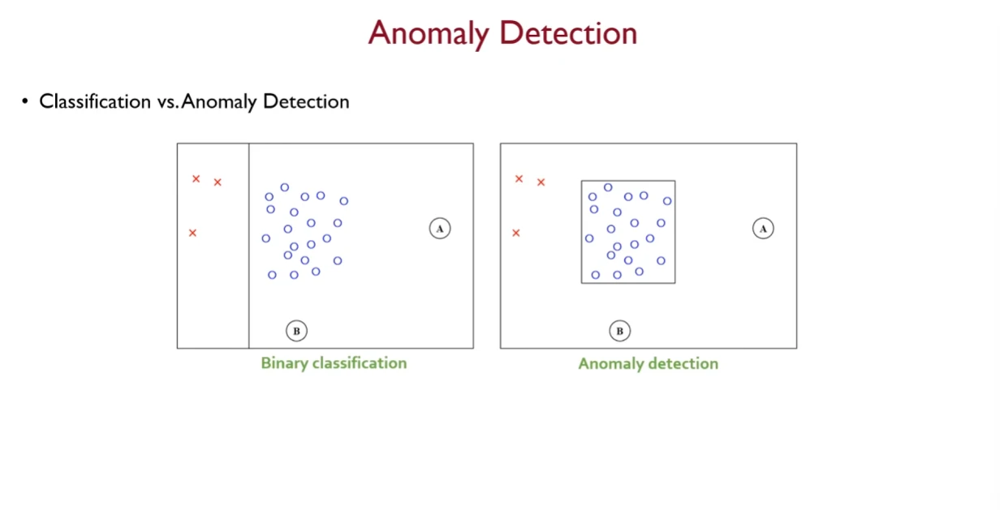
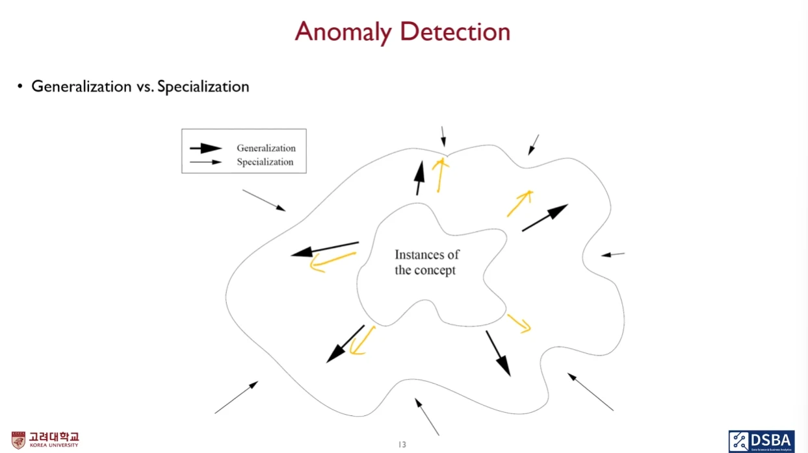

# Anomaly Detection - Overview

[03-1: Anomaly Detection - Overview](https://www.youtube.com/watch?v=ECgI1YVQpY8)

## &lt;Anomaly Detection&gt;

### Machine Learning

컴퓨터 프로그램이 학습이 가능하다는 것은 어떠한 Task인 T가 있고, 명확한 Performance Measure P가 있을 때, 충분한 데이터(경험)인 E를 제공하여 T에 대한 P를 지속적으로 상승시킬 수 있는 경우를 말한다.

- Supervised Learning

    - Y = f(x), 설명변수(독립변수)와 종속변수 간의 관계식을 찾아내는 것이 목표

- Unsupervised Learning

    - f(x), 설명변수만으로 데이터의 내재적인 특징이나 분포를 추정하고, 비슷한 객체의 집단을 찾아내는 것 등이 목표
    - 밀도 추정, 군집, 연관성 분석, 네트워크의 특징 파악 등에 사용된다.

### Anomaly Detection

> Novelty Detection이라고 정의하거나 Outlier Detection이라고도 부른다.

- Outlier: 단변량(Univariate) 데이터에서 실제 변수들의 범위를 너무 극단적으로 벗어나는 데이터

- Novelty/Anomaly: 다변량(Multivariate) 데이터의 관점을 더 가지며, Novelty는 대체로 긍정적, Anomaly는 부정적인 느낌을 갖는다.

    - 만약 불량 데이터를 찾아내는 것이 목표라면 Anomaly Detection이라고 하고, 주식 시장의 급등을 파악해내는 것이 목표라면 Novelty Detection이라고 한다.

- 데이터 생성 메커니즘에 의한 관점

    - “Observations that deviate so much from other observations as to arouse suspicions that they were generated by a different mechanism (Hawkins, 1980)”

- 데이터 분포 및 밀도에 의한 관점

    - “Instances that their true probability density is very low (Harmeling et al., 2006)”

> Outlier와 Noise는 구분지어 확인할 필요가 있다.  
>   
> Noise(노이즈)를 완벽하게 제거하기는 쉽지 않고, 정의하기도 쉽지 않다. 즉, 데이터에 노이즈가 내재되어 있다고 가정하는 것이지 완벽하게 찾아내어 제거하기는 쉽지 않을 수 있다는 것이다. ⇒ 이에 동의하지 않는 견해도 있다.  
>   
> Outlier는 우리가 반드시 찾아내야 하는 흥미로운 객체 또는 상황이라고 할 수 있다. 일반적으로 데이터를 만들어내는 메커니즘에 의해 만들어지는 것이 아니다.

- Convolutional Auto Encoder
- Isolation Forest
- Anomaly Detection의 목적 자체는 Supervised Learning이다. 데이터가 이상치인지 아닌지를 판단해야 하는 것이기 때문이다. 그러나 실질적으로는 Unsupervised Learning에 가깝게 수행한다. 다음과 같은 상황을 살펴보자.

왼쪽 이미지를 볼 때 전통적인 Binary Classification의 경우, 어떻게든 선을 하나 그어내서 분리를 수행해야만 한다. 따라서 A, B는 모두 정상 데이터로 판단된다.

그러나 오른쪽 이미지의 경우, 파란색 동그라미 데이터만을 가지고 정상 영역을 찾아낸다. 위와 같이 네모 박스로 정상 데이터 영역이 구분지어졌다고 한다면, A, B는 Normal이 아니라고 판단된다. Abnormal로 판단되지 않는 이유는, Abnormal도 종류가 여러 개 있을 수 있기 때문이다.

정리하자면 Classification은 반드시 주어진 범주의 한 범주를 할당해야 하지만, Anomaly Detection은 정상/비정상의 Boundary를 정해놓고, 데이터가 그 Boundary를 벗어나면 Normal Class가 아니라고 결론을 짓는 방식이다.

- **Generalization vs. Specialization**

일반화와 특수화 사이에는 항상 trade-off가 있다. 일반화를 너무 많이 하면 실제로는 정상 데이터가 아님에도 정상 데이터라고 판단할 수도 있고, 특수화를 너무 많이 하면 정상 데이터임에도 비정상이라고 판단할 수도 있다.

⇒ 이는 통계에서 발생하는 1종 오류, 2종 오류로 볼 수 있다.

- **Anomaly Detection의 가정**

Anomaly Detection의 첫 번째 가정은 Normal 데이터가 Abnormal 데이터보다는 훨씬 더 많다는 것이다. 또한 모델링을 할 때는, Normal 데이터만 사용해서 모델을 학습시켜야 한다.
